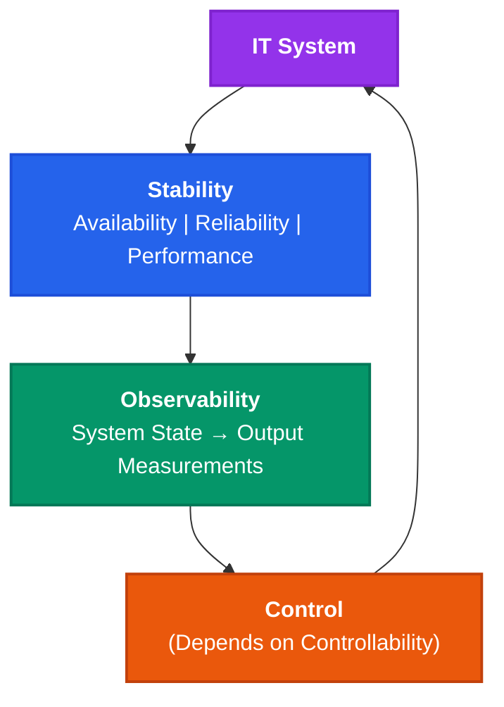
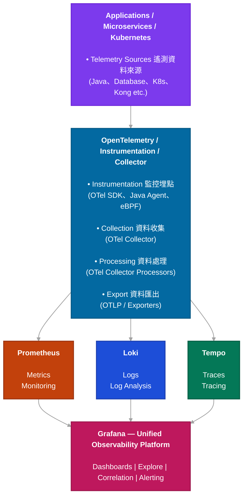
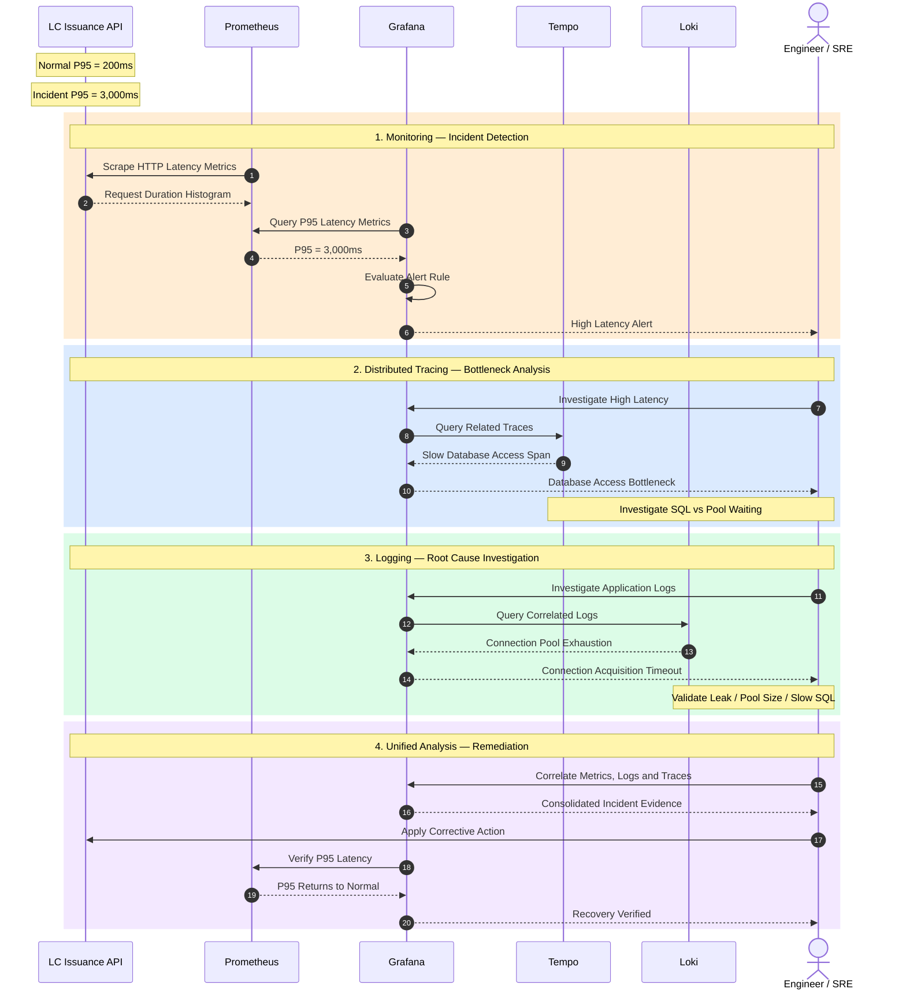
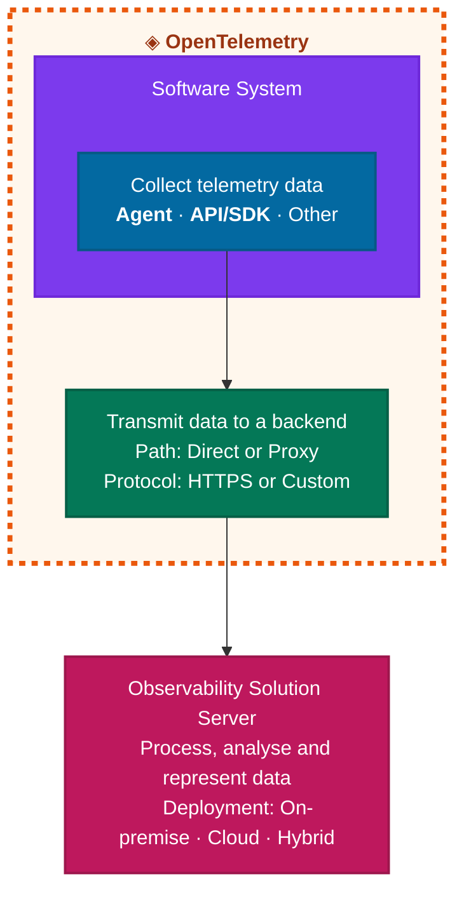
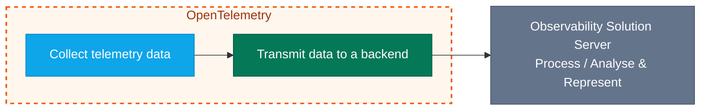
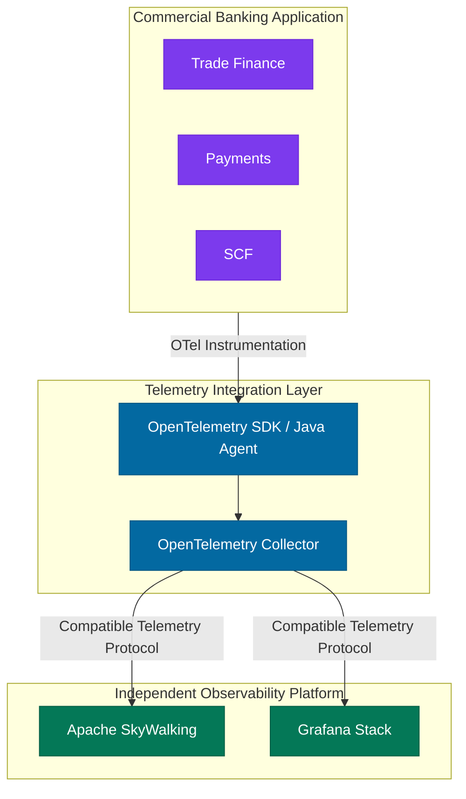

# Udemy 課程 OpenTelemetry Foundations

# Course Resources

1. [OpenTelemetry Documentation](https://opentelemetry.io/docs/?utm_source=chatgpt.com)
2. [OpenTelemetry Demo Documentation](https://opentelemetry.io/docs/demo/?utm_source=chatgpt.com)
3. [OpenTelemetry Demo – GitHub Repository](https://github.com/open-telemetry/opentelemetry-demo?utm_source=chatgpt.com)
4. [OpenTelemetry Java Documentation](https://opentelemetry.io/docs/languages/java/?utm_source=chatgpt.com)
5. [OpenTelemetry Java Examples – GitHub Repository](https://github.com/open-telemetry/opentelemetry-java-examples?utm_source=chatgpt.com)
6. [OpenTelemetry Concepts](https://opentelemetry.io/docs/concepts/?utm_source=chatgpt.com)

課程講義： [OpenTelemetry Foundations &amp; OTCA Prep – Hands-on.pdf](https://www.udemy.com/course/opentelemetry-foundations/learn/lecture/46086513?utm_source=chatgpt.com#overview)

---

# Non-Functional Requirements (NFRs)

- Usability
- Scalability
- Maintainability
- Portability
- Availability
- Reliability
- Performance
- Security

---
# What is Observability?

## IT System

### Stability
- Availability
- Reliability
- Performance

### Observability
- State of the System
- Output Measurements

### Control
- Depends on Controllability
- Control actions are applied to the IT System.

## Control Theory

> **Observability:** Possibility of observing the state of a system through output measurements.

## Relationship Between Stability, Observability, and Control


---
# Telemetry Signals

- Metrics
- Logs
- Traces

---
# Monitoring vs Observability

## 1. Monitoring vs Observability 比較

| 比較項目                      | Monitoring（監控）          | Observability（可觀測性）         |
| ------------------------- | ----------------------- | --------------------------- |
| Focus（關注重點）               | 系統健康狀態、故障偵測             | 理解系統行為與內部狀態                 |
| Data Sources（資料來源）        | 主要使用 Metrics、Logs       | Metrics、Logs、Traces、Context |
| Approach（方法）              | 已知條件、閾值、告警              | 探索、資料關聯、深入調查、關聯分析與根因診斷（可透過 **ML & AI** 輔助）                |
| Thresholds（閾值）            | Static、Dynamic、AI-Based | Static、Dynamic、AI-Based     |
| Key Question（核心問題）        | 系統是否發生問題？               | 為什麼會發生問題？                   |
| Incident Examples（故障案例）   | 記憶體不足、反應時間過長、程式錯誤       | 相同故障，但進一步分析內部原因             |
| Root Cause Analysis（根因分析） | 能力較有限，但仍可進行             | 提供更強的診斷與根因分析能力              |
| Primary Objective（主要目標）   | 偵測問題                    | 理解、分析及診斷問題                  |


**核心概念：**

- **Monitoring：** 偵測已知異常，確認系統是否正常。
- **Observability：** 利用系統輸出的 Telemetry Data，理解內部狀態並調查未知問題。

Monitoring 是 Observability 實務中的重要組成部分，兩者並非互斥。

---

## 2. Enterprise Observability Architecture

### 2.1 技術定位

| Component | Primary Responsibility | Category |
|---|---|---|
| Prometheus | Metrics + Monitoring + Alerting Rules | Metrics Backend |
| Loki | Logs Storage + Querying | Logging Backend |
| Tempo | Distributed Tracing | Tracing Backend |
| Grafana | Visualization + Correlation + Analysis + Alerting | Observability UI |
| OpenTelemetry | Instrumentation + Collection + Processing + Export | Telemetry Framework |

### 2.2 完整 Observability 架構



> **概念架構說明：** Prometheus 也可以直接 Scrape Metrics；OTel Collector 並非所有資料流的必要中介。Grafana 透過 Data Sources 查詢三個 Backend，圖中的箭頭代表邏輯關係而非資料由 Backend 主動推送給 Grafana。

### 2.3 Telemetry Pipeline 各階段定義

| 階段 | 中文 | 主要職責 | 使用工具 |
|---|---|---|---|
| Telemetry Sources | 遙測資料來源 | 提供可被觀察的系統行為 | Java、K8s、Database、Kong |
| Instrumentation | 監控埋點 | 產生 Metrics、Logs、Traces | OTel SDK、Java Agent、eBPF |
| Collection | 資料收集 | 接收及匯集 Telemetry | OTel Collector |
| Processing | 資料處理 | Filtering、Batching、Enrichment | OTel Collector Processors |
| Export | 資料匯出 | 傳送資料至後端 | OTLP、Exporters |
| Storage | 資料儲存 | 保存 Metrics、Logs、Traces | Prometheus、Loki、Tempo |
| Visualization | 視覺化分析 | Dashboards、Correlation、Troubleshooting | Grafana |

---

## 3. Monitoring vs Observability — Banking Example

假設銀行系統的 **LC Issuance API** 反應時間突然增加：

| Metric | Normal | Incident |
|---|---:|---:|
| P95 Latency | 200 ms | 3,000 ms |

> 以上是示意數據，並非實際生產環境量測值。

### 3.1 Monitoring — Prometheus + Grafana Alerting

Prometheus 收集 LC Issuance API 的 Request Latency Metrics。Grafana 定期查詢 Prometheus，評估 P95 Latency 是否超過設定閾值。當 P95 從 200ms 增加至 3,000ms 且符合 Alert Rule 條件時，Grafana 發送告警給 Engineer / SRE。

### 3.2 Distributed Tracing — Grafana + Tempo

工程師透過 Grafana 查詢 Tempo 的 Distributed Traces，發現延遲集中在 Database Access。

| Operation | Illustrative Duration |
|---|---:|
| Connection Pool Waiting | 2,500 ms |
| SQL Execution | 300 ms |
| Other Processing | 200 ms |
| **Single Request Total** | **3,000 ms** |

> 上表是**單筆示意請求**的時間分解，不能將它當成 P95 Latency 的數學分解。Connection Pool Waiting 需要對應 Instrumentation 才能獨立觀察，不是所有 JDBC Auto-Instrumentation 都會自動顯示。

### 3.3 Logging — Grafana + Loki

透過關聯的 Application Logs，工程師發現：

```text
Database Connection Pool Exhaustion
Active Connections: 50
Maximum Connections: 50
Idle Connections: 0
Connection Acquisition Timeout
```

以上訊息表示連線池資源可能耗盡，但仍須確認底層原因，例如 Connection Leak、Slow SQL、Pool Size 不足或 Database Resource Saturation。

### 3.4 Unified Analysis — Grafana

Grafana 關聯 Prometheus Metrics、Tempo Traces 與 Loki Logs。工程師根據證據採取修復措施，隨後驗證 P95 Latency 是否恢復正常。

---

## 4. End-to-End Incident Investigation — Sequence Diagram



> 此圖採用 **Grafana-managed Alerting**，不是 Prometheus Alertmanager 流程。它假設 Telemetry 已經被正確收集、匯出及關聯，且工程師已驗證事件根因。

### 4.1 各階段作用

| 階段 | 工具 | 目的 | 調查結果 |
|---|---|---|---|
| 1. Detection | Prometheus + Grafana | 偵測 P95 異常並告警 | 200ms → 3,000ms |
| 2. Investigation | Grafana + Tempo | 找出延遲位置 | Database Access |
| 3. Root Cause Analysis | Grafana + Loki | 分析 Logs 並驗證根因 | Connection Pool Exhaustion |
| 4. Remediation | Engineer + Grafana | 修復及驗證 | P95 恢復正常 |

---

## 5. Monitoring 與 Observability 的真正差異

| Component | Question | Example |
|---|---|---|
| Prometheus | What is wrong? | P95 Latency = 3,000ms |
| Tempo | Where is the delay? | Database Access |
| Loki | What diagnostic evidence is available? | Connection Pool Exhaustion |
| Grafana | How are the signals related? | Correlated Metrics, Logs and Traces |
| Engineer / SRE | How do we fix and verify it? | Remediation + Recovery Validation |

**Monitoring 發現已知問題；Observability 提供深入調查系統行為與未知問題的能力。**

---

## 6. 建議的標準定義

```text
Prometheus     → Metrics + Monitoring + Alerting Rules
Loki           → Logs Storage + Querying
Tempo          → Distributed Tracing Backend
Grafana        → Visualization + Correlation + Analysis + Alerting
OpenTelemetry  → Instrumentation + Collection + Processing + Export

Together       → Enterprise Observability Platform
```

### 6.1 Observability 核心要素

**Observability = Metrics + Logs + Traces + Context + Correlation + Analysis**

- **Metrics：** 量化系統行為與效能。
- **Logs：** 記錄系統事件及診斷資訊。
- **Traces：** 追蹤請求跨服務的執行流程。
- **Context：** 提供 Service、Environment、Entity、Country、Process 等背景資訊。
- **Correlation：** 利用 Trace ID、Resource Attributes 等機制關聯不同訊號。
- **Analysis：** 找出瓶頸、異常及可能根因。

### 6.2 Enterprise Architecture 命名

**OpenTelemetry + Grafana Observability Stack**

- OpenTelemetry：Telemetry Instrumentation & Pipeline
- Prometheus：Metrics Monitoring
- Loki：Centralized Logging
- Tempo：Distributed Tracing
- Grafana：Unified Visualization, Correlation & Alerting

---

## 7. 最終結論

Enterprise Banking System 的 Observability 不應只監控 CPU、Memory、Application Availability，也應支援：

1. **Proactive Incident Detection** — 及早發現故障。
2. **End-to-End Distributed Tracing** — 追蹤跨服務請求。
3. **Root Cause Investigation** — 關聯 Metrics、Logs、Traces。
4. **Performance Optimization** — 找出 Java、JDBC、Database 和 Network 瓶頸。
5. **Operational Resilience** — 縮短 MTTD (Mean Time to Detect)、MTTR (Mean Time to Repair)，提高 Availability、Reliability 和 Performance。

**最終建議：** 以 OpenTelemetry 為統一 Telemetry Framework，搭配 Prometheus、Loki、Tempo 和 Grafana，建立 Enterprise Observability Baseline，並以 MTTD、MTTR、MTBF (Mean Time Between Failures)、Availability、Error Rate 和 P95/P99 Latency 作為核心營運指標。

---

# Software System — Reliability Metrics

## 1. Reliability Metrics - Monitoring vs Observability

| Reliability Metric | Full Name | Monitoring | Observability | 目標 |
|---|---|---|---|---|
| **MTTD** | Mean Time To Detect | ↓ Reduce（主要） | ↓ Reduce（輔助） | 越短越好 |
| **MTTR** | Mean Time To Repair | ↓ Reduce（輔助） | ↓ Reduce（主要） | 越短越好 |
| **MTBF** | Mean Time Between Failures | ↑ Increase（間接） | ↑ Increase（間接） | 越長越好 |
| **MTTF** | Mean Time To Failure | ↑ Increase（間接） | ↑ Increase（間接） | 越長越好 |

**Legend:**
- ↓ Reduce — 縮短時間
- ↑ Increase — 延長時間
- — Not explicitly indicated in the diagram

**Observability Impact:**

> Enabled by knowledge about the Underlying Cause（透過了解問題的根本原因來改善可靠性）。

## 2. Reliability Metrics — Timeline

```mermaid

flowchart TB
    subgraph S1["Repairable System — 可修復系統"]
        direction LR
        A["Failure Occurs"]
        B["Failure Detected"]
        C["Service Restored"]
        D["Next Failure"]

        A -->|"MTTD ↓"| B
        B -->|"MTTR ↓"| C
        C -->|"Operating Time / MTBF ↑"| D
    end

    subgraph S2["Non-Repairable Component — 不可修復元件"]
        direction LR
        E["Operation Starts"]
        F["Component Fails"]

        E -->|"MTTF ↑"| F
    end

    classDef failure fill:#DC2626,color:#FFFFFF,stroke:#991B1B,stroke-width:2px
    classDef detection fill:#D97706,color:#FFFFFF,stroke:#B45309,stroke-width:2px
    classDef normal fill:#059669,color:#FFFFFF,stroke:#047857,stroke-width:2px
    classDef start fill:#2563EB,color:#FFFFFF,stroke:#1D4ED8,stroke-width:2px

    class A,D,F failure
    class B detection
    class C normal
    class E start

    linkStyle 0 stroke:#DC2626,stroke-width:3px
    linkStyle 1 stroke:#F59E0B,stroke-width:3px
    linkStyle 2 stroke:#059669,stroke-width:3px
    linkStyle 3 stroke:#2563EB,stroke-width:3px

```



## 3. Monitoring vs Observability

### Monitoring

- Detect system failures.
- Reduce **MTTD (Mean Time To Detect)**.
- Trigger alerts based on predefined or dynamic thresholds.

### Observability

- Understand internal system behavior.
- Investigate underlying causes.
- Support faster diagnosis and repair.
- Reduce **MTTR (Mean Time To Repair)**.
- Improve operational reliability through deeper analysis.

### Key Relationship

**Monitoring → Faster Detection → Lower MTTD**

**Observability → Better Root Cause Analysis → Lower MTTR**

## 4. Key Concept

> Monitoring detects problems, while Observability helps understand their underlying causes and accelerate recovery.

**Note:** In reliability engineering, MTTF usually refers to operating time until failure, particularly for non-repairable components. MTBF is commonly defined as operating time between failures for repairable systems. The timeline above preserves the original image's conceptual arrangement; it is not a rigorous mathematical definition of MTTF or MTBF.

---

# Observability Solution


---

# Recap — Observability

## 1. What is Observability?

> The process of using output measurements to understand the internal state of the system.

## 2. Telemetry Signals

- Metrics
- Logs
- Traces

## 3. Monitoring vs Observability

> Observability helps identify the **underlying cause**, monitoring doesn't.

## 4. Reliability Metrics

- **MTTD** — Mean Time To Detect
- **MTTR** — Mean Time To Repair
- **MTBF** — Mean Time Between Failures
- **MTTF** — Mean Time To Failure

## 5. Observability Solutions

- Collect telemetry data
- Transmit data to a backend
- Observability Solution Server
    * Process
    * Analyse & 
    * Represent


---


# OpenTelemetry Observability Platforms — Open Source vs Commercial

## 1. Observability Platforms Comparison

| 平台／組合 | Logs | Metrics | Traces | 查看介面 | 授權模式 |
|---|:---:|:---:|:---:|---|---|
| **Grafana + Loki + Prometheus + Tempo / Jaeger** | ✅ | ✅ | ✅ | Grafana | Open Source + Commercial |
| **SigNoz** | ✅ | ✅ | ✅ | SigNoz UI | Open Source + Commercial |
| **Apache SkyWalking** | ✅ | ✅ | ✅ | SkyWalking UI / Horizon | Open Source (Apache 2.0) |
| **Elastic Observability** | ✅ | ✅ | ✅ | Kibana | Source-Available / Open Source Components + Commercial |
| **Datadog** | ✅ | ✅ | ✅ | Datadog UI | Commercial |
| **New Relic** | ✅ | ✅ | ✅ | New Relic UI | Commercial |
| **Dynatrace** | ✅ | ✅ | ✅ | Dynatrace UI | Commercial |

> **Note:** All listed platforms support Logs, Metrics, and Traces. However, OpenTelemetry OTLP compatibility, instrumentation coverage, and integration capabilities vary by platform and version.

## 2. 哪些 Observability 工具屬於 CNCF？

| Component | Open Source | CNCF 託管專案 | 主要維護／治理 |
|---|:---:|:---:|---|
| **OpenTelemetry** | ✅ | ✅ Graduated | CNCF / Community |
| **Prometheus** | ✅ | ✅ Graduated | CNCF / Community |
| **Jaeger** | ✅ | ✅ Graduated | CNCF / Community |
| **Grafana OSS** | ✅ | ❌ | Grafana Labs / Community |
| **Loki** | ✅ | ❌ | Grafana Labs / Community |
| **Tempo** | ✅ | ❌ | Grafana Labs / Community |
| **SigNoz Community** | ✅ | ❌ | SigNoz / Community |
| **Apache SkyWalking** | ✅ | ❌ | **Apache** Software Foundation (ASF) / Community |

## 3. 開源授權比較

| Component         | License    | 真正 Open Source | 商業使用 | 授權特性       |
| ----------------- | ---------- | -------------- | ---- | ---------- |
| Apache SkyWalking | Apache 2.0 | ✅              | ✅    | 寬鬆授權       |
| OpenTelemetry     | Apache 2.0 | ✅              | ✅    | 寬鬆授權       |
| Prometheus        | Apache 2.0 | ✅              | ✅    | 寬鬆授權       |
| Jaeger            | Apache 2.0 | ✅              | ✅    | 寬鬆授權       |
| Grafana OSS       | AGPLv3     | ✅              | ✅    | 強 Copyleft |
| Loki              | AGPLv3     | ✅              | ✅    | 強 Copyleft |
| Tempo             | AGPLv3     | ✅              | ✅    | 強 Copyleft |

Apache 2.0 和 AGPLv3 都是正式的開源授權。 差別不是誰真開源、誰假開源，而是修改、散布或提供網路服務時需要遵守的義務不同。



> 採用 Component-Based Architecture（元件化架構）+ Loose Coupling（低耦合），讓 Observability 平台與核心銀行業務系統保持清楚的邊界。

### Notes

- **CNCF:** Cloud Native Computing Foundation，負責託管與治理部分雲原生開源專案。
- **ASF:** Apache Software Foundation，負責託管與治理 Apache SkyWalking 等開源專案。
- **Open Source ≠ CNCF Project:** 開源軟體不一定屬於 CNCF。
- **Apache SkyWalking:** 採用 Apache License 2.0，支援多語言 APM、Distributed Tracing、Metrics、Logs 和 Service Topology。
- **CNCF Landscape:** 被收錄於 CNCF Landscape，不代表該軟體由 CNCF 託管。

---
