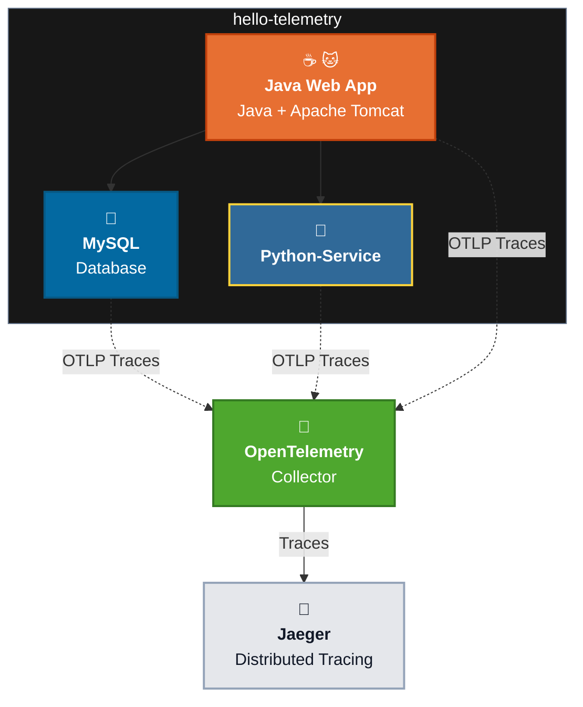
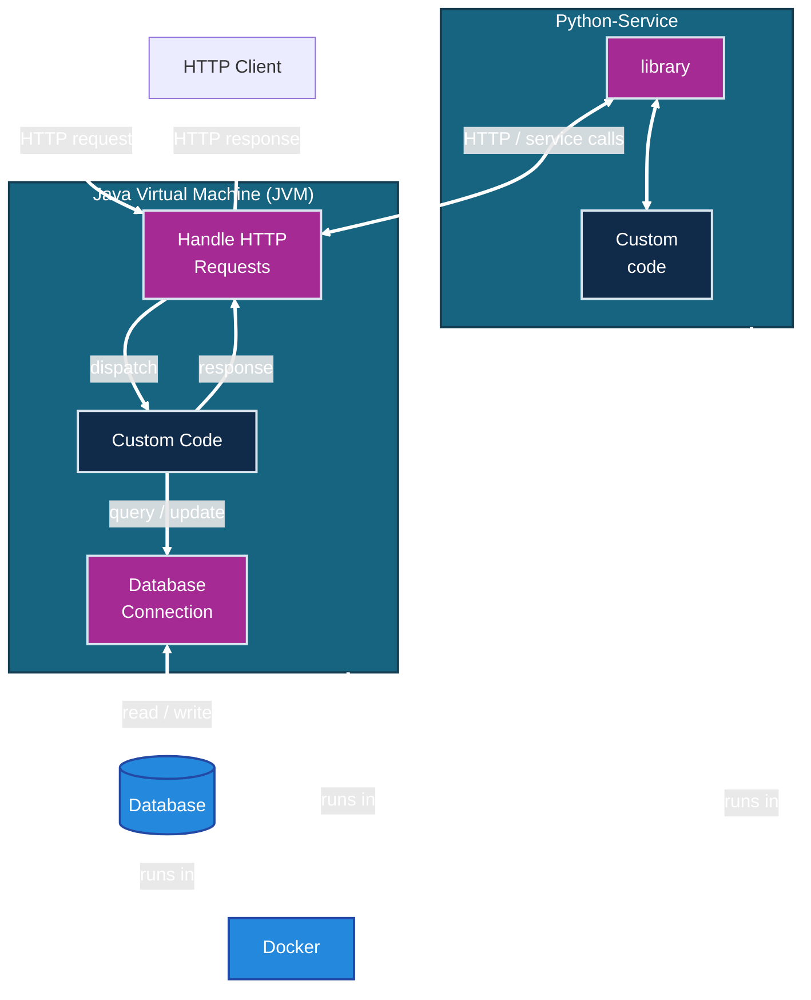
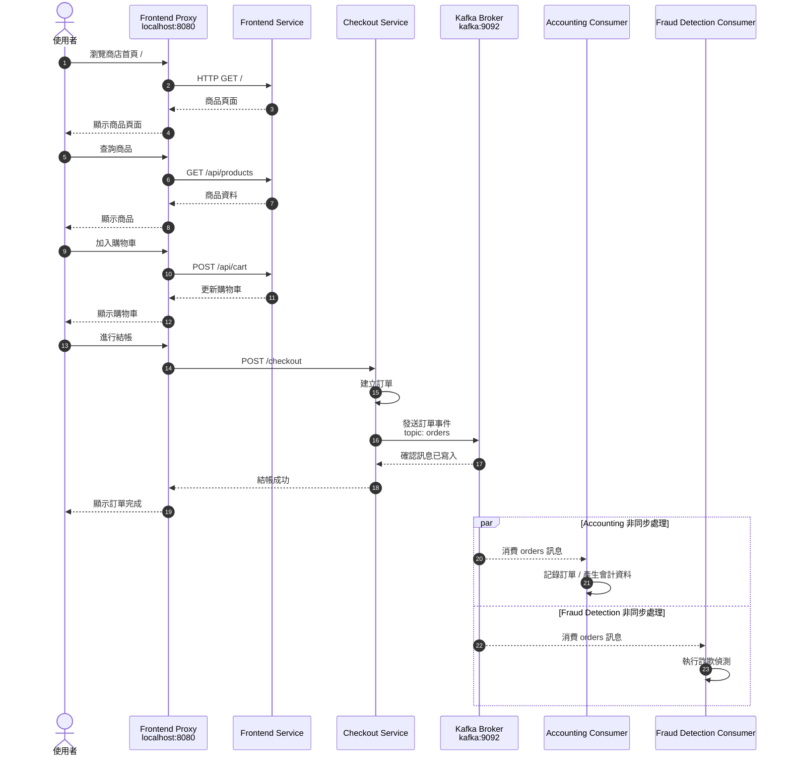
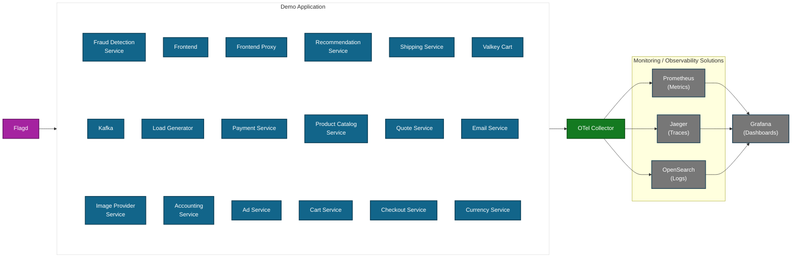

# Learning Environment

- Setup Learning Environment
- hello-telemetry App
- OpenTelemetry Astronomy Shop Demo App

---

# Setup Learning Environment

- **Minimum Hardware:**
    - 4 vCPU & 12 GB RAM (Recommended)
- Install Visual Studio Code
- Install Docker Desktop
- Install Open-JDK and Apache Maven
- Install Python
- Install Git
- Download hello-telemetry App <https://github.com/brainbsod/hello-telemetry>
- Download OpenTelemetry Demo App <https://github.com/open-telemetry/opentelemetry-demo>
- Visual Studio Code - Extensions (from Microsoft)
    - Python
    - Docker
    - Maven
    - Optional GitHub Copilot Chat (GitHub)

```bash
docker --version
java --version
mvn --version
python --version

cd Otel-Foundations
git clone https://github.com/brainbsod/hello-telemetry.git
git clone https://github.com/open-telemetry/opentelemetry-demo.git
```

---

# Hello Telemetry



## Testing Hello Telemetry

Start the learning environment from the `Otel-Foundations` directory:

```bash
cd Otel-Foundations/hello-telemetry/

bash build.sh 
docker compose up --build -d
docker compose ps
```

The published host ports are:

- Python service: `5001` (container port `5000`)
- Tomcat web application: `8085` (container port `8080`)
- Jaeger UI: `16686`

Test the Tomcat application:

```bash
curl -i http://localhost:8085/MyWebApp/
curl -i http://localhost:8085/MyWebApp/results
```

Both requests should return HTTP `200`. The `/results` response should display the database rows and an average age, for example `30.3`. This request exercises the Hello Telemetry application and its database-backed flow.

```bash
for i in {1..10}; do
  curl -sS -o /dev/null -w "Request $i: HTTP %{http_code}\n" \
    http://localhost:8085/MyWebApp/results
done
```

Open [Jaeger](http://localhost:16686), search for the configured Tomcat service `ht-tomcat`, and inspect the generated trace.

### Direct Python service test

```bash
curl -i -X POST http://localhost:5001/compute_average_age \
  -H "Content-Type: application/json" \
  -d '{"data":[{"age":20},{"age":30},{"age":40}]}'
```

Expected response:

```json
{"average_age":30.0}
```

Generate additional telemetry:

```bash
for i in {1..10}; do
  curl -sS -o /dev/null -w "Request $i: HTTP %{http_code}\n" \
    -X POST http://localhost:5001/compute_average_age \
    -H "Content-Type: application/json" \
    -d '{"data":[{"age":20},{"age":30},{"age":40}]}'
done
```

Open [Jaeger](http://localhost:16686), search for the configured Tomcat service `ht-python-service`, and inspect the generated trace.

To stop the environment:

```bash
docker compose down
```

## Architecture

- Docker Compose 會將 init.sql 掛載到 MySQL 的初始化目錄，MySQL 首次建立資料庫時執行它，用來建立資料庫、資料表與初始資料。
- Java/Tomcat 應用程式執行 JDBC 查詢時，OpenTelemetry Java Agent 會觀測這些資料庫操作。
- Python service 負責計算平均年齡（average age），並透過 OpenTelemetry 產生 trace/span。

> 注意：只有在 mysql_data volume 為空、第一次初始化時才會自動執行。

```text
Service & Operation

ht-tomcat  GET /MyWebApp/results
└─ ht-tomcat  SELECT mydatabase.mytable
   └─ ht-tomcat  POST
      └─ ht-python-service  POST /compute_average_age

```


---

## Hello Telemetry Summary

- **MySQL**
  - MySQL runs as `ht-mysql`.
  - `init.sql` is mounted through `/docker-entrypoint-initdb.d`.
  - It creates the database, tables, and initial data only when `mysql_data` is initialized for the first time.

- **Java/Tomcat**
  - Runs as `ht-tomcat`.
  - The WAR file is copied into Tomcat.
  - The OpenTelemetry Java Agent provides **Auto Instrumentation** for:
    - HTTP/Servlet requests
    - **JDBC/MySQL queries**
    - HTTP calls to the Python service
  - `MyServlet.java` does not contain Manual Instrumentation.

- **Python service**
  - Runs as `ht-python-service`.
  - Receives database records and calculates the average age.
  - The Python code shown has no Manual Instrumentation.
  - It uses Auto Instrumentation only if its Dockerfile starts the service with `opentelemetry-instrument`.

- **OpenTelemetry Collector**
  - Receives OTLP traces on port `4317` or `4318`.
  - Exports telemetry according to `otel-collector-config.yaml`.

- **Jaeger**
  - Displays traces through the Jaeger UI.

Overall flow:

```text
Client
  → Java/Tomcat
  → MySQL query
  → Python average-age service
  → OpenTelemetry Collector
  → Jaeger
```

Important issues to improve:

- `depends_on` controls startup order but not service readiness.
- Java should close JDBC resources with try-with-resources.
- Java should handle Python’s HTTP `400` response when no data exists.
- Python should validate missing or invalid JSON safely.
- The MySQL credentials are hard-coded and should be externalized for production.

---

# OpenTelemetry Demo

- <https://opentelemetry.io/docs/demo/>
- <https://opentelemetry.io/docs/demo/docker-deployment/>
- <https://github.com/open-telemetry/opentelemetry-demo>

## Start the demo

```bash
cd ../opentelemetry-demo/

docker compose --env-file .env --env-file .env.override \
  -f compose.yaml -f compose.full.yaml \
  -f compose.observability.yaml -f compose.extras.yaml \
   -f compose.agent.yaml  -f compose.profiling.yaml \
  up --force-recreate --remove-orphans --detach

```

## Verify the Web Store and Telemetry

Once the images are built and containers are started, you can access:

- **Web store:** http://localhost:8080/
- **Load Generator UI:** http://localhost:8080/loadgen/
- **Flagd configurator UI:** http://localhost:8080/eature
- **Telemetry documentation (generated by Weaver):** http://localhost:8080/telemetry/

## Observability Stack

The following are available when the observability stack is running (i.e., not in `*-no-o11y` modes):

- **Grafana:** http://localhost:8080/grafana/
- **Jaeger UI:** http://localhost:8080/jaeger/ui/
- **OpAMP UI:** http://localhost:8080/opamp/
- **Chatbot (agentic mode):** http://localhost:8080/chatbot/

> Due to a known Jaeger issue, Grafana’s Jaeger search functionality is not working. However, retrieving a trace by its trace ID works correctly.

---

# Opentelemetry DEMO http://localhost:8080/ Shop Demo 使用 Kafka 的流程



## Demo Application



對應關係：

- 藍色：Demo Application services
- 紫色：Flagd
- 綠色：OpenTelemetry Collector
- 灰色：Prometheus、Jaeger、OpenSearch、Grafana
- 橘色箭頭：Telemetry data flow

## Technologies

| 類別 | 數量 | 項目 |
|---|---:|---|
| 程式語言 | 10 | .NET、C++、Go、Java、JavaScript、Kotlin、PHP、Python、Ruby、Rust |
| 技術 | 4 | Envoy、Nginx、Kafka、Valkey |
| 通訊協定 | 3 | HTTP、gRPC、TCP |

## Kafka

| Service | Span / Operation | Kafka 動作 |
|---|---|---|
| `checkout` | `publish orders` | Publish / Producer |
| `accounting` | `order-consumed` | Consume / Consumer |
| `fraud-detection` | Kafka consumer operation | Consume / Consumer |

簡化流程：

```text
checkout
  └─ publish orders       Producer

accounting
  └─ order-consumed       Consumer

fraud-detection
  └─ Kafka consumer       Consumer
```

---

# OpenTelemetry Demo 通过 `http://localhost:8080` 暴露瀏覽器的 URL

| URL | 说明 |
|---|---|
| [http://localhost:8080/](http://localhost:8080/) | Astronomy Shop Web Store 主页面 |
| [http://localhost:8080/loadgen/](http://localhost:8080/loadgen/) | Locust Load Generator 控制台，可查看和产生负载 |
| [http://localhost:8080/feature](http://localhost:8080/feature) | Flagd UI，管理 Feature Flags |
| [http://localhost:8080/telemetry/](http://localhost:8080/telemetry/) | Telemetry Documentation，查看生成的遥测文档 |
| [http://localhost:8080/grafana/](http://localhost:8080/grafana/) | Grafana Dashboard、Explore、Metrics、Logs、Traces |
| [http://localhost:8080/jaeger/ui/](http://localhost:8080/jaeger/ui/) | Jaeger Trace Search 与 Trace Detail |
| [http://localhost:8080/opamp/](http://localhost:8080/opamp/) | OpAMP Server UI，查看 Collector 管理状态 |
| [http://localhost:8080/chatbot/](http://localhost:8080/chatbot/) | Astronomy Shop Chatbot / Agentic Demo |
| [http://localhost:8080/profiles/](http://localhost:8080/profiles/) | Firepit Profiles UI，用于 Profiling 数据 |


此外，以下路径会被转发到 Web Store 前端：

```text
http://localhost:8080/api/...
```

例如：

```text
http://localhost:8080/api/products
http://localhost:8080/api/cart
http://localhost:8080/api/currency
```

注意：README 中的 `/eature` 是拼写错误，正确路径是：

```text
http://localhost:8080/feature
```

Grafana、Jaeger、OpAMP、Chatbot 和 Profiles 需要使用包含 observability/agent 相关 Compose 文件的完整启动方式。

---

# 手工埋點

| 服務 | 程式碼位置 | 手動建立 span 的程式碼 | Span 名稱 |
|---|---|---|---|
| Payment | [charge.js:28](Otel-Foundations/opentelemetry-demo/src/payment/charge.js:28) | `tracer.startSpan('charge')` | `charge` |
| Ad | [AdService.java:278](Otel-Foundations/opentelemetry-demo/src/ad/src/main/java/oteldemo/AdService.java:278) | `tracer.spanBuilder("getRandomAds").startSpan()` | `getRandomAds` |
| Recommendation | [RecommendationService.java:93](Otel-Foundations/opentelemetry-demo/src/recommendation/src/main/java/oteldemo/recommendation/RecommendationService.java:93) | `tracer.spanBuilder("get_product_list").startSpan()` | `get_product_list` |
| Quote | [routes.php:19](Otel-Foundations/opentelemetry-demo/src/quote/app/routes.php:19) | `spanBuilder('calculate-quote')->startSpan()` | `calculate-quote` |
| Email | [email_server.rb:64](Otel-Foundations/opentelemetry-demo/src/email/email_server.rb:64) | `tracer.in_span("send_email")` | `send_email` |
| Load Generator | [locustfile.py:151](Otel-Foundations/opentelemetry-demo/src/load-generator/locustfile.py:151) | `start_as_current_span(...)` | `user_index` |
| Load Generator | 同上 | `start_as_current_span(...)` | `user_browse_product` |
| Load Generator | 同上 | `start_as_current_span(...)` | `user_get_recommendations` |
| Load Generator | 同上 | `start_as_current_span(...)` | `user_get_ads` |
| Load Generator | 同上 | `start_as_current_span(...)` | `user_view_cart` |
| Load Generator | 同上 | `start_as_current_span(...)` | `user_add_to_cart` |
| Load Generator | 同上 | `start_as_current_span(...)` | `user_checkout_single` |
| Load Generator | 同上 | `start_as_current_span(...)` | `user_checkout_multi` |
| Load Generator | 同上 | `start_as_current_span(...)` | `user_flood_home` |
| Load Generator | 同上 | `start_as_current_span(...)` | `user_ask_agent` |
| Load Generator | 同上 | `start_as_current_span(...)` | `user_session_start` |
| Load Generator | 同上 | `start_as_current_span(...)` | `browser_change_currency` |
| Load Generator | 同上 | `start_as_current_span(...)` | `browser_add_to_cart` |

結論：清單內容正確，共 18 個手動 span 定義。實際是否產生 span，仍取決於該程式流程是否被執行以及目前的 trace sampling 設定。

## 手動建立 span 的 API

| API | 語言 | Demo 中的使用方式 | 說明 |
|---|---|---|---|
| `tracer.startSpan()` | JavaScript | `tracer.startSpan('charge')` | 建立 span，通常需要呼叫 `span.end()` |
| `tracer.spanBuilder(...).startSpan()` | Java | `tracer.spanBuilder("getRandomAds").startSpan()` | 建立 Java span |
| `spanBuilder(...)->startSpan()` | PHP | `spanBuilder('calculate-quote')->startSpan()` | 建立 PHP span |
| `tracer.in_span()` | Ruby | `tracer.in_span("send_email")` | 區塊結束時自動結束 span |
| `tracer.start_as_current_span()` | Python | `start_as_current_span("user_index")` | `with` 區塊結束時自動結束 span |

其他說明：

- 🌐 地球：HTTP span
- ↔️ 雙向箭頭：gRPC/RPC span
- ● 棕色圓點：Internal span，不代表一定是手動建立
- 🛢️ 圓柱：Database/Redis span
- `setAttribute()`、`recordException()`、`setStatus()`、`addEvent()`：補充或修改既有 span
- `Span.current()`：取得目前的 active span，不會建立新 span，也不會自行修改 span

---
