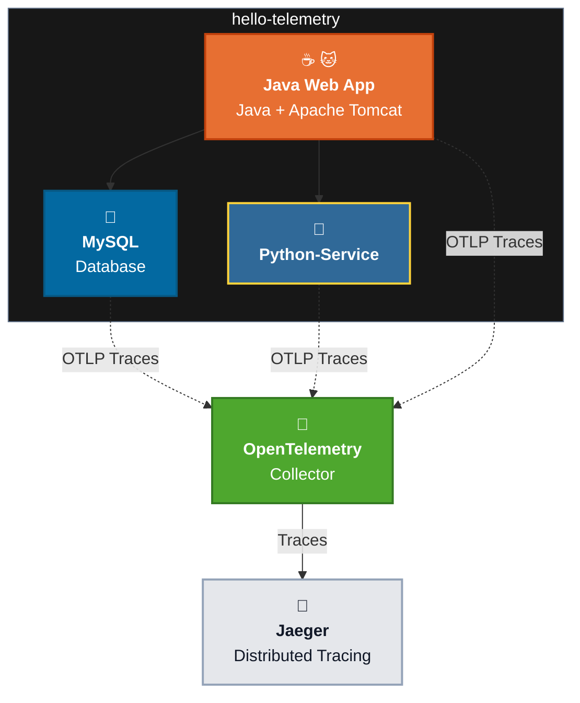

# Learning Environment

- Setup Learning Environment
- hello-telemetry App
- OpenTelemetry Astronomy Shop Demo App

---

# Setup Learning Environment

- **Minimum Hardware:**
    - 4 vCPU & 12 GB RAM (Recommended)
- Install Visual Studio Code
- Install Docker Desktop
- Install Open-JDK and Apache Maven
- Install Python
- Install Git
- Download hello-telemetry App <https://github.com/brainbsod/hello-telemetry>
- Download OpenTelemetry Demo App <https://github.com/open-telemetry/opentelemetry-demo>
- Visual Studio Code - Extensions (from Microsoft)
    - Python
    - Docker
    - Maven
    - Optional GitHub Copilot Chat (GitHub)

```bash
docker --version
java --version
mvn --version
python --version
git clone https://github.com/open-telemetry/opentelemetry-demo.git

cd Otel-Foundations
git clone https://github.com/brainbsod/hello-telemetry.git
git clone https://github.com/open-telemetry/opentelemetry-demo.git
```

---

# Hello Telemetry



## Testing Hello Telemetry

Start the learning environment from the `Otel-Foundations` directory:

```bash
cd Otel-Foundations/hello-telemetry/
docker compose up --build -d
docker compose ps
```

The published host ports are:

- Python service: `5001` (container port `5000`)
- Tomcat web application: `8085` (container port `8080`)
- Jaeger UI: `16686`

Test the Tomcat application:

```bash
curl -i http://localhost:8085/MyWebApp/
curl -i http://localhost:8085/MyWebApp/results
```

Both requests should return HTTP `200`. The `/results` response should display the database rows and an average age, for example `30.3`. This request exercises the Hello Telemetry application and its database-backed flow.

```bash
for i in {1..10}; do
  curl -sS -o /dev/null -w "Request $i: HTTP %{http_code}\n" \
    http://localhost:8085/MyWebApp/results
done
```
### Direct Python service test

```bash
curl -i -X POST http://localhost:5001/compute_average_age \
  -H "Content-Type: application/json" \
  -d '{"data":[{"age":20},{"age":30},{"age":40}]}'
```

Expected response:

```json
{"average_age":30.0}
```

Generate additional telemetry:

```bash
for i in {1..10}; do
  curl -sS -o /dev/null -w "Request $i: HTTP %{http_code}\n" \
    -X POST http://localhost:5001/compute_average_age \
    -H "Content-Type: application/json" \
    -d '{"data":[{"age":20},{"age":30},{"age":40}]}'
done
```

Open [Jaeger](http://localhost:16686), search for the configured Tomcat service, and inspect the generated trace.

To stop the environment:

```bash
docker compose down
```