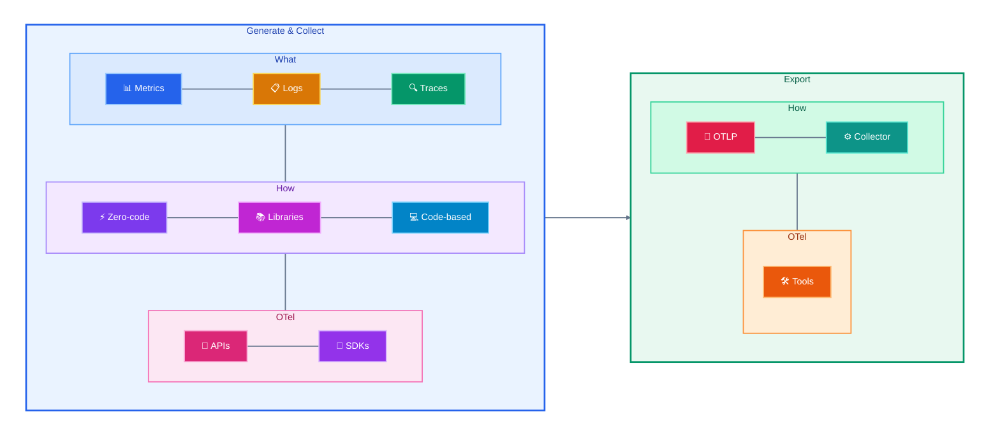
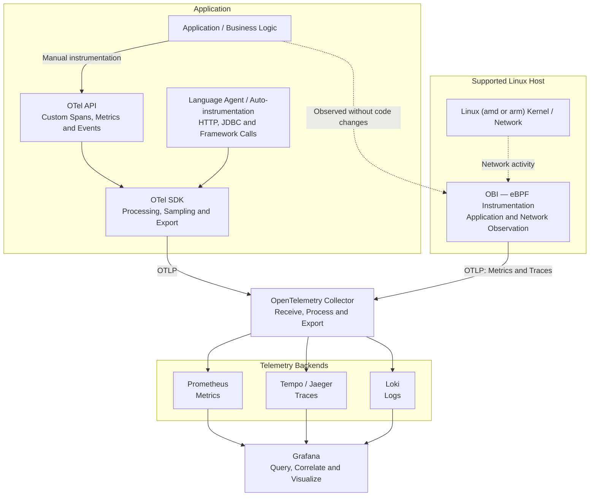

# **About Telemetry**

- Opensource alternative to collect Observability data
- Generates, Collects & Exports Telemetry data
- Follows below principles:
  - “You own the data that you generate. There’s **no vendor lock-in**”
  - “You only have to learn a **single set of APIs** and **conventions**”

## 矩陣結構

| Layer ↓ / Function → | Generate & Collect             | Export         |
| -------------------- | ------------------------------ | -------------- |
| What                 | Metrics、Logs、Traces            | —              |
| How                  | Zero-code、Libraries、Code-based | OTLP、Collector |
| OTel                 | APIs、SDKs                      | Tools          |


## Generates, Collects & Exports Telemetry Data



---

# Signals, Instrumentations, and APIs & SDKs

- Signals <https://opentelemetry.io/docs/concepts/signals/>
- Instrumentations <https://opentelemetry.io/docs/concepts/instrumentation/>
- Language APIs & SDKs <https://opentelemetry.io/docs/languages/>

## Signals

OpenTelemetry currently supports:

- Traces
- Metrics
- Logs
- Baggage

Also under development or at the proposal stage:

- Events, a specific type of log
- Profiles

## Instrumentations

OpenTelemetry achieves the instrumentation in 3 ways:

- **Zero-code**: Adds API & SDK capabilities as **agent** or **agent-like** installation
- **Code-based**: Manual instrumentation
- **Libraries**: Between zero-code and code-based

| 類型 | 說明 | OpenTelemetry Demo 範例 |
|---|---|---|
| Zero-code / Automatic instrumentation | 不修改業務程式碼，透過 Agent 或自動 instrumentation 自動產生 telemetry | Node.js `getNodeAutoInstrumentations()`、.NET Auto Instrumentation |
| Code-based / Manual instrumentation | 開發者直接在程式碼中建立 span、metric 或 event | `tracer.startSpan('charge')`、`start_as_current_span()`、`createProducerSpan()` |
| Instrumentation libraries | 由 OpenTelemetry 官方或第三方提供，用來自動攔截特定框架或函式庫 | HTTPX、FastAPI、OpenAI、Traceloop 等 instrumentation |

### Instrumentation libraries 範例：

> `opentelemetry-instrumentation-httpx` 是 OpenTelemetry 官方 Contrib instrumentation library。

```python
from opentelemetry.instrumentation.httpx import HTTPXClientInstrumentor

HTTPXClientInstrumentor().instrument()
```

> `traceloop-sdk` 是第三方 Library，使用或整合 OpenTelemetry，自動產生 LLM/Agent 相關 telemetry；它不是 OpenTelemetry Core 或官方 Contrib Library。

```python
from traceloop.sdk import Traceloop

Traceloop.init(app_name="agent")
```

> OpenTelemetry 主要提供 Zero-code/Automatic 與 Code-based/Manual instrumentation；Instrumentation libraries 則是實現或支援這兩種方式的整合元件。

## 建議架構

```text
Application
    ↓
Company Observability Library
    ↓
OpenTelemetry API
    ↓
OpenTelemetry SDK / Exporter
    ↓
Collector
    ↓
Jaeger、Grafana、其他 Vendor Backend

```

---

# Zero-code Instrumentation

- OpenTelemetry adds API & SDK capabilities through agent or agent-like installation.
- Instrumentation methods:
  - Bytecode manipulation: Modifying bytecode of a program at runtime.
  - Monkey Patching: Modifying existing code at runtime.
  - **eBPF**: Technology for instrumentation, tracing and monitoring in the Linux kernel. (<https://opentelemetry.io/docs/zero-code/obi/>)
    - eBPF – extended Berkeley Packet Filter
    - OBI – OpenTelemetry eBPF Instrumentation <https://opentelemetry.io/docs/zero-code/obi/>
        - Wide language support: Java (JDK 8+), .NET, Go, Python, Ruby, Node.js, C, C++, and Rust
        - Distributed tracing: Distributed trace spans are captured and reported to a collector
        - Protocol support (client and server): **HTTP/S**, HTTP/2, **gRPC**, **Kafka**, NATS, MQTT, Memcached, SunRPC (including NFS), and JSON-RPC
        - Database instrumentation (client and server): **PostgreSQL** (including the pgx driver), MySQL, **MSSQL**, and **Redis**
        - Database instrumentation (client only): MongoDB, Couchbase (N1QL/SQL++ and KV protocol), Aerospike, Elasticsearch, and **OpenSearch**
        - **Collector** integration: Run OBI as an OpenTelemetry Collector receiver component
        - Linux kernel	5.8+, or RHEL-family Linux 4.18+ with the required eBPF backports

## OpenTelemetry Architecture Diagram



## OBI 發布下列支援的版本

| 人工製品 | 支援的平台 |
| :--- | :--- |
| `obi` 二進位歸檔 | Linux `amd64`、Linux `arm64` |
| `otel/ebpf-instrument` 容器鏡像 | Linux `amd64`、Linux `arm64` |
| `otel/opentelemetry-ebpf-k8s-cache` 容器鏡像 | Linux `amd64`、Linux `arm64` |

---

# Handson Hello Opentelemetry - Java

- Java Example from https://github.com/open-telemetry/opentelemetry-java-examples?
## Shutdown OpenTelemetry Demo first
```bash
cd Otel-Foundations/opentelemetry-demo

docker compose --env-file .env --env-file .env.override \
  -f compose.yaml -f compose.full.yaml \
  -f compose.observability.yaml -f compose.extras.yaml \
  -f compose.agent.yaml  \
  down

```

```bash
cd ../hello-telemetry/

bash build.sh 
docker compose up --build -d
docker compose ps
```

- http://localhost:8085/MyWebApp/
- http://localhost:16686/search

### View JVM Metrics

- Run `jconsole` => Remote Process <localhost:9010> => Connect => Insecure connection

---
# Handson Hello Opentelemetry - Python

- https://opentelemetry.io/docs/zero-code/python/
- https://opentelemetry.io/docs/languages/python/getting-started/

```bash
bash build.sh 
docker compose up --build -d
```

- http://localhost:8085/MyWebApp/
- http://localhost:16686/search
- Contain view `ht-otel-collector`

---
# Zero-code Telemetry

- Metrics
    - HTTP Metrics
    - JVM Metrics

- Logs
- Traces

---
# OpenTelemetry DEMO

```bash
git clone --branch 2.2.0 --depth 1 https://github.com/open-telemetry/opentelemetry-demo.git opentelemetry-demo2.2.0
```

## Auto Instrumentations
- Java => Ad Service => opentelemetry-demo2.2.0\src\ad
- Python => Recommendation Service opentelemetry-demo2.2.0\src\recommendations

## Code-base Instrumentations
- Java <https://opentelemetry.io/docs/languages/java/>
- Python <https://opentelemetry.io/docs/languages/python/>

---
## **Recap**

### **1. About OpenTelemetry**

- Open-source alternative for observability data collection.

### **2. Instrumentation**

- Process of adding measurement capabilities to a system.
- Zero-code, code-based, and library-based.

### **3. APIs & SDKs**

- **API** = Application Program Interface → Entry Point
- **SDK** = Software Development Kit → Full Code

### **4. Zero-code Instrumentation**

- Agent-based instrumentation.
- No need to manually modify application code (agent takes care of it).
- Instruments supported libraries/code.
- OpenTelemetry eBPF Instrumentation.

> Zero-code Instrumentation automatically generates telemetry using agents, language-specific auto-instrumentation, or eBPF, without requiring modifications to application source code.

### **5. Code-based Instrumentation**

- Manual instrumentation utilizing APIs & SDKs.
- More control and flexibility.

> Application → OTel API → OTel SDK → OTLP Exporter → OTel Collector → Backend
---
