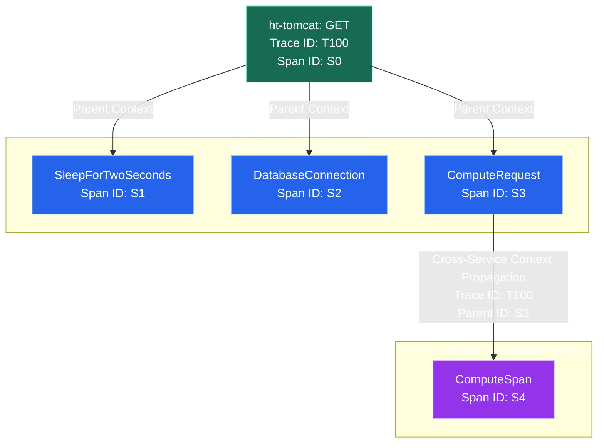
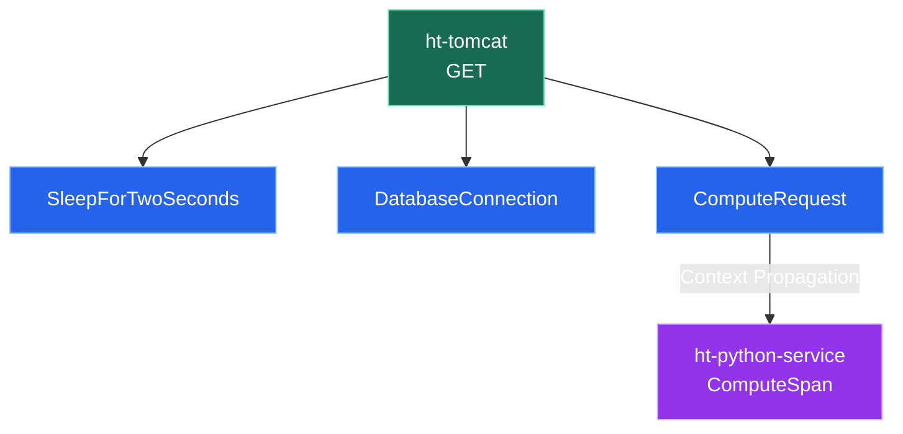
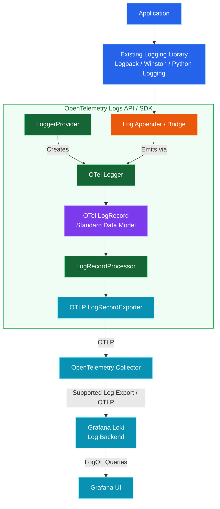
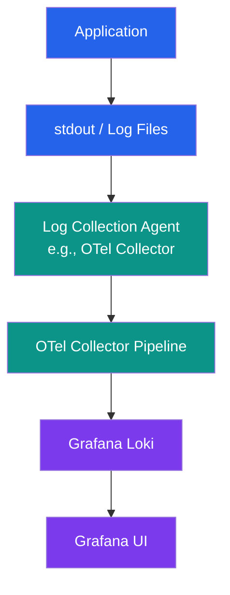
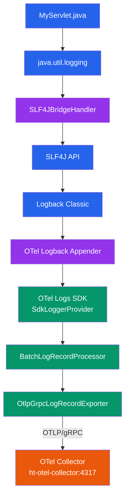
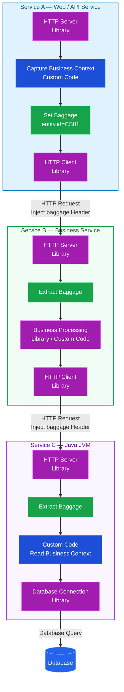
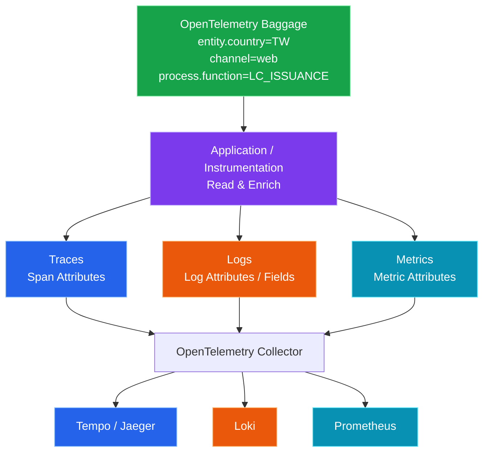
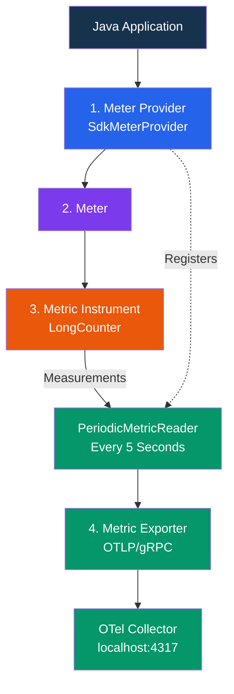
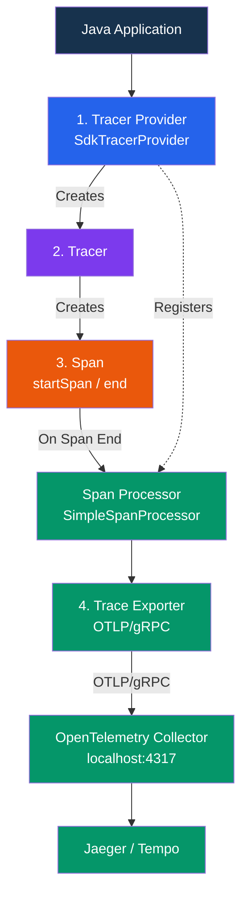
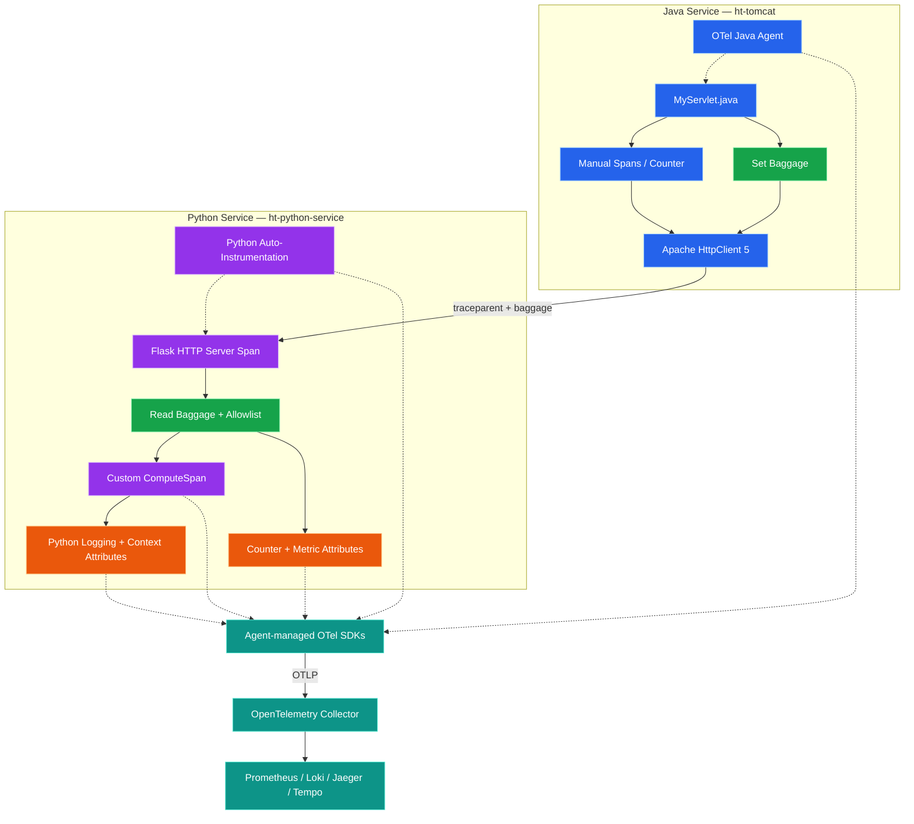

# **Telemetry Signals**

- <https://opentelemetry.io/docs/concepts/signals/>

> Data collected from a system to monitor its behaviour & performance.

- Metrics
- Logs
- Traces
- Baggage
    - 用途：在不同服務與程序之間傳遞共用的業務資訊。
    - 資料格式：Key-Value（鍵值對）。
    - 傳遞方式：透過 Context Propagation，跨服務傳遞資訊。
    - 應用：可將 Baggage 資訊加入 Traces、Metrics 或 Logs。

> 注意： Baggage 本身不是 Telemetry Signal，也不會自動記錄到 Traces、Metrics 或 Logs，必須另外配置或寫入。
---
## **Metrics**

<https://opentelemetry.io/docs/concepts/signals/metrics/>

- **How OpenTelemetry collects metrics**

    - Initialize Meter Provider
    - Meter creates metric instruments which capture measurements
    - Metric exporter sends metrics to a consumer

### **Metrics Collection Architecture**

```
Application
    │
    ▼
Meter Provider
    │
    ▼
Meter
    │
    ├── Metric Instrument
    ├── Metric Instrument
    └── Metric Instrument
              │
              ▼
       Metric Exporter
```

##　Metric Instruments
A metric instrument is defined by:

- Name
- Kind
- Unit (optional)
- Description (optional)

## **OpenTelemetry Metric Kinds**

| Instrument                     | 類型       | 用途／範例                           |
| ------------------------------ | -------- | ------------------------------- |
| **Counter**                    | 同步、只增不減  | 累計 HTTP Requests                |
| **Asynchronous Counter**       | 非同步、只增不減 | 定期讀取累計請求數                       |
| **UpDownCounter**              | 同步、可增可減  | **活躍連線數**                           |
| **Asynchronous UpDownCounter** | 非同步、可增可減 | 定期讀取 Queue Size                 |
| **Gauge**                      | 同步、當前值   | CPU Temperature                 |
| **Asynchronous Gauge**         | 非同步、當前值  | 定期讀取 Memory Usage               |
| **Histogram**                  | 同步、數值分布  | HTTP Request Latency（P95 / P99） |

**重點：**

- **Counter**：只增加。
- **UpDownCounter**：可增加、可減少。
- **Gauge**：記錄當前數值。
- **Histogram**：統計數值分布。
- **Asynchronous**：透過 Callback 定期觀測，而非每次變化都主動記錄。

*註：Histogram 可提供延遲分布資料；P95/P99 通常由後端根據 Histogram 計算。*

---

# Handson code-based Instrumentations

## Java - Metrics

- <https://github.com/brainbsod/hello-telemetry/blob/2-code-based-metrics/java-app/pom.xml>
- <https://mvnrepository.com/artifact/io.opentelemetry/opentelemetry-api>

- Update `pom.xml` and `MyServlet.java`

```bash
cd Otel-Foundations/hello-telemetry/
mvn -f ./java-app/pom.xml clean package

docker compose up --build -d

```

- <http://localhost:8085/MyWebApp/>
- Docker Container <ht-otel-collector> -> Name: app.db.db_requests

---
## Python - Metrics

```bash
cd ../python-service/
pip install -r requirements.txt

cd ..
docker compose up --build -d
```

- <http://localhost:8085/MyWebApp/>
- Docker Container <ht-otel-collector> -> Name: app_compute_request_count

--- 

# Hands-on Metrics - **OpenTelemetry Demo** - Data Analysis

```bash
cd ..
docker compose down

cd ../opentelemetry-demo

docker compose --env-file .env --env-file .env.override \
  -f compose.yaml -f compose.full.yaml \
  -f compose.observability.yaml -f compose.extras.yaml \
  -f compose.agent.yaml  \
  up -d

```
- Prometheus <http://localhost:9092/query> => demo_***
    - demo_ad_requests_total

```text
demo_ad_requests_total
demo_ad_served_total
demo_cart_add_item_latency_seconds_bucket
demo_cart_add_item_latency_seconds_count
demo_cart_add_item_latency_seconds_sum
demo_cart_get_cart_latency_seconds_bucket
demo_cart_get_cart_latency_seconds_count
demo_cart_get_cart_latency_seconds_sum
demo_exchange_conversions_counter_total
demo_notification_confirmations_total
demo_payment_transactions_total
demo_recommendation_requests_total
demo_shipping_items_shipped_total
demo_tool_calls_total
quotes_total
```

- Locust http://localhost:8080/loadgen/ 
    - Locust 是這個 OpenTelemetry Demo 的「流量產生器／負載測試工具」。

- Grafana http://localhost:8080/grafana

- Shopping http://localhost:8080/

- Jaeger http://localhost:8080/jaeger/ui/ or http://localhost:60498/jaeger/ui/

## Start Hello Telemetry
```bash
cd ../hello-telemetry/
docker compose up -d

```

---
# **Traces**

- <https://opentelemetry.io/docs/concepts/signals/traces/>

## **How OpenTelemetry collects traces**

- Initialize Tracer Provider ← Factory of Tracers
- Tracer creates spans
- Trace exporter sends spans to a consumer

### **Span Information**

- Name
- Span Context
- Parent Span ID
- Start and End Timestamps
- Attributes
- Span Events
- Span Links
- Span Status
- Span Kind

### **Traces Collection Architecture**

```
Application
    │
    ▼
Tracer Provider
    │
    ▼
Tracer
    │
    ├── Span 1
    ├── Span 2
    └── Span 3
          │
          ▼
    Trace Exporter
```

---

# Span Information

> OpenTelemetry 將 Span 定義為 Trace 中的一個有時間範圍的操作。[OpenTelemetry Traces 官方文件](https://opentelemetry.io/docs/concepts/signals/traces/)

| Span 資訊 | 實際範例 | 說明 |
|---|---|---|
| **Name** | `POST /api/checkout` | 表示目前執行的操作，例如處理結帳請求。 |
| **Span Context** | `trace_id=4bf92f3577b34da6a3ce929d0e0e4736`<br>`span_id=00f067aa0ba902b7`<br>`trace_flags=01` | 識別目前 Span 並連結整個分散式 Trace。Span Context 通常包含 Trace ID、Span ID、Trace Flags 和 Trace State，且不可修改。 |
| **Parent Span ID** | `parent_span_id=7a1c5e9b2d4f8a10` | 表示哪一個 Span 呼叫了目前的 Span，例如前端 Proxy。 |
| **Start and End Timestamps** | 開始：`2026-11-17T10:15:30.120Z`<br>結束：`2026-11-17T10:15:30.245Z` | 表示結帳操作花費 125 毫秒。 |
| **Attributes** | `http.request.method=POST`<br>`url.path=/api/checkout`<br>`http.response.status_code=200`<br>`order.item_count=2` | 描述操作的鍵值資料。不要記錄密碼、信用卡號等敏感資訊。 |
| **Span Events** | `checkout.validation.completed`<br>`exception: PaymentDeclinedException` | Span 執行期間發生的時間點事件，例如付款失敗或快取未命中。 |
| **Span Links** | 連結至 Kafka 訊息的 Span Context：`trace_id=9f8e7d6c...` | 將目前 Span 連結到另一個沒有直接父子關係的 Span，常用於非同步訊息或批次處理。 |
| **Span Status** | `ERROR`<br>`status.message="Payment was declined"` | 表示操作結果。正式狀態值為 `UNSET`、`OK` 和 `ERROR`。 |
| **Span Kind** | `SERVER` | 表示此服務接收並處理外部傳入的請求。 |

## Span Status

Span Status 用來表示操作結果。正式狀態值為 `UNSET`、`OK` 和 `ERROR`；`UNSET` 不一定代表操作失敗。

| Span Status | 中文 | 實際情境 | 範例 |
|---|---|---|---|
| **`UNSET`** | 未設定 | 沒有明確判定成功或失敗，是 Span 的預設狀態；不一定代表失敗。 | HTTP 請求完成，但程式沒有特別設定 Status。 |
| **`OK`** | 成功 | 明確表示操作成功完成。 | 付款成功、資料庫查詢成功、訂單建立成功。 |
| **`ERROR`** | 錯誤 | 表示操作失敗或發生例外。 | HTTP 500、付款被拒絕、資料庫連線失敗。 |

## Span Kind
一個完整的分散式 Trace 可能如下：

```text
frontend-proxy       SERVER
└── checkout-service SERVER
    ├── payment-api  CLIENT
    └── accounting    PRODUCER
        └── accounting-worker CONSUMER
```

常見的 Span Kind：

- `SERVER`：處理傳入的 HTTP 或 RPC 請求。
- `CLIENT`：呼叫其他服務或外部系統。
- `PRODUCER`：發送訊息，例如 Kafka message。
- `CONSUMER`：接收並處理訊息。
- `INTERNAL`：服務內部的程式操作，沒有遠端邊界。

---

# Context Propagation（追蹤上下文傳遞）

## 1. Span Propagation

```text
Service A                       Service B
Span 1                          Span 2
   │                               ▲
   └──── Context Propagation ──────┘

Same Trace ID
Different Span IDs
Span 2 Parent Span ID = Span 1 Span ID
```

## 2. Span Data

- `Context`
    - **Trace ID**：`trace_id`（整條 Trace 共用）
    - **Span ID**：`span_id`（每個 Span 獨立）
    - **Trace Flags**：`flag_value`（例如 Sampling Flag）
    - **Trace State**：`state_value`（Vendor-specific Trace Context）
- `Parent Span Id` (span_1_id)

## 3. W3C Trace Context（Default）

HTTP Headers：

- `traceparent`：主要 Trace Context Header
- `tracestate`：選用，用於額外的 Trace Context

## 4. W3C traceparent（HTTP Header）

- <https://www.w3.org/TR/trace-context/#trace-context-http-headers-format>

**Format:**

```text
version-trace-id-parent-id-trace-flags
```

**Example:**

```http
traceparent: 00-4bf92f3577b34da6a3ce929d0e0e4736-00f067aa0ba902b7-01
```

| Field | Example | Description |
|---|---|---|
| Version | `00` | W3C Trace Context Version |
| Trace ID | `4bf92f3577b34da6a3ce929d0e0e4736` | 整條 Trace 共用 |
| Parent ID | `00f067aa0ba902b7` | 發送端 Span ID |
| Trace Flags | `01` | Sampled Flag |

---

# Hello Telemetry — OpenTelemetry Context Propagation

## 1. Overview

根據 Jaeger Distributed Trace，系統包含兩個 Services：

- **Java Service（ht-tomcat）**
  - `GET`：Root Span
  - `SleepForTwoSeconds`：Child Span
  - `DatabaseConnection`：Child Span
  - `ComputeRequest`：Child Span
- **Python Service（ht-python-service）**
  - `ComputeSpan`：Java `ComputeRequest` 的 Child Span

### Jaeger Trace Summary

| Item | Value |
|---|---|
| Root Service | `ht-tomcat` |
| Root Operation | `GET` |
| Services | 2 |
| Total Spans | 5 |
| Maximum Span Depth | 3 |
| Trace Duration | 2.04 seconds |

以上顯示 Java 和 Python 的 Spans 屬於同一條 Distributed Trace，並建立了跨服務的 Parent-Child Relationship。

## 2. Context Propagation Architecture



> `T100`、`S0`～`S4` 為示意 ID。實際 W3C Trace ID 為 32 個十六進位字元，Span ID 為 16 個十六進位字元。

## 3. Span Context and Parent-Child Relationships

| Service | Span | Trace ID | Span ID | Parent Span ID |
|---|---|---|---|---|
| Java | `GET` | T100 | S0 | None |
| Java | `SleepForTwoSeconds` | T100 | S1 | S0 |
| Java | `DatabaseConnection` | T100 | S2 | S0 |
| Java | `ComputeRequest` | T100 | S3 | S0 |
| Python | `ComputeSpan` | T100 | S4 | S3 |

**Key Observations:**

- **Same Trace ID**：所有 Spans 使用同一個 Trace ID（T100）。
- **Unique Span IDs**：每個 Span 都有自己的 Span ID。
- **Java Sibling Spans**：`SleepForTwoSeconds`、`DatabaseConnection` 和 `ComputeRequest` 的 Parent 都是 `GET`。
- **Cross-Service Child Span**：Python 的 `ComputeSpan` 以 Java 的 `ComputeRequest` 作為 Parent。
- **Span Depth = 3**：`GET → ComputeRequest → ComputeSpan`。

> Sibling Spans 不代表一定平行執行。它們也可能依序執行，但具有相同 Parent Span。

## 4. How Does Context Propagation Work?

### 4.1 Within Java Service

Java Service 透過 OpenTelemetry Context 管理目前 Active Span。

當 `GET` 是 Active Span 時，建立：

- `SleepForTwoSeconds`
- `DatabaseConnection`
- `ComputeRequest`

這三個 Spans 都可以繼承 `GET` 的 Context，形成 Parent-Child Relationships。

同一個 Java Process 內通常不需要使用 HTTP Headers 傳遞 Context。

### 4.2 Between Java and Python Services

當 Java `ComputeRequest` 呼叫 Python Service 時：

1. Java 從目前 Active Span 取得 Span Context。
2. OTel Propagator 將 Context 注入 HTTP Request Headers。
3. Python 從 HTTP Headers 提取 Trace Context。
4. Python 使用提取的 Context 建立 `ComputeSpan`。
5. Python `ComputeSpan` 保持相同 Trace ID，但產生新的 Span ID。

**W3C Trace Context 使用：**

- `traceparent`：主要 Trace Context Header。
- `tracestate`：選用 Header，用於附加 Trace Context 資訊。

## 5. W3C traceparent HTTP Header

### Format

```text
version-trace-id-parent-id-trace-flags
```

### Example

```http
traceparent: 00-4bf92f3577b34da6a3ce929d0e0e4736-00f067aa0ba902b7-01
```

| Field | Example | Meaning |
|---|---|---|
| Version | `00` | W3C Trace Context Version |
| Trace ID | `4bf92f3577b34da6a3ce929d0e0e4736` | 跨 Java / Python 保持相同 |
| Parent ID | `00f067aa0ba902b7` | 發送端目前 Active Span 的 Span ID |
| Trace Flags | `01` | Sampled Flag |

在本範例中，如果 Java 在 `ComputeRequest` 內直接注入 Context，則 `parent-id` 對應 Java `ComputeRequest` 的 Span ID。

Python 建立 `ComputeSpan` 時，會將這個 ID 作為自己的 Parent Span ID。

> 若 HTTP Auto-Instrumentation 額外建立 HTTP CLIENT / SERVER Spans，實際的 Parent Span ID 可能對應 HTTP CLIENT Span，而不是 `ComputeRequest`。應以 Jaeger 中實際顯示的 Span Hierarchy 與 Span Context 為準。

## 6. Distributed Trace Hierarchy



## 7. Conclusion

OpenTelemetry Context Propagation 讓不同 Services 的 Spans 可以形成同一條 Distributed Trace。

- **Trace ID**：識別整條 Trace。
- **Span ID**：識別個別 Span。
- **Parent Span ID**：建立 Span 之間的 Parent-Child Relationship。
- **Context Propagation**：將 Trace Context 從 Java 傳遞到 Python。
- **Jaeger**：透過 Trace Hierarchy 呈現跨服務呼叫關係。

**本範例的核心結果：**

`Java GET → Java ComputeRequest → Python ComputeSpan`

這條路徑證明 Java 與 Python 的 Spans 已正確關聯在同一條 Distributed Trace。

---


# Hands on Traces and Context Propagation for `Hello Telemetry`

- Update `MyServlet.java`
- Update `compute.py`

```bash
bash build.sh
docker compose up --build -d
```

- http://localhost:16686/api/traces/b0c61326a6c439f752945d866417f08b

```json
{ "traceID": "b0c61326a6c439f752945d866417f08b",
    "spans": [
    {
        "traceID": "b0c61326a6c439f752945d866417f08b",
        "spanID": "a1dd96d7a6fe434c",
        "operationName": "SleepForTwoSeconds",
        "references": [
        {
            "refType": "CHILD_OF",
            "traceID": "b0c61326a6c439f752945d866417f08b",
            "spanID": "d6b2b31b3259dd51"
        }
        ],
        ...
    }
  ]
},
...
{
    "traceID": "b0c61326a6c439f752945d866417f08b",
    "spanID": "964fc27efa08e78d",
    "operationName": "ComputeSpan",
    "references": [
    {
        "refType": "CHILD_OF",
        "traceID": "b0c61326a6c439f752945d866417f08b",
        "spanID": "fdd8834ed68847ca"
    }
    ]
}
```
---

# Logs

- Official Documentation: https://opentelemetry.io/docs/concepts/signals/logs/

## 1. OpenTelemetry Logging Objective

- Support existing logs and logging libraries.
- Integrate logging with OpenTelemetry without replacing existing logging frameworks.
- Standardize log records using the OpenTelemetry Log Data Model.
- Enable correlation between Logs and Traces using Trace ID and Span ID.

## 2. Supported Logging Libraries

| Language | Logging Libraries |
|---|---|
| **Java** | Log4j, SLF4J, Logback |
| **.NET** | Log4net, NLog, Serilog |
| **JavaScript / Node.js** | Log4js, Winston, Pino |
| **Go** | Logrus, Zap |
| **Python** | Logging, Loguru |

**Note:** Integration capabilities and maturity vary by language, library, and OpenTelemetry instrumentation version.

## 3. OpenTelemetry Logging

- Provides **Logs API and SDK**, primarily designed for integration with existing logging libraries.
- **Enhances existing logs with correlation data**, such as Trace ID, Span ID, and Trace Flags.
- Provides capabilities to receive, process, and export log data to a consumer or backend server.
- Supports integration through **Log Appenders / Bridges** without requiring applications to replace existing logging libraries.

### 3.1 Example 1: Original Log

```text
2024-08-08 18:59:25 - oteldemo.AdService - Targeted ad request received for [travel]
```

### 3.2 Example 2: Log with OpenTelemetry Correlation

```text
2024-08-08 18:59:25 - oteldemo.AdService - Targeted ad request received for [travel]
trace_id=f9cc0f59ce50d371ed73ba00b4d2019e
span_id=0fdc4062b3732f51
trace_flags=01
```

**Key Point:** OpenTelemetry enables existing application logs to be correlated with distributed traces using `trace_id` and `span_id`.

**Note:** Trace correlation fields are available when appropriate logging instrumentation or context enrichment is configured. They are not automatically added to every log in every language.

---

## 4. OpenTelemetry Logging Architecture — Log Appender / Bridge

Existing Logging Libraries can integrate with OpenTelemetry through **Log Appenders / Bridges**, allowing log records to follow the OpenTelemetry Logs API / SDK pipeline.

### 4.1 Logging Architecture



**Architecture Explanation:**

1. The application generates logs through an existing Logging Library.
2. A Log Appender / Bridge converts or maps existing log records into OpenTelemetry LogRecords.
3. The OpenTelemetry Logger, obtained from a LoggerProvider, emits LogRecords.
4. A LogRecordProcessor processes and optionally batches the records.
5. The LogRecordExporter exports logs using OTLP.
6. The OpenTelemetry Collector receives, processes, and forwards logs.
7. Loki stores and indexes logs, while Grafana provides visualization and querying.

**Important:** The OpenTelemetry Log Data Model defines the structure of LogRecords. It is not a standalone processing component.

### 4.2 Components and Responsibilities

| Component | Responsibility |
|---|---|
| **Logging Library** | Generates application logs, e.g., Logback, Winston. |
| **Log Appender / Bridge** | Integrates existing logging records with the OpenTelemetry Logs API. |
| **LoggerProvider** | Creates and manages OTel Loggers. |
| **Logger** | Emits OTel LogRecords. |
| **OTel LogRecord** | Represents a log using the standard OpenTelemetry Log Data Model. |
| **LogRecordProcessor** | Processes and optionally batches LogRecords before export. |
| **LogRecordExporter** | Exports LogRecords to a Collector or backend. |
| **OTel Collector** | Receives, processes, and forwards log telemetry. |
| **Grafana Loki** | Stores and enables querying of logs. |
| **Grafana UI** | Visualizes logs and correlates them with traces. |

### 4.3 Real-World Java Example

```text
Java Application
    ↓
SLF4J + Logback
    ↓
OpenTelemetry Logback Appender
    ↓
OTel Logger (from LoggerProvider)
    ↓
OTel LogRecord
    ↓
LogRecordProcessor
    ↓
OTLP LogRecordExporter
    ↓
OpenTelemetry Collector
    ↓
Grafana Loki
    ↓
Grafana UI
```

### 4.4 Alternative — Collect Existing Log Files / stdout

OpenTelemetry can also collect existing application logs without requiring an in-process Log Appender / Bridge.



In this model:

- Existing applications continue writing logs to files or stdout.
- A collection agent reads and forwards the logs.
- The Collector processes the records and exports them to Loki.
- Trace ID and Span ID correlation requires those identifiers to be included in the logs or enriched through an appropriate integration.

**Note:** The collection agent and Collector pipeline may be part of the same Collector deployment. Loki ingestion must use a supported exporter or OTLP endpoint.

---

## 5. Key Differences Between the Two Logging Approaches

| Comparison | Log Appender / Bridge | stdout / File Collection |
|---|---|---|
| Integration Location | Inside Application Runtime | Outside Application |
| Existing Logging Library | Reused | Reused |
| OTel Logs SDK in Application | Usually required | Not required |
| Log Collection | OTel SDK → OTLP | Agent / Collector |
| Trace Correlation | Through Context-aware logging integration | Requires Trace / Span IDs in log content |
| Application Changes | Configuration / dependencies may be required | Often only collection configuration |
| Kubernetes Deployment | Application instrumentation | DaemonSet / Agent / Collector |

## 6. Conclusion

OpenTelemetry provides **Logs API, Logs SDK, Log Appenders / Bridges, and standardized Log Data Models** to integrate existing logging frameworks with observability backends.

Two common approaches are:

**Approach A — Application-level Appender Integration**

`Logging Library → OTel Appender / Bridge → OTel Logs SDK → OTLP Exporter → Collector → Loki → Grafana`

**Approach B — Infrastructure-level Collection**

`Application stdout / Files → Collection Agent → OTel Collector → Loki → Grafana`

**Recommended Principle:** Continue using existing Logging Libraries where appropriate, standardize log data collection and export through OpenTelemetry, and enable correlation between Logs and Traces using Trace ID and Span ID.

---

# Hands on Java Log Appender for Hello Telemetry

- <https://github.com/open-telemetry/opentelemetry-java-examples/tree/main/log-appender>

- Update `pom.xml`
- Create `logback.xml`
- Update `MyServlet.java`

```java
// Logs
// Install SLF4JBridgeHandler to route JUL logs to SLF4J
SLF4JBridgeHandler.removeHandlersForRootLogger();
SLF4JBridgeHandler.install();  
        
// Install OpenTelemetry in logback appender
OpenTelemetryAppender.install(openTelemetry);        

more //Logs ...
```

```bash
bash build.sh
docker compose up --build -d
```

## Logs Architecture



## Verify Logs

- <http://localhost:8085/MyWebApp/>

```bash
docker logs -f ht-otel-collector 2>&1   | grep -E 'otelcol.signal.*logs|LogRecord|DB Connection'
```

- Docker Desktop `ht-otel-collector` => `LogRecord`

---
# Hands on Python for Hello Telemetry

- <https://github.com/open-telemetry/opentelemetry-python/tree/main/docs/examples/logs>

- Update `requirements.txt` and `compute.py`

```bash
docker compose up --build -d
```

## Verify Logs

- <http://localhost:8085/MyWebApp/>
- Docker Desktop `ht-otel-collector` => `LogRecord` OR `Computed average age`

---

# Hands-on - Zero-code + Code-based Instrumentations - hello-telemetry

## Java
- Update `docker-compose.yaml`, `pom.xml`, and `MyServlet.java`

## Python
- Update `requirements.txt`, and `compute.py`

```bash
bash build.sh
docker compose up --build -d
```
---

# Baggage

## 1. References

- W3C Baggage Specification: https://www.w3.org/TR/baggage/
- OpenTelemetry Baggage: https://opentelemetry.io/docs/concepts/signals/baggage/

## 2. Data Structure

- **Key-Value Store**：用於儲存及傳遞 Contextual Information（上下文資訊）。
- **Context Propagation**：可跨 Services 和 Processes 傳遞 Baggage。
- **Common Examples**：
  - Entity ID
  - Entity Country
  - Environment — prod / sit / uat / dev
  - Channel — web / mobile
  - Process Function — LC_ISSUANCE / PAYMENT

### 2.1 W3C HTTP Headers

| Header | Purpose |
|---|---|
| `traceparent` | 傳遞 Trace ID、Parent ID、Trace Flags |
| `tracestate` | 選用的 Trace Context Metadata |
| `baggage` | 傳遞 Application-defined Contextual Information |

**Important:**

- `baggage` 是獨立於 W3C Trace Context 的標準 HTTP Header。
- Baggage 使用逗號分隔多組 Key-Value Pairs。
- 跨服務傳遞需要啟用 Baggage Propagator。
- Baggage 不會自動成為 Span Attributes、Metrics Attributes 或 Log Fields。

**Example:**

```http
baggage: entity.id=CS01,entity.country=TW,channel=web,environment=sit
```

## 3. Baggage Architecture



## 4. Baggage Propagation Flow

| Step | Component | Action |
|---|---|---|
| 1 | Service A | Capture and validate Business Context |
| 2 | Service A | Create and set Baggage in the active Context |
| 3 | Service A → B | Inject W3C `baggage` HTTP Header |
| 4 | Service B | Extract Baggage into its local Context |
| 5 | Service B → C | Propagate Baggage through the outgoing HTTP Request |
| 6 | Service C | Extract and read Baggage |
| 7 | Service C | Execute Business Logic and Database Operations |

**Important:** Baggage is propagated only when supported instrumentation or application code performs the required Context Injection and Extraction.

## 5. OpenTelemetry Baggage Configuration

Enable W3C Trace Context and Baggage Propagation:

```yaml
env:
  - name: OTEL_PROPAGATORS
    value: "tracecontext,baggage"
```

This configuration enables the propagators in an OpenTelemetry SDK or Agent that supports environment-based configuration.

However, it does not automatically create Business Context or guarantee propagation through every protocol and library.

## 6. Baggage vs Trace Context

| Feature | Trace Context | Baggage |
|---|---|---|
| Primary Purpose | Distributed Tracing | Contextual Information |
| Main HTTP Header | `traceparent` | `baggage` |
| Data | Trace ID, Parent ID, Trace Flags | Application-defined Key-Value Pairs |
| Cross-Service Propagation | Yes | Yes |
| Automatically Added to Spans | Trace identity and parent relationships | No |
| Typical Example | Trace ID | Entity ID, Country, Channel |

## 7. Security Considerations

- Do not place passwords, authentication tokens, full account numbers, or sensitive personal information in Baggage.
- Use an approved allowlist for Baggage keys and values.
- Validate Baggage received from external clients; do not trust incoming values automatically.
- Restrict or remove Baggage before requests leave trusted service boundaries.
- Avoid using high-cardinality identifiers as Metric Labels.
- Use non-sensitive business identifiers only when approved by security and data governance policies.

## 8. Conclusion

**Baggage = Application-defined Contextual Information propagated between Services and Processes.**

- **Set**：Application creates and stores Baggage in Context.
- **Inject**：Propagator writes Baggage into outgoing HTTP Headers.
- **Extract**：Receiving Service reconstructs Baggage from incoming Headers.
- **Get**：Application reads Baggage from its local Context.
- **Enrich**：Application may explicitly add approved Baggage values to Spans, Metrics, or Logs.

**Key Point:** OpenTelemetry Baggage enables cross-service Context Propagation, but does not automatically create Telemetry Signals or record Baggage values in Observability Backends.

---

# OpenTelemetry Baggage — Learning Notes

## 1. What Is Baggage?

**Baggage** 用於在不同 Services / Processes 之間傳遞共用的業務上下文資訊（Contextual Information）。

- 使用 **Key-Value Pairs** 儲存資料。
- 透過 **Context Propagation** 跨服務傳遞。
- 可以讓 Traces、Logs、Metrics 使用相同的業務上下文。
- **Baggage 本身不是 Telemetry Signal。**
- **Baggage 不會自動寫入 Spans、Logs 或 Metrics。**

### Example — W3C Baggage Header

```http
baggage: entity.country=TW,channel=web,process.function=LC_ISSUANCE
```

此 Header 可以隨 HTTP Request 在 Java、Node.js、Python 等 Microservices 之間傳遞。

## 2. Baggage vs. Telemetry Attributes

| Telemetry Signal | Baggage 的使用方式 | Example |
|---|---|---|
| **Traces** | 寫入 Span Attributes | `entity.country=TW` |
| **Logs** | 寫入 Log Attributes / Fields | `channel=web` |
| **Metrics** | 寫入 Metric Attributes | `process.function=LC_ISSUANCE` |

**Important:** Application Code 或經配置的 Instrumentation 必須明確讀取 Baggage，並將所需資訊加入 Telemetry。

## 3. Baggage to Telemetry Architecture



此圖說明 Baggage 如何被 Application / Instrumentation 用於 Telemetry Enrichment。

Collector 只接收已產生的 Telemetry Records；Baggage 不會單獨作為一種 Signal 被匯出。

## 4. Real-World Example — LC Issuance

假設 LC Issuance 經過三個 Microservices：

```text
API Gateway
    ↓
LC Issuance Service
    ↓
Document Validation Service
    ↓
Settlement Service
```

API Gateway 建立以下 Baggage：

```http
baggage: entity.country=TW,channel=web,process.function=LC_ISSUANCE
```

下游 Services 可讀取相同的業務上下文，並選擇性地加入不同 Telemetry Signals。

| Signal | Recorded Data | Purpose |
|---|---|---|
| Trace | `entity.country=TW` | 分析不同國家的交易處理流程 |
| Log | `channel=web` | 分析不同渠道的應用日誌 |
| Metric | `process.function=LC_ISSUANCE` | 監控 LC Issuance 的交易量與效能 |

**Important:** Baggage Propagation 與 Telemetry Enrichment 是兩個不同的操作。

## 5. Attributes vs. Fields

| Type | Description |
|---|---|
| **Span Attributes** | 描述 Span 的 Key-Value 屬性 |
| **Log Attributes / Fields** | 記錄在 Log Record 中的上下文資訊 |
| **Metric Attributes** | 用於 Metric 分類、查詢及統計的 Key-Value 屬性 |

### Cardinality Considerations

Metric Attributes 必須控制 **Cardinality（基數）**。

- **Suitable:** `entity.country=TW`
- **Suitable:** `channel=web`
- **Suitable:** `process.function=LC_ISSUANCE`
- **Avoid:** 每筆交易都不同的 LC Number、Transaction ID、User ID

高基數 Attributes 可能造成 Metrics Storage 與查詢成本大幅增加。

## 6. Security Considerations

- 不要在 Baggage 中放入密碼、Token、完整帳號或敏感個資。
- 僅傳遞經核准的 Context Keys / Values。
- 外部 HTTP Request 的 Baggage 必須經過驗證。
- Baggage 傳送至外部服務前，應清除不應外送的資訊。

## 7. Key Takeaways

**Baggage = Propagate Context**

**Attributes / Fields = Record Context in Telemetry**

### Remember

1. Baggage 透過 Context Propagation 跨服務傳遞。
2. Baggage 本身不是 Metrics、Logs 或 Traces。
3. Baggage 不會自動成為 Telemetry Attributes。
4. Application / Instrumentation 可以將 Baggage 資訊加入 Span、Log 或 Metric。
5. Metrics Attributes 必須控制 Cardinality。

**Conclusion:** OpenTelemetry Baggage enables consistent business context across microservices, while Telemetry Enrichment makes selected context available for observability analysis.

## References

- W3C Baggage: https://www.w3.org/TR/baggage/
- OpenTelemetry Baggage: https://opentelemetry.io/docs/concepts/signals/baggage/

---
# Hands-on Baggage - Hello Telemetry

- Update `MyServlet.java`
- Update `compute.py`

```bash
bash build.sh
docker compose up --build -d
```

- <http://localhost:8085/MyWebApp/results>
- <http://localhost:16686/search>
- Docker Desktop `ht-otel-collector` => 'john_doe'

---
## **Profiling**

- **Profiling** – Snapshots of code resource utilization (CPU/Memory)
- Application-level profiling
- System-level profiling
- `opentelemetry-ebpf-profiler`
- In **public alpha**
- **Links:**
  - [https://opentelemetry.io/docs/concepts/signals/profiles/](https://opentelemetry.io/docs/concepts/signals/profiles/?utm_source=chatgpt.com)
  - [https://github.com/open-telemetry/opentelemetry-ebpf-profiler](https://github.com/open-telemetry/opentelemetry-ebpf-profiler?utm_source=chatgpt.com)
  - [https://opentelemetry.io/docs/specs/otel/profiles/](https://opentelemetry.io/docs/specs/otel/profiles/?utm_source=chatgpt.com)

---
## **OpenTelemetry Metrics — Java Code Example**

此範例展示 OpenTelemetry Metrics 的四個主要元件：**Meter Provider → Meter → Metric Instrument → Metric Exporter**。

### **1. Metric Exporter & Meter Provider**

```

OtlpGrpcMetricExporter otlpGrpcMetricExporter =
    OtlpGrpcMetricExporter.builder()
        .setEndpoint("http://localhost:4317")
        .build();

PeriodicMetricReader periodicMetricReader =
    PeriodicMetricReader.builder(otlpGrpcMetricExporter)
        .setInterval(java.time.Duration.ofSeconds(5))
        .build();

SdkMeterProvider sdkMeterProvider =
    SdkMeterProvider.builder()
        .registerMetricReader(periodicMetricReader)
        .build();

```

### **2. Meter & Metric Instrument**

```

public MyServlet(OpenTelemetry openTelemetry) {

    // 2. Meter
    this.meter = openTelemetry.getMeter(INSTRUMENTATION_NAME);

    // 3. Metric Instrument — Counter
    this.requestCounter =
        meter.counterBuilder("app.db.db_requests")
            .setDescription("Counts DB requests")
            .build();
}

```

### **3. Components and Responsibilities**

| Component                | Java API                 | Responsibility            |
| ------------------------ | ------------------------ | ------------------------- |
| **1. Meter Provider**    | `SdkMeterProvider`       | 建立與管理 Meters              |
| **2. Meter**             | `getMeter()`             | 建立 Metric Instruments     |
| **3. Metric Instrument** | `counterBuilder()`       | 記錄測量值，例如 DB Request Count |
| **4. Metric Exporter**   | `OtlpGrpcMetricExporter` | 透過 OTLP/gRPC 匯出 Metrics   |
| **Metric Reader**        | `PeriodicMetricReader`   | 每 5 秒收集並匯出 Metrics        |

### **4. Metrics Collection Architecture**



### **5. Recording a Measurement**

建立 Counter 後，在實際執行 DB Query 時呼叫：

```

requestCounter.add(1);

```

每呼叫一次，Counter 就增加 1。

**重點：** `counterBuilder()` 只建立 Instrument，並不會自動統計 Database Requests。必須由應用程式呼叫 `add(1)`，或使用相應的 Auto-Instrumentation。

另外，`PeriodicMetricReader` 每 5 秒匯出一次是本範例的設定，不代表 Counter 每 5 秒才增加一次。Counter 在 `add(1)` 時就記錄測量值。

## **Metric Instrument Types**

- Counter
- Asynchronous Counter
- UpDownCounter (記錄增加或減少多少)
- Asynchronous UpDownCounter
- Gauge (記錄目前是多少)
- Histogram

| 項目     | Gauge        | UpDownCounter |
| ------ | ------------ | ------------- |
| 原本數值   | 60           | 60            |
| 現在數值   | 70           | 70            |
| API 操作 | `record(70)` | `add(+10)`    |
| 記錄內容   | 目前值 70       | 增加量 +10       |

---
## **OpenTelemetry Traces — Java Code Example**

這張圖展示 OpenTelemetry Traces 的四個主要元件：

**Tracer Provider → Tracer → Span → Trace Exporter**

### **1. Trace Exporter & Tracer Provider**

```

// 4. Trace Exporter
OtlpGrpcSpanExporter otlpGrpcSpanExporter =
    OtlpGrpcSpanExporter.builder()
        .setEndpoint("http://localhost:4317")
        .build();

// 1. Tracer Provider
SdkTracerProvider sdkTracerProvider =
    SdkTracerProvider.builder()
        .addSpanProcessor(
            SimpleSpanProcessor.create(otlpGrpcSpanExporter)
        )
        .build();

```

### **2. Tracer**

```

// 2. Tracer
this.tracer = openTelemetry.getTracer(INSTRUMENTATION_NAME);

```

### **3. Create a Span**

```

// 3. Span
Span span = tracer
    .spanBuilder("initiate database query")
    .startSpan();

try (Scope scope = span.makeCurrent()) {
    // Execute database operations
} finally {
    span.end();
}

```

### **4. Components and Responsibilities**

| Component              | Java API                    | Responsibility               |
| ---------------------- | --------------------------- | ---------------------------- |
| **1. Tracer Provider** | `SdkTracerProvider`         | 建立與管理 Tracers                |
| **2. Tracer**          | `getTracer()`               | 建立 Spans                     |
| **3. Span**            | `spanBuilder().startSpan()` | 記錄操作、Attributes、Events 和執行時間 |
| **4. Trace Exporter**  | `OtlpGrpcSpanExporter`      | 透過 OTLP/gRPC 匯出 Traces       |
| **Span Processor**     | `SimpleSpanProcessor`       | 將已結束的 Span 交給 Exporter       |

### **5. Traces Collection Architecture**



**重點：** `startSpan()` 建立 Span；`end()` 結束 Span，然後由 Span Processor 交給 Exporter 匯出。

另外，`SimpleSpanProcessor` 適合示範；Production 通常建議使用 `BatchSpanProcessor`，降低每個 Span 結束時立即匯出的效能成本。

---

## Span Data

**Name:** `Span 1`

### 1. Span Context

**Span Context** 包含用於 Distributed Tracing 和 Context Propagation 的識別資訊。

- **Trace ID:** `<value>` — 整條 Trace 共用。
- **Span ID:** `<value>` — 每個 Span 的唯一識別碼。
- **Trace Flags:** `<value>` — 例如 Sampling Flag。
- **Trace State:** `<value>` — 選用的追蹤狀態資訊。

**Context Propagation:**

- 同一 Process：透過 OpenTelemetry Context 傳遞。
- 跨 Services：透過 W3C `traceparent` / `tracestate` Headers 傳遞。
- 新 Span 保留相同 Trace ID，但產生新的 Span ID。

### 2. Other Span Information

- **Parent Span ID:** `<value>` — 父 Span 的 ID；Root Span 沒有 Parent。
- **Start Time:** `<time>`
- **End Time:** `<time>`
- **Attributes:** Key-Value Pairs
  - `key1: value1`
  - `key2: value2`
- **Events:** Timestamped Events，例如 Exception 或重要處理事件。
- **Links:** 關聯其他 Span Context，可跨不同 Traces。
- **Status:** `Unset` | `Ok` | `Error`
- **Kind:** `SERVER` | `CLIENT` | `INTERNAL` | `PRODUCER` | `CONSUMER`

### 3. W3C Trace Context

**HTTP Headers:**

- `traceparent` — 主要追蹤上下文。
- `tracestate` — 選用的追蹤狀態。

**traceparent Format:**

```text
version-trace-id-parent-id-trace-flags
```

**Important:** `parent-id` 代表發送端目前 Span 的 ID，接收端可使用它建立新的 Parent-Child Relationship。

---
## **OpenTelemetry Logging — Log Appender / Bridge**

**Enhances existing logs with correlation data (Trace ID, Span ID, etc.).**

### **Components**

- **Logging Library Log Record**
- **Log Bridge API**
- **OpenTelemetry Log Data Model**
- **Log Appender / Bridge**
  - Logger Provider
  - Logger
- **Log Record**

### **Architecture**

```text
Logging Library Log Record
            │
            ├── Log Bridge API(1) ──→ OpenTelemetry Log Data Model
           (2)                                │
            ▼                                 ▼
    Log Appender / Bridge               Log Record
            │                                 ▲
            ▼                                 │
      Logger Provider                         │
            │                                 │
            ▼                                 │
          Logger ─────────────────────────────┘
```

**Key Point:** The Log Appender / Bridge connects existing logging libraries to OpenTelemetry, allowing logs to be represented using the OpenTelemetry Log Data Model and enriched with trace correlation information.

| 角色 | 誰？ | 主要工作 |
|---|---|---|
| **Application Developer** | Java、Python、Node.js 應用程式開發者 | 使用 Logging Library 記錄 Logs |
| **Logging Library Developer** | Logback、Log4j、Winston 等函式庫的開發者 | 開發及維護 Logging Framework |
| **OpenTelemetry Instrumentation Developer** | OTel 社群或第三方整合工具開發者 | 開發 Appender / Bridge，將 Logging Library 接入 OTel Logs API |

---
# Hello Telemetry 完整架構圖


---

# SDK Architecture — Zero-code + Code-based

## Zero-code + Code-based Instrumentation

**docker-compose.yml**

```yaml
environment:
  - JAVA_TOOL_OPTIONS=-javaagent:/opt/opentelemetry-javaagent.jar
  - OTEL_EXPORTER_OTLP_ENDPOINT=http://ht-otel-collector:4318
  - OTEL_SERVICE_NAME=tomcat-service
```

**MyServlet.java**

```java
// Reuse the OpenTelemetry instance initialized by the Java Agent
OpenTelemetry openTelemetry = GlobalOpenTelemetry.get();

// Code-based Metrics
this.meter = openTelemetry.getMeter(INSTRUMENTATION_NAME);
this.requestCounter = meter.counterBuilder("app.db.db_requests")
        .setDescription("Count DB requests")
        .build();

// Code-based Traces
this.tracer = openTelemetry.getTracer(INSTRUMENTATION_NAME);
```

---
