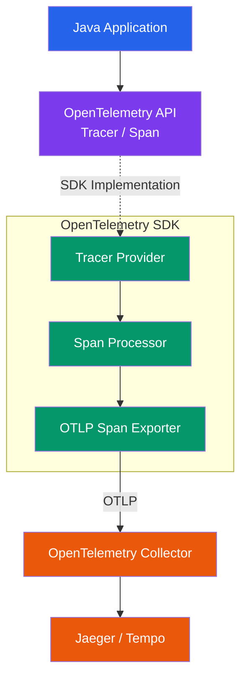
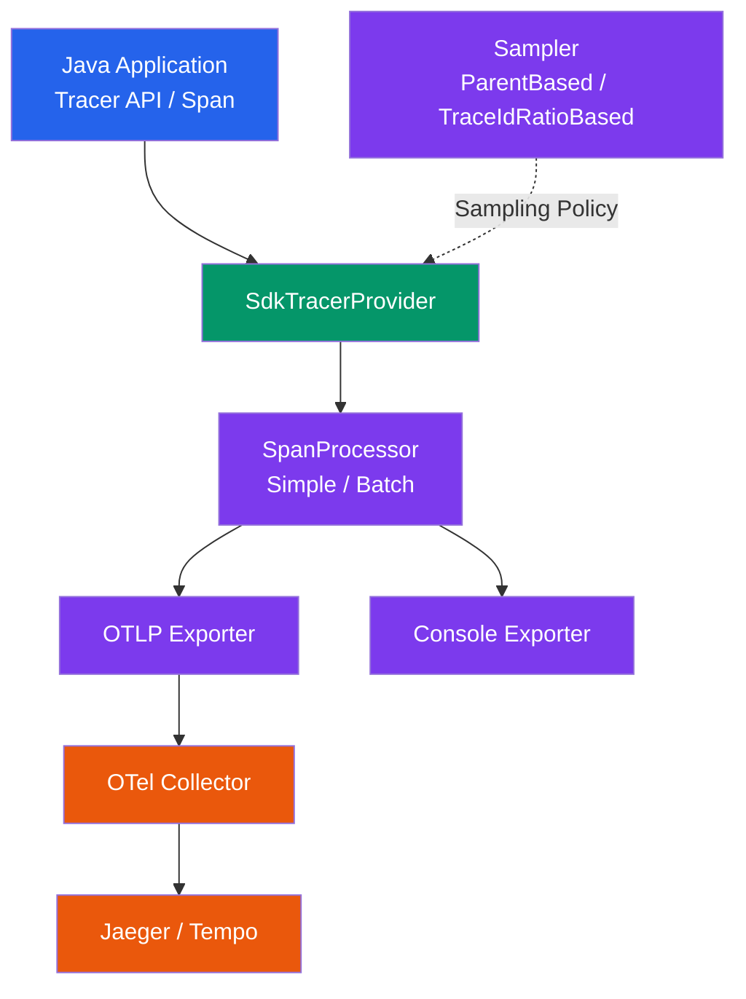
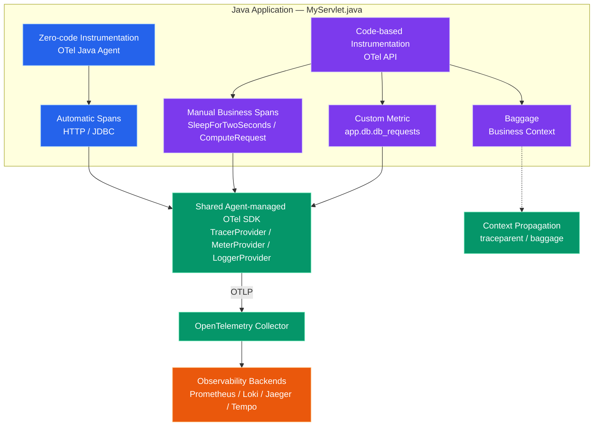
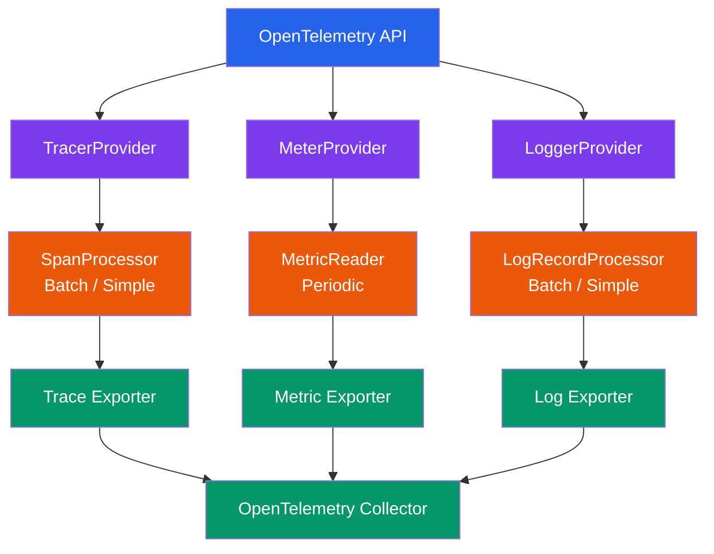
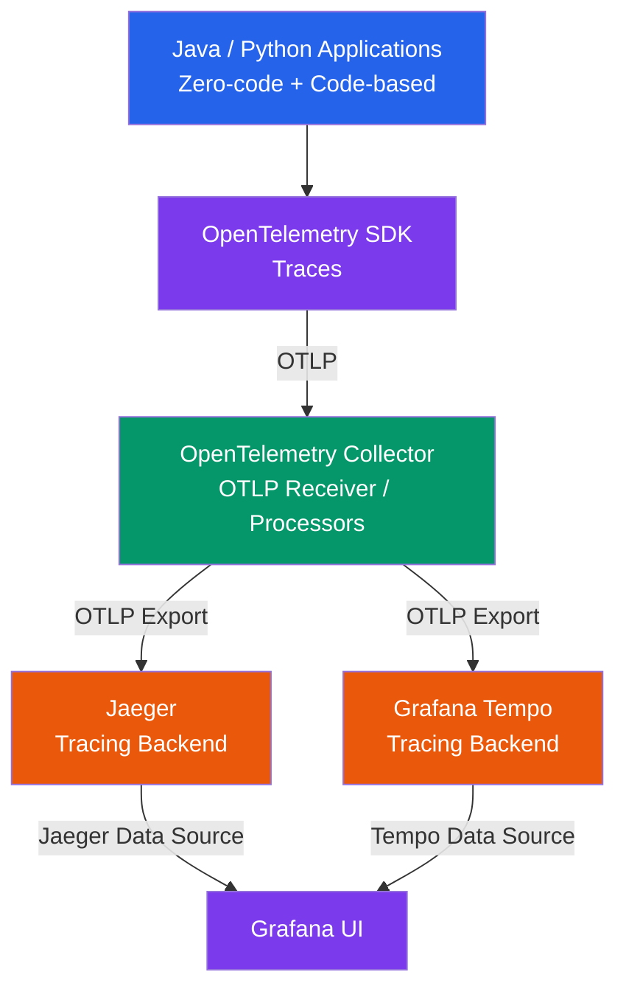
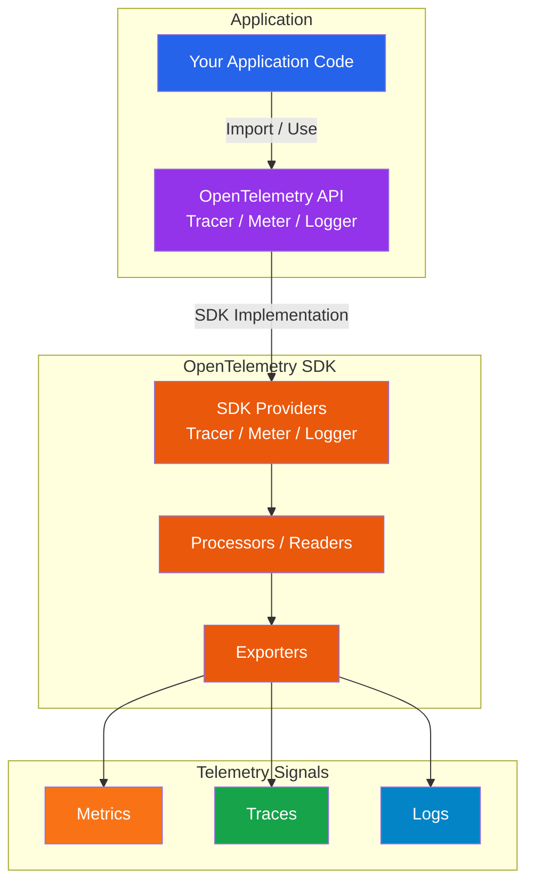
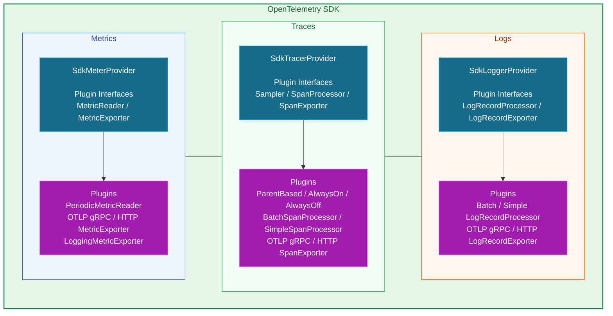
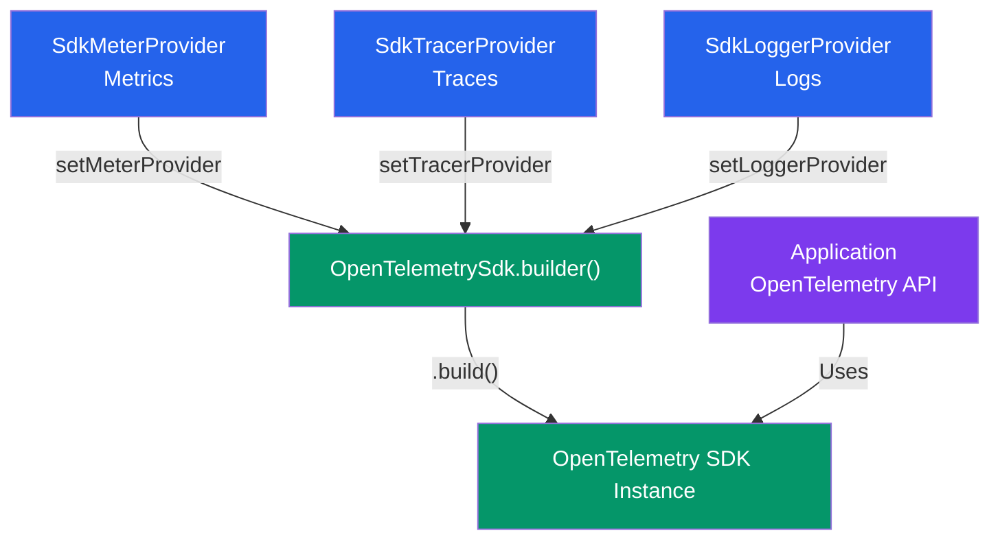
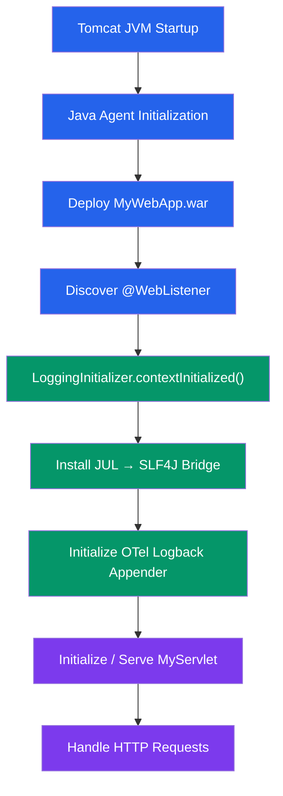

# **SDK Architecture and Composability**

## **Content**

- OpenTelemetry API vs SDK
- SDK Providers, Plugin Interfaces & Plugins
- Composability
- Configuration
- Practical Tips

---
# **OpenTelemetry SDK Architecture and Composability**

OpenTelemetry 的架構可以分成 **API、SDK、Providers、Plugins、Configuration** 五個部分。

其中最重要的觀念是：

**API 負責定義如何產生 Telemetry；SDK 負責處理及匯出 Telemetry；Composability 讓你自由組合不同的處理元件，而不必更改 Application Business Logic。**

## **1. OpenTelemetry API vs SDK**

| 比較      | API                              | SDK                                             |
| ------- | -------------------------------- | ----------------------------------------------- |
| 主要用途    | 定義 Telemetry 操作介面                | 實際處理與匯出 Telemetry                               |
| 使用者     | Application / Library Developers | Platform / Application Engineers                |
| Traces  | `Tracer`、`Span`                  | `SdkTracerProvider`、SpanProcessor、Exporter      |
| Metrics | `Meter`、Counter、Histogram        | `SdkMeterProvider`、MetricReader、Exporter        |
| Logs    | `Logger`、LogRecord API           | `SdkLoggerProvider`、LogRecordProcessor、Exporter |
| 是否必須設定  | 手動埋點通常需要 API                     | 實際收集與匯出時需要 SDK 或 Agent 提供的實作                    |

例如，你之前的 Java 程式碼：

```java
// API — Create a Span
Span span = tracer.spanBuilder("DatabaseQuery").startSpan();
```

而 SDK 負責：

```java
// SDK — Configure Exporter
OtlpGrpcSpanExporter exporter =
    OtlpGrpcSpanExporter.builder()
        .setEndpoint("http://otel-collector:4317")
        .build();
```

**API = What to measure；SDK = How to process and export。**

## **2. SDK Providers, Plugin Interfaces & Plugins**

Provider 是 SDK 的核心管理元件，負責建立及管理相應的 Telemetry Instruments。

| Signal  | Provider            | Processing           | Exporter            |
| ------- | ------------------- | -------------------- | ------------------- |
| Traces  | `SdkTracerProvider` | `SpanProcessor`      | `SpanExporter`      |
| Metrics | `SdkMeterProvider`  | `MetricReader`       | `MetricExporter`    |
| Logs    | `SdkLoggerProvider` | `LogRecordProcessor` | `LogRecordExporter` |

例如 Traces：



這裡的 **Plugin Interfaces** 是指 SDK 提供可替換的介面，例如 `SpanExporter`、`SpanProcessor`、`Sampler` 等；**Plugins** 則是這些介面的具體實作，例如 OTLP Exporter、BatchSpanProcessor。

注意：這裡的 Plugin 是架構上的可插拔元件，不一定代表必須安裝獨立的 Plugin 系統。

## **3. Composability（可組合性）**

Composability 是指 **SDK 元件可以依需求自由組合與替換，而不必修改 Application 的 Instrumentation Code**。

例如，Java Application 已經建立 `DatabaseQuery` Span，可以根據環境選擇不同的 Processor、Sampler 和 Exporter。



例如：

| Environment | SDK Configuration                                    |
| ----------- | ---------------------------------------------------- |
| Development | Console Exporter，方便 Debug                            |
| UAT         | OTLP Exporter，完整測試                                   |
| Production  | BatchSpanProcessor + OTLP Exporter + Sampling Policy |

這裡要注意，**SDK 的 Sampling 通常在 Span 建立時決定是否記錄**，並非必然在 Processor 之後才處理。圖中的 Sampler 以設定關係呈現。

## **4. Configuration（配置管理）**

OpenTelemetry 可以透過程式碼、環境變數，以及相應的 Agent / SDK 設定機制進行配置。

例如 Kubernetes Deployment：

```conf

env:
  - name: OTEL_SERVICE_NAME
    value: "payment-service"

  - name: OTEL_EXPORTER_OTLP_ENDPOINT
    value: "http://otel-collector:4317"

  - name: OTEL_EXPORTER_OTLP_PROTOCOL
    value: "grpc"

  - name: OTEL_TRACES_SAMPLER
    value: "parentbased_traceidratio"

  - name: OTEL_TRACES_SAMPLER_ARG
    value: "0.1"

  - name: OTEL_PROPAGATORS
    value: "tracecontext,baggage"

```

這個例子表示採用 Parent-based Sampling，對沒有既有 Parent Sampling Decision 的 Root Traces 使用 10% 的機率取樣。

**注意：** 這些環境變數必須由 SDK Autoconfigure 或 Agent 等配置機制讀取。你之前的 `MyServlet.java` 使用手動建立的 SDK，因此不能假設設定環境變數就會自動覆蓋程式碼中已寫死的 Exporter、Processor 和 Sampler。

## **5. Practical Tips（實務建議）**

對 Java、Node.js、Python 與 Kubernetes Microservices，可以採用以下原則：

| 建議                                               | 原因                                  |
| ------------------------------------------------ | ----------------------------------- |
| 優先使用 Auto-Instrumentation                        | 減少重複 Instrumentation Code           |
| 重要 Business Operations 使用 Manual Instrumentation | 補足 LC Issuance、Payment 等業務追蹤        |
| 每個 Application Runtime 共用 SDK Provider           | 避免重複初始化與資源浪費                        |
| Production 優先使用 Batch Processors                 | 降低 Telemetry Export 效能成本            |
| 使用 OTel Collector                                | 集中管理 Processing、Routing、Export      |
| 使用 Semantic Conventions                          | 統一 Metric / Span / Log Attribute 命名 |
| 控制 Sampling 與 Cardinality                        | 降低效能及儲存成本                           |

### **對你的 Java Servlet 特別重要**

你之前的 `MyServlet.java` 在 Constructor 中呼叫：

```
OpenTelemetry openTelemetry = initOpenTelemetry();
```

這意味著初始化與 Servlet Instance 的建立綁定在一起。

較好的設計是：

**Application Startup → Initialize SDK Once → Share Tracer / Meter / LoggerProvider → Application Shutdown → Close SDK**

如果已經使用 OpenTelemetry Java Agent，應優先使用 Agent 已初始化的 SDK，避免 Application 再建立另一套獨立 SDK，造成重複 Instrumentation 或匯出設定衝突。

## **6. Summary**

| Topic                 | Key Concept                            |
| --------------------- | -------------------------------------- |
| **API vs SDK**        | API 定義 Telemetry 操作，SDK 提供實際處理         |
| **SDK Providers**     | 管理 Tracer、Meter、Logger                 |
| **Plugin Interfaces** | 定義可替換的處理、取樣及匯出介面                       |
| **Plugins**           | 具體的 Processor、Sampler、Exporter 實作      |
| **Composability**     | 不改 Business Code 即可替換 SDK 元件           |
| **Configuration**     | 透過程式碼或適用的配置機制管理 SDK                    |
| **Practical Tips**    | SDK 共用、Batch Export、Collector、Sampling |

**最重要的學習觀念：**

**Application 使用 OTel API → SDK Providers 管理 Telemetry → Processors / Readers 處理資料 → Exporters 輸出 → OTel Collector → Observability Backend。**

這就是 OpenTelemetry SDK Architecture 與 Composability 的核心設計理念。

## ** 建議的 OTel Configuration**

以 Python Auto-Instrumentation 為例：

```conf
export OTEL_SERVICE_NAME=ht-python-service
export OTEL_EXPORTER_OTLP_ENDPOINT=http://ht-otel-collector:4317
export OTEL_EXPORTER_OTLP_PROTOCOL=grpc
export OTEL_PROPAGATORS=tracecontext,baggage
```

opentelemetry-instrument python app.py

## **最終建議**

| Layer          | Java Service          | Python Service              |
| -------------- | --------------------- | --------------------------- |
| Zero-code      | Java Agent            | Python Auto-Instrumentation |
| Manual Traces  | `ComputeRequest`      | `ComputeSpan`               |
| Manual Metrics | `LongCounter`         | Counter                     |
| Logs           | JUL → SLF4J → Logback | Python Logging              |
| Baggage        | Create + Propagate    | Read + Enrich               |
| SDK / Exporter | Agent-managed         | Auto-configured             |
| Backend        | OTel Collector        | OTel Collector              |

---

# OpenTelemetry Composability（可組合性）

## 1. What Is Composability?

**Composability（可組合性）** 是指將不同的 OpenTelemetry 元件依需求組合、替換或擴充，建立符合應用需求的 Observability Solution。

OpenTelemetry 的 Composability 可從三個層次理解：

| Layer | Composability | Example |
|---|---|---|
| **Instrumentation Composability** | Zero-code + Code-based Instrumentation | Java Agent + Manual Business Spans |
| **SDK Composability** | Provider + Processor / Reader + Exporter | BatchSpanProcessor + OTLP Exporter |
| **Backend Flexibility** | Replace or combine Observability Backends | Jaeger ↔ Tempo |

**Key Point:** Zero-code + Code-based 是 Hybrid Instrumentation，也是 Composability 的一個例子，但 Composability 不限於 Instrumentation。

---

## 2. Instrumentation Composability

### 2.1 Zero-code + Code-based Instrumentation

OpenTelemetry 可以在同一個 Application 中，同時使用：

- **Zero-code Instrumentation**：透過 Agent 自動收集 HTTP、JDBC 等技術 Telemetry。
- **Code-based Instrumentation**：透過 OpenTelemetry API 建立 Custom Spans、Metrics、Events。
- **Instrumentation Libraries**：整合已支援的 Frameworks 和 Libraries。
- **Context Propagation**：跨 Services 傳遞 Trace Context 和 Baggage。

### 2.2 Real-World Example — Java MyServlet.java

你的 Java Application 採用 **Hybrid Instrumentation Architecture**：



**Note:** Baggage 是 Contextual Information，不是獨立的 Telemetry Signal。它可以跨服務傳遞，但不會自動作為 Metrics、Logs 或 Traces 匯出。

### 2.3 Zero-code Instrumentation

Java Agent 在 Application 啟動時初始化 OpenTelemetry SDK，並對支援的 HTTP、JDBC 等 Libraries 進行自動埋點。

Application 可以透過以下 API 取得 Agent 提供的 OpenTelemetry Instance：

```java
OpenTelemetry openTelemetry = GlobalOpenTelemetry.get();
```

**Important:** `GlobalOpenTelemetry.get()` 只負責取得 OpenTelemetry Instance，並不是啟動 Zero-code Instrumentation 的指令。

### 2.4 Code-based Instrumentation

Application Developer 可以使用同一個 OpenTelemetry Instance 建立業務 Spans：

```java
Tracer tracer = openTelemetry.getTracer("MyServlet");

Span span = tracer.spanBuilder("ComputeRequest").startSpan();

try (Scope scope = span.makeCurrent()) {
    // Business logic
} finally {
    span.end();
}
```

這樣可以補充 Java Agent 無法自動理解的 Business Operations。

**Key Point:** Zero-code 和 Code-based Instrumentation 可以共用同一個 Agent-managed SDK，不需要建立兩套 SDK。

---

## 3. SDK Composability

OpenTelemetry SDK 透過可配置的 Providers、Processors、Readers、Exporters 等元件實現 Composability。

### 3.1 SDK Architecture



此圖是邏輯架構。Provider 負責管理對應 Signal 的元件，實際 Telemetry 由 Tracer、Meter Instruments 或 Logger 產生。

### 3.2 SDK Components

| Signal | Provider | Processing Component | Exporter |
|---|---|---|---|
| **Traces** | TracerProvider | SpanProcessor | SpanExporter |
| **Metrics** | MeterProvider | MetricReader | MetricExporter |
| **Logs** | LoggerProvider | LogRecordProcessor | LogRecordExporter |

OpenTelemetry SDK 也提供其他可配置元件，例如：

- **Sampler**：決定 Traces 的 Sampling Policy。
- **Resource**：定義 `service.name` 等資源資訊。
- **Propagator**：定義 Trace Context 和 Baggage 的傳遞方式。
- **Views**：自訂 Metrics Aggregation 與 Attributes。

### 3.3 Composable SDK Configuration

| Environment | SDK Configuration |
|---|---|
| **Development** | Console / Logging Exporter |
| **UAT** | OTLP Exporter + Detailed Telemetry |
| **Production** | BatchSpanProcessor + OTLP Exporter + Sampling Policy |

例如，可以將：

`SimpleSpanProcessor + Console Exporter`

替換為：

`BatchSpanProcessor + OTLP Exporter`

而不需要修改原本的：

```java
tracer.spanBuilder("ComputeRequest").startSpan();
```

**Key Point:** SDK Composability 的核心是可替換 SDK 處理元件，而不必修改 Application Instrumentation Code。

---

## 4. Backend Flexibility — Jaeger vs Tempo

Jaeger 和 Tempo 都是 OpenTelemetry 相容的 Distributed Tracing Backends。

它們展示的是 **Backend Flexibility（後端可替換性）**，可以視為廣義 Composability 的實際例子，但不屬於 SDK 內部元件。

### 4.1 Jaeger vs Tempo

| Capability | Jaeger | Tempo |
|---|---|---|
| Distributed Tracing Backend | ✅ | ✅ |
| OpenTelemetry / OTLP Support | ✅ | ✅ |
| Store and Query Traces | ✅ | ✅ |
| Grafana Integration | ✅ | ✅ |
| Replaceable Backend | ✅ | ✅ |

### 4.2 Backend Architecture



此圖代表兩種可選擇的部署模式：

1. **Backend Replacement**：由 Jaeger 切換為 Tempo。
2. **Dual Export**：Collector 同時將 Traces 匯出至 Jaeger 與 Tempo。

Dual Export 需要明確配置相應的 Exporters，不是 OpenTelemetry 的必要部署方式。

### 4.3 Why Is This Composable?

假設 Application 原本使用：

`Application → OTel SDK → Collector → Jaeger`

日後希望改用 Tempo：

`Application → OTel SDK → Collector → Tempo`

通常只需要調整 Collector 的 Exporter Configuration，以及 Grafana Data Source。

**Application Instrumentation Code 不需要因為更換 Tracing Backend 而修改。**

但仍需驗證 Backend 的 OTLP 支援、儲存設定、查詢功能及相容性。

---

## 5. Three Types of Composability

| Type | Components | Real-World Example |
|---|---|---|
| **Instrumentation Composability** | Java Agent + Manual OTel API | HTTP Auto Spans + Business Spans |
| **SDK Composability** | Provider + Processor / Reader + Exporter | BatchSpanProcessor + OTLP Exporter |
| **Backend Flexibility** | Collector + Observability Backend | Jaeger ↔ Tempo |

### Key Differences

**Hybrid Instrumentation**

= Zero-code + Code-based Instrumentation

**SDK Composability**

= 可自由組合 Providers、Processors、Readers、Samplers、Exporters。

**Backend Flexibility**

= 可以使用標準化 Telemetry Protocol 與 Collector 更換或組合 Observability Backends。

---

## 6. Practical Recommendations

對 Java、Python、Node.js 等 Enterprise Microservices：

1. 使用 **Zero-code Instrumentation** 自動收集 HTTP、Database、Messaging 等技術 Telemetry。
2. 使用 **Code-based Instrumentation** 補充重要 Business Spans 和 Metrics。
3. 優先使用共用的 **Agent-managed SDK**，避免重複初始化。
4. 使用 **OTLP + OpenTelemetry Collector** 解耦 Application 與 Observability Backend。
5. Production 優先使用適當的 Batch Processing、Sampling 和 Cardinality Controls。
6. 統一使用 OpenTelemetry Semantic Conventions 和經核准的 Business Telemetry Attributes。

## 7. Conclusion

**OpenTelemetry Composability = Instrumentation + SDK Components + Backend Flexibility。**

- **Instrumentation**：Zero-code + Code-based。
- **SDK**：Provider + Processor / Reader + Exporter。
- **Backend**：Jaeger、Tempo 等可依需求替換或組合。

最重要的學習觀念：

**Composability = 可組合、可替換、可擴充。**

它讓 Application 的 Business Logic、Telemetry Instrumentation、SDK Configuration 與 Observability Backend 彼此解耦，減少 Vendor Lock-in，提升維護與擴充彈性。

---

## References

- OpenTelemetry Components: https://opentelemetry.io/docs/concepts/components/
- OpenTelemetry Java Instrumentation: https://opentelemetry.io/docs/languages/java/instrumentation/
- OpenTelemetry SDK: https://opentelemetry.io/docs/languages/java/sdk/
- OpenTelemetry Collector: https://opentelemetry.io/docs/collector/
- OpenTelemetry SDK Configuration: https://opentelemetry.io/docs/specs/otel/configuration/sdk/

---

## **OpenTelemetry SDK Architecture**

OpenTelemetry 的核心架構：**OpenTelemetry API + OpenTelemetry SDK = Telemetry Signals**



### **Components and Responsibilities**

| Component             | Responsibility                  |
| --------------------- | ------------------------------- |
| **Application Code**  | 使用 OTel API 建立 Custom Telemetry |
| **OpenTelemetry API** | 提供 Tracer、Meter、Logger 等介面      |
| **OpenTelemetry SDK** | 實作 API，處理、聚合及匯出 Telemetry       |
| **Metrics**           | 監控請求數、延遲、資源使用量                  |
| **Traces**            | 追蹤跨服務請求與 Span Relationships     |
| **Logs**              | 記錄應用事件、錯誤與執行資訊                  |

### **與你的 MyServlet.java 對應**

在目前 Java Agent 的架構中：

```java
OpenTelemetry openTelemetry = GlobalOpenTelemetry.get();

Tracer tracer = openTelemetry.getTracer("MyServlet");

Meter meter = openTelemetry.getMeter("MyServlet");
```

這是 **Application 使用 OpenTelemetry API**。

Java Agent 則負責初始化和配置相應的 SDK Providers、Processors、Readers、Exporters。

**重要：** OpenTelemetry API 並不負責直接匯出 Telemetry；實際的記錄、處理與 Export 由 SDK 完成。

因此，這張圖也呈現了你之前學習的 **SDK Composability**：Application 使用穩定的 API，而 SDK 內部元件可以依需要組合或替換。

---
## **OpenTelemetry SDK & Plugins（SDK 架構與可插拔元件）**

這兩張圖主要說明 **OpenTelemetry SDK Composability（可組合性）**：SDK 透過標準 **Plugin Interfaces（介面）**，讓開發者選擇不同的 **Plugin Implementations（具體實作）**，不必修改 Application Instrumentation Code。

## **1. 三個主要 SDK Providers**

| Provider              | Plugin Interfaces  | Plugin Implementations                           |
| --------------------- | ------------------ | ------------------------------------------------ |
| **SdkMeterProvider**  | MetricReader       | PeriodicMetricReader                             |
|                       | MetricExporter     | OTLP gRPC / HTTP、LoggingMetricExporter           |
| **SdkTracerProvider** | Sampler            | ParentBased、AlwaysOn、AlwaysOff、TraceIdRatioBased |
|                       | SpanProcessor      | BatchSpanProcessor、SimpleSpanProcessor           |
|                       | SpanExporter       | OTLP gRPC / HTTP、LoggingSpanExporter             |
| **SdkLoggerProvider** | LogRecordProcessor | BatchLogRecordProcessor、SimpleLogRecordProcessor |
|                       | LogRecordExporter  | OTLP gRPC / HTTP、LoggingLogRecordExporter        |

## **2. SDK & Plugins Architecture**



## **3. Plugin Interface vs Plugin Implementation**

以你之前的 `MyServlet.java` 為例：

```

// Plugin Interface
SpanProcessor

// Plugin Implementation
BatchSpanProcessor

// Plugin Interface
SpanExporter

// Plugin Implementation
OtlpGrpcSpanExporter

```

簡單理解：

- **Plugin Interface**：定義元件必須具備哪些功能。
- **Plugin Implementation**：實際執行這些功能的類別。
- **Composability**：可以替換實作，例如 `SimpleSpanProcessor` 改成 `BatchSpanProcessor`，或將 Exporter 從 OTLP gRPC 改成 OTLP HTTP。

## **4. 與 Zero-code + Code-based 的關係**

在你目前的 Java Agent 架構下：

| Layer                            | Responsibility                      |
| -------------------------------- | ----------------------------------- |
| **Application / MyServlet.java** | 使用 OTel API 建立 Custom Spans、Metrics |
| **Java Agent**                   | 自動 Instrumentation，初始化及配置 SDK       |
| **SDK Providers**                | 管理 Metrics、Traces、Logs              |
| **Plugin Interfaces**            | 定義 Reader、Processor、Exporter 等介面    |
| **Plugins**                      | 具體執行 Sampling、Processing、Export     |
| **OTel Collector**               | 集中接收、處理和路由 Telemetry                |

**重要：** 如果已使用 Java Agent 管理 SDK，Application 通常不需要自行建立這些 SDK Providers 與 Exporters。

**結論：OpenTelemetry SDK Composability 的核心，就是透過 Plugin Interfaces 與不同 Implementations，自由組合 Metrics、Traces、Logs 的處理及匯出方式。**

這兩張圖正是在說明你之前提到的：

**Provider + Plugin Interface + Plugin Implementation = SDK Composability。**

---
# **OpenTelemetry SDK Composability（可組合性）** 的核心範例。

它將 Metrics、Traces、Logs 三個 SDK Providers 組合成**一個 OpenTelemetry SDK Instance**，並在應用程式結束時關閉 SDK。

## **1. Code Explanation**

```java

OpenTelemetrySdk sdk = OpenTelemetrySdk.builder()
    .setMeterProvider(sdkMeterProvider)     // Metrics
    .setTracerProvider(tracerProvider)      // Traces
    .setLoggerProvider(loggerProvider)      // Logs
    .build();

// Cleanup when JVM shuts down
Runtime.getRuntime().addShutdownHook(
    new Thread(sdk::close)
);

```

| Java Code                    | Component            | Purpose                                    |
| ---------------------------- | -------------------- | ------------------------------------------ |
| `OpenTelemetrySdk.builder()` | SDK Builder          | 建立 SDK 配置                                  |
| `setMeterProvider(...)`      | Metrics Provider     | 管理 Meters、Metric Readers、Exporters         |
| `setTracerProvider(...)`     | Traces Provider      | 管理 Tracers、Span Processors、Exporters       |
| `setLoggerProvider(...)`     | Logs Provider        | 管理 Loggers、Log Record Processors、Exporters |
| `.build()`                   | SDK Instance         | 組合上述三個 Providers                           |
| `addShutdownHook(...)`       | Lifecycle Management | JVM 關閉時釋放 SDK 資源                           |

## **2. SDK Composability Architecture**



## **3. 與你目前的 MyServlet.java 有何不同？**

這點非常重要。

| 比較                     | Manual SDK Initialization    | Java Agent（Zero-code + Code-based） |
| ---------------------- | ---------------------------- | ---------------------------------- |
| SDK 建立                 | `OpenTelemetrySdk.builder()` | Java Agent 自動建立                    |
| Providers 設定           | Application 手動設定             | Agent Configuration                |
| Exporters 設定           | Application 手動設定             | Agent Configuration                |
| SDK 取得                 | 使用自行建立的 Instance             | `GlobalOpenTelemetry.get()`        |
| Custom Spans / Metrics | 使用 OTel API                  | 使用 OTel API                        |
| SDK Shutdown           | Application 負責管理             | Agent 負責管理                         |

### **Manual SDK Initialization**

```java
OpenTelemetrySdk sdk = OpenTelemetrySdk.builder()
    .setMeterProvider(sdkMeterProvider)
    .setTracerProvider(tracerProvider)
    .setLoggerProvider(loggerProvider)
    .build();
```

### **Java Agent + Code-based Instrumentation**

```java
// Reuse the SDK configured by the Java Agent
OpenTelemetry openTelemetry = GlobalOpenTelemetry.get();

Tracer tracer = openTelemetry.getTracer("MyServlet");
Meter meter = openTelemetry.getMeter("MyServlet");
```

**注意：** 使用 Java Agent 時，`GlobalOpenTelemetry.get()` 是取得 Agent 初始化的 OpenTelemetry API Instance，不是重新建立 SDK。

## **4. 最重要的結論**

**SDK Composability = 將不同的 Providers、Processors、Readers、Exporters 組合成符合需求的 OpenTelemetry SDK。**

而你目前採用的 **Java Agent + Manual API Instrumentation**：

- Java Agent 負責初始化 SDK。
- Application 使用 OTel API 建立 Custom Spans、Metrics。
- SDK 負責處理與匯出 Telemetry。

**因此，既然你已採用 Java Agent，就不需要在&#x20;**`MyServlet.java`**&#x20;再執行&#x20;**`OpenTelemetrySdk.builder()`**，避免重複建立 SDK。**

另外，`addShutdownHook(new Thread(sdk::close))` 適合管理自行建立的 SDK；使用 Agent-managed SDK 時通常不需要由 Application 再註冊相同的 Shutdown Hook。

---
## **SDK Configuration**

Reference <https://opentelemetry.io/docs/languages/java/configuration/>

- **Programmatic Configuration**
- Environment Variables
- Configuration Files

---
# Application Startup Lifecycle - Logs Enhancement

- Add `LoggingInitializer.java`

```java
package com.bbsod.demo;

import jakarta.servlet.ServletContextEvent;
import jakarta.servlet.ServletContextListener;
import jakarta.servlet.annotation.WebListener;

import io.opentelemetry.api.GlobalOpenTelemetry;
import io.opentelemetry.instrumentation.logback.appender.v1_0.OpenTelemetryAppender;
import org.slf4j.bridge.SLF4JBridgeHandler;

/**
 * Initializes application-wide logging integrations once when the web
 * application starts.
 */
@WebListener
public class LoggingInitializer implements ServletContextListener {

    @Override
    public void contextInitialized(ServletContextEvent event) {
        // Logs
        // Install SLF4JBridgeHandler to route JUL logs to SLF4J
        SLF4JBridgeHandler.removeHandlersForRootLogger();
        SLF4JBridgeHandler.install();

        // Install OpenTelemetry in logback appender
        OpenTelemetryAppender.install(GlobalOpenTelemetry.get());
    }
}

```


## ** 觸發時機**

| Event                          | Action                           |
| ------------------------------ | -------------------------------- |
| Tomcat JVM 啟動                  | Java Agent 初始化 OTel SDK          |
| WAR Deployment                 | Tomcat 載入 `MyWebApp`             |
| Web Application Initialization | Tomcat 呼叫 `contextInitialized()` |
| Logging Initialization         | 安裝 JUL Bridge、初始化 OTel Appender  |
| Servlet Initialization         | 建立 `MyServlet` Instance          |
| HTTP Request                   | 執行 `doGet()`                     |


---
# Sampler

> 如果使用 SDK 的 10% 頭部採樣（head sampling），某筆請求一開始就沒被抽中，即使後來發生錯誤，通常也看不到那筆請求的完整 trace。** 因為 SDK 的 `Sampler` 在 span 開始時就做決定，當時還不知道請求會成功、失敗，還是超時。

## Sampler 在真實世界有什麼作用？

以 **LC Issuance API** 為例。假設每分鐘有 10,000 筆請求，每筆經過 Kong、Java Service 和資料庫，產生 5 個 spans。全量收集約是每分鐘 **50,000 個 spans**。如果這些請求都各自啟動新 trace，且下游沿用上游的採樣決定，採樣 10% 後，匯出的量約是每分鐘 **5,000 個 spans**。這可以降低傳輸、儲存和查詢成本，但也會漏掉部分失敗請求的 trace。

| 做法 | 某筆 LC Issuance 請求發生 JDBC timeout 時 |
|---|---|
| **SDK 頭部採樣 10%** | 如果這筆請求一開始沒被抽中，後續的 timeout 不會讓 trace 補送。 |
| **Collector 尾部採樣（tail sampling）** | Collector 收到 spans 後，可依規則保留含 `ERROR` span 的 trace，並只抽樣保留部分正常 trace。前提是錯誤有被記錄到 span，且該 span 在採樣決策前已送達。 |

如果你的目標是**保留可辨識的錯誤 trace，正常請求只留 10%**，做法是讓 **Kong → Java Service** 的相關 spans 先送到 Collector，再由 Collector 做尾部採樣。若 SDK 已先用 10% 頭部採樣丟掉那筆資料，Collector 就無法復原。

即使沒有該筆 trace，**獨立收集的錯誤日誌與指標**仍可告訴你何時發生 JDBC timeout、錯誤率升了多少。完整 trace 則能進一步顯示這一筆請求在 Kong、Java Service 和 JDBC 各花了多少時間。

## 尾部採樣（tail sampling）

尾部採樣是實際生產環境會採用的做法。** 如果你的目標是保留 **LC Issuance 的錯誤與慢速請求**，同時降低正常 trace 的儲存量，我會建議在 **OpenTelemetry Collector** 做尾部採樣。

| Collector 採樣規則 | LC Issuance 範例 |
|---|---|
| 保留含 `ERROR` span 的 trace | JDBC timeout，且 JDBC span 已標記為 `ERROR` |
| 保留超過延遲門檻的 trace | 請求成功，但耗時 3 秒 |
| 其餘正常 trace 只保留 10% | 請求成功，耗時 200 毫秒 |

**部署時有兩個重點。** 第一，Kong 和 Java SDK 要先把相關 spans 送到 Collector。如果上游已用頭部採樣丟棄某筆 trace，Collector 就無法補回。第二，如果有多個 Collector 實例，同一個 `trace_id` 的 spans 要路由到同一個執行尾部採樣的實例，讓它能根據收到的相關 spans 做決定。

尾部採樣主要降低 **Collector 到 Tempo 的傳輸量與 Tempo 的儲存量**。Collector 仍須接收並暫存 spans，因此要為這段額外的處理預留容量。

---
