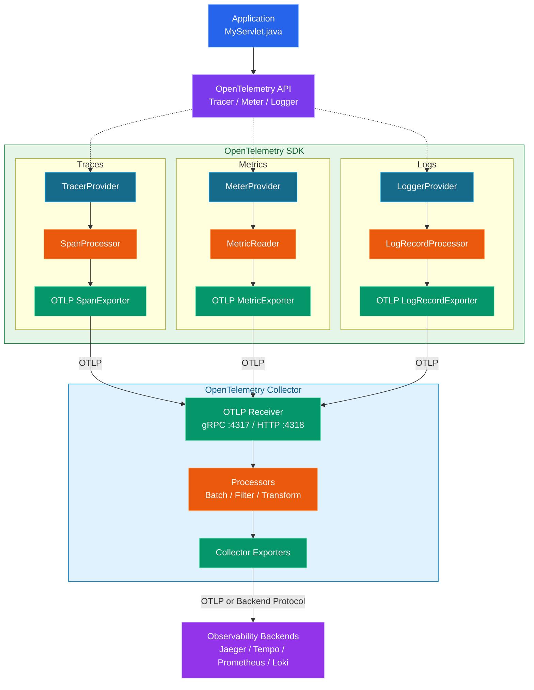
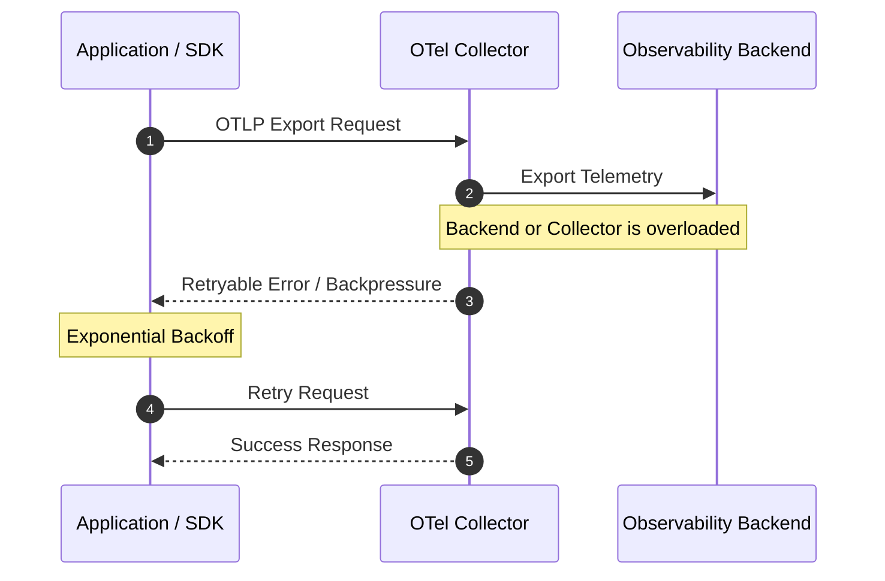
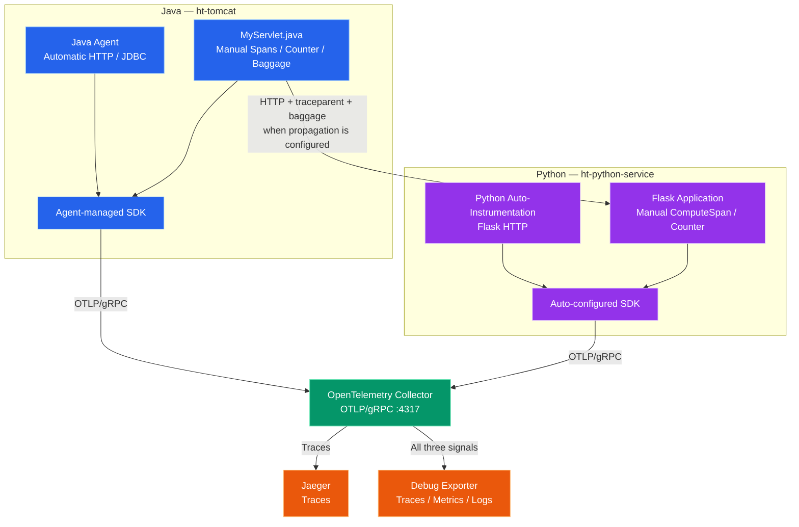
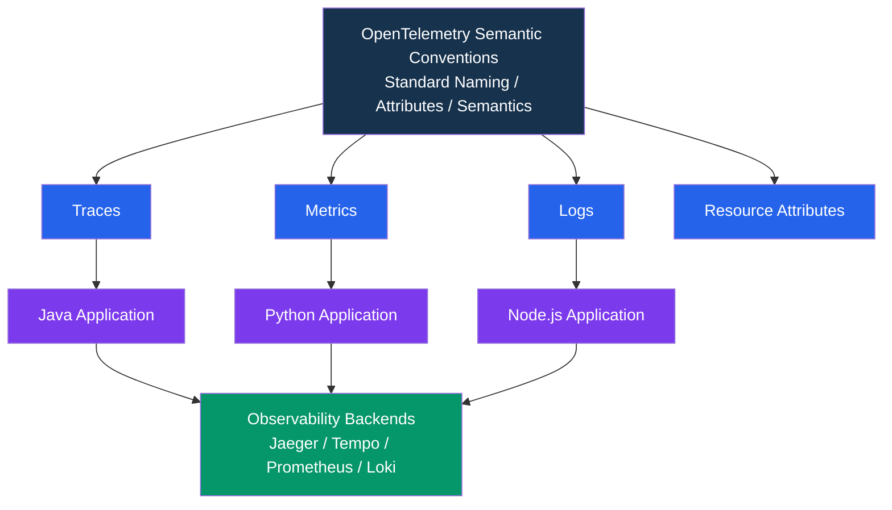

# OTLP — OpenTelemetry Protocol

## 1. References

- [OpenTelemetry OTLP Specification](https://opentelemetry.io/docs/specs/otlp/)
- [OTLP Design Goals](https://github.com/open-telemetry/opentelemetry-proto/blob/main/docs/design-goals.md)

## 2. What Is OTLP?

**OTLP（OpenTelemetry Protocol）** 是 OpenTelemetry 用於傳輸 Telemetry Data 的標準通訊協定。

主要功能：

- **Encoding**：定義 Telemetry Data 的編碼格式。
- **Transport**：支援 gRPC 與 HTTP。
- **Delivery**：定義 Request / Response、Error Handling、Retry 與 Backpressure。
- **Telemetry Signals**：傳輸 Traces、Metrics、Logs；Profiles 的支援依規格成熟度與實作版本而定。

**Key Point:** OTLP 是資料傳輸協定，不是 OpenTelemetry SDK，也不是 OpenTelemetry Collector。

---

## 3. OTLP Design Goals

| Design Goal | Description |
|---|---|
| **Suitability** | 適用於 Applications、Agents、Collectors 和 Telemetry Backends |
| **High Reliability** | 追求可靠傳輸，並能辨識及處理傳輸失敗 |
| **Low CPU Usage** | 降低 Serialization / Deserialization 的 CPU 成本 |
| **Minimal Memory Pressure** | 降低資料處理及傳輸時的記憶體負擔 |
| **Efficient Data Handling** | 有效率地處理、轉換及轉送 Telemetry Data |
| **High Throughput** | 支援高流量及高延遲網路環境 |
| **Backpressure Signalling** | Server 可以通知 Client 降低傳輸速率 |
| **Load-balancer Friendly** | 支援透過 Load Balancer 分配 Telemetry Traffic |

**Important:** 以上是 OTLP 的 Design Goals，不代表所有實作都能保證零資料遺失、固定吞吐量或特定資源使用率。

## 4. OTLP Transport Standards

| Transport | Default Port | Encoding | Protocol |
|---|---|---|---|
| **OTLP/gRPC** | `4317` | Protocol Buffers | gRPC |
| **OTLP/HTTP** | `4318` | Binary Protobuf / JSON Protobuf | HTTP/1.1 或 HTTP/2 |

### 4.1 OTLP/HTTP Endpoints

| Signal | Default Endpoint |
|---|---|
| Traces | `/v1/traces` |
| Metrics | `/v1/metrics` |
| Logs | `/v1/logs` |

- **OTLP/gRPC**：使用 gRPC Unary Requests 傳輸 Telemetry。
- **OTLP/HTTP**：使用 HTTP POST 傳輸 Telemetry。
- **OTLP/HTTP Protobuf**：使用 Binary Protocol Buffers。
- **OTLP/HTTP JSON**：使用符合 Protobuf JSON Mapping 的資料格式。

**Important:** `4317` 和 `4318` 是預設 Port，可以依部署環境調整。

---

## 5. OpenTelemetry Architecture — API, SDK, Exporter and Collector

正確的整體流程：

**Application → OpenTelemetry API → SDK → Exporter → Collector → Backend**

其中，**Exporter 是 SDK Pipeline 的一部分，不屬於 API。**

### 5.1 Complete Architecture



這是邏輯架構圖。API 呼叫由對應的 SDK Provider 實作處理；實際 Telemetry 由 Tracer、Meter Instruments、Logger 等產生。

### 5.2 Component Responsibilities

| Component | Responsibility |
|---|---|
| **Application** | 執行 Business Logic，使用 OTel API |
| **OpenTelemetry API** | 提供 Tracer、Meter、Logger 等介面 |
| **OpenTelemetry SDK** | 實作 API，管理 Telemetry Recording、Processing 和 Export |
| **Provider** | 建立及管理 Tracer、Meter、Logger |
| **Processor / Reader** | 處理 Spans、Logs，或定期收集 Metrics |
| **Exporter** | 將 Telemetry 傳送到 Collector 或 Backend |
| **Collector Receiver** | 接收 Telemetry Data |
| **Collector Processors** | Batch、Filter、Transform 等資料處理 |
| **Collector Exporters** | 將 Telemetry 轉送至 Backend |
| **Observability Backend** | 儲存、查詢及分析 Telemetry |

**Important:** Collector → Backend 不一定使用 OTLP，也可以使用 Backend 支援的其他協定。

---

## 6. OTLP Reliability and Delivery

OTLP 透過 Request / Response 機制回報接收結果，並定義錯誤與重試處理方式。

### 6.1 Delivery Mechanisms

| Mechanism | Description |
|---|---|
| **Acknowledgement** | Server 回應資料接收結果 |
| **Retry** | 對可重試的暫時性錯誤重新傳送 |
| **Exponential Backoff** | 逐步增加重試間隔，降低 Server 負載 |
| **Partial Success** | Server 可以接受部分資料並回報拒絕數量 |
| **Backpressure** | 接收端可透過錯誤回應及重試提示要求 Client 放慢傳送 |

### 6.2 OTLP/HTTP Retryable Status Codes

| HTTP Status | Meaning | Retry |
|---|---|---|
| `429` | Too Many Requests | Yes |
| `502` | Bad Gateway | Yes |
| `503` | Service Unavailable | Yes |
| `504` | Gateway Timeout | Yes |
| `400` | Bad Request | No |

Client 應依 OTLP Specification 的 Retry Policy 處理，不應將所有 HTTP 5xx 都直接視為可重試。

### 6.3 Partial Success

例如：

- Client 傳送 1,000 個 Spans。
- Server 接受 900 個。
- Server 拒絕 100 個。

Server 可以回傳 Partial Success，指出被拒絕的資料數量。

**Important:** Client 不應因 Partial Success 而直接重試整個 Request，避免重複傳送已接受的 Telemetry。

---

## 7. OTLP Backpressure

**Backpressure（背壓）** 是指接收端處理能力不足時，通知發送端降低傳輸速率或稍後重試。

### 7.1 gRPC Backpressure

- Server 可以回傳 `UNAVAILABLE`。
- 可以透過 `RetryInfo` 指示建議重試時間。
- Client 依 Retry Policy 使用 Backoff。

### 7.2 HTTP Backpressure

- Server 可以回傳 `429` 或 `503`。
- 可以透過 `Retry-After` Header 提供重試建議。
- Client 應依 Retry Policy 調整重新傳送的時間。

### 7.3 Backpressure Architecture



**Key Point:** Backpressure 旨在降低過載風險，但並不保證 Telemetry 永遠不會遺失。

---

## 8. OTLP Delivery Limitations

OTLP 的 Acknowledgement 主要反映相鄰 Client / Server 之間的資料接收狀態。

- 不保證 Application → Collector → Backend 的完整 End-to-End Delivery。
- Network Failure 與 Retry 可能造成 Duplicate Telemetry。
- Collector 接收資料不代表 Backend 已完成持久化。
- Client 或 Collector 可能因 Queue 滿載、記憶體不足或故障而遺失資料。
- 對可靠性要求較高的環境，應評估 Sending Queue、Retry、Persistent Storage 和 Monitoring。

**High Reliability ≠ Guaranteed Delivery**

---

## 9. MyServlet.java — Real-World Example

你目前的 Java Application 使用：

**Zero-code Instrumentation + Code-based Instrumentation + Agent-managed SDK**

### 9.1 Application Code

```java
OpenTelemetry openTelemetry = GlobalOpenTelemetry.get();
Tracer tracer = openTelemetry.getTracer("MyServlet");
Meter meter = openTelemetry.getMeter("MyServlet");
```

這是 Application 使用 OpenTelemetry API。

**Java Agent** 負責 SDK Initialization、Providers、Processors、Readers 和 Exporters。

因此，`MyServlet.java` 不需要自行呼叫：

```java
OpenTelemetrySdk.builder()
    .setTracerProvider(...)
    .setMeterProvider(...)
    .setLoggerProvider(...)
    .build();
```

### 9.2 SDK Autoconfigure — Java and Python

Java 與 Python 都可以透過標準 `OTEL_*` Environment Variables 使用 **OTLP/gRPC Port 4317**，但啟動 Auto-Instrumentation 的方式不同。

| Configuration           | Java Agent — `ht-tomcat`                | Python — `ht-python-service`                        |
| ----------------------- | ------------------------------------------ | ------------------------------------------------------ |
| SDK 初始化              | Java Agent 啟動時自動配置                  | `opentelemetry-instrument` 啟動時自動配置            |
| Service Name            | `ht-tomcat`                              | `ht-python-service`                                  |
| OTLP Protocol / Port    | `grpc` / `4317`                        | `grpc` / `4317`                                    |
| Traces / Metrics / Logs | `otlp`                                   | `otlp`（需安裝相應套件）                             |
| Context Propagation     | `tracecontext,baggage`                   | `tracecontext,baggage`                               |
| Log correlation         | 依 Java Logging Instrumentation / Appender | `OTEL_PYTHON_LOG_CORRELATION=true`（需配合日誌格式） |

#### 9.2.1 Java — `docker-compose.yaml`

```yaml
services:
  ht-tomcat:
    environment:
      JAVA_TOOL_OPTIONS: "-javaagent:/opt/opentelemetry-javaagent.jar"
      OTEL_SERVICE_NAME: "ht-tomcat"
      OTEL_EXPORTER_OTLP_ENDPOINT: "http://ht-otel-collector:4317"
      OTEL_EXPORTER_OTLP_PROTOCOL: "grpc"
      OTEL_TRACES_EXPORTER: "otlp"
      OTEL_METRICS_EXPORTER: "otlp"
      OTEL_LOGS_EXPORTER: "otlp"
      OTEL_PROPAGATORS: "tracecontext,baggage"
```

以上設定由 **Java Agent + SDK Autoconfigure** 使用；`MyServlet.java` 使用 `GlobalOpenTelemetry.get()` 取得已註冊的 OTel API，不再自行建立 SDK Providers / Exporters。Java Agent JAR 必須實際存在於 Container 中。

#### 9.2.2 Python — `Dockerfile`

```dockerfile
# Python SDK / Auto-Instrumentation environment
ENV OTEL_SERVICE_NAME=ht-python-service
ENV OTEL_EXPORTER_OTLP_ENDPOINT=http://ht-otel-collector:4317
ENV OTEL_EXPORTER_OTLP_PROTOCOL=grpc
ENV OTEL_TRACES_EXPORTER=otlp
ENV OTEL_METRICS_EXPORTER=otlp
ENV OTEL_LOGS_EXPORTER=otlp
ENV OTEL_PROPAGATORS=tracecontext,baggage
# Inject tracing identifiers into Python LogRecord, if supported/configured
ENV OTEL_PYTHON_LOG_CORRELATION=true
```

**重要：** Dockerfile 的 `ENV` 僅設定參數，**不會單獨啟動 Auto-Instrumentation**。Python Image 必須先安裝 `opentelemetry-distro`、適用的 OTLP Exporter、Flask Instrumentation 等相容套件，並使用下列啟動方式（假設入口為 `app.py`）：

```dockerfile
# After installing application dependencies, e.g. Flask
RUN pip install opentelemetry-distro opentelemetry-exporter-otlp \
    && opentelemetry-bootstrap -a install
CMD ["opentelemetry-instrument", "python", "app.py"]
```

**Python Logging 注意事項：**

- `OTEL_PYTHON_LOG_CORRELATION=true` 用於 Logging Correlation / Formatting，不等於保證 OTel Logs 已被匯出。
- 若使用自動建立的 OTel Logging Handler，**不要再另外手動新增另一個 `LoggingHandler`**；否則同一筆 Log 可能重複匯出。
- `OTEL_PYTHON_LOG_AUTO_INSTRUMENTATION` 等特定開關的支援與預設值依 Python OTel Instrumentation 版本而異；本範例不強制設定，應以實際版本確認。
- 建議在 Python 執行中確認 `baggage.get_all()`、Trace ID / Span ID 關聯以及 Collector Logs，不能只憑環境變數推定功能已生效。

### 9.3 Java → Python Telemetry Flow



兩個 Application 可以使用相同的 Collector、Protocol 與 Port，但必須各自設定 `OTEL_SERVICE_NAME`，並確認 Java HTTP Client 與 Python Flask 的 Instrumentation 已啟用。跨服務 Baggage 仍需由 Application 建立及傳遞；它不會自動成為 Metrics / Logs / Span Attributes。

### 9.4 Current Collector Pipelines

| Signal | Collector Pipeline | Destination |
|---|---|---|
| **Traces** | OTLP Receiver → Batch Processor | Jaeger + Debug |
| **Metrics** | OTLP Receiver → Batch Processor | Debug |
| **Logs** | OTLP Receiver → Batch Processor | Debug |

這符合目前 Learning / PoC 的需求。

**Note:** Metrics 和 Logs 目前沒有持久化 Backend。Collector Debug Exporter 主要用於驗證資料是否成功接收及處理。

---

## 10. Key Takeaways

| Concept | Key Point |
|---|---|
| **OTLP** | Standard Telemetry Transport Protocol |
| **OTLP/gRPC** | Default Port `4317` |
| **OTLP/HTTP** | Default Port `4318` |
| **Protobuf** | Telemetry Data Encoding |
| **API** | 定義 Telemetry 操作介面 |
| **SDK** | 實際 Recording、Processing 和 Export |
| **Exporter** | 將 Telemetry 送往 Collector 或 Backend |
| **Collector** | Receive、Process、Export |
| **Reliability** | Retry、Backoff、Partial Success |
| **Backpressure** | 避免接收端持續過載 |
| **Backend Flexibility** | 可以替換 Jaeger、Tempo 等 Backends |

## 11. Conclusion

OpenTelemetry 的整體資料流程：

**Application → OTel API → SDK → OTLP Exporter → Collector → Observability Backend**

其中：

- **API**：定義及操作 Telemetry Instruments。
- **SDK**：實作 API，記錄、處理及匯出 Telemetry。
- **Exporter**：屬於 SDK Pipeline，負責資料傳輸。
- **OTLP**：定義 Telemetry 的標準通訊協定。
- **Collector**：接收、處理及路由 Telemetry。
- **Backend**：儲存、查詢和分析 Telemetry。

**OTLP 的核心價值是提供標準化、可互通且具備錯誤處理與流量控制能力的 Telemetry Transport Protocol，協助實現 Vendor-neutral Observability Architecture。**

---

# OpenTelemetry Semantic Conventions（語意規範）

## 1. Main Reference

- **OpenTelemetry Semantic Conventions（官方主規範）**
  - https://opentelemetry.io/docs/specs/semconv/

Semantic Conventions 定義 OpenTelemetry Telemetry Data 的標準化命名與語意，讓不同 Applications、Programming Languages、Instrumentation Libraries 和 Observability Backends 能一致地理解資料。

## 2. What Are Semantic Conventions?

**Semantic Conventions = Standardized Naming + Attributes + Data Types + Semantics**

主要目的：

- **Consistency**：統一 Telemetry 的命名與資料格式。
- **Interoperability**：讓不同語言與系統產生的 Telemetry 能互相理解。
- **Standardization**：規範 Attributes、Span Names、Metric Names 等。
- **Observability**：方便跨服務進行 Traces、Metrics 和 Logs 分析。

例如 HTTP Request 可以使用標準 Attributes：

- `http.request.method`
- `http.response.status_code`
- `http.route`

## 3. Semantic Conventions Architecture



此圖為概念架構。Semantic Conventions 是規範，不是獨立執行或傳送 Telemetry 的元件。

## 4. Examples of Semantic Conventions

以下三份文件是 Semantic Conventions 在不同技術領域中的應用範例，**不是三個獨立的主規範**。

| Example | Official Reference | Description |
|---|---|---|
| **General Trace** | [Trace Semantic Conventions](https://opentelemetry.io/docs/specs/semconv/general/trace/) | 通用 Span 命名與 Trace Attributes |
| **Database Spans** | [Database Span Conventions](https://opentelemetry.io/docs/specs/semconv/db/database-spans/) | Database Client Operations，例如 JDBC、MySQL |
| **RPC Spans** | [RPC Span Conventions](https://opentelemetry.io/docs/specs/semconv/rpc/rpc-spans/) | RPC Client / Server Operations，例如 gRPC |

這三項只是官方 Semantic Conventions 中的部分範例，並非完整規範範圍。

## 5. Real-World Example — MyServlet.java

目前架構：

`Java Servlet → MySQL → Python Flask`

| Operation | Semantic Convention | Example |
|---|---|---|
| Java HTTP GET | HTTP | `http.request.method=GET` |
| MySQL JDBC Query | Database | `db.system.name=mysql` |
| Java → Python HTTP POST | HTTP | `http.request.method=POST` |
| gRPC Service Call（若有） | RPC | `rpc.system.name=grpc` |

你的 Java Agent 可以透過 Auto-Instrumentation，為受支援的 HTTP、JDBC 等操作自動產生標準 Attributes。

手動建立的 `ComputeRequest` 等 Business Spans，則可以使用經核准的自訂 Business Attributes。

**Important:** 目前 Java → Python 使用 HTTP，因此應參考 HTTP Semantic Conventions；不應因為是跨服務呼叫就一律使用 RPC Semantic Conventions。

## 6. Key Takeaways

- **Semantic Conventions**：定義 Telemetry 的標準命名與語意。
- **Main Reference**：OpenTelemetry Semantic Conventions 官方總覽。
- **General Trace / Database / RPC**：不同技術領域的應用範例。
- **Auto-Instrumentation**：可以依相應規範自動產生標準 Attributes。
- **Manual Instrumentation**：可補充標準 Attributes 與自訂 Business Attributes。

**Conclusion:** Semantic Conventions 讓不同技術、語言與服務產生的 Telemetry 使用一致的命名及語意，提升 Observability Data 的一致性、可查詢性與互通性。

---
# **Semantic Conventions — Audience（適用對象）**

## **Must（必須遵循）**

- **OpenTelemetry SDK Maintainers**：OpenTelemetry SDK 維護者
- **Instrumentation Library Authors**：自動埋點函式庫開發者

## **Strongly Encouraged（強烈建議遵循）**

- **Application Developers**：應用程式開發者
- **Observability Experts**：可觀測性專家
- **SREs（Site Reliability Engineers）**：網站可靠性工程師

---
