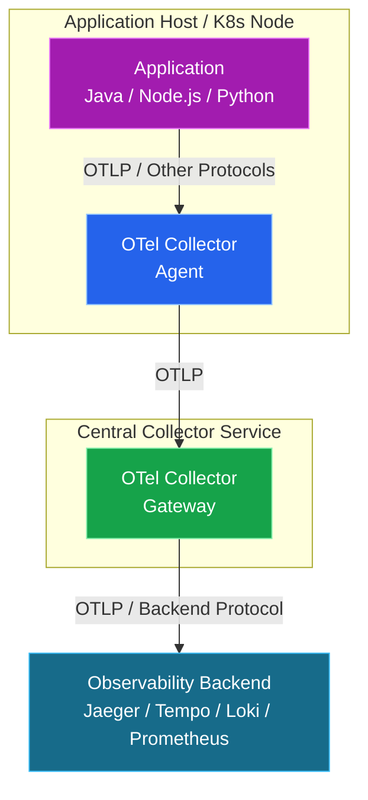
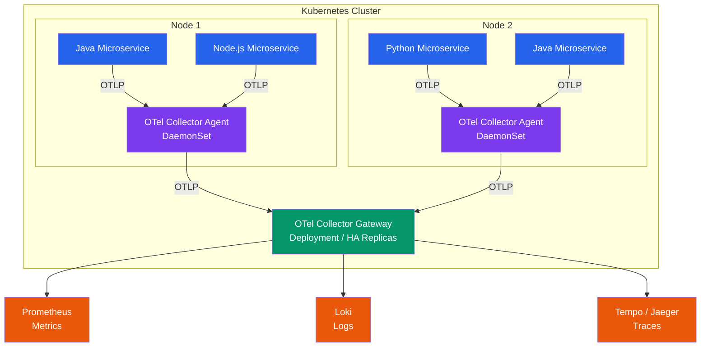
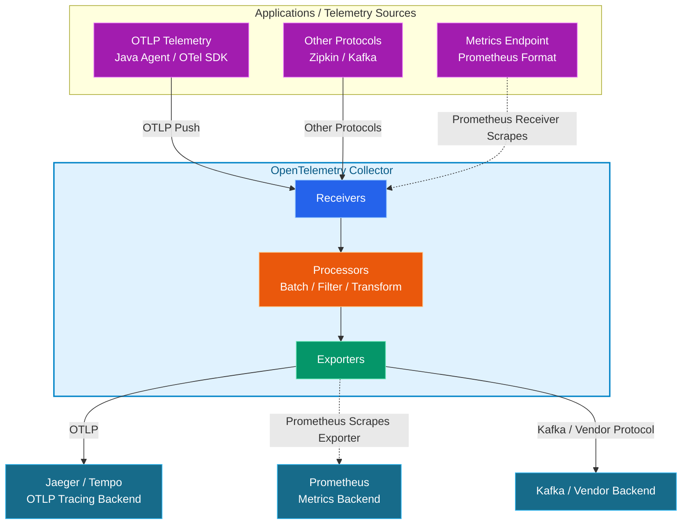
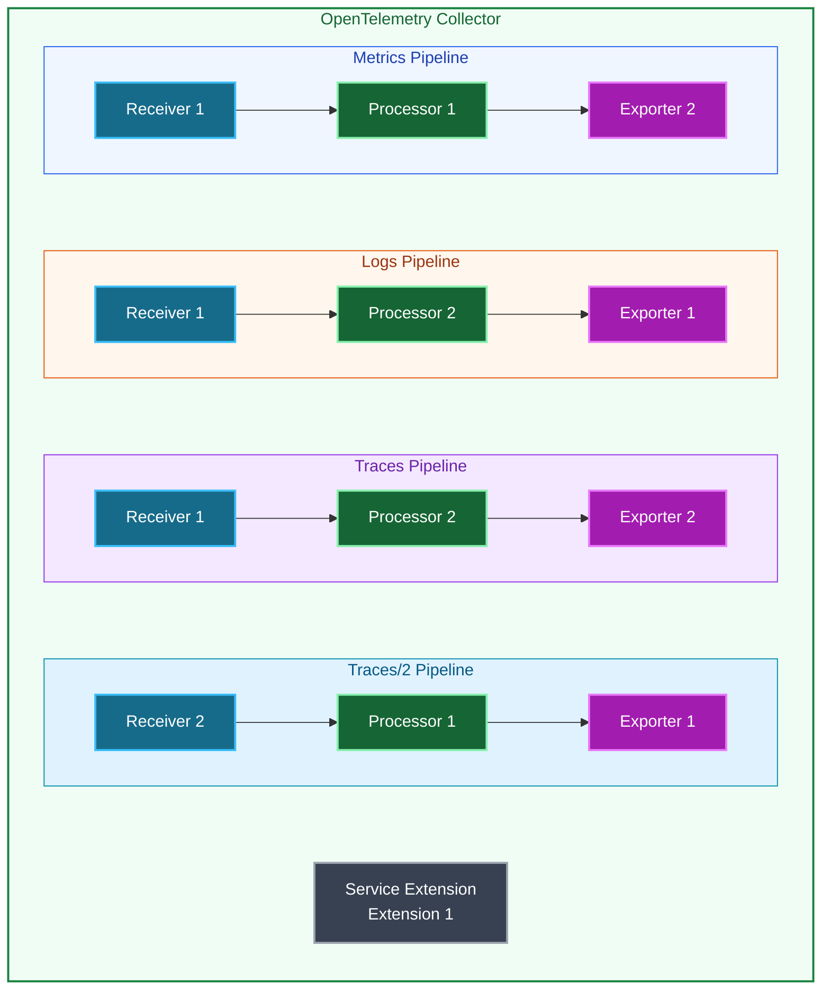
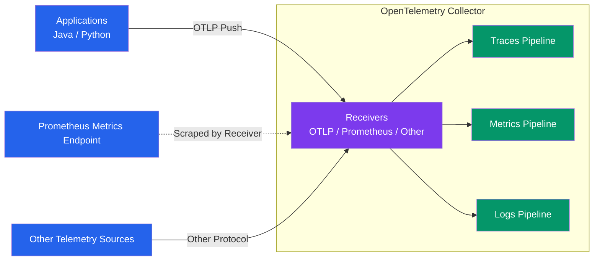
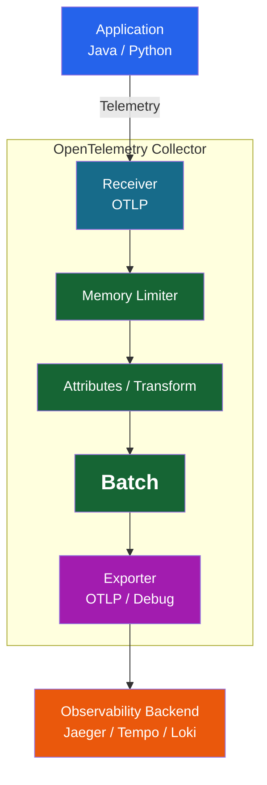
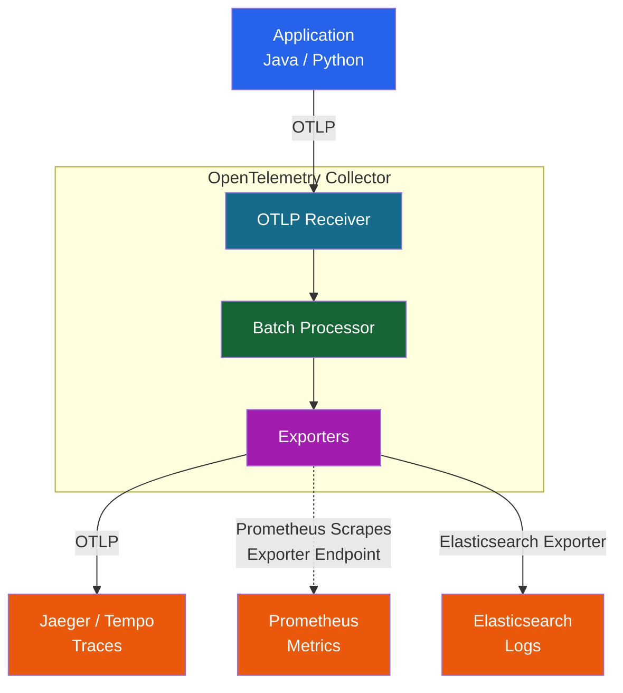
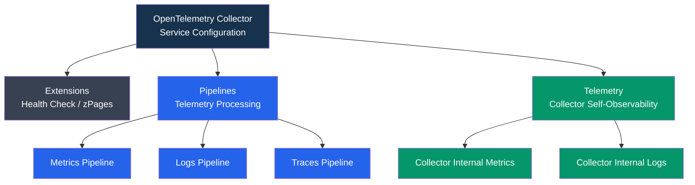
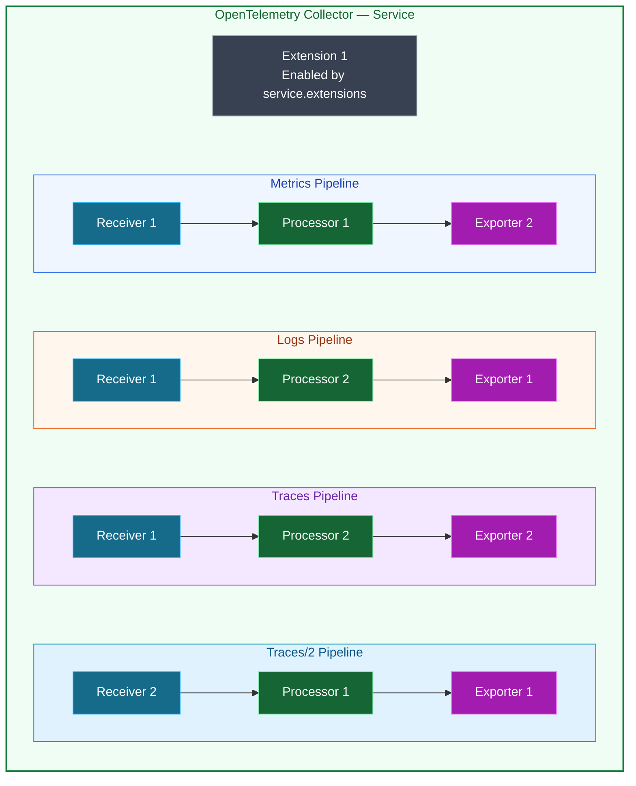
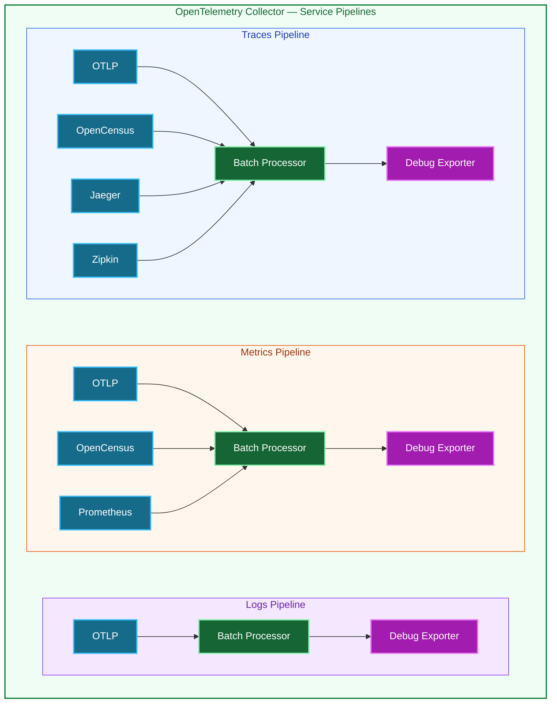

# OpenTelemetry Collector 

> Agent + Gateway Deployment Pattern，是**企業級 Observability 常見且值得推薦的架構。**

但要區分：

**Agent + Gateway 是一種 Best Practice，不代表所有 OpenTelemetry 部署都必須同時使用 Agent 和 Gateway。**

對你的 **Kubernetes + Java / Node.js / Python Microservices**，是否需要兩層 Collector，取決於 Logs 收集、流量規模、集中治理及 High Availability 等需求。

## **1. 圖中的架構代表甚麼？**



| Component                       | Responsibility                                    |
| ------------------------------- | ------------------------------------------------- |
| **Application**           | 產生 Metrics、Logs、Traces                        |
| **Collector Agent**       | 在 Application Host / K8s Node 附近收集 Telemetry |
| **Collector Gateway**     | 集中處理、過濾、批次化、路由與匯出                |
| **Observability Backend** | 儲存、查詢及分析 Telemetry                        |

這種設計有一個重要優勢：**Application 不需要直接連接各個 Observability Vendors，而是透過 Collector 統一處理 Telemetry。**

## **2. Agent vs Gateway — 主要責任分工**

| Comparison             | Collector Agent             | Collector Gateway         |
| ---------------------- | --------------------------- | ------------------------- |
| Deployment             | Kubernetes DaemonSet / Host | Kubernetes Deployment     |
| Location               | 每個 Node / Host            | Cluster 中央服務          |
| OTLP Receiver          | ✅                          | ✅                        |
| Container Logs         | ✅ 適合收集                 | 通常不直接讀取 Node Logs  |
| Host Metrics           | ✅                          | 通常不負責                |
| Kubernetes Metadata    | ✅                          | ✅                        |
| Memory Limiter         | ✅                          | ✅                        |
| Batch Processing       | ✅                          | ✅                        |
| Tail Sampling          | 通常**不建議**                  | ✅ 推薦                   |
| Centralized Filtering  | 可做                        | ✅ 推薦                   |
| Backend Authentication | 通常不需要                  | ✅ 集中管理               |
| Horizontal Scaling     | DaemonSet 隨 Nodes 增長     | Deployment Replicas / HPA |

OpenTelemetry 官方的 [Agent-to-Gateway Deployment Pattern](https://opentelemetry.io/docs/collector/deploy/other/agent-to-gateway/?utm_source=chatgpt.com) 也明確介紹這種分層架構，尤其適合集中處理、網路隔離與大規模成本控制。

## **3. Kubernetes 的兩種實際方案**

**方案 A — Gateway-only**

Application 直接透過 OTLP 傳送資料到中央 Collector Gateway。架構簡單、資源使用較少，適合 Docker Desktop Kubernetes、PoC 或**小型 Cluster**。

**方案 B — Agent + Gateway**

每個 Kubernetes Node 執行 Collector Agent（DaemonSet），集中 Gateway 負責處理和匯出。適合**正式企業部署**、Container Logs、Node Metrics、集中治理及更高資料量。

## **4. 對你的環境，我建議怎麼部署？**

| Environment                                | Recommendation                                    |
| ------------------------------------------ | ------------------------------------------------- |
| **Docker Desktop Kubernetes**        | Gateway-only（先採用）                            |
| **Development / UAT**                | Gateway-only 或 Agent + Gateway，依 Logs 收集需求 |
| **Production Banking Microservices** | Agent + Gateway（建議評估）                       |
| **Large Multi-node Kubernetes**      | Agent DaemonSet + HA Gateway                      |

對 Production，我建議將 Collector Gateway 配置為多副本，並考慮 Exporter Queue、Retry、Memory Limiter、TLS 與適當的 Resource Limits。

### **Tail Sampling 需要特別注意**

你之前討論的 **Tail Sampling** 非常適合放在 Gateway 層，但必須確保：

**同一條 Trace 的所有 Spans 都被送到同一個 Tail Sampling Gateway Instance。**

如果 Gateway 有多個 Replicas，不能只依賴一般 Round-robin Load Balancing；需要透過 Trace ID 路由，或採用能確保 Trace Affinity 的設計。

## **5. 最終結論**

**這張圖展示的是正確且成熟的 Agent + Gateway Architecture，也是 OpenTelemetry 官方推薦的部署模式之一。**

對你的需求，我建議：

**現在：** Docker Desktop + Java / Python Services → Single Collector Gateway → Jaeger / Debug。

**未來 Production：** Java / Python Services → Node-local Collector Agents → Central Collector Gateways → Prometheus / Loki / Tempo。

當你需要集中處理 **Tail Sampling、Sensitive Data Filtering、Logs、Metrics、Traces 和 Backend Routing** 時，Agent + Gateway 的優勢就會更明顯。

但如果目前的單一 Collector 已經能滿足需求，**不需要為了符合這張圖而強制增加 Agent 層。**

---
# 多個 Microservices、部署在多個 Kubernetes Nodes 的環境，

> 建議優先評估 OpenTelemetry Collector 的 Agent + Gateway 架構。**

但重點不是 Microservices 的數量，而是 **Node 數量、Telemetry 流量、Logs 收集方式、集中管理及高可用性需求**。

## **1. 推薦的 Kubernetes Architecture**



圖為邏輯架構。實際 Metrics 與 Logs Export 須使用對應的 Receiver / Exporter 或 Scrape 機制；Agent DaemonSet 的 OTLP 流量也必須正確路由到所在 Node 的 Agent。

## **2. 何時需要 Agent + Gateway？**

| 環境                                          | 建議                                          |
| ------------------------------------------- | ------------------------------------------- |
| 單一 Node、少量 Microservices                    | Gateway-only                                |
| 多 Nodes，但只有少量 OTLP Traces / Metrics         | Gateway-only 仍可使用                           |
| 多 Nodes，需要收集 Container Logs / Host Metrics  | **Agent + Gateway**                         |
| 多 Nodes、大量 Telemetry、集中 Filtering / Routing | **Agent + Gateway**                         |
| Production、需要 HA / Tail Sampling            | **Agent + HA Gateway**，並另外設計 Trace Affinity |

Agent 通常以 **DaemonSet** 部署，每個 Node 一個 Collector；Gateway 則以 **Deployment** 部署，可依需求擴展 Replicas。

## **3. 對你的 Banking Microservices 的具體建議**

對正式的多節點 Kubernetes，我建議：

**Application → Node-local OTel Agent → Central Gateway → Observability Backend**

其中有兩個重要設計原則：

- **Agent 負責就近收集**：Container Logs、Host Metrics、Application OTLP。
- **Gateway 負責集中處理**：Batch、Filter、Sensitive Data Protection、Tail Sampling、Exporters、Backend Authentication。

如果需要 Tail Sampling，應確保同一個 Trace ID 的所有 Spans 都送到同一個 Gateway Instance，不能只依賴一般 Round-robin。

**結論：多個 Microservices + 多個 K8s Nodes，Agent + Gateway 是很好的企業級部署選擇；但若目前只有少量 Telemetry、不收集 Node Logs，也沒有複雜處理需求，Gateway-only 仍然合理。**

官方參考：[OpenTelemetry Agent-to-Gateway Deployment Pattern](https://opentelemetry.io/docs/collector/deploy/other/agent-to-gateway/?utm_source=chatgpt.com)。

---

# OpenTelemetry Collector — Purpose, Functions & Protocols

## 1. Overview

**OpenTelemetry Collector** 是一個 Vendor-neutral Telemetry Processing Component，負責接收、處理及輸出 Telemetry Data。

其三個核心功能：

**Receive → Process → Export**

- **Receive**：接收 OTLP 或其他支援協定的 Telemetry。
- **Process**：批次處理、過濾及轉換 Telemetry。
- **Export**：將 Telemetry 傳送至 Observability Backends。

**Key Point:** OpenTelemetry Collector 不只支援 OTLP，也能透過不同的 Receivers 和 Exporters 整合其他協定與資料格式。

---

## 2. Collector Components

| Component | Responsibility | Examples |
|---|---|---|
| **Receiver** | 接收或主動收集 Telemetry Data | OTLP、Prometheus、Zipkin |
| **Processor** | 處理、過濾、轉換及批次化 Telemetry | Batch、Filter、Transform |
| **Exporter** | 將 Telemetry 輸出至 Backend，或提供 Endpoint 供擷取 | OTLP、Prometheus、Kafka、Vendor Exporters |

### Important

- **Receivers**：支援 Push 或 Pull，例如 OTLP Receiver 接收資料，而 Prometheus Receiver 主動 Scrape Metrics。
- **Processors**：執行 Batch、Filter、Transform 等操作。
- **Exporters**：可以 Push Telemetry，也可以暴露 Metrics Endpoint 供外部系統 Scrape。

實際支援的 Components 取決於 Collector Distribution 與版本。

## 3. Collector Architecture



**Note:** 圖中的連線為邏輯資料流。Prometheus Receiver 主動 Scrape Metrics Endpoint；Prometheus Server 則主動 Scrape Collector 的 Prometheus Exporter Endpoint。

---

## 4. OTLP vs Other Protocols

圖中的 **Other** 代表 OTLP 以外的協定或資料格式，例如 Prometheus、Zipkin、Kafka，以及部分 Legacy Jaeger Protocols。

| Protocol / Format | Collector Receiver | Collector Exporter |
|---|---|---|
| **OTLP** | 接收 OTLP Traces、Metrics、Logs | 使用 OTLP 傳送 Telemetry |
| **Prometheus** | 主動 Scrape Metrics Endpoint | 暴露 Metrics Endpoint 供 Prometheus Scrape |
| **Jaeger Legacy Protocol** | 部分 Collector Distribution / 版本可接收傳統 Jaeger Traces | 現代 Jaeger 通常使用 OTLP |
| **Zipkin** | 接收 Zipkin 格式的 Traces | 依 Collector Distribution 支援對應 Exporter |
| **Kafka** | 從 Kafka Topics 接收 Telemetry | 將 Telemetry 輸出到 Kafka Topics |

### 4.1 Prometheus

Prometheus 通常使用 **Pull / Scrape Model**：

```text id="jjb8uy"
Application /metrics
        ↑
Prometheus Receiver
        ↓
OpenTelemetry Collector
        ↓
Prometheus Exporter /metrics
        ↑
Prometheus Server
```

**Important:** Collector 的 Prometheus Exporter 通常不會主動 Push Metrics 到 Prometheus Server。

### 4.2 Jaeger

Jaeger 的整合方式取決於版本和協定：

- **Legacy Jaeger Protocol**：屬於 OTLP 以外的 Other Protocols。
- **Jaeger 2.x**：可直接接收 OTLP Traces。

因此，你目前的 Jaeger 2.x 可以透過 Collector 的 **OTLP Exporter** 接收 Traces，不需要使用傳統 Jaeger Protocol。

---

## 5. Real-World Example — MyServlet.java

你的 Java Application 使用：

**Zero-code + Code-based Instrumentation + Agent-managed SDK**

### 5.1 Current Architecture

```text id="m8i04i"
MyServlet.java
    ↓
OpenTelemetry API
    ↓
Java Agent-managed SDK
    ↓
OTLP/gRPC :4317
    ↓
OpenTelemetry Collector
    ├── Traces → Jaeger + Debug
    ├── Metrics → Debug
    └── Logs → Debug
```

### 5.2 Current Docker Compose Configuration

```yaml id="l93pk8"
OTEL_SERVICE_NAME: "ht-tomcat"

OTEL_EXPORTER_OTLP_ENDPOINT: "http://ht-otel-collector:4317"
OTEL_EXPORTER_OTLP_PROTOCOL: "grpc"

OTEL_TRACES_EXPORTER: "otlp"
OTEL_METRICS_EXPORTER: "otlp"
OTEL_LOGS_EXPORTER: "otlp"

OTEL_PROPAGATORS: "tracecontext,baggage"
```

### 5.3 Current Collector Pipelines

| Signal | Receiver | Processor | Exporter / Destination |
|---|---|---|---|
| **Traces** | OTLP | Batch | OTLP → Jaeger + Debug |
| **Metrics** | OTLP | Batch | Debug |
| **Logs** | OTLP | Batch | Debug |

上述設定符合你目前的 Learning / PoC 架構。

**Note:** Metrics 和 Logs 尚未配置長期儲存的 Backend，Collector Debug Exporter 僅適合驗證 Telemetry 是否成功接收及處理。

---

## 6. Collector vs OTLP

| Component | Definition |
|---|---|
| **OTLP** | OpenTelemetry 原生定義的標準 Telemetry Transport Protocol |
| **Collector** | 接收、處理及輸出 Telemetry 的獨立服務 |
| **Receiver** | 支援多種資料來源及協定 |
| **Processor** | Batch、Filter、Transform 等處理元件 |
| **Exporter** | 使用 OTLP 或其他協定將 Telemetry 傳送至 Backend |

**OTLP ≠ Collector**

OTLP 是通訊協定；Collector 是實際執行 Telemetry Processing 的元件。

## 7. Key Takeaways

- **Receive → Process → Export** 是 OpenTelemetry Collector 的核心 Pipeline。
- **OTLP** 是標準傳輸協定，但不是 Collector 唯一支援的協定。
- **Other Protocols** 可以包括 Prometheus Scrape、Zipkin、Kafka 及部分 Legacy Jaeger Protocols。
- **Prometheus** 通常使用 Pull / Scrape，而不是 OTLP Push。
- **Jaeger 2.x** 可以直接使用 OTLP 接收 Traces。
- **Collector** 支援多種 Backend，降低 Application 對特定 Vendor 的依賴。

## 8. Conclusion

**OpenTelemetry Collector 可以透過 Receivers、Processors 和 Exporters，接收 OTLP 或其他協定的 Telemetry，並輸出至不同 Observability Backends。**

核心架構：

**Application → OTel API → SDK → Exporter → Collector（Receive → Process → Export）→ Backend**

這體現了 OpenTelemetry 的三項重要特性：

**Vendor Neutrality + Composability + Backend Flexibility**

---

## References

- [OpenTelemetry Collector](https://opentelemetry.io/docs/collector/)
- [Collector Configuration](https://opentelemetry.io/docs/collector/configuration/)
- [OpenTelemetry Protocol（OTLP）](https://opentelemetry.io/docs/specs/otlp/)

---
## **OpenTelemetry Collector — Installation**

### **1. Collector Core**

- Essential and Core functionality
- More mature & stable
- Maintained by core OTel team
- GitHub: [https://github.com/open-telemetry/opentelemetry-collector](https://github.com/open-telemetry/opentelemetry-collector?utm_source=chatgpt.com)

### **2. Collector Contribution（Contrib）**

- Essential & Core + extended functionality
- **Community-contributed** Receivers, Processors, Exporters & Extensions
- More experimental features
- Maintained by Community
- GitHub: [https://github.com/open-telemetry/opentelemetry-collector-contrib](https://github.com/open-telemetry/opentelemetry-collector-contrib?utm_source=chatgpt.com)

### **Collector Core vs Contrib**

| Comparison             | Collector Core     | Collector Contrib    |
| ---------------------- | ------------------ | -------------------- |
| Essential Components   | ✅                  | ✅                    |
| Extended Components    | Limited            | Extensive            |
| Community Integrations | Limited            | Extensive            |
| Experimental Features  | Fewer              | More                 |
| Primary Focus          | Core functionality | Broader integrations |

**對你目前的環境：**

你使用的是：

```
image: otel/opentelemetry-collector-contrib:0.146.0
```

因此你已採用 **Collector Contrib**，可使用其打包提供的 Core Components 與更多社群整合元件。

**注意：** Contrib 不代表所有元件都不穩定；各個 Receiver、Processor、Exporter 的成熟度需要個別確認。

---

# Install Collector

- <https://opentelemetry.io/docs/collector/install/>
- <https://github.com/open-telemetry/opentelemetry-collector-releases/releases> => otelcol-contrib_0.165.0_windows_arm64.msi

Install `otelcol-contrib_0.165.0_windows_arm64.msi`

## Verify Installation

```bash
curl -sS -i --max-time 10 \
  -H 'Content-Type: application/json' \
  --data-raw '{"resourceLogs":[{"scopeLogs":[{"logRecords":[{"severityText":"INFO","body":{"stringValue":"otel-git-bash-smoke-test"}}]}]}]}' \
  http://127.0.0.1:4318/v1/logs

# HTTP/1.1 200 OK
# Content-Type: application/json
# Date: Tue, 24 Nov 2026 04:58:54 GMT
# Content-Length: 21

# {"partialSuccess":{}}

sc.exe query otelcol-contrib

# SERVICE_NAME: otelcol-contrib
#   TYPE               : 10  WIN32_OWN_PROCESS
#   STATE              : 4  RUNNING

cd '/c/Program Files/OpenTelemetry Collector'
./otelcol-contrib.exe validate --config=config.yaml
echo $?
# 0

curl -fsS http://127.0.0.1:13133/
curl -fsS http://127.0.0.1:8888/metrics | head -n 15

curl -fsS http://127.0.0.1:8888/metrics |   grep '^otelcol_receiver_accepted_metric_points{' |   grep 'receiver="prometheus"'
# otelcol_receiver_accepted_metric_points{receiver="prometheus",service_instance_id="d2fe1153-127f-4528-ae03-c7fa7f87f7ef",service_name="otelcol-contrib",service_version="0.165.0",transport="http"} 476

curl -fsS http://127.0.0.1:8888/metrics |   grep '^otelcol_receiver_accepted_metric_points{' |   grep 'receiver="prometheus"'
# otelcol_receiver_accepted_metric_points{receiver="prometheus",service_instance_id="d2fe1153-127f-4528-ae03-c7fa7f87f7ef",service_name="otelcol-contrib",service_version="0.165.0",transport="http"} 665
# Counter from 476 => 665

```

---

# OpenTelemetry Collector — Configuration, Extensions & Composability

## 1. Overview

OpenTelemetry Collector 透過不同的 **Receivers、Processors、Exporters 和 Extensions**，建立可配置、可擴充的 Telemetry Processing Architecture。

三個核心功能：

**Receive → Process → Export**

其中：

- **Receivers**：接收或收集 Telemetry Data。
- **Processors**：過濾、轉換或批次處理資料。
- **Exporters**：將資料輸出至 Observability Backends。
- **Extensions**：提供獨立於 Telemetry Pipelines 的管理與輔助功能。

這種將不同元件組合成多條 Pipelines 的能力，就是 **Collector Composability（可組合性）**。

## 2. Collector Configuration Structure

Collector 的 `config.yaml` 包含元件定義與啟用設定。

| Component | Defined In | Activated By | Purpose |
|---|---|---|---|
| **Receiver** | `receivers` | `service.pipelines` | 接收 Telemetry |
| **Processor** | `processors` | `service.pipelines` | 處理 Telemetry |
| **Exporter** | `exporters` | `service.pipelines` | 匯出 Telemetry |
| **Extension** | `extensions` | `service.extensions` | Collector 管理及輔助功能 |

**重要：**

- Receiver、Processor、Exporter 必須由相應的 `service.pipelines` 引用才能啟用。
- Extension 必須在 `service.extensions` 中引用才能啟用。
- Extension 不屬於 Metrics、Logs 或 Traces Pipeline。

## 3. Collector Composability

Collector Composability 是指可以依照 Telemetry Signal、資料來源及輸出需求，靈活組合及重用不同的元件配置。

| Component | Composability | Examples |
|---|---|---|
| **Receiver** | 選擇不同來源與協定 | OTLP、Prometheus、Zipkin |
| **Processor** | 組合不同資料處理功能 | Batch、Filter、Transform |
| **Exporter** | 選擇不同輸出方式 | OTLP、Kafka、Prometheus |
| **Pipeline** | 使用不同的元件組合處理各種 Signals | Metrics、Logs、Traces、Traces/2 |
| **Extension** | 獨立啟用 Collector 管理功能 | Health Check、pprof、zPages |

**Key Point:** 多條 Pipelines 可以引用相同的元件定義，但各自具有獨立的 Pipeline Configuration。

## 4. Multiple Pipelines Configuration

以下是原始架構圖中的四條 Pipelines：

| Pipeline | Receiver | Processor | Exporter |
|---|---|---|---|
| **Metrics** | Receiver 1 | Processor 1 | Exporter 2 |
| **Logs** | Receiver 1 | Processor 2 | Exporter 1 |
| **Traces** | Receiver 1 | Processor 2 | Exporter 2 |
| **Traces/2** | Receiver 2 | Processor 1 | Exporter 1 |

同時啟用 `Extension 1`，提供獨立的 Collector 管理功能。

### 4.1 Multiple Pipelines — Mermaid Architecture



**Note:** `~~~` 是 Mermaid 的 Invisible Link，主要用於協助控制排版，不代表實際 Telemetry Data Flow。

### 4.2 Key Observations

- 同一個 Receiver 可以被多條相容的 Pipelines 引用。
- 同一個 Processor 或 Exporter 可以被多條相容的 Pipelines 引用。
- 同一種 Signal 可以建立多條 Pipelines。
- 不同 Pipelines 可以配置不同的 Processors 和 Exporters。

例如：

`traces` 和 `traces/2` 都處理 Traces，但可以使用不同的 Receivers、Processors 和 Exporters。

其中，`traces/2` 是第二個 Traces Pipeline 的識別名稱，並不是新的 Telemetry Signal。

## 5. Collector Extensions

Extensions 用於提供 Collector 的管理、診斷與輔助功能，通常不直接參與 Telemetry Data Pipeline。

### 5.1 Common Extensions

| Extension | Purpose |
|---|---|
| `health_check` | 提供 Collector Health Check Endpoint |
| `pprof` | 提供 Collector CPU / Memory Profiling |
| `zpages` | 提供 Collector 內部診斷頁面 |

### 5.2 Extension Configuration Example

```yaml
extensions:
  health_check:
    endpoint: 0.0.0.0:13133

service:
  extensions: [health_check]
```

**Important:** 定義 `health_check` 並不代表自動啟用，仍需要在 `service.extensions` 中引用。

另外，Extension 的可用性取決於 Collector Distribution 及版本。

## 6. Real-World Example — MyServlet.java

你目前的 OpenTelemetry Collector 配置包括：

- OTLP Receiver
- Batch Processor
- Debug Exporter
- OTLP Exporter（Jaeger）
- Traces / Metrics / Logs Pipelines

### 6.1 Current Collector Pipelines

| Signal | Receiver | Processor | Exporter |
|---|---|---|---|
| **Traces** | OTLP | Batch | OTLP → Jaeger + Debug |
| **Metrics** | OTLP | Batch | Debug |
| **Logs** | OTLP | Batch | Debug |

### 6.2 Current Collector Configuration

```yaml
receivers:
  otlp:
    protocols:
      grpc:
        endpoint: 0.0.0.0:4317
      http:
        endpoint: 0.0.0.0:4318

processors:
  batch: {}

exporters:
  debug:
    verbosity: detailed

  otlp:
    endpoint: ht-jaeger:4317
    tls:
      insecure: true

service:
  pipelines:
    traces:
      receivers: [otlp]
      processors: [batch]
      exporters: [debug, otlp]

    metrics:
      receivers: [otlp]
      processors: [batch]
      exporters: [debug]

    logs:
      receivers: [otlp]
      processors: [batch]
      exporters: [debug]
```

目前只有 Traces 匯出到 Jaeger，Metrics 和 Logs 則使用 Debug Exporter。

**Note:** Debug Exporter 主要適合 Learning / PoC，不提供 Metrics 或 Logs 的長期儲存能力。

### 6.3 Add Health Check Extension

如果希望啟用 Docker Compose 中已映射的 `13133` Health Check Port，可以加入：

```yaml
extensions:
  health_check:
    endpoint: 0.0.0.0:13133

service:
  extensions: [health_check]
  pipelines:
    # Existing traces / metrics / logs pipelines
```

這只是展示新增的配置片段；實際修改時應與原有 `service.pipelines` 合併，而不是覆蓋既有 Pipelines。

## 7. Collector vs SDK Composability

OpenTelemetry 的 Composability 不只存在於 Collector，也存在於 Instrumentation、SDK 和 Backend Integration。

| Type | Description | Example |
|---|---|---|
| **Instrumentation Composability** | 組合不同 Instrumentation Methods | Zero-code + Code-based |
| **SDK Composability** | 組合 SDK Providers、Processors / Readers、Exporters | BatchSpanProcessor + OTLP Exporter |
| **Collector Composability** | 組合 Receivers、Processors、Exporters 和多條 Pipelines | Metrics、Logs、Traces、Traces/2 |
| **Backend Flexibility** | 更換或整合不同 Observability Backends | Jaeger ↔ Tempo |

### Important Differences

**SDK Composability**

- 發生於 Application Runtime / SDK。
- 控制 Telemetry Recording、Processing、Export。

**Collector Composability**

- 發生於 OpenTelemetry Collector。
- 控制 Telemetry Receiving、Processing、Routing、Export。

**Backend Flexibility**

- 允許不同 Observability Backends 與 Collector 整合。
- 降低 Application 對特定 Vendor 的依賴。

## 8. Key Takeaways

- **Collector Pipeline** = Receiver → Processor → Exporter。
- **Multiple Pipelines**：可以為 Metrics、Logs、Traces 建立不同處理流程。
- **Reusable Components**：不同 Pipelines 可以引用相容的共同元件配置。
- **Extensions**：獨立於 Telemetry Pipelines，由 `service.extensions` 啟用。
- **Composability**：可依需求自由組合、替換及擴充 Collector Components。
- **Backend Flexibility**：透過 Exporters 整合不同 Observability Backends。

## 9. Conclusion

**OpenTelemetry Collector Composability = Receivers + Processors + Exporters + Multiple Pipelines + Extensions。**

其中：

- `service.pipelines` 定義及啟用 Telemetry Pipelines。
- `service.extensions` 啟用 Collector 管理與輔助功能。
- 不同 Pipelines 可以依需求組合及重用相容元件。

**核心觀念：OpenTelemetry Collector 透過模組化元件與多條 Pipelines，提供靈活的 Telemetry Processing、Protocol Integration 和 Backend Routing 能力。**

這是 OpenTelemetry Composability、Vendor Neutrality 和 Backend Flexibility 的重要實現方式。

## References

- OpenTelemetry Collector: https://opentelemetry.io/docs/collector/
- Collector Configuration: https://opentelemetry.io/docs/collector/configuration/
- OpenTelemetry Protocol: https://opentelemetry.io/docs/specs/otlp/

---
## ** OpenTelemetry Collector — Receiver**

- <https://github.com/open-telemetry/opentelemetry-collector-contrib/tree/main/receiver>
- <https://github.com/open-telemetry/opentelemetry-collector/tree/main/receiver>
- <https://opentelemetry.io/docs/collector/configuration/#receivers>

### ** 1. Main Function: Collect Data**

- **Listen on Network Ports**：監聽網路連接埠，接收 Telemetry Data。
- **Collect Data**：也可以主動收集 Telemetry，例如 Prometheus Scrape。
- **Send Data to Pipelines**：將收集的資料傳送至一條或多條 Telemetry Pipelines。

### ** 2. Receiver Examples**

| Receiver                  | Distribution | Purpose                            |
| ------------------------- | ------------ | ---------------------------------- |
| **OTLP**                  | Core         | 接收 OTLP/gRPC 或 OTLP/HTTP Telemetry |
| **Prometheus**            | Contrib      | 主動 Scrape Prometheus Metrics       |
| **Jaeger**                | Contrib      | 接收傳統 Jaeger Tracing Protocol       |
| **Elasticsearch Queries** | Contrib      | 透過 Elasticsearch Queries 收集資料      |

### ** 3. Collector Receiver Architecture**



**重要：** Receiver 可以被多條 Pipelines 引用，但實際上必須支援該 Pipeline 的 Signal Type（Traces、Metrics 或 Logs），不能假設任意 Receiver 都支援三種訊號。

### **4. MyServlet.java Example**

你目前的 Collector 使用 OTLP Receiver：

```yaml
receivers:
  otlp:
    protocols:
      grpc:
        endpoint: 0.0.0.0:4317
      http:
        endpoint: 0.0.0.0:4318
```

它同時被三條 Pipeline 引用：

```yaml
service:
  pipelines:
    traces:
      receivers: [otlp]
    metrics:
      receivers: [otlp]
    logs:
      receivers: [otlp]
```

以上 Pipeline YAML 為局部示意，完整可執行設定仍須包含相應 Exporters 及其他必要配置。

**Key Point：Receiver 是 OpenTelemetry Collector 的資料入口，負責接收或主動收集 Telemetry，然後依配置送入一條或多條相容的 Pipelines。**

---
## ** OpenTelemetry Collector — Processor**

- <https://github.com/open-telemetry/opentelemetry-collector-contrib/tree/main/processor>
- <https://github.com/open-telemetry/opentelemetry-collector/tree/main/processor>
- <https://opentelemetry.io/docs/collector/configuration/#processors>

### ** 1. Main Function: Modify Data**

- **Modify Data**：修改接收或收集到的 Telemetry Data。
- **Add / Modify / Remove**：新增、修改或移除 Telemetry Attributes 與資料。
- **Process Data**：執行 Batch、Memory Limiting、Metrics Transformation 等處理。
- **Shared Across Pipelines**：同一 Processor 可以被一條或多條相容的 Pipelines 引用。

### **2. Processor Examples**

| Processor               | Distribution（投影片） | Purpose                      |
| ----------------------- | ----------------- | ---------------------------- |
| **Batch**               | Core              | 批次處理 Telemetry，提高傳輸效率        |
| **Memory Limiter**      | Core              | 限制 Collector 記憶體使用，降低 OOM 風險 |
| **Attributes**          | Contrib           | 新增、修改或刪除 Attributes          |
| **Cumulative to Delta** | Contrib           | 將累積型 Metrics 轉換為 Delta       |
| **Metrics Generation**  | Contrib           | 從既有 Telemetry 產生額外 Metrics   |

Core / Contrib 分類依照原始投影片。具體元件名稱、可用性及 Distribution 應以使用的 Collector 版本為準。

### ** 3. Collector Processor Architecture**



### ** 4. Real-World Example — MyServlet.java**

你目前的 Collector 使用 `batch` Processor：

```yaml

processors:
  batch: {}

service:
  pipelines:
    traces:
      receivers: [otlp]
      processors: [batch]
      exporters: [debug, otlp]

    metrics:
      receivers: [otlp]
      processors: [batch]
      exporters: [debug]

    logs:
      receivers: [otlp]
      processors: [batch]
      exporters: [debug]

```

這表示 Traces、Metrics、Logs 三條 Pipeline 都引用 `batch` Processor，進行批次處理後再交給 Exporters。

**Key Point：Processor 是 Collector Pipeline 中負責修改、轉換、過濾或批次處理 Telemetry Data 的元件。**

它不需要 Application 修改 `MyServlet.java`，可以直接透過 Collector 的 `config.yaml` 管理，這也是 **Collector Composability** 的實際應用。

---
## **OpenTelemetry Collector — Exporter **

- <https://github.com/open-telemetry/opentelemetry-collector-contrib/tree/main/exporter>
- <https://github.com/open-telemetry/opentelemetry-collector/tree/main/exporter>
- <https://opentelemetry.io/docs/collector/configuration/#exporters>

### ** 1. Main Function: Forward Data**

- **Forward Data**：將 Telemetry Data 傳送至網路上的指定目的地。
- **Observability Backend**：將資料輸出至 Jaeger、Tempo、Prometheus、Elasticsearch 等系統。
- **Multiple Pipelines**：同一 Exporter 可以被多條相容的 Pipelines 引用。

### ** 2. Exporter Examples**

| Exporter          | Distribution（投影片） | Purpose                                 |
| ----------------- | ----------------- | --------------------------------------- |
| **Debug**         | Core              | 輸出 Telemetry 至 Collector Logs，方便除錯      |
| **OTLP gRPC**     | Core              | 透過 OTLP/gRPC 傳送 Telemetry               |
| **OTLP HTTP**     | Core              | 透過 OTLP/HTTP 傳送 Telemetry               |
| **Prometheus**    | Contrib           | 暴露 Metrics Endpoint 供 Prometheus Scrape |
| **Jaeger**        | Contrib           | 傳統 Jaeger Exporter（依版本支援）               |
| **Elasticsearch** | Contrib           | 將 Telemetry 傳送至 Elasticsearch           |

Core / Contrib 分類依照投影片。實際元件支援情況取決於 Collector 版本；現代 Jaeger 通常透過 OTLP Exporter 整合。

### ** 3. Collector Exporter Architecture**



### ** 4. Real-World Example — MyServlet.java**

你目前使用的 Collector Exporters：

```yaml
exporters:
  debug:
    verbosity: detailed

  otlp:
    endpoint: ht-jaeger:4317
    tls:
      insecure: true
```

三條 Pipeline：

| Signal      | Exporter        | Destination             |
| ----------- | --------------- | ----------------------- |
| **Traces**  | `debug`, `otlp` | Collector Logs + Jaeger |
| **Metrics** | `debug`         | Collector Logs          |
| **Logs**    | `debug`         | Collector Logs          |

**重點：Exporter 是 Collector Pipeline 的資料出口。** 它可以將 Telemetry 傳送至不同的 Backend，或提供 Endpoint 供其他系統擷取資料。

這也是 **Collector Composability** 的重要能力：不需要修改 `MyServlet.java`，即可透過 Collector Configuration 調整 Telemetry 的輸出目的地。

---
## ** OpenTelemetry Collector — Extension**

- <https://github.com/open-telemetry/opentelemetry-collector-contrib/tree/main/extension>
- <https://github.com/open-telemetry/opentelemetry-collector/tree/main/extension>
- <https://opentelemetry.io/docs/collector/configuration/#extensions>

### ** 1. Main Function: Collector Management & Support**

**Extensions** 用於執行通常不屬於 Telemetry Data Processing Pipeline 的功能。

- **Collector Health Monitoring**：監控 Collector 的健康狀態。
- **Service Discovery**：支援服務發現相關功能。

### ** 2. Extension Examples**

| Extension          | Distribution（投影片） | Purpose                   |
| ------------------ | ----------------- | ------------------------- |
| **Memory Ballast** | Core              | 管理 Collector 記憶體配置        |
| **zPages**         | Core              | 提供 Collector 內部診斷頁面       |
| **Basic Auth**     | Contrib           | 提供基本身分驗證功能                |
| **pprof**          | Contrib           | 提供 CPU / Memory Profiling |

Core / Contrib 分類依原始投影片。Memory Ballast 屬於舊式機制，現代 Collector 不建議使用；實際元件是否存在及支援情況應以目前版本為準。

### ** 3. Extensions vs Processors**

| Comparison    | Extension                            | Processor                             |
| ------------- | ------------------------------------ | ------------------------------------- |
| 主要用途          | 管理、診斷、驗證及輔助功能                        | 處理 Telemetry Data                     |
| 是否屬於 Pipeline | 通常不是                                 | 是                                     |
| 啟用位置          | `service.extensions`                 | `service.pipelines`                   |
| Examples      | Health Check、zPages、Basic Auth、pprof | Batch、Memory Limiter、Filter、Transform |

### ** 4. Real-World Example — Health Check**

```yaml

extensions:
  health_check:
    endpoint: 0.0.0.0:13133

service:
  extensions: [health_check]

  pipelines:
    traces:
      receivers: [otlp]
      processors: [batch]
      exporters: [debug, otlp]

```

此為配置片段，需與既有的 Receiver、Processor、Exporter 定義及其他 Pipelines 合併。

對你目前的 `otel-collector-config.yaml` 而言，增加並啟用 `health_check` 後，便可利用已在 Docker Compose 映射的 `13133` Port 進行健康檢查。

**Key Point：Collector Extension 提供 Pipeline 以外的管理與輔助能力，必須在&#x20;**`service.extensions`**&#x20;中明確啟用。**

---

# OpenTelemetry Collector — Service Configuration & Multiple Pipelines

- <https://github.com/open-telemetry/opentelemetry-collector/tree/main/service>
- <https://opentelemetry.io/docs/collector/configuration/#service>

## 1. Overview

OpenTelemetry Collector 的 `service` 是**元件啟用、Telemetry Pipelines 與 Collector Self-Observability 的配置區段**。

主要包含三個 Subsections：

| Subsection | Purpose | Configuration |
|---|---|---|
| **Extensions** | 啟用 Collector 管理與輔助功能 | `service.extensions` |
| **Pipelines** | 啟用 Metrics、Logs、Traces 資料處理流程 | `service.pipelines` |
| **Telemetry** | 設定 Collector 自身的 Metrics、Logs 等診斷資料 | `service.telemetry` |

**Key Point:** Receivers、Processors、Exporters 由 `service.pipelines` 啟用；Extensions 由 `service.extensions` 啟用。Collector 自身的 Observability 則由 `service.telemetry` 設定。

## 2. Service Configuration Architecture



**Important:** `service.telemetry` 用於 Collector 本身的 Self-Observability，不等同於 Application Telemetry Pipelines。

---

## 3. Multiple Pipelines Configuration

同一個 Collector 可以配置多條 Telemetry Pipelines，並重複引用 Receivers、Processors 和 Exporters 的定義。

以下是原始架構圖中的四條 Pipelines：

| Pipeline | Receiver | Processor | Exporter |
|---|---|---|---|
| **Metrics** | Receiver 1 | Processor 1 | Exporter 2 |
| **Logs** | Receiver 1 | Processor 2 | Exporter 1 |
| **Traces** | Receiver 1 | Processor 2 | Exporter 2 |
| **Traces/2** | Receiver 2 | Processor 1 | Exporter 1 |

另外，`Extension 1` 透過 `service.extensions` 啟用，不屬於任何 Telemetry Pipeline。

### 3.1 Multiple Pipelines — Mermaid Architecture



**Note:** Mermaid 的 `~~~` 是 Invisible Link，用於協助控制排版，不代表實際 Telemetry Data Flow。

### 3.2 Key Concepts

- **Multiple Pipelines**：同一個 Collector 可以配置多條不同的 Telemetry Pipelines。
- **Component Reuse**：不同 Pipelines 可以引用相同的 Receiver、Processor 或 Exporter 定義。
- **Signal Compatibility**：被引用的元件必須支援對應的 Signal Type。
- **Pipeline Identification**：`traces/2` 是第二條 Traces Pipeline，不是第四種 Telemetry Signal。
- **Extension Independence**：Extensions 由 `service.extensions` 啟用，不參與一般 Telemetry Pipeline。

**Key Point:** Multiple Pipelines 展示了 OpenTelemetry Collector 的 Composability（可組合性）。

---

## 4. Service Configuration — YAML Example

以下範例展示如何定義並啟用 Extensions、Pipelines 及 Collector 自身的 Telemetry。

```yaml
extensions:
  health_check:
    endpoint: 0.0.0.0:13133

receivers:
  otlp:
    protocols:
      grpc:
        endpoint: 0.0.0.0:4317
      http:
        endpoint: 0.0.0.0:4318

processors:
  batch: {}

exporters:
  debug:
    verbosity: detailed

service:
  extensions: [health_check]

  pipelines:
    traces:
      receivers: [otlp]
      processors: [batch]
      exporters: [debug]

    metrics:
      receivers: [otlp]
      processors: [batch]
      exporters: [debug]

    logs:
      receivers: [otlp]
      processors: [batch]
      exporters: [debug]

  telemetry:
    logs:
      level: info
```

### Configuration Explanation

| Configuration | Responsibility |
|---|---|
| `extensions.health_check` | 定義 Health Check Extension |
| `receivers.otlp` | 定義 OTLP Receiver |
| `processors.batch` | 定義 Batch Processor |
| `exporters.debug` | 定義 Debug Exporter |
| `service.extensions` | 啟用 Health Check |
| `service.pipelines` | 啟用 Traces、Metrics、Logs Pipelines |
| `service.telemetry` | 設定 Collector 自身的診斷資訊 |

**Note:** Collector Internal Metrics 的配置方式依版本而異；部分版本使用 `service.telemetry.metrics.level`，較新版本可使用 `readers` 等配置。因此本範例僅設定 Internal Logs Level。

---

## 5. `service.pipelines` vs `service.telemetry`

這兩者最容易混淆。

| Comparison | `service.pipelines` | `service.telemetry` |
|---|---|---|
| 監控對象 | Application / Microservices | Collector 本身 |
| Metrics | HTTP Requests、JVM Metrics | Collector Accepted / Refused Metric Points |
| Logs | Java / Python Application Logs | Collector Internal Logs |
| Traces | Distributed Application Traces | Collector Internal Traces（若配置） |
| 主要用途 | Application Observability | Collector Self-Observability |

### Real-World Example

你之前透過：

```bash
curl http://127.0.0.1:8888/metrics
```

查詢的是 Collector 自身的 Internal Metrics。

例如：

```text
otelcol_receiver_accepted_metric_points
```

這表示 Collector OTLP 或其他 Metrics Receiver 已接受的 Metric Data Points 數量。

**Important:** 它不是 Application 自訂的 `app.db.db_requests` Metric，而是 Collector 用來監控自身處理情況的 Internal Metric。

---

## 6. Real-World Example — MyServlet.java

你目前的 `otel-collector-config.yaml` 已經定義三條 Pipelines：

| Signal | Receiver | Processor | Exporter |
|---|---|---|---|
| **Traces** | OTLP | Batch | Jaeger + Debug |
| **Metrics** | OTLP | Batch | Debug |
| **Logs** | OTLP | Batch | Debug |

### 6.1 Current Telemetry Flow

```text
MyServlet.java
    ↓
Java Agent-managed SDK
    ↓
OTLP/gRPC :4317
    ↓
OpenTelemetry Collector
    ├── Traces → Batch → Jaeger + Debug
    ├── Metrics → Batch → Debug
    └── Logs → Batch → Debug
```

這些配置都屬於 `service.pipelines`。

目前 Metrics 和 Logs 尚未配置持久化 Backend，因此 Collector Debug Exporter 主要用於 Learning / PoC 驗證。

### 6.2 Extensions in Your Environment

你目前的 Docker Compose 已映射：

```text
13133 → Health Check
55679 → zPages
```

但 Port Mapping 不會自動啟用 Extensions。

如果需要使用，必須先在 Collector Configuration 中定義：

```yaml
extensions:
  health_check:
    endpoint: 0.0.0.0:13133

  zpages:
    endpoint: 0.0.0.0:55679

service:
  extensions: [health_check, zpages]
```

此為配置片段；實際套用時需保留原有 `service.pipelines`，並確認目前的 Collector Distribution 支援這些 Extensions。

---

## 7. Collector Composability

OpenTelemetry Collector 可以透過不同的 Receivers、Processors、Exporters、Extensions 及 Pipelines 建立靈活架構。

| Type | Example |
|---|---|
| **Instrumentation Composability** | Zero-code + Code-based Instrumentation |
| **SDK Composability** | Provider + Processor / Reader + Exporter |
| **Collector Composability** | Receiver + Processor + Exporter + Multiple Pipelines |
| **Backend Flexibility** | Jaeger ↔ Tempo |

其中：

- **SDK Composability**：控制 Application SDK 內部 Telemetry Recording、Processing 和 Export。
- **Collector Composability**：控制 Collector 接收、處理、路由和輸出 Telemetry 的方式。
- **Backend Flexibility**：可依需求替換或整合不同 Observability Backends。

---

## 8. Key Takeaways

| Concept | Key Point |
|---|---|
| **`service.extensions`** | 啟用 Collector Extensions |
| **`service.pipelines`** | 啟用 Telemetry Processing Pipelines |
| **`service.telemetry`** | Collector Self-Observability Configuration |
| **Multiple Pipelines** | 同一 Collector 可配置不同的 Telemetry Pipelines |
| **Component Reuse** | 不同 Pipelines 可重用相容元件的配置 |
| **Composability** | 以模組化元件組合不同的資料處理流程 |

## 9. Conclusion

**OpenTelemetry Collector 的 `service` 主要負責三項配置：**

1. **Extensions**：啟用 Collector 管理與輔助功能。
2. **Pipelines**：啟用 Metrics、Logs、Traces 等 Telemetry Processing Pipelines。
3. **Telemetry**：配置 Collector 自身的 Observability。

其中，Multiple Pipelines 可依不同的 Signals、資料來源和 Backend 需求重用相容的元件，展現 Collector Composability。

**核心觀念：**

- `service.extensions` → Collector Management
- `service.pipelines` → Application Telemetry Processing
- `service.telemetry` → Collector Self-Observability

---
# Service Pipelines 

## **1. Pipeline Configuration Mapping**

| Pipeline    | Receivers                     | Processor | Exporter |
| ----------- | ----------------------------- | --------- | -------- |
| **Traces**  | OTLP、OpenCensus、Jaeger、Zipkin | Batch     | Debug    |
| **Metrics** | OTLP、OpenCensus、Prometheus    | Batch     | Debug    |
| **Logs**    | OTLP                          | Batch     | Debug    |

## **2. YAML Configuration**

```yaml

service:
  pipelines:
    traces:
      receivers: [otlp, opencensus, jaeger, zipkin]
      processors: [batch]
      exporters: [debug]

    metrics:
      receivers: [otlp, opencensus, prometheus]
      processors: [batch]
      exporters: [debug]

    logs:
      receivers: [otlp]
      processors: [batch]
      exporters: [debug]

```

這是原始投影片的概念性 Pipeline 配置，並非完整可直接執行的 YAML。Receivers、Processors、Exporters 還需要在對應區段定義；OpenCensus、Jaeger 等舊協定 Receiver 的可用性也需依 Collector 版本確認。

## **3. Complete Mermaid Architecture**



## **4. How Multiple Receivers Work**

| Pipeline    | How It Works                                                   |
| ----------- | -------------------------------------------------------------- |
| **Traces**  | OTLP **OR/AND** OpenCensus **OR/AND** Jaeger **OR/AND** Zipkin |
| **Metrics** | OTLP **OR/AND** OpenCensus **OR/AND** Prometheus               |
| **Logs**    | OTLP                                                           |

**Important:** `OR/AND` 在這裡只是概念說明，並非 Collector 的配置運算子。

例如 Metrics Pipeline：

- OTLP Receiver 可以接收 Application 推送的 Metrics。
- OpenCensus Receiver 可以接收舊式 OpenCensus Metrics（前提是版本支援）。
- Prometheus Receiver 可以主動 Scrape Metrics Endpoint。
- 任一來源收到資料後，都可以進入 `batch` Processor，再由 `debug` Exporter 輸出。

**不需要所有 Receivers 同時收到資料，Pipeline 才能執行。**

**結論：Traces、Metrics、Logs 都採用相同的 Receiver → Processor → Exporter 架構；不同 Signals 可以配置不同數量的 Receivers，並可重用相容的元件定義。這就是 OpenTelemetry Collector Composability。**

---
# Handson Collector - MySql for Hello Telemetry

## Receiver
- <https://github.com/open-telemetry/opentelemetry-collector-contrib/tree/main/receiver>
- <https://github.com/open-telemetry/opentelemetry-collector-contrib/tree/main/receiver/mysqlreceiver>

## Update files

- `otel-collector-config.dev.yaml`
- `otel-collector-config.prod.yaml`
- `docker-compose.yml`

```bash
docker compose up --build -d
```
