# OpenTelemetry Collector 

> Agent + Gateway Deployment Pattern，是**企業級 Observability 常見且值得推薦的架構。**

但要區分：

**Agent + Gateway 是一種 Best Practice，不代表所有 OpenTelemetry 部署都必須同時使用 Agent 和 Gateway。**

對你的 **Kubernetes + Java / Node.js / Python Microservices**，是否需要兩層 Collector，取決於 Logs 收集、流量規模、集中治理及 High Availability 等需求。

## **1. 圖中的架構代表甚麼？**

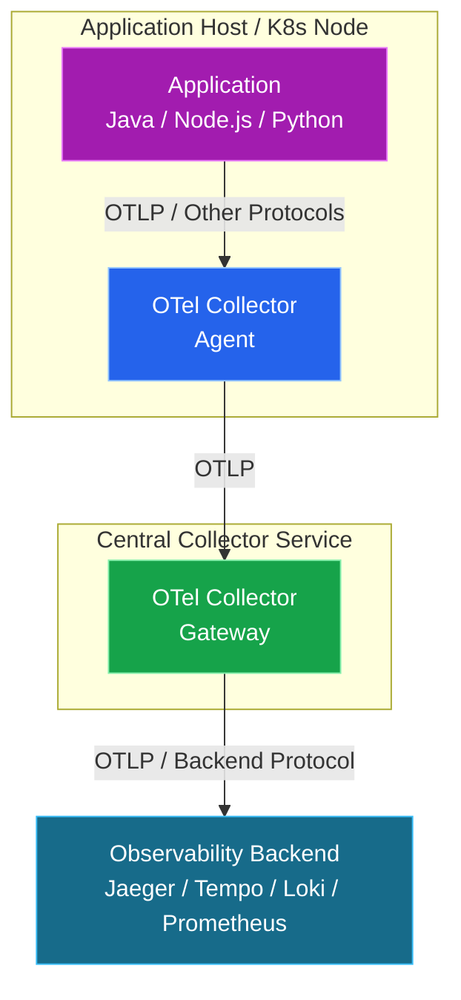

| Component                       | Responsibility                                    |
| ------------------------------- | ------------------------------------------------- |
| **Application**           | 產生 Metrics、Logs、Traces                        |
| **Collector Agent**       | 在 Application Host / K8s Node 附近收集 Telemetry |
| **Collector Gateway**     | 集中處理、過濾、批次化、路由與匯出                |
| **Observability Backend** | 儲存、查詢及分析 Telemetry                        |

這種設計有一個重要優勢：**Application 不需要直接連接各個 Observability Vendors，而是透過 Collector 統一處理 Telemetry。**

## **2. Agent vs Gateway — 主要責任分工**

| Comparison             | Collector Agent             | Collector Gateway         |
| ---------------------- | --------------------------- | ------------------------- |
| Deployment             | Kubernetes DaemonSet / Host | Kubernetes Deployment     |
| Location               | 每個 Node / Host            | Cluster 中央服務          |
| OTLP Receiver          | ✅                          | ✅                        |
| Container Logs         | ✅ 適合收集                 | 通常不直接讀取 Node Logs  |
| Host Metrics           | ✅                          | 通常不負責                |
| Kubernetes Metadata    | ✅                          | ✅                        |
| Memory Limiter         | ✅                          | ✅                        |
| Batch Processing       | ✅                          | ✅                        |
| Tail Sampling          | 通常**不建議**                  | ✅ 推薦                   |
| Centralized Filtering  | 可做                        | ✅ 推薦                   |
| Backend Authentication | 通常不需要                  | ✅ 集中管理               |
| Horizontal Scaling     | DaemonSet 隨 Nodes 增長     | Deployment Replicas / HPA |

OpenTelemetry 官方的 [Agent-to-Gateway Deployment Pattern](https://opentelemetry.io/docs/collector/deploy/other/agent-to-gateway/?utm_source=chatgpt.com) 也明確介紹這種分層架構，尤其適合集中處理、網路隔離與大規模成本控制。

## **3. Kubernetes 的兩種實際方案**

**方案 A — Gateway-only**

Application 直接透過 OTLP 傳送資料到中央 Collector Gateway。架構簡單、資源使用較少，適合 Docker Desktop Kubernetes、PoC 或**小型 Cluster**。

**方案 B — Agent + Gateway**

每個 Kubernetes Node 執行 Collector Agent（DaemonSet），集中 Gateway 負責處理和匯出。適合**正式企業部署**、Container Logs、Node Metrics、集中治理及更高資料量。

## **4. 對你的環境，我建議怎麼部署？**

| Environment                                | Recommendation                                    |
| ------------------------------------------ | ------------------------------------------------- |
| **Docker Desktop Kubernetes**        | Gateway-only（先採用）                            |
| **Development / UAT**                | Gateway-only 或 Agent + Gateway，依 Logs 收集需求 |
| **Production Banking Microservices** | Agent + Gateway（建議評估）                       |
| **Large Multi-node Kubernetes**      | Agent DaemonSet + HA Gateway                      |

對 Production，我建議將 Collector Gateway 配置為多副本，並考慮 Exporter Queue、Retry、Memory Limiter、TLS 與適當的 Resource Limits。

### **Tail Sampling 需要特別注意**

你之前討論的 **Tail Sampling** 非常適合放在 Gateway 層，但必須確保：

**同一條 Trace 的所有 Spans 都被送到同一個 Tail Sampling Gateway Instance。**

如果 Gateway 有多個 Replicas，不能只依賴一般 Round-robin Load Balancing；需要透過 Trace ID 路由，或採用能確保 Trace Affinity 的設計。

## **5. 最終結論**

**這張圖展示的是正確且成熟的 Agent + Gateway Architecture，也是 OpenTelemetry 官方推薦的部署模式之一。**

對你的需求，我建議：

**現在：** Docker Desktop + Java / Python Services → Single Collector Gateway → Jaeger / Debug。

**未來 Production：** Java / Python Services → Node-local Collector Agents → Central Collector Gateways → Prometheus / Loki / Tempo。

當你需要集中處理 **Tail Sampling、Sensitive Data Filtering、Logs、Metrics、Traces 和 Backend Routing** 時，Agent + Gateway 的優勢就會更明顯。

但如果目前的單一 Collector 已經能滿足需求，**不需要為了符合這張圖而強制增加 Agent 層。**

---
# 多個 Microservices、部署在多個 Kubernetes Nodes 的環境，

> 建議優先評估 OpenTelemetry Collector 的 Agent + Gateway 架構。**

但重點不是 Microservices 的數量，而是 **Node 數量、Telemetry 流量、Logs 收集方式、集中管理及高可用性需求**。

## **1. 推薦的 Kubernetes Architecture**

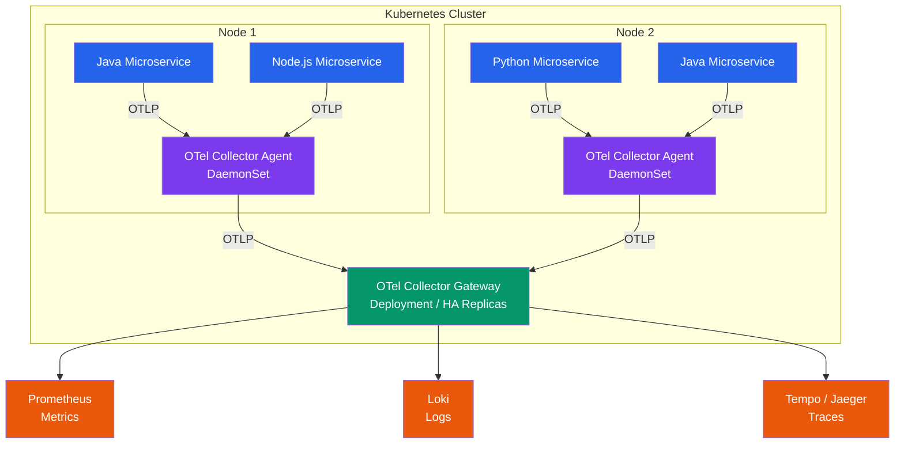

圖為邏輯架構。實際 Metrics 與 Logs Export 須使用對應的 Receiver / Exporter 或 Scrape 機制；Agent DaemonSet 的 OTLP 流量也必須正確路由到所在 Node 的 Agent。

## **2. 何時需要 Agent + Gateway？**

| 環境                                          | 建議                                          |
| ------------------------------------------- | ------------------------------------------- |
| 單一 Node、少量 Microservices                    | Gateway-only                                |
| 多 Nodes，但只有少量 OTLP Traces / Metrics         | Gateway-only 仍可使用                           |
| 多 Nodes，需要收集 Container Logs / Host Metrics  | **Agent + Gateway**                         |
| 多 Nodes、大量 Telemetry、集中 Filtering / Routing | **Agent + Gateway**                         |
| Production、需要 HA / Tail Sampling            | **Agent + HA Gateway**，並另外設計 Trace Affinity |

Agent 通常以 **DaemonSet** 部署，每個 Node 一個 Collector；Gateway 則以 **Deployment** 部署，可依需求擴展 Replicas。

## **3. 對你的 Banking Microservices 的具體建議**

對正式的多節點 Kubernetes，我建議：

**Application → Node-local OTel Agent → Central Gateway → Observability Backend**

其中有兩個重要設計原則：

- **Agent 負責就近收集**：Container Logs、Host Metrics、Application OTLP。
- **Gateway 負責集中處理**：Batch、Filter、Sensitive Data Protection、Tail Sampling、Exporters、Backend Authentication。

如果需要 Tail Sampling，應確保同一個 Trace ID 的所有 Spans 都送到同一個 Gateway Instance，不能只依賴一般 Round-robin。

**結論：多個 Microservices + 多個 K8s Nodes，Agent + Gateway 是很好的企業級部署選擇；但若目前只有少量 Telemetry、不收集 Node Logs，也沒有複雜處理需求，Gateway-only 仍然合理。**

官方參考：[OpenTelemetry Agent-to-Gateway Deployment Pattern](https://opentelemetry.io/docs/collector/deploy/other/agent-to-gateway/?utm_source=chatgpt.com)。

---

# OpenTelemetry Collector — Purpose, Functions & Protocols

## 1. Overview

**OpenTelemetry Collector** 是一個 Vendor-neutral Telemetry Processing Component，負責接收、處理及輸出 Telemetry Data。

其三個核心功能：

**Receive → Process → Export**

- **Receive**：接收 OTLP 或其他支援協定的 Telemetry。
- **Process**：批次處理、過濾及轉換 Telemetry。
- **Export**：將 Telemetry 傳送至 Observability Backends。

**Key Point:** OpenTelemetry Collector 不只支援 OTLP，也能透過不同的 Receivers 和 Exporters 整合其他協定與資料格式。

---

## 2. Collector Components

| Component | Responsibility | Examples |
|---|---|---|
| **Receiver** | 接收或主動收集 Telemetry Data | OTLP、Prometheus、Zipkin |
| **Processor** | 處理、過濾、轉換及批次化 Telemetry | Batch、Filter、Transform |
| **Exporter** | 將 Telemetry 輸出至 Backend，或提供 Endpoint 供擷取 | OTLP、Prometheus、Kafka、Vendor Exporters |

### Important

- **Receivers**：支援 Push 或 Pull，例如 OTLP Receiver 接收資料，而 Prometheus Receiver 主動 Scrape Metrics。
- **Processors**：執行 Batch、Filter、Transform 等操作。
- **Exporters**：可以 Push Telemetry，也可以暴露 Metrics Endpoint 供外部系統 Scrape。

實際支援的 Components 取決於 Collector Distribution 與版本。

## 3. Collector Architecture

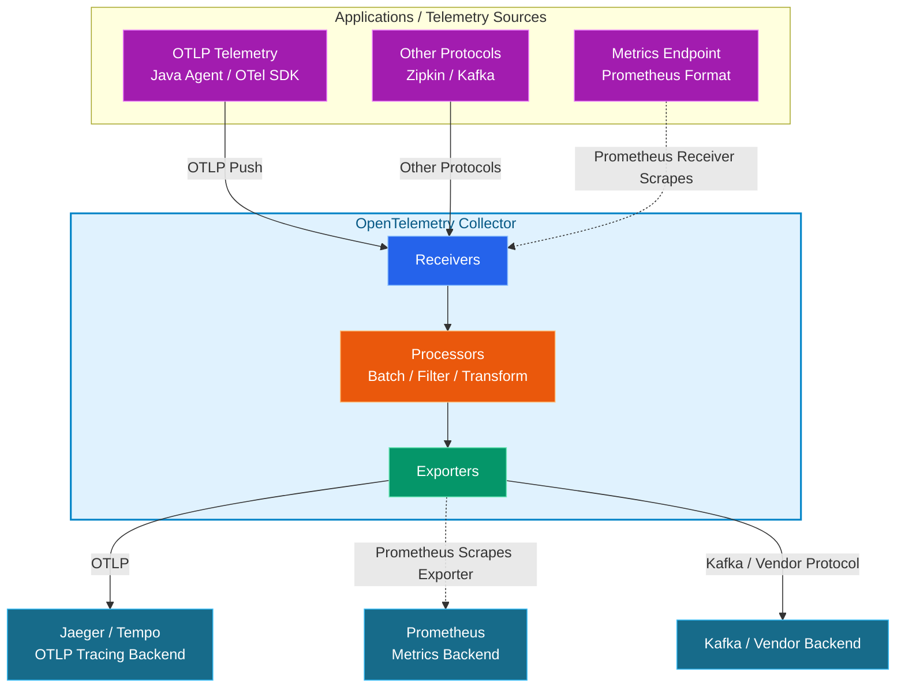

**Note:** 圖中的連線為邏輯資料流。Prometheus Receiver 主動 Scrape Metrics Endpoint；Prometheus Server 則主動 Scrape Collector 的 Prometheus Exporter Endpoint。

---

## 4. OTLP vs Other Protocols

圖中的 **Other** 代表 OTLP 以外的協定或資料格式，例如 Prometheus、Zipkin、Kafka，以及部分 Legacy Jaeger Protocols。

| Protocol / Format | Collector Receiver | Collector Exporter |
|---|---|---|
| **OTLP** | 接收 OTLP Traces、Metrics、Logs | 使用 OTLP 傳送 Telemetry |
| **Prometheus** | 主動 Scrape Metrics Endpoint | 暴露 Metrics Endpoint 供 Prometheus Scrape |
| **Jaeger Legacy Protocol** | 部分 Collector Distribution / 版本可接收傳統 Jaeger Traces | 現代 Jaeger 通常使用 OTLP |
| **Zipkin** | 接收 Zipkin 格式的 Traces | 依 Collector Distribution 支援對應 Exporter |
| **Kafka** | 從 Kafka Topics 接收 Telemetry | 將 Telemetry 輸出到 Kafka Topics |

### 4.1 Prometheus

Prometheus 通常使用 **Pull / Scrape Model**：

```text id="jjb8uy"
Application /metrics
        ↑
Prometheus Receiver
        ↓
OpenTelemetry Collector
        ↓
Prometheus Exporter /metrics
        ↑
Prometheus Server
```

**Important:** Collector 的 Prometheus Exporter 通常不會主動 Push Metrics 到 Prometheus Server。

### 4.2 Jaeger

Jaeger 的整合方式取決於版本和協定：

- **Legacy Jaeger Protocol**：屬於 OTLP 以外的 Other Protocols。
- **Jaeger 2.x**：可直接接收 OTLP Traces。

因此，你目前的 Jaeger 2.x 可以透過 Collector 的 **OTLP Exporter** 接收 Traces，不需要使用傳統 Jaeger Protocol。

---

## 5. Real-World Example — MyServlet.java

你的 Java Application 使用：

**Zero-code + Code-based Instrumentation + Agent-managed SDK**

### 5.1 Current Architecture

```text id="m8i04i"
MyServlet.java
    ↓
OpenTelemetry API
    ↓
Java Agent-managed SDK
    ↓
OTLP/gRPC :4317
    ↓
OpenTelemetry Collector
    ├── Traces → Jaeger + Debug
    ├── Metrics → Debug
    └── Logs → Debug
```

### 5.2 Current Docker Compose Configuration

```yaml id="l93pk8"
OTEL_SERVICE_NAME: "ht-tomcat"

OTEL_EXPORTER_OTLP_ENDPOINT: "http://ht-otel-collector:4317"
OTEL_EXPORTER_OTLP_PROTOCOL: "grpc"

OTEL_TRACES_EXPORTER: "otlp"
OTEL_METRICS_EXPORTER: "otlp"
OTEL_LOGS_EXPORTER: "otlp"

OTEL_PROPAGATORS: "tracecontext,baggage"
```

### 5.3 Current Collector Pipelines

| Signal | Receiver | Processor | Exporter / Destination |
|---|---|---|---|
| **Traces** | OTLP | Batch | OTLP → Jaeger + Debug |
| **Metrics** | OTLP | Batch | Debug |
| **Logs** | OTLP | Batch | Debug |

上述設定符合你目前的 Learning / PoC 架構。

**Note:** Metrics 和 Logs 尚未配置長期儲存的 Backend，Collector Debug Exporter 僅適合驗證 Telemetry 是否成功接收及處理。

---

## 6. Collector vs OTLP

| Component | Definition |
|---|---|
| **OTLP** | OpenTelemetry 原生定義的標準 Telemetry Transport Protocol |
| **Collector** | 接收、處理及輸出 Telemetry 的獨立服務 |
| **Receiver** | 支援多種資料來源及協定 |
| **Processor** | Batch、Filter、Transform 等處理元件 |
| **Exporter** | 使用 OTLP 或其他協定將 Telemetry 傳送至 Backend |

**OTLP ≠ Collector**

OTLP 是通訊協定；Collector 是實際執行 Telemetry Processing 的元件。

## 7. Key Takeaways

- **Receive → Process → Export** 是 OpenTelemetry Collector 的核心 Pipeline。
- **OTLP** 是標準傳輸協定，但不是 Collector 唯一支援的協定。
- **Other Protocols** 可以包括 Prometheus Scrape、Zipkin、Kafka 及部分 Legacy Jaeger Protocols。
- **Prometheus** 通常使用 Pull / Scrape，而不是 OTLP Push。
- **Jaeger 2.x** 可以直接使用 OTLP 接收 Traces。
- **Collector** 支援多種 Backend，降低 Application 對特定 Vendor 的依賴。

## 8. Conclusion

**OpenTelemetry Collector 可以透過 Receivers、Processors 和 Exporters，接收 OTLP 或其他協定的 Telemetry，並輸出至不同 Observability Backends。**

核心架構：

**Application → OTel API → SDK → Exporter → Collector（Receive → Process → Export）→ Backend**

這體現了 OpenTelemetry 的三項重要特性：

**Vendor Neutrality + Composability + Backend Flexibility**

---

## References

- [OpenTelemetry Collector](https://opentelemetry.io/docs/collector/)
- [Collector Configuration](https://opentelemetry.io/docs/collector/configuration/)
- [OpenTelemetry Protocol（OTLP）](https://opentelemetry.io/docs/specs/otlp/)

---
## **OpenTelemetry Collector — Installation**

### **1. Collector Core**

- Essential and Core functionality
- More mature & stable
- Maintained by core OTel team
- GitHub: [https://github.com/open-telemetry/opentelemetry-collector](https://github.com/open-telemetry/opentelemetry-collector?utm_source=chatgpt.com)

### **2. Collector Contribution（Contrib）**

- Essential & Core + extended functionality
- **Community-contributed** Receivers, Processors, Exporters & Extensions
- More experimental features
- Maintained by Community
- GitHub: [https://github.com/open-telemetry/opentelemetry-collector-contrib](https://github.com/open-telemetry/opentelemetry-collector-contrib?utm_source=chatgpt.com)

### **Collector Core vs Contrib**

| Comparison             | Collector Core     | Collector Contrib    |
| ---------------------- | ------------------ | -------------------- |
| Essential Components   | ✅                  | ✅                    |
| Extended Components    | Limited            | Extensive            |
| Community Integrations | Limited            | Extensive            |
| Experimental Features  | Fewer              | More                 |
| Primary Focus          | Core functionality | Broader integrations |

**對你目前的環境：**

你使用的是：

```
image: otel/opentelemetry-collector-contrib:0.146.0
```

因此你已採用 **Collector Contrib**，可使用其打包提供的 Core Components 與更多社群整合元件。

**注意：** Contrib 不代表所有元件都不穩定；各個 Receiver、Processor、Exporter 的成熟度需要個別確認。

---

# Install Collector

- <https://opentelemetry.io/docs/collector/install/>
- <https://github.com/open-telemetry/opentelemetry-collector-releases/releases> => otelcol-contrib_0.165.0_windows_arm64.msi

Install `otelcol-contrib_0.165.0_windows_arm64.msi`

## Verify Installation

```bash
curl -sS -i --max-time 10 \
  -H 'Content-Type: application/json' \
  --data-raw '{"resourceLogs":[{"scopeLogs":[{"logRecords":[{"severityText":"INFO","body":{"stringValue":"otel-git-bash-smoke-test"}}]}]}]}' \
  http://127.0.0.1:4318/v1/logs

# HTTP/1.1 200 OK
# Content-Type: application/json
# Date: Tue, 24 Nov 2026 04:58:54 GMT
# Content-Length: 21

# {"partialSuccess":{}}

sc.exe query otelcol-contrib

# SERVICE_NAME: otelcol-contrib
#   TYPE               : 10  WIN32_OWN_PROCESS
#   STATE              : 4  RUNNING

cd '/c/Program Files/OpenTelemetry Collector'
./otelcol-contrib.exe validate --config=config.yaml
echo $?
# 0

curl -fsS http://127.0.0.1:13133/
curl -fsS http://127.0.0.1:8888/metrics | head -n 15

curl -fsS http://127.0.0.1:8888/metrics |   grep '^otelcol_receiver_accepted_metric_points{' |   grep 'receiver="prometheus"'
# otelcol_receiver_accepted_metric_points{receiver="prometheus",service_instance_id="d2fe1153-127f-4528-ae03-c7fa7f87f7ef",service_name="otelcol-contrib",service_version="0.165.0",transport="http"} 476

curl -fsS http://127.0.0.1:8888/metrics |   grep '^otelcol_receiver_accepted_metric_points{' |   grep 'receiver="prometheus"'
# otelcol_receiver_accepted_metric_points{receiver="prometheus",service_instance_id="d2fe1153-127f-4528-ae03-c7fa7f87f7ef",service_name="otelcol-contrib",service_version="0.165.0",transport="http"} 665
# Counter from 476 => 665

```

---

# OpenTelemetry Collector — Configuration, Extensions & Composability

## 1. Overview

OpenTelemetry Collector 透過不同的 **Receivers、Processors、Exporters 和 Extensions**，建立可配置、可擴充的 Telemetry Processing Architecture。

三個核心功能：

**Receive → Process → Export**

其中：

- **Receivers**：接收或收集 Telemetry Data。
- **Processors**：過濾、轉換或批次處理資料。
- **Exporters**：將資料輸出至 Observability Backends。
- **Extensions**：提供獨立於 Telemetry Pipelines 的管理與輔助功能。

這種將不同元件組合成多條 Pipelines 的能力，就是 **Collector Composability（可組合性）**。

## 2. Collector Configuration Structure

Collector 的 `config.yaml` 包含元件定義與啟用設定。

| Component | Defined In | Activated By | Purpose |
|---|---|---|---|
| **Receiver** | `receivers` | `service.pipelines` | 接收 Telemetry |
| **Processor** | `processors` | `service.pipelines` | 處理 Telemetry |
| **Exporter** | `exporters` | `service.pipelines` | 匯出 Telemetry |
| **Extension** | `extensions` | `service.extensions` | Collector 管理及輔助功能 |

**重要：**

- Receiver、Processor、Exporter 必須由相應的 `service.pipelines` 引用才能啟用。
- Extension 必須在 `service.extensions` 中引用才能啟用。
- Extension 不屬於 Metrics、Logs 或 Traces Pipeline。

## 3. Collector Composability

Collector Composability 是指可以依照 Telemetry Signal、資料來源及輸出需求，靈活組合及重用不同的元件配置。

| Component | Composability | Examples |
|---|---|---|
| **Receiver** | 選擇不同來源與協定 | OTLP、Prometheus、Zipkin |
| **Processor** | 組合不同資料處理功能 | Batch、Filter、Transform |
| **Exporter** | 選擇不同輸出方式 | OTLP、Kafka、Prometheus |
| **Pipeline** | 使用不同的元件組合處理各種 Signals | Metrics、Logs、Traces、Traces/2 |
| **Extension** | 獨立啟用 Collector 管理功能 | Health Check、pprof、zPages |

**Key Point:** 多條 Pipelines 可以引用相同的元件定義，但各自具有獨立的 Pipeline Configuration。

## 4. Multiple Pipelines Configuration

以下是原始架構圖中的四條 Pipelines：

| Pipeline | Receiver | Processor | Exporter |
|---|---|---|---|
| **Metrics** | Receiver 1 | Processor 1 | Exporter 2 |
| **Logs** | Receiver 1 | Processor 2 | Exporter 1 |
| **Traces** | Receiver 1 | Processor 2 | Exporter 2 |
| **Traces/2** | Receiver 2 | Processor 1 | Exporter 1 |

同時啟用 `Extension 1`，提供獨立的 Collector 管理功能。

### 4.1 Multiple Pipelines — Mermaid Architecture

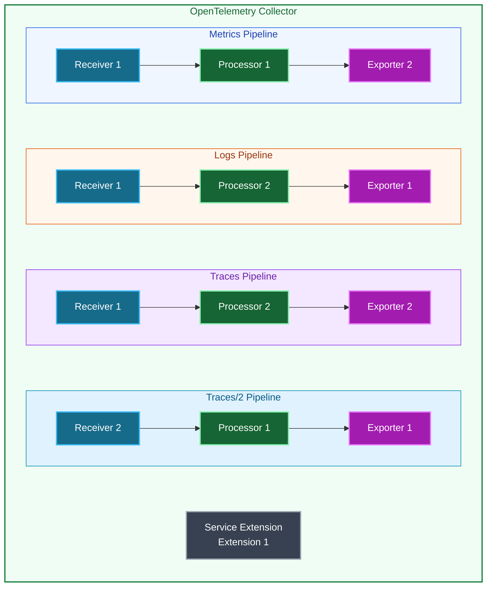

**Note:** `~~~` 是 Mermaid 的 Invisible Link，主要用於協助控制排版，不代表實際 Telemetry Data Flow。

### 4.2 Key Observations

- 同一個 Receiver 可以被多條相容的 Pipelines 引用。
- 同一個 Processor 或 Exporter 可以被多條相容的 Pipelines 引用。
- 同一種 Signal 可以建立多條 Pipelines。
- 不同 Pipelines 可以配置不同的 Processors 和 Exporters。

例如：

`traces` 和 `traces/2` 都處理 Traces，但可以使用不同的 Receivers、Processors 和 Exporters。

其中，`traces/2` 是第二個 Traces Pipeline 的識別名稱，並不是新的 Telemetry Signal。

## 5. Collector Extensions

Extensions 用於提供 Collector 的管理、診斷與輔助功能，通常不直接參與 Telemetry Data Pipeline。

### 5.1 Common Extensions

| Extension | Purpose |
|---|---|
| `health_check` | 提供 Collector Health Check Endpoint |
| `pprof` | 提供 Collector CPU / Memory Profiling |
| `zpages` | 提供 Collector 內部診斷頁面 |

### 5.2 Extension Configuration Example

```yaml
extensions:
  health_check:
    endpoint: 0.0.0.0:13133

service:
  extensions: [health_check]
```

**Important:** 定義 `health_check` 並不代表自動啟用，仍需要在 `service.extensions` 中引用。

另外，Extension 的可用性取決於 Collector Distribution 及版本。

## 6. Real-World Example — MyServlet.java

你目前的 OpenTelemetry Collector 配置包括：

- OTLP Receiver
- Batch Processor
- Debug Exporter
- OTLP Exporter（Jaeger）
- Traces / Metrics / Logs Pipelines

### 6.1 Current Collector Pipelines

| Signal | Receiver | Processor | Exporter |
|---|---|---|---|
| **Traces** | OTLP | Batch | OTLP → Jaeger + Debug |
| **Metrics** | OTLP | Batch | Debug |
| **Logs** | OTLP | Batch | Debug |

### 6.2 Current Collector Configuration

```yaml
receivers:
  otlp:
    protocols:
      grpc:
        endpoint: 0.0.0.0:4317
      http:
        endpoint: 0.0.0.0:4318

processors:
  batch: {}

exporters:
  debug:
    verbosity: detailed

  otlp:
    endpoint: ht-jaeger:4317
    tls:
      insecure: true

service:
  pipelines:
    traces:
      receivers: [otlp]
      processors: [batch]
      exporters: [debug, otlp]

    metrics:
      receivers: [otlp]
      processors: [batch]
      exporters: [debug]

    logs:
      receivers: [otlp]
      processors: [batch]
      exporters: [debug]
```

目前只有 Traces 匯出到 Jaeger，Metrics 和 Logs 則使用 Debug Exporter。

**Note:** Debug Exporter 主要適合 Learning / PoC，不提供 Metrics 或 Logs 的長期儲存能力。

### 6.3 Add Health Check Extension

如果希望啟用 Docker Compose 中已映射的 `13133` Health Check Port，可以加入：

```yaml
extensions:
  health_check:
    endpoint: 0.0.0.0:13133

service:
  extensions: [health_check]
  pipelines:
    # Existing traces / metrics / logs pipelines
```

這只是展示新增的配置片段；實際修改時應與原有 `service.pipelines` 合併，而不是覆蓋既有 Pipelines。

## 7. Collector vs SDK Composability

OpenTelemetry 的 Composability 不只存在於 Collector，也存在於 Instrumentation、SDK 和 Backend Integration。

| Type | Description | Example |
|---|---|---|
| **Instrumentation Composability** | 組合不同 Instrumentation Methods | Zero-code + Code-based |
| **SDK Composability** | 組合 SDK Providers、Processors / Readers、Exporters | BatchSpanProcessor + OTLP Exporter |
| **Collector Composability** | 組合 Receivers、Processors、Exporters 和多條 Pipelines | Metrics、Logs、Traces、Traces/2 |
| **Backend Flexibility** | 更換或整合不同 Observability Backends | Jaeger ↔ Tempo |

### Important Differences

**SDK Composability**

- 發生於 Application Runtime / SDK。
- 控制 Telemetry Recording、Processing、Export。

**Collector Composability**

- 發生於 OpenTelemetry Collector。
- 控制 Telemetry Receiving、Processing、Routing、Export。

**Backend Flexibility**

- 允許不同 Observability Backends 與 Collector 整合。
- 降低 Application 對特定 Vendor 的依賴。

## 8. Key Takeaways

- **Collector Pipeline** = Receiver → Processor → Exporter。
- **Multiple Pipelines**：可以為 Metrics、Logs、Traces 建立不同處理流程。
- **Reusable Components**：不同 Pipelines 可以引用相容的共同元件配置。
- **Extensions**：獨立於 Telemetry Pipelines，由 `service.extensions` 啟用。
- **Composability**：可依需求自由組合、替換及擴充 Collector Components。
- **Backend Flexibility**：透過 Exporters 整合不同 Observability Backends。

## 9. Conclusion

**OpenTelemetry Collector Composability = Receivers + Processors + Exporters + Multiple Pipelines + Extensions。**

其中：

- `service.pipelines` 定義及啟用 Telemetry Pipelines。
- `service.extensions` 啟用 Collector 管理與輔助功能。
- 不同 Pipelines 可以依需求組合及重用相容元件。

**核心觀念：OpenTelemetry Collector 透過模組化元件與多條 Pipelines，提供靈活的 Telemetry Processing、Protocol Integration 和 Backend Routing 能力。**

這是 OpenTelemetry Composability、Vendor Neutrality 和 Backend Flexibility 的重要實現方式。

## References

- OpenTelemetry Collector: https://opentelemetry.io/docs/collector/
- Collector Configuration: https://opentelemetry.io/docs/collector/configuration/
- OpenTelemetry Protocol: https://opentelemetry.io/docs/specs/otlp/

---
## ** OpenTelemetry Collector — Receiver**

- <https://github.com/open-telemetry/opentelemetry-collector-contrib/tree/main/receiver>
- <https://github.com/open-telemetry/opentelemetry-collector/tree/main/receiver>
- <https://opentelemetry.io/docs/collector/configuration/#receivers>

### ** 1. Main Function: Collect Data**

- **Listen on Network Ports**：監聽網路連接埠，接收 Telemetry Data。
- **Collect Data**：也可以主動收集 Telemetry，例如 Prometheus Scrape。
- **Send Data to Pipelines**：將收集的資料傳送至一條或多條 Telemetry Pipelines。

### ** 2. Receiver Examples**

| Receiver                  | Distribution | Purpose                            |
| ------------------------- | ------------ | ---------------------------------- |
| **OTLP**                  | Core         | 接收 OTLP/gRPC 或 OTLP/HTTP Telemetry |
| **Prometheus**            | Contrib      | 主動 Scrape Prometheus Metrics       |
| **Jaeger**                | Contrib      | 接收傳統 Jaeger Tracing Protocol       |
| **Elasticsearch Queries** | Contrib      | 透過 Elasticsearch Queries 收集資料      |

### ** 3. Collector Receiver Architecture**

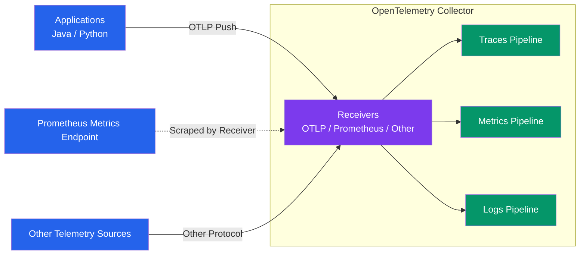

**重要：** Receiver 可以被多條 Pipelines 引用，但實際上必須支援該 Pipeline 的 Signal Type（Traces、Metrics 或 Logs），不能假設任意 Receiver 都支援三種訊號。

### **4. MyServlet.java Example**

你目前的 Collector 使用 OTLP Receiver：

```yaml
receivers:
  otlp:
    protocols:
      grpc:
        endpoint: 0.0.0.0:4317
      http:
        endpoint: 0.0.0.0:4318
```

它同時被三條 Pipeline 引用：

```yaml
service:
  pipelines:
    traces:
      receivers: [otlp]
    metrics:
      receivers: [otlp]
    logs:
      receivers: [otlp]
```

以上 Pipeline YAML 為局部示意，完整可執行設定仍須包含相應 Exporters 及其他必要配置。

**Key Point：Receiver 是 OpenTelemetry Collector 的資料入口，負責接收或主動收集 Telemetry，然後依配置送入一條或多條相容的 Pipelines。**

---
## ** OpenTelemetry Collector — Processor**

- <https://github.com/open-telemetry/opentelemetry-collector-contrib/tree/main/processor>
- <https://github.com/open-telemetry/opentelemetry-collector/tree/main/processor>
- <https://opentelemetry.io/docs/collector/configuration/#processors>

### ** 1. Main Function: Modify Data**

- **Modify Data**：修改接收或收集到的 Telemetry Data。
- **Add / Modify / Remove**：新增、修改或移除 Telemetry Attributes 與資料。
- **Process Data**：執行 Batch、Memory Limiting、Metrics Transformation 等處理。
- **Shared Across Pipelines**：同一 Processor 可以被一條或多條相容的 Pipelines 引用。

### **2. Processor Examples**

| Processor               | Distribution（投影片） | Purpose                      |
| ----------------------- | ----------------- | ---------------------------- |
| **Batch**               | Core              | 批次處理 Telemetry，提高傳輸效率        |
| **Memory Limiter**      | Core              | 限制 Collector 記憶體使用，降低 OOM 風險 |
| **Attributes**          | Contrib           | 新增、修改或刪除 Attributes          |
| **Cumulative to Delta** | Contrib           | 將累積型 Metrics 轉換為 Delta       |
| **Metrics Generation**  | Contrib           | 從既有 Telemetry 產生額外 Metrics   |

Core / Contrib 分類依照原始投影片。具體元件名稱、可用性及 Distribution 應以使用的 Collector 版本為準。

### ** 3. Collector Processor Architecture**

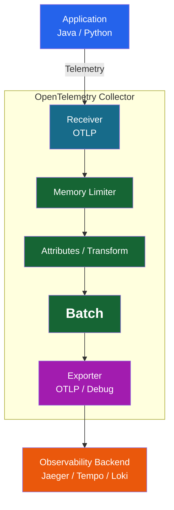

### ** 4. Real-World Example — MyServlet.java**

你目前的 Collector 使用 `batch` Processor：

```yaml

processors:
  batch: {}

service:
  pipelines:
    traces:
      receivers: [otlp]
      processors: [batch]
      exporters: [debug, otlp]

    metrics:
      receivers: [otlp]
      processors: [batch]
      exporters: [debug]

    logs:
      receivers: [otlp]
      processors: [batch]
      exporters: [debug]

```

這表示 Traces、Metrics、Logs 三條 Pipeline 都引用 `batch` Processor，進行批次處理後再交給 Exporters。

**Key Point：Processor 是 Collector Pipeline 中負責修改、轉換、過濾或批次處理 Telemetry Data 的元件。**

它不需要 Application 修改 `MyServlet.java`，可以直接透過 Collector 的 `config.yaml` 管理，這也是 **Collector Composability** 的實際應用。

---
## **OpenTelemetry Collector — Exporter **

- <https://github.com/open-telemetry/opentelemetry-collector-contrib/tree/main/exporter>
- <https://github.com/open-telemetry/opentelemetry-collector/tree/main/exporter>
- <https://opentelemetry.io/docs/collector/configuration/#exporters>

### ** 1. Main Function: Forward Data**

- **Forward Data**：將 Telemetry Data 傳送至網路上的指定目的地。
- **Observability Backend**：將資料輸出至 Jaeger、Tempo、Prometheus、Elasticsearch 等系統。
- **Multiple Pipelines**：同一 Exporter 可以被多條相容的 Pipelines 引用。

### ** 2. Exporter Examples**

| Exporter          | Distribution（投影片） | Purpose                                 |
| ----------------- | ----------------- | --------------------------------------- |
| **Debug**         | Core              | 輸出 Telemetry 至 Collector Logs，方便除錯      |
| **OTLP gRPC**     | Core              | 透過 OTLP/gRPC 傳送 Telemetry               |
| **OTLP HTTP**     | Core              | 透過 OTLP/HTTP 傳送 Telemetry               |
| **Prometheus**    | Contrib           | 暴露 Metrics Endpoint 供 Prometheus Scrape |
| **Jaeger**        | Contrib           | 傳統 Jaeger Exporter（依版本支援）               |
| **Elasticsearch** | Contrib           | 將 Telemetry 傳送至 Elasticsearch           |

Core / Contrib 分類依照投影片。實際元件支援情況取決於 Collector 版本；現代 Jaeger 通常透過 OTLP Exporter 整合。

### ** 3. Collector Exporter Architecture**

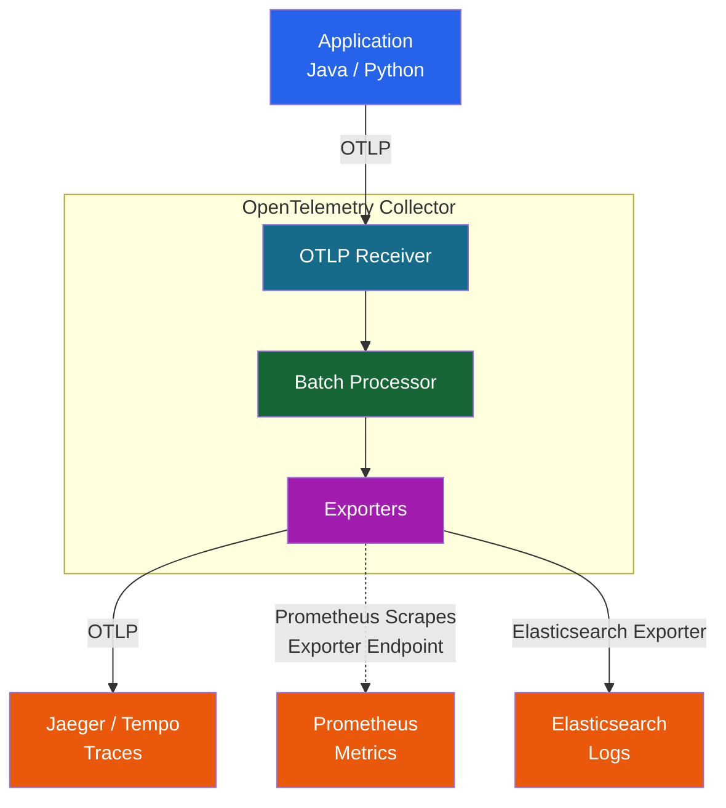

### ** 4. Real-World Example — MyServlet.java**

你目前使用的 Collector Exporters：

```yaml
exporters:
  debug:
    verbosity: detailed

  otlp:
    endpoint: ht-jaeger:4317
    tls:
      insecure: true
```

三條 Pipeline：

| Signal      | Exporter        | Destination             |
| ----------- | --------------- | ----------------------- |
| **Traces**  | `debug`, `otlp` | Collector Logs + Jaeger |
| **Metrics** | `debug`         | Collector Logs          |
| **Logs**    | `debug`         | Collector Logs          |

**重點：Exporter 是 Collector Pipeline 的資料出口。** 它可以將 Telemetry 傳送至不同的 Backend，或提供 Endpoint 供其他系統擷取資料。

這也是 **Collector Composability** 的重要能力：不需要修改 `MyServlet.java`，即可透過 Collector Configuration 調整 Telemetry 的輸出目的地。

---
## ** OpenTelemetry Collector — Extension**

- <https://github.com/open-telemetry/opentelemetry-collector-contrib/tree/main/extension>
- <https://github.com/open-telemetry/opentelemetry-collector/tree/main/extension>
- <https://opentelemetry.io/docs/collector/configuration/#extensions>

### ** 1. Main Function: Collector Management & Support**

**Extensions** 用於執行通常不屬於 Telemetry Data Processing Pipeline 的功能。

- **Collector Health Monitoring**：監控 Collector 的健康狀態。
- **Service Discovery**：支援服務發現相關功能。

### ** 2. Extension Examples**

| Extension          | Distribution（投影片） | Purpose                   |
| ------------------ | ----------------- | ------------------------- |
| **Memory Ballast** | Core              | 管理 Collector 記憶體配置        |
| **zPages**         | Core              | 提供 Collector 內部診斷頁面       |
| **Basic Auth**     | Contrib           | 提供基本身分驗證功能                |
| **pprof**          | Contrib           | 提供 CPU / Memory Profiling |

Core / Contrib 分類依原始投影片。Memory Ballast 屬於舊式機制，現代 Collector 不建議使用；實際元件是否存在及支援情況應以目前版本為準。

### ** 3. Extensions vs Processors**

| Comparison    | Extension                            | Processor                             |
| ------------- | ------------------------------------ | ------------------------------------- |
| 主要用途          | 管理、診斷、驗證及輔助功能                        | 處理 Telemetry Data                     |
| 是否屬於 Pipeline | 通常不是                                 | 是                                     |
| 啟用位置          | `service.extensions`                 | `service.pipelines`                   |
| Examples      | Health Check、zPages、Basic Auth、pprof | Batch、Memory Limiter、Filter、Transform |

### ** 4. Real-World Example — Health Check**

```yaml

extensions:
  health_check:
    endpoint: 0.0.0.0:13133

service:
  extensions: [health_check]

  pipelines:
    traces:
      receivers: [otlp]
      processors: [batch]
      exporters: [debug, otlp]

```

此為配置片段，需與既有的 Receiver、Processor、Exporter 定義及其他 Pipelines 合併。

對你目前的 `otel-collector-config.yaml` 而言，增加並啟用 `health_check` 後，便可利用已在 Docker Compose 映射的 `13133` Port 進行健康檢查。

**Key Point：Collector Extension 提供 Pipeline 以外的管理與輔助能力，必須在&#x20;**`service.extensions`**&#x20;中明確啟用。**

---

# OpenTelemetry Collector — Service Configuration & Multiple Pipelines

- <https://github.com/open-telemetry/opentelemetry-collector/tree/main/service>
- <https://opentelemetry.io/docs/collector/configuration/#service>

## 1. Overview

OpenTelemetry Collector 的 `service` 是**元件啟用、Telemetry Pipelines 與 Collector Self-Observability 的配置區段**。

主要包含三個 Subsections：

| Subsection | Purpose | Configuration |
|---|---|---|
| **Extensions** | 啟用 Collector 管理與輔助功能 | `service.extensions` |
| **Pipelines** | 啟用 Metrics、Logs、Traces 資料處理流程 | `service.pipelines` |
| **Telemetry** | 設定 Collector 自身的 Metrics、Logs 等診斷資料 | `service.telemetry` |

**Key Point:** Receivers、Processors、Exporters 由 `service.pipelines` 啟用；Extensions 由 `service.extensions` 啟用。Collector 自身的 Observability 則由 `service.telemetry` 設定。

## 2. Service Configuration Architecture

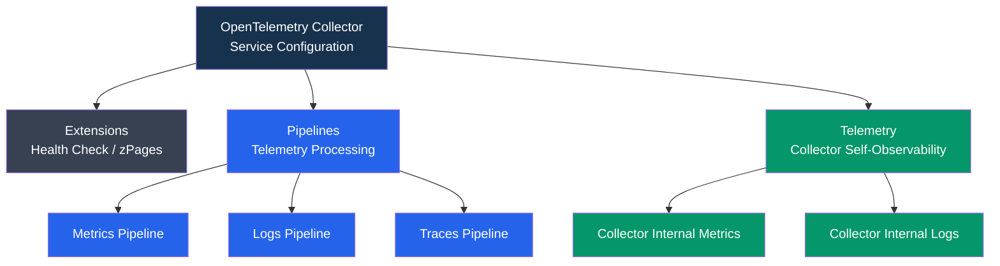

**Important:** `service.telemetry` 用於 Collector 本身的 Self-Observability，不等同於 Application Telemetry Pipelines。

---

## 3. Multiple Pipelines Configuration

同一個 Collector 可以配置多條 Telemetry Pipelines，並重複引用 Receivers、Processors 和 Exporters 的定義。

以下是原始架構圖中的四條 Pipelines：

| Pipeline | Receiver | Processor | Exporter |
|---|---|---|---|
| **Metrics** | Receiver 1 | Processor 1 | Exporter 2 |
| **Logs** | Receiver 1 | Processor 2 | Exporter 1 |
| **Traces** | Receiver 1 | Processor 2 | Exporter 2 |
| **Traces/2** | Receiver 2 | Processor 1 | Exporter 1 |

另外，`Extension 1` 透過 `service.extensions` 啟用，不屬於任何 Telemetry Pipeline。

### 3.1 Multiple Pipelines — Mermaid Architecture

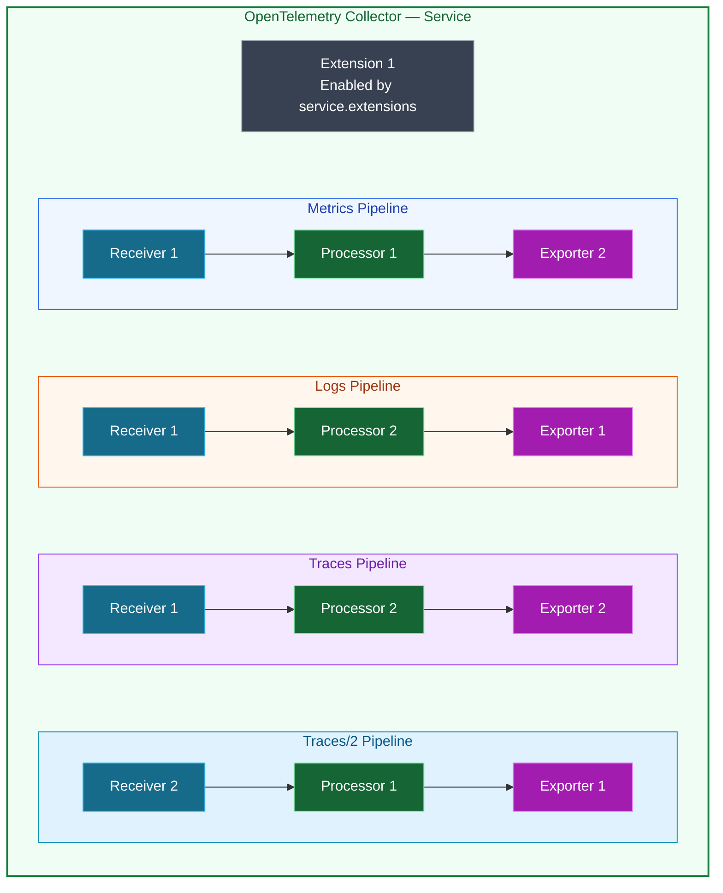

**Note:** Mermaid 的 `~~~` 是 Invisible Link，用於協助控制排版，不代表實際 Telemetry Data Flow。

### 3.2 Key Concepts

- **Multiple Pipelines**：同一個 Collector 可以配置多條不同的 Telemetry Pipelines。
- **Component Reuse**：不同 Pipelines 可以引用相同的 Receiver、Processor 或 Exporter 定義。
- **Signal Compatibility**：被引用的元件必須支援對應的 Signal Type。
- **Pipeline Identification**：`traces/2` 是第二條 Traces Pipeline，不是第四種 Telemetry Signal。
- **Extension Independence**：Extensions 由 `service.extensions` 啟用，不參與一般 Telemetry Pipeline。

**Key Point:** Multiple Pipelines 展示了 OpenTelemetry Collector 的 Composability（可組合性）。

---

## 4. Service Configuration — YAML Example

以下範例展示如何定義並啟用 Extensions、Pipelines 及 Collector 自身的 Telemetry。

```yaml
extensions:
  health_check:
    endpoint: 0.0.0.0:13133

receivers:
  otlp:
    protocols:
      grpc:
        endpoint: 0.0.0.0:4317
      http:
        endpoint: 0.0.0.0:4318

processors:
  batch: {}

exporters:
  debug:
    verbosity: detailed

service:
  extensions: [health_check]

  pipelines:
    traces:
      receivers: [otlp]
      processors: [batch]
      exporters: [debug]

    metrics:
      receivers: [otlp]
      processors: [batch]
      exporters: [debug]

    logs:
      receivers: [otlp]
      processors: [batch]
      exporters: [debug]

  telemetry:
    logs:
      level: info
```

### Configuration Explanation

| Configuration | Responsibility |
|---|---|
| `extensions.health_check` | 定義 Health Check Extension |
| `receivers.otlp` | 定義 OTLP Receiver |
| `processors.batch` | 定義 Batch Processor |
| `exporters.debug` | 定義 Debug Exporter |
| `service.extensions` | 啟用 Health Check |
| `service.pipelines` | 啟用 Traces、Metrics、Logs Pipelines |
| `service.telemetry` | 設定 Collector 自身的診斷資訊 |

**Note:** Collector Internal Metrics 的配置方式依版本而異；部分版本使用 `service.telemetry.metrics.level`，較新版本可使用 `readers` 等配置。因此本範例僅設定 Internal Logs Level。

---

## 5. `service.pipelines` vs `service.telemetry`

這兩者最容易混淆。

| Comparison | `service.pipelines` | `service.telemetry` |
|---|---|---|
| 監控對象 | Application / Microservices | Collector 本身 |
| Metrics | HTTP Requests、JVM Metrics | Collector Accepted / Refused Metric Points |
| Logs | Java / Python Application Logs | Collector Internal Logs |
| Traces | Distributed Application Traces | Collector Internal Traces（若配置） |
| 主要用途 | Application Observability | Collector Self-Observability |

### Real-World Example

你之前透過：

```bash
curl http://127.0.0.1:8888/metrics
```

查詢的是 Collector 自身的 Internal Metrics。

例如：

```text
otelcol_receiver_accepted_metric_points
```

這表示 Collector OTLP 或其他 Metrics Receiver 已接受的 Metric Data Points 數量。

**Important:** 它不是 Application 自訂的 `app.db.db_requests` Metric，而是 Collector 用來監控自身處理情況的 Internal Metric。

---

## 6. Real-World Example — MyServlet.java

你目前的 `otel-collector-config.yaml` 已經定義三條 Pipelines：

| Signal | Receiver | Processor | Exporter |
|---|---|---|---|
| **Traces** | OTLP | Batch | Jaeger + Debug |
| **Metrics** | OTLP | Batch | Debug |
| **Logs** | OTLP | Batch | Debug |

### 6.1 Current Telemetry Flow

```text
MyServlet.java
    ↓
Java Agent-managed SDK
    ↓
OTLP/gRPC :4317
    ↓
OpenTelemetry Collector
    ├── Traces → Batch → Jaeger + Debug
    ├── Metrics → Batch → Debug
    └── Logs → Batch → Debug
```

這些配置都屬於 `service.pipelines`。

目前 Metrics 和 Logs 尚未配置持久化 Backend，因此 Collector Debug Exporter 主要用於 Learning / PoC 驗證。

### 6.2 Extensions in Your Environment

你目前的 Docker Compose 已映射：

```text
13133 → Health Check
55679 → zPages
```

但 Port Mapping 不會自動啟用 Extensions。

如果需要使用，必須先在 Collector Configuration 中定義：

```yaml
extensions:
  health_check:
    endpoint: 0.0.0.0:13133

  zpages:
    endpoint: 0.0.0.0:55679

service:
  extensions: [health_check, zpages]
```

此為配置片段；實際套用時需保留原有 `service.pipelines`，並確認目前的 Collector Distribution 支援這些 Extensions。

---

## 7. Collector Composability

OpenTelemetry Collector 可以透過不同的 Receivers、Processors、Exporters、Extensions 及 Pipelines 建立靈活架構。

| Type | Example |
|---|---|
| **Instrumentation Composability** | Zero-code + Code-based Instrumentation |
| **SDK Composability** | Provider + Processor / Reader + Exporter |
| **Collector Composability** | Receiver + Processor + Exporter + Multiple Pipelines |
| **Backend Flexibility** | Jaeger ↔ Tempo |

其中：

- **SDK Composability**：控制 Application SDK 內部 Telemetry Recording、Processing 和 Export。
- **Collector Composability**：控制 Collector 接收、處理、路由和輸出 Telemetry 的方式。
- **Backend Flexibility**：可依需求替換或整合不同 Observability Backends。

---

## 8. Key Takeaways

| Concept | Key Point |
|---|---|
| **`service.extensions`** | 啟用 Collector Extensions |
| **`service.pipelines`** | 啟用 Telemetry Processing Pipelines |
| **`service.telemetry`** | Collector Self-Observability Configuration |
| **Multiple Pipelines** | 同一 Collector 可配置不同的 Telemetry Pipelines |
| **Component Reuse** | 不同 Pipelines 可重用相容元件的配置 |
| **Composability** | 以模組化元件組合不同的資料處理流程 |

## 9. Conclusion

**OpenTelemetry Collector 的 `service` 主要負責三項配置：**

1. **Extensions**：啟用 Collector 管理與輔助功能。
2. **Pipelines**：啟用 Metrics、Logs、Traces 等 Telemetry Processing Pipelines。
3. **Telemetry**：配置 Collector 自身的 Observability。

其中，Multiple Pipelines 可依不同的 Signals、資料來源和 Backend 需求重用相容的元件，展現 Collector Composability。

**核心觀念：**

- `service.extensions` → Collector Management
- `service.pipelines` → Application Telemetry Processing
- `service.telemetry` → Collector Self-Observability

---
# Service Pipelines 

## **1. Pipeline Configuration Mapping**

| Pipeline    | Receivers                     | Processor | Exporter |
| ----------- | ----------------------------- | --------- | -------- |
| **Traces**  | OTLP、OpenCensus、Jaeger、Zipkin | Batch     | Debug    |
| **Metrics** | OTLP、OpenCensus、Prometheus    | Batch     | Debug    |
| **Logs**    | OTLP                          | Batch     | Debug    |

## **2. YAML Configuration**

```yaml

service:
  pipelines:
    traces:
      receivers: [otlp, opencensus, jaeger, zipkin]
      processors: [batch]
      exporters: [debug]

    metrics:
      receivers: [otlp, opencensus, prometheus]
      processors: [batch]
      exporters: [debug]

    logs:
      receivers: [otlp]
      processors: [batch]
      exporters: [debug]

```

這是原始投影片的概念性 Pipeline 配置，並非完整可直接執行的 YAML。Receivers、Processors、Exporters 還需要在對應區段定義；OpenCensus、Jaeger 等舊協定 Receiver 的可用性也需依 Collector 版本確認。

## **3. Complete Mermaid Architecture**

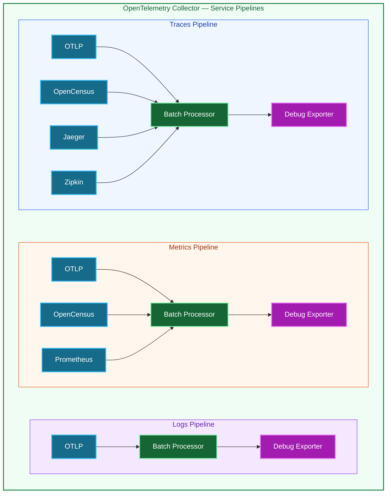

## **4. How Multiple Receivers Work**

| Pipeline    | How It Works                                                   |
| ----------- | -------------------------------------------------------------- |
| **Traces**  | OTLP **OR/AND** OpenCensus **OR/AND** Jaeger **OR/AND** Zipkin |
| **Metrics** | OTLP **OR/AND** OpenCensus **OR/AND** Prometheus               |
| **Logs**    | OTLP                                                           |

**Important:** `OR/AND` 在這裡只是概念說明，並非 Collector 的配置運算子。

例如 Metrics Pipeline：

- OTLP Receiver 可以接收 Application 推送的 Metrics。
- OpenCensus Receiver 可以接收舊式 OpenCensus Metrics（前提是版本支援）。
- Prometheus Receiver 可以主動 Scrape Metrics Endpoint。
- 任一來源收到資料後，都可以進入 `batch` Processor，再由 `debug` Exporter 輸出。

**不需要所有 Receivers 同時收到資料，Pipeline 才能執行。**

**結論：Traces、Metrics、Logs 都採用相同的 Receiver → Processor → Exporter 架構；不同 Signals 可以配置不同數量的 Receivers，並可重用相容的元件定義。這就是 OpenTelemetry Collector Composability。**

---
# Handson Collector - MySql for Hello Telemetry

## Receiver
- <https://github.com/open-telemetry/opentelemetry-collector-contrib/tree/main/receiver>
- <https://github.com/open-telemetry/opentelemetry-collector-contrib/tree/main/receiver/mysqlreceiver>

## Update files

- `otel-collector-config.dev.yaml`
- `otel-collector-config.prod.yaml`
- `docker-compose.yml`
- `.env`
- `init.sql`

```conf
# Due to the OpenTelemetry Collector is installed in Windows Machine
OTLP_GRPC_PORT=14317
OTLP_HTTP_PORT=14318
OTEL_ZPAGES_PORT=55680
```

```bash
docker compose down -v
docker compose up --build -d
docker compose exec ht-mysql mysql -uroot -prootpassword -e \
"GRANT SELECT ON performance_schema.* TO 'myuser'@'%';
 GRANT REPLICATION CLIENT ON *.* TO 'myuser'@'%';"

docker compose exec ht-mysql mysql -uroot -prootpassword -e "SHOW GRANTS FOR 'myuser'@'%';" 

docker compose exec ht-mysql mysql -h ht-mysql -umyuser -pmypassword -e "SELECT USER(), CURRENT_USER(); SELECT COUNT(*) FROM performance_schema.events_statements_summary_by_digest; SHOW REPLICA STATUS;"

docker compose restart ht-otel-collector
docker compose logs --since 1m ht-otel-collector
```

- <http://localhost:8085/MyWebApp/>
- <http://localhost:16686/search>

```bash
docker compose exec ht-mysql mysql -uroot -prootpassword -e \
"SELECT User, Host FROM mysql.user WHERE User='myuser';"

docker compose exec ht-mysql mysql -uroot -prootpassword -e "SHOW DATABASES;"
docker compose exec ht-mysql mysql -uroot -prootpassword -e "SELECT * FROM mydatabase.mytable;"
```

---
## **OpenTelemetry Collector — Agent Deployment Pattern**

這兩張圖說明 **OpenTelemetry Collector Agent Pattern** 的三種部署方式，以及何時適合使用 Agent。

**Agent Pattern 的核心概念：將 Collector 部署在 Application 附近，快速接收 Telemetry，並收集 Host / Node 層級的監控資料。**

## **1. Three Agent Deployment Patterns**

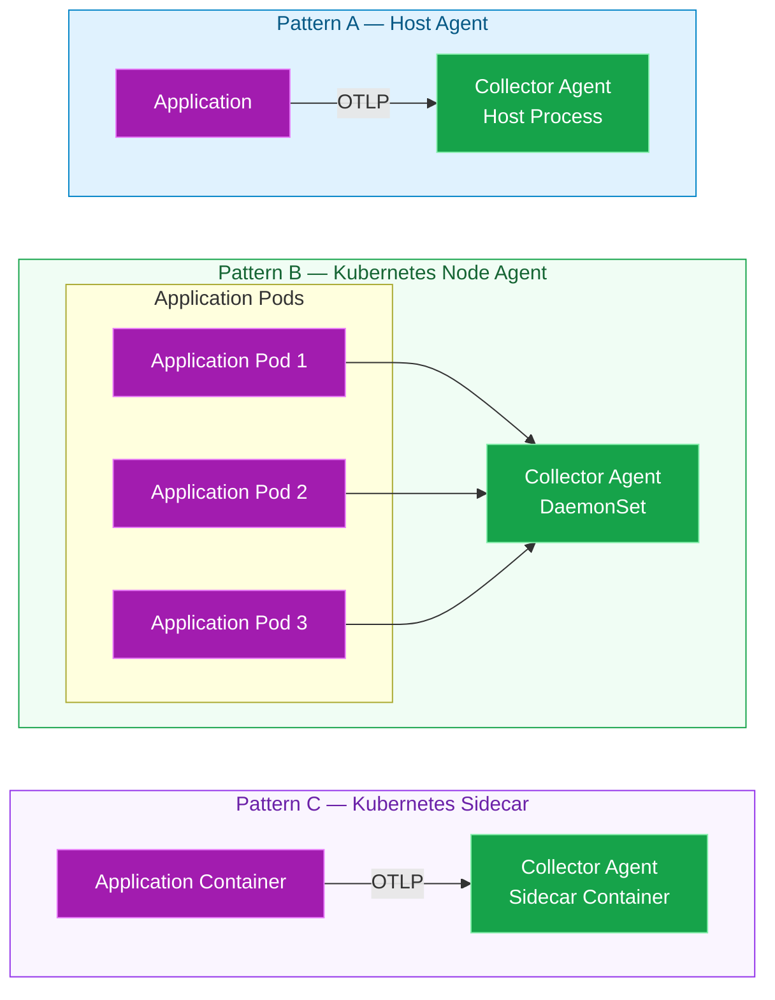

| Pattern           | Deployment           | Purpose                                      |
| ----------------- | -------------------- | -------------------------------------------- |
| **Host Agent**    | VM / Physical Server | 收集 Host Metrics、Application Telemetry        |
| **Node Agent**    | Kubernetes DaemonSet | 每個 Node 一個 Collector，收集 Node / Pod Telemetry |
| **Sidecar Agent** | Kubernetes Pod       | Application 和 Collector 在同一個 Pod 中運行         |

**對多節點 Kubernetes，Node Agent（DaemonSet）通常是首選 Agent Pattern。**

## **2. When to Use Agent Pattern**

根據投影片，適合使用 Agent 的情境：

- **Host-level Data Collection**：需要收集 CPU、Memory、Disk、Network 等 Host Metrics。
- **Offload Telemetry Quickly**：Application 能快速將 Telemetry 傳送給附近的 Agent。
- **Host-dependent Receivers**：某些 Receivers 必須在 Host / Node 上執行，例如讀取本機 Log Files。

## **3. Advantages vs Disadvantages**

| Pros                                      | Cons                                               |
| ----------------------------------------- | -------------------------------------------------- |
| **Low Latency**：就近接收 Telemetry            | **Management Complexity**：需要管理多個 Agents            |
| **Host-specific Data**：可取得 Node / Host 資料 | **Resource Consumption**：每個 Agent 都消耗 CPU / Memory |
| **Decoupling**：Application 不直接依賴 Backend  | **Heavy Processing**：不適合在每個 Agent 上執行大量複雜處理        |

## **4. Recommended Kubernetes Architecture**

對多個 Java、Node.js、Python Microservices 分散在不同 Kubernetes Nodes 的架構，可以採用：

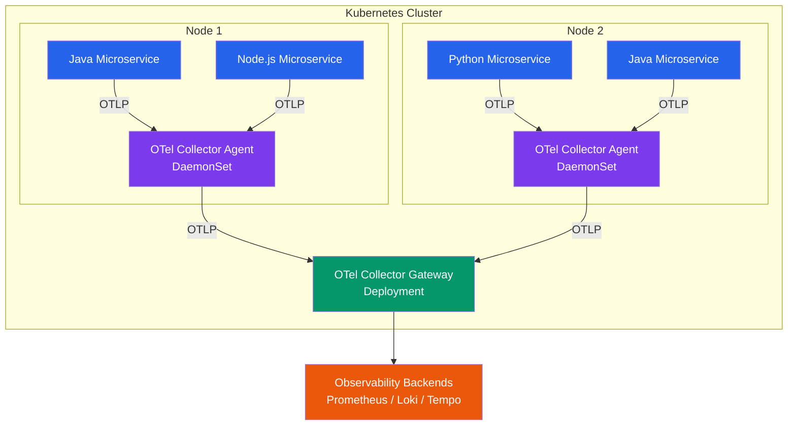

### **Agent vs Gateway Responsibilities**

| Collector Agent            | Collector Gateway                  |
| -------------------------- | ---------------------------------- |
| Host / Node Metrics        | Centralized Processing             |
| Container Log Collection   | Filtering / Transformation         |
| Application OTLP Receiving | Tail Sampling（需 Trace Affinity）    |
| Lightweight Processing     | Backend Routing                    |
| Fast Telemetry Offloading  | Authentication / Export Management |

**注意：** Agent Pattern 不一定需要 Gateway；這張圖展示的是進階的 Agent + Gateway 組合。

## **5. 與你的 MyServlet.java 的關係**

你目前使用：

`MyServlet.java → Java Agent-managed OTel SDK → Single OTel Collector → Jaeger`

這是適合 Learning / PoC 的簡單部署。

將來改成多節點 Kubernetes 時，可以調整為：

`MyServlet.java → Node-local Collector Agent → Central Collector Gateway → Jaeger / Tempo`

**重要區別：OpenTelemetry Java Agent 與 OpenTelemetry Collector Agent 不是同一個元件。**

- **Java Agent**：在 JVM 中進行 Zero-code Instrumentation。
- **Collector Agent**：在 Host / Kubernetes Node 上收集及轉送 Telemetry。

**結論：Agent Pattern 適合需要 Host-level Telemetry、快速卸載資料，以及 Node-local Receivers 的環境。對多節點 Kubernetes，通常使用 DaemonSet 部署 Collector Agent，再視需求搭配中央 Gateway。**

---
## **OpenTelemetry Collector — Gateway Deployment Pattern**

這兩張圖說明 **OpenTelemetry Collector Gateway Pattern** 的部署方式、適用情境，以及優缺點。

**Gateway Pattern 的核心概念：Application 將 Telemetry 傳送至集中部署的 Collector Gateway，由 Gateway 統一處理、控制及匯出至 Observability Backend。**

## **1. Gateway Deployment Architecture**

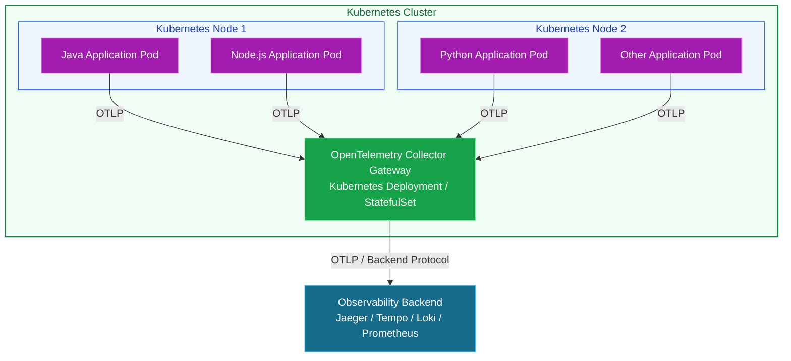

這是依據投影片整理的 Gateway-only 邏輯架構。原圖也展示 VM／Host 上的 Application 將資料傳送到獨立 Gateway Host；不局限於 Kubernetes。

## **2. When to Use Gateway Pattern**

根據投影片，以下情況適合採用 Gateway：

| Use Case                           | Purpose                                  |
| ---------------------------------- | ---------------------------------------- |
| **Centralized Policy Enforcement** | 集中執行 Telemetry Filtering、Transform、治理政策  |
| **Expensive Processing**           | 集中處理較耗費資源的 Telemetry Processing          |
| **Multiple Backends**              | 將 Telemetry 分送到多個 Observability Backends |
| **Proxy**                          | Gateway 作為 Application 與 Backend 之間的中介層  |

## **3. Advantages vs Disadvantages**

| Pros                                       | Cons                                                        |
| ------------------------------------------ | ----------------------------------------------------------- |
| **Centralized Control**：集中管理 Telemetry     | **Latency**：多一個網路傳輸節點                                       |
| **Easy Scalability**：可以擴充 Gateway Replicas | **High Availability**：正式環境需設計 HA                            |
| **Expensive Processing**：集中執行耗資源處理         | **Careful Configuration**：需要正確設計 Pipeline、Routing、Resources |

## **4. Gateway vs Agent**

| Comparison               | Agent Pattern                            | Gateway Pattern                 |
| ------------------------ | ---------------------------------------- | ------------------------------- |
| Deployment Location      | Application Host / Kubernetes Node / Pod | 獨立 Host 或 Kubernetes Deployment |
| Main Responsibility      | 就近接收與收集 Telemetry                        | 集中處理及路由 Telemetry               |
| Host Metrics             | 適合                                       | 通常不直接收集                         |
| Container Logs           | 適合                                       | 需要其他收集機制                        |
| Central Filtering        | 可以                                       | 特別適合                            |
| Multiple Backend Routing | 可以                                       | 特別適合                            |
| Heavy Processing         | 不建議在所有 Agent 重複執行                        | 適合集中處理                          |
| Scalability              | 隨 Node 或 Pod 數量增加                        | 依負載擴展 Gateway                   |

## **5. Real-World Example — MyServlet.java**

你目前的 Docker Compose 架構，其實就是簡化版的 **Gateway-only Pattern**：

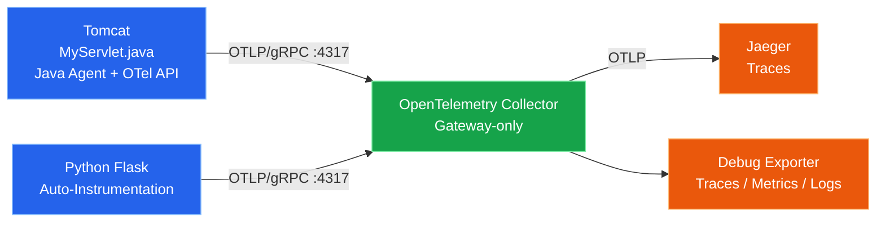

根據你目前的 `otel-collector-config.yaml`：

- **Traces** → Jaeger + Debug Exporter
- **Metrics** → Debug Exporter
- **Logs** → Debug Exporter

因此，Application 不需要部署額外的 Collector Agent，就可以將三種 Telemetry Signals 傳送到集中式 Collector。

## **6. Gateway Pattern 的重要注意事項**

對於正式 Kubernetes 部署，Gateway 可以使用多個 Replicas 提高可用性及吞吐量。

但如果使用 **Tail Sampling**，必須確保同一個 Trace ID 的 Spans 被送到同一個 Gateway Instance，否則不同 Gateway 可能只收到部分 Trace，影響採樣決策。

此外，Gateway 無法單靠自身自動讀取所有 Kubernetes Nodes 的 Container Log Files；若需要 Node-local Logs、Host Metrics，通常要另外部署 Collector Agent（DaemonSet）或其他收集元件。

## **7. Final Recommendation**

對你的平台，建議：

| Environment                                            | Recommended Pattern                  |
| ------------------------------------------------------ | ------------------------------------ |
| **Docker Compose / PoC**                               | Gateway-only                         |
| **Docker Desktop Kubernetes**                          | Gateway-only                         |
| **Multiple K8s Nodes + OTLP-only**                     | Gateway-only 仍可行                     |
| **Multiple K8s Nodes + Host Metrics / Container Logs** | Agent + Gateway                      |
| **Production + Centralized Processing / HA**           | Gateway 或 Agent + HA Gateway，依資料來源決定 |

**結論：Gateway Pattern 特別適合 Centralized Control、Expensive Processing、Multiple Backend Routing 和 Telemetry Proxy。**

你目前的 `MyServlet.java → Collector → Jaeger` 已是 Gateway Pattern 的實際例子。當未來需要 Node-level Logs、Host Metrics 或更完整的企業級 Observability 時，再導入 **Agent + Gateway Pattern** 即可。

---
# Production Deployment

> 尤其是多個 Microservices、分散在多個 Kubernetes Nodes 的企業環境，Agent + Gateway 是我優先推薦評估的 OpenTelemetry Collector 部署架構。**

## ** Agent-to-Gateway Deployment Pattern**：

**Application → Collector Agent → Collector Gateway → Observability Backend**

但要注意：**這是企業常用的推薦架構，不是 OpenTelemetry 規定所有 Production 都必須使用的架構。**

## **1. 為什麼推薦 Agent + Gateway？**

| Component                 | Production Responsibility                                       |
| ------------------------- | --------------------------------------------------------------- |
| **Application**           | 透過 OTel SDK / Java Agent 產生 Metrics、Logs、Traces                 |
| **Collector Agent**       | 就近收集 Application Telemetry、Container Logs、Host Metrics          |
| **Collector Gateway**     | 集中 Filtering、Batch、Tail Sampling、Routing、Backend Authentication |
| **Observability Backend** | 儲存及查詢 Telemetry，例如 Prometheus、Loki、Tempo、Jaeger                 |

這樣的設計可以將 **Telemetry Collection** 和 **Centralized Processing** 分開，方便規模化管理。

## **2. Production Kubernetes — Recommended Architecture**

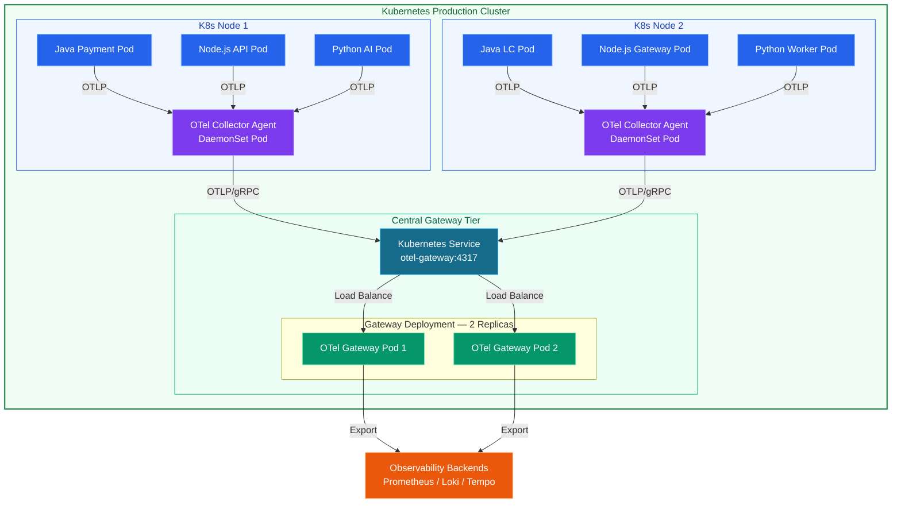

圖為簡化的多節點架構。Gateway 並非固定將某個 Node 分配到某個 Gateway；實際流量由 Load Balancer 或其他 Routing 策略決定。

## **3. Production 必須考慮的設定**

| Area                   | Recommendation                                                    |
| ---------------------- | ----------------------------------------------------------------- |
| **Agent Deployment**   | Kubernetes DaemonSet，每個 Node 一個 Collector                         |
| **Gateway Deployment** | Deployment，多副本及適當的 Autoscaling                                    |
| **Memory Management**  | Memory Limiter + Resource Limits                                  |
| **Batch Processing**   | Agent 小批次、Gateway 較大批次                                            |
| **Reliability**        | Exporter Queue、Retry、必要時 Persistent Queue                         |
| **Security**           | TLS / mTLS、Authentication、RBAC、Network Policies                   |
| **Data Protection**    | Sensitive Data Filtering、Telemetry Attributes Governance          |
| **Tail Sampling**      | Gateway 層執行，需 Trace ID Affinity                                   |
| **Monitoring**         | Collector Internal Metrics、Queue Size、Dropped / Refused Telemetry |

這些原則與 OpenTelemetry 官方 Agent-to-Gateway 部署指南一致。

尤其是 **Tail Sampling**：如果有多個 Gateway Replicas，同一條 Trace 的所有 Spans 必須盡可能路由到同一個負責 Sampling 的 Collector。一般 Round-robin 並不能保證這點。

## **4. 與 Gateway-only 比較**

| Environment                          | Recommended Pattern |
| ------------------------------------ | ------------------- |
| Docker Compose / PoC                 | Gateway-only        |
| 單節點 Docker Desktop Kubernetes        | Gateway-only        |
| 多節點、只有 OTLP Traces / Metrics         | Gateway-only 仍可滿足需求 |
| 多節點、需要 Container Logs / Host Metrics | **Agent + Gateway** |
| Production、集中式治理及大量 Telemetry        | **Agent + Gateway** |

### **最終建議**

對你的 Enterprise Banking Microservices，我建議將 **Agent（DaemonSet）+ Gateway（HA Deployment）** 作為 Production 的優先架構候選，尤其當需要 Node-local Logs、Host Metrics、Sensitive Data Filtering、集中式 Backend Routing 或 Tail Sampling 時。

但若部署規模較小、所有應用都能直接以 OTLP 傳送資料，而且沒有 Host-specific Collection 需求，**Gateway-only 仍然是正式 Production 可接受的架構**。

官方參考：[OpenTelemetry Agent-to-Gateway Deployment Pattern](https://opentelemetry.io/docs/collector/deploy/other/agent-to-gateway/?utm_source=chatgpt.com)。

---
# OpenTelemetry Collector — Scaling Strategies（擴展策略）

## 1. Overview

當 Microservices、Requests、Spans、Metrics 和 Logs 增加時，OpenTelemetry Collector 需要適當擴展。

**建議順序：Monitor → Tune → Vertical Scaling → Horizontal Scaling → Stateful Routing（必要時）。**

OpenTelemetry Collector 可採用兩種主要擴展方式：

| Comparison | Vertical Scaling（垂直擴展） | Horizontal Scaling（水平擴展） |
|---|---|---|
| 方法 | 增加單個 Collector 的 CPU / Memory | 增加 Collector Replicas |
| Kubernetes | 調整 Pod Requests / Limits | Deployment Replicas / HPA |
| 高可用性 | 單個 Pod 擴容不能實現 HA | 多副本可提高服務可用性 |
| 主要限制 | Node 資源上限 | Routing、State、Backend Capacity |
| 適用情境 | 單一 Collector 資源不足 | 需要更高吞吐量或 HA |

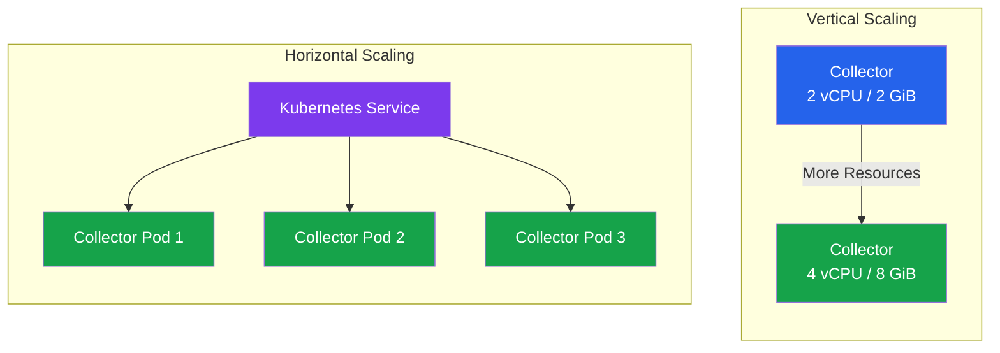

## 2. Before Scaling — Tune Collector Configuration

擴容前先確認瓶頸是否位於 Collector、Exporter、Backend 或 Network。

| Component | Purpose |
|---|---|
| **Memory Limiter** | 限制記憶體壓力並對上游產生拒收／背壓；降低 OOM 風險 |
| **Batch Processor** | 合併小批次，降低部分 Export Calls 的開銷 |
| **Requests / Limits** | 設定合理的 CPU、Memory 資源 |
| **Queue / Retry** | 處理短暫網路及 Backend 故障；留意 Queue 積壓 |

以下是示意片段，需搭配 Receiver / Exporter 定義才能使用：

```yaml
processors:
  memory_limiter:
    check_interval: 1s
    limit_mib: 512
    spike_limit_mib: 128
  batch:
    timeout: 5s
    send_batch_size: 1024

service:
  pipelines:
    traces:
      receivers: [otlp]
      processors: [memory_limiter, batch]
      exporters: [otlp]
```

> Memory Limiter 應放在 Processor Chain 前端。資源數值只是示例，須與 Kubernetes Container Memory Limit 相互配合。Batch 不等於必然啟用壓縮。

## 3. Horizontal Scaling — Stateless vs Stateful

| Processing | Example | Recommended Strategy |
|---|---|---|
| **Stateless** | Batch、Filter、一般 OTLP Logs / Traces | Kubernetes Service + Gateway Replicas |
| **Stateful** | Tail Sampling、Cumulative-to-Delta | Trace / Metric Stream-aware Routing |
| **Active Scraping** | Prometheus Receiver | Target Allocation 或明確的 Sharding |

對 Stateless Processing，一般的 Kubernetes Service 可以將 OTLP Requests 分散到多個 Gateway Pods。注意 gRPC 可能重用長時間連線，因此連線數、流量分布和 Load Balancer 行為仍需監測。

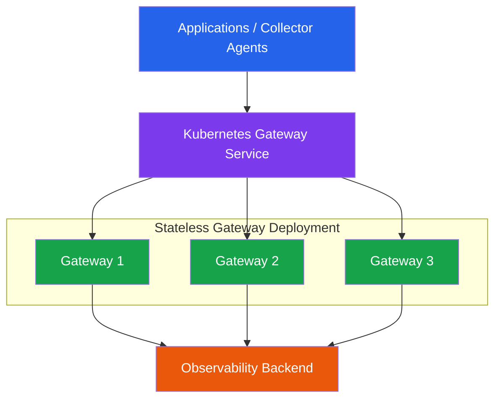

## 4. Kubernetes Collector Agent — DaemonSet Deployment

**Collector Agent（DaemonSet）與 OpenTelemetry Java Agent 不同：**

- **Java Agent** 在 JVM 中進行 Zero-code Instrumentation。
- **Collector Agent** 是獨立的 Collector Pod；Kubernetes DaemonSet 通常在每個符合條件的 Node 部署一個。
- 每個 Node 可以有多個 Application Pods，共用該 Node 上的 Collector Agent。
- Gateway 是共用服務層，不是每個 Node 對應一個 Gateway。

### 4.1 Agent + HA Gateway Architecture

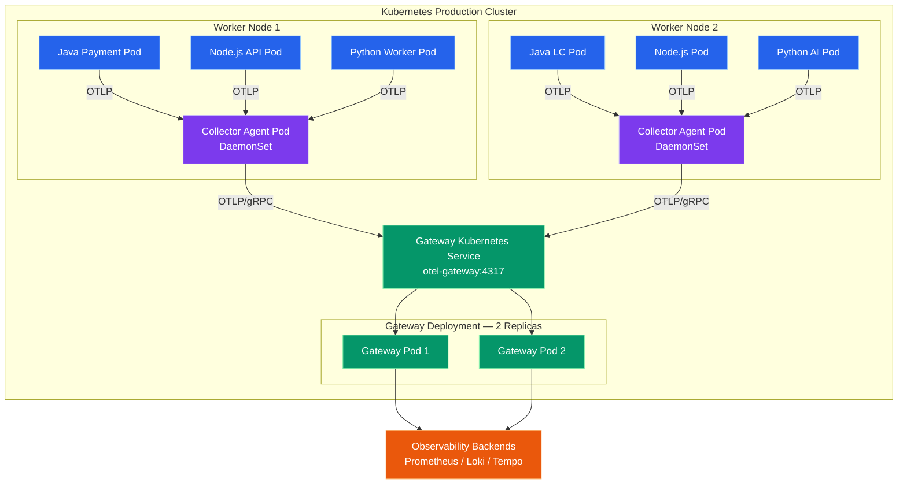

**Routing requirement:** 應用程式要真正送到本機 Node 的 Agent，必須使用 Node IP、Downward API 或可保證 Node-local Routing 的方式。不能假設普通 ClusterIP Service 一定路由到同 Node。

| Agent（DaemonSet） | Gateway（Deployment） |
|---|---|
| Node-local OTLP / Container Logs / Host Metrics | Central Filtering / Routing / Backend Credentials |
| 隨符合條件的 Node 數量增加 | 依流量、資源及 HA 增加 Replicas |
| 適合就近接收與輕量處理 | 適合昂貴或需集中治理的處理 |
| 每個 Node 一份管理成本 | 統一出口、TLS 與 Backend Export |

**When to adopt:** 多節點 + Node Logs / Host Metrics / 集中治理時優先評估 Agent + Gateway；若只接收少量 OTLP 且無 Node-local 需求，Gateway-only 仍然可以用於 Production。

## 5. Stateful Scaling — Tail-based Sampling

Tail Sampling 需要同一條 Trace 的相關 Spans 到達同一個 Tail Sampling Gateway Instance，不能只依賴普通 Round-robin。

### 5.1 Trace ID-aware Routing

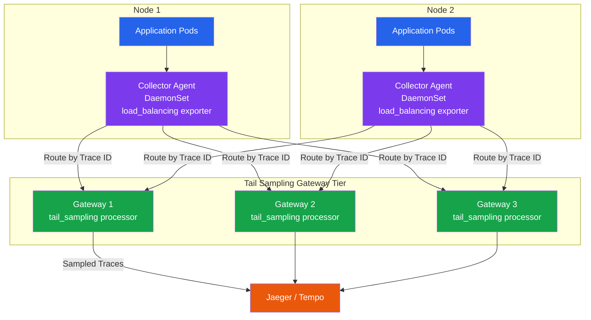

**圖示解讀：** 六條 Agent → Gateway 線是「可能路由的目的地」，不代表每筆 Trace 都要發送到全部 Gateways。`load_balancing` Exporter 使用 Trace ID 一致性選擇目的地。Gateway Replicas 變更時仍須考慮路由重分配與 Sampling Decision 一致性；應先驗證再投入正式環境。

## 6. Collector Metrics — When to Scale?

| Metric | Purpose | Interpretation |
|---|---|---|
| `otelcol_processor_refused_spans` | Processor 拒絕的 Spans | Rate 持續大於零需調查 |
| `otelcol_receiver_accepted_spans` | 接收的 Spans | 用於估算 Ingestion Rate |
| `otelcol_exporter_queue_size` | Export Queue Size | 持續上升可能表示匯出瓶頸 |
| `otelcol_exporter_queue_capacity` | Export Queue Capacity | 可計算 Queue Utilization |
| `otelcol_exporter_send_failed_spans` | 失敗的 Span Exports | 調查 Backend / Network / Retry |

```bash
curl -s http://localhost:8888/metrics | grep 'otelcol_exporter_queue_size'
```

若版本／設定有暴露這些 Metrics，可在 Prometheus 使用：

```promql
otelcol_exporter_queue_size / otelcol_exporter_queue_capacity
```

**注意：** Collector 自身 Metrics 並非所有版本都預設綁定 `8888`。需在 `service.telemetry.metrics` 明確配置適用的 Reader / Endpoint，並確認實際名稱與 Labels。Queue 高也可能是 Backend 慢，不一定是 Collector CPU 不夠。Queue 長期達約 60–70% 容量可作為調查與擴容的早期警訊，而非固定 SLO 門檻。

## 7. Signal-specific Scaling

| Signal | Scaling Approach | Special Consideration |
|---|---|---|
| **Traces** | Stateless Gateway Replicas | Tail Sampling 需 Trace ID Affinity |
| **Metrics** | Horizontal Scaling / Sharding | Prometheus Scraping 需 Target Allocator；Stateful Metric Conversion 需一致性路由 |
| **Logs** | Horizontal Scaling | Filelog / Node-local Collectors 必須控制 File Ownership 與 Offsets |

不能讓多個 Prometheus Receiver Replicas 無條件重複 Scrape 同一組 Targets；需要 Target Allocation 或其他明確的 Sharding 設計。

## 8. MyServlet.java — From PoC to Production

**Current Docker Compose PoC**：

```text
MyServlet.java → Java Agent-managed SDK → OTLP/gRPC
    → Single Collector → Jaeger (Traces) + Debug (All Signals)
```

**Recommended Multi-node Production Candidate**：

```text
Multiple Application Pods (each Node)
    → Node-local Collector Agent (DaemonSet)
    → Gateway Kubernetes Service
    → HA Collector Gateway Deployment
    → Prometheus / Loki / Tempo
```

若 Gateway 需要 Tail Sampling，應將普通 Gateway Service 分配策略改為 **Trace ID-aware Routing**，由 Node Agents 或獨立 Routing Tier 使用 `load_balancing` Exporter 進行分流。

## 9. Summary — Scaling Checklist

| Step | Recommendation |
|---|---|
| **1. Monitor** | CPU、Memory、Receiver Refusals、Exporter Queue、Send Failures |
| **2. Tune** | Memory Limiter、Batch、Queue / Retry、Requests / Limits |
| **3. Vertical Scale** | 增加資源直到成本／Node 資源不再合理 |
| **4. Horizontal Scale** | Stateless Gateway Replicas + Kubernetes Service |
| **5. Node-local Collection** | 多節點 Node Logs / Host Metrics 使用 DaemonSet Agents |
| **6. Stateful Routing** | Tail Sampling 使用 Trace ID-aware Load Balancing |
| **7. Validate** | 確保瓶頸不是 Backend、Network 或重複 Scrape |

**Conclusion:** Vertical Scaling 是增加單個 Collector 的資源；Horizontal Scaling 是增加 Collector Instances；Agent DaemonSet 隨 Node 數量部署，而 Gateway Deployment 隨 Telemetry 負載及 HA 需求擴展。多節點 Production 可優先評估 **Agent + Gateway**，但不是所有環境的硬性要求。

## References

- [Scaling the Collector](https://opentelemetry.io/docs/collector/scaling/)
- [Agent-to-Gateway Deployment Pattern](https://opentelemetry.io/docs/collector/deploy/other/agent-to-gateway/)
- [Agent Deployment Pattern](https://opentelemetry.io/docs/collector/deploy/agent/)
- [Gateway Deployment Pattern](https://opentelemetry.io/docs/collector/deploy/gateway/)
- [Collector Internal Telemetry](https://opentelemetry.io/docs/collector/internal-telemetry/)

---
# ** OpenTelemetry SDK Exporter vs Collector 比較方式。**

你提供的說明正確區分了三個不同的角色：

1. **SDK Exporter**：Application SDK 內部的匯出元件，負責將 Telemetry 傳送到指定目的地。
2. **OpenTelemetry Collector**：獨立運行的服務，負責接收、處理和轉送 Telemetry。
3. **Collector Exporter**：Collector 內部的輸出元件，負責將處理後的 Telemetry 傳送至 Backend。

尤其是這個流程**完全正確。**：

`Java SDK Exporter → Collector OTLP Receiver → Collector Processing → Collector Exporter → Tempo`

## **1. 更精確的比較**

| Comparison                 | SDK Exporter                                     | OpenTelemetry Collector                            |
| -------------------------- | ------------------------------------------------ | -------------------------------------------------- |
| **Where it runs**          | Application Process 內，屬於 SDK                     | 獨立 Process / Container / Pod                       |
| **What it receives**       | SDK 提供的 Telemetry                                | 來自多個 Applications 或其他 Sources 的 Telemetry          |
| **Primary Responsibility** | Export Telemetry                                 | Receive、Process、Export                             |
| **Processing**             | Exporter 本身主要負責傳輸；SDK 其他元件負責 Sampling、Batching 等 | Collector Processors 提供 Batch、Filter、Transform 等功能 |
| **Destinations**           | 由 SDK Exporter 配置指定目的地                           | 可透過多條 Pipelines 配置不同 Backends                      |
| **Is Collector required?** | 不需要                                              | 選用                                                 |

最重要的是：**不要拿 SDK Exporter 與整個 Collector 當作功能完全對等的元件比較。**

它們不是同一個層級。

## **2. 正確的架構關係**

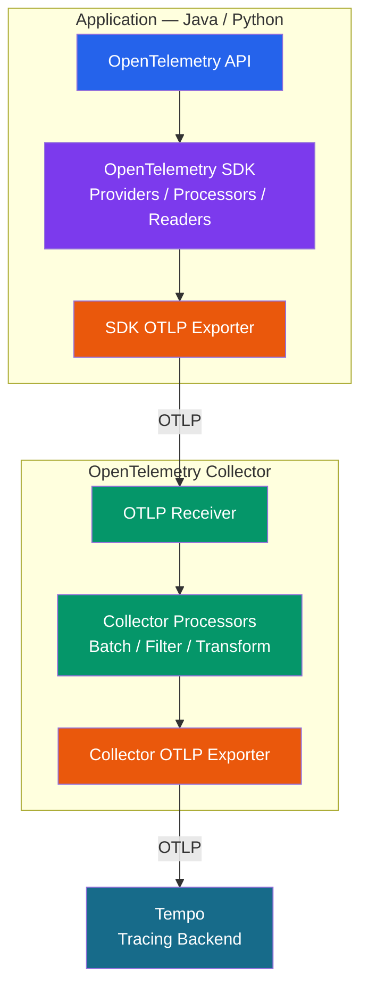

這與 OpenTelemetry 官方定義一致：Collector 是獨立執行的元件，可以配置多條由 Receivers、Processors 和 Exporters 組成的 Pipelines。


## **3. Collector 是 Optional**

你原文這一段也正確：

> The Collector is optional. If the backend accepts the exporter’s protocol and signal type, the SDK exporter can send directly to the backend.

實際上有兩種有效架構：

| Architecture               | Telemetry Flow                                 |
| -------------------------- | ---------------------------------------------- |
| **Direct Export**          | Application SDK Exporter → Backend             |
| **Collector-based Export** | Application SDK Exporter → Collector → Backend |

你的 `MyServlet.java` 採用第二種，透過 Java Agent-managed SDK 的 OTLP Exporter，將資料傳送至 Collector。

---
# ** OpenTelemetry Collector — Recap**

本章主要介紹 **OpenTelemetry Collector 的功能、架構、部署方式、Scaling Strategies，以及 SDK Exporter 與 Collector 的差異**。

**核心觀念：OpenTelemetry Collector 是 Application 與 Observability Backend 之間的 Telemetry Processing 元件，負責 Receive → Process → Export。**

## **1. Collector Purpose（主要用途）**

Collector 的主要價值包括：

- **Fast Offloading**：Application 快速將 Telemetry 傳送到 Collector。
- **Centralized Processing**：集中執行 Batch、Filter、Transform。
- **Multiple Protocols**：支援 OTLP、Prometheus、Zipkin 等。
- **Network Simplification**：減少 Application 直接連接不同 Backends 的需求。
- **Flexibility & Scalability**：支援不同部署方式及水平擴展。

## **2. Collector Distributions**

| Distribution          | Description                                           |
| --------------------- | ----------------------------------------------------- |
| **Core Collector**    | 提供核心功能，由 OpenTelemetry 核心團隊維護                         |
| **Contrib Collector** | 包含更多社群提供的 Receivers、Processors、Exporters 和 Extensions |

Contrib 提供更廣泛的整合元件選擇，但不表示其所有元件都具有相同成熟度。

## **3. Collector Configuration — Five Sections**

| Section        | Responsibility                                   | Activated By                    |
| -------------- | ------------------------------------------------ | ------------------------------- |
| **Receivers**  | 接收或主動收集 Telemetry                                | `service.pipelines`             |
| **Processors** | Batch、Filter、Transform、Memory Limiting           | `service.pipelines`             |
| **Exporters**  | 將 Telemetry 傳送到指定目的地                             | `service.pipelines`             |
| **Extensions** | Health Check、pprof、zPages                        | `service.extensions`            |
| **Service**    | 啟用 Components、配置 Pipelines 和 Collector Telemetry | Collector Service Configuration |

### **Collector Pipeline**

```mermaid

flowchart TD
    SRC["Telemetry Sources<br/>Java / Python / MySQL"]
    REC["Receivers"]
    PROC["Processors"]
    EXP["Exporters"]
    BACK["Observability Backend"]

    SRC --> REC --> PROC --> EXP --> BACK

    classDef source fill:#2563EB,color:#fff
    classDef receiver fill:#176B8A,color:#fff
    classDef processor fill:#166534,color:#fff
    classDef exporter fill:#A21CAF,color:#fff
    classDef backend fill:#EA580C,color:#fff

    class SRC source
    class REC receiver
    class PROC processor
    class EXP exporter
    class BACK backend

```

**Important:** Processors 按照 `service.pipelines` 中列出的順序執行。

## **4. Collector Deployment Patterns**

| Pattern             | Deployment                             | Best For                                     |
| ------------------- | -------------------------------------- | -------------------------------------------- |
| **Agent**           | Host Process / K8s DaemonSet / Sidecar | Host Metrics、快速收集及卸載 Telemetry               |
| **Gateway**         | Centralized Collector Deployment       | 集中 Policy、Filtering、Routing、Heavy Processing |
| **Agent + Gateway** | Node Agents → Central Gateway          | 多節點 Production、集中治理及完整 Observability         |

### **Recommended Production Pattern**

```mermaid

flowchart TB
    subgraph NODE1["K8s Node 1"]
        A1["Java /<br> Node.js Pods"]
        AG1["Collector Agent<br/>DaemonSet"]
        A1 --> AG1
    end

    subgraph NODE2["K8s Node 2"]
        A2["Python /<br> Java Pods"]
        AG2["Collector Agent<br/>DaemonSet"]
        A2 --> AG2
    end

    GW["Central Collector Gateway<br/>HA Deployment"]
    BACK["Observability Backends"]

    AG1 -->|"OTLP"| GW
    AG2 -->|"OTLP"| GW
    GW --> BACK

    classDef app fill:#2563EB,color:#fff
    classDef agent fill:#7C3AED,color:#fff
    classDef gateway fill:#059669,color:#fff
    classDef backend fill:#EA580C,color:#fff

    class A1,A2 app
    class AG1,AG2 agent
    class GW gateway
    class BACK backend

```

**Key Point:** Agent + Gateway 是常見的 Production 架構，但不是所有環境都必須部署兩層 Collector。

## **5. Scaling Strategies**

| Strategy                           | Description                      | Recommendation            |
| ---------------------------------- | -------------------------------- | ------------------------- |
| **Vertical Scaling**               | 增加單一 Collector 的 CPU、Memory、Disk | 先調整資源與 Processor 配置       |
| **Horizontal Scaling — Stateless** | 增加 Collector Replicas            | 使用 Load Balancer 分配負載     |
| **Horizontal Scaling — Stateful**  | 增加 Replicas 並維持資料路由一致性           | 使用 Trace ID-aware Routing |

擴容前應先檢查 **Memory Limiter、Batch Processor、Kubernetes Requests / Limits**。

### **Tail Sampling — Two-Tier Architecture**

Tail Sampling 需要同一條 Trace 的所有 Spans 盡可能到達同一個 Collector Instance。

```mermaid

flowchart TB
    APP["Applications<br/>Distributed Traces"]

    T1["Tier 1 — Routing Collector<br/>Load-balancing Exporter<br/>Trace ID-aware Routing"]

    subgraph T2["Tier 2 — Tail Sampling Collectors"]
        direction LR
        G1["Collector 1<br/>tail_sampling"]
        G2["Collector 2<br/>tail_sampling"]
        G3["Collector 3<br/>tail_sampling"]
    end

    BACK["Jaeger / Tempo"]

    APP -->|"OTLP"| T1

    T1 -->|"Route by Trace ID"| G1
    T1 -->|"Route by Trace ID"| G2
    T1 -->|"Route by Trace ID"| G3

    G1 --> BACK
    G2 --> BACK
    G3 --> BACK

    classDef app fill:#2563EB,color:#fff
    classDef routing fill:#7C3AED,color:#fff
    classDef sampler fill:#059669,color:#fff
    classDef backend fill:#EA580C,color:#fff

    class APP app
    class T1 routing
    class G1,G2,G3 sampler
    class BACK backend

```

**重要：** 一般 Round-robin Load Balancer 不能保證 Trace Affinity，因此 Tail Sampling 需要適當的 Trace ID-based Routing。

## **6. Collector Internal Metrics**

以下 Metrics 用來判斷 Collector 是否需要擴容：

| Metric                            | Purpose                    |
| --------------------------------- | -------------------------- |
| `otelcol_processor_refused_spans` | 監控 Processor 拒絕的 Spans     |
| `otelcol_receiver_accepted_spans` | 監控 Collector 接收的 Traces 流量 |
| `otelcol_exporter_queue_size`     | 監控 Export Queue 是否持續累積     |

當 Refused Spans 持續增加、Exporter Queue 持續成長時，應檢查 Collector Resource Limits、Backend Performance 和 Exporter Configuration。

## **7. Signal-specific Scaling**

| Signal      | Scaling Considerations                                             |
| ----------- | ------------------------------------------------------------------ |
| **Traces**  | Stateless 可一般 Load Balance；Tail Sampling 需要 Trace ID-aware Routing |
| **Metrics** | Prometheus Scraping 需要 Target Allocator 或 Sharding，避免重複收集          |
| **Logs**    | 一般 OTLP Logs 可水平擴展；File-based Collection 需考慮檔案位置及讀取狀態              |

## **8. SDK Exporter vs Collector Exporter**

這是本章最後的重要觀念。

| Comparison          | SDK Exporter                           | Collector Exporter                           |
| ------------------- | -------------------------------------- | -------------------------------------------- |
| Location            | Application Runtime                    | Collector Process                            |
| Purpose             | 將 SDK Telemetry 傳送到目的地                 | 將 Collector Pipeline 的 Telemetry 輸出到 Backend |
| Configuration       | SDK / Agent Configuration              | Collector `config.yaml`                      |
| Processing          | 由 SDK 的 Sampler、Processor、Reader 等元件處理 | 由 Collector Processors 處理                    |
| Typical Destination | Collector 或 Backend                    | Observability Backend                        |

**完整流程：**

`Application → OTel API → SDK → SDK Exporter → Collector Receiver → Collector Processor → Collector Exporter → Backend`

Collector 是選用元件；如果 Backend 支援相應協定，SDK Exporter 也可以直接傳送。

## ** 9. OTCA Exam — Key Takeaways** — Collector 必記重點

- **Receive → Process → Export**
- **Core vs Contrib**
- **Receivers / Processors / Exporters / Extensions / Service**
- **Agent vs Gateway vs Agent + Gateway**
- **Vertical vs Horizontal Scaling**
- **Stateless vs Stateful Tail Sampling**
- **Collector Internal Metrics**
- **SDK Exporter vs Collector Exporter**

課程指出，本章對應 **OTCA Domain 3 — OpenTelemetry Collector**，占考試約 **26%**；這是課程提供的比例，正式考試仍應以當期官方 Exam Blueprint 為準。

**最終結論：OpenTelemetry Collector 的核心價值，是讓 Telemetry 的收集、處理、路由、擴展及 Backend Integration 能獨立於 Application 管理。**

對你的 `MyServlet.java` Learning / PoC，現有 **Java Agent + Code-based Instrumentation → SDK Exporter → Collector → Jaeger / Debug** 已足以實驗本章大部分功能；未來多節點 Production 再依需求導入 **Collector Agent（DaemonSet）+ HA Gateway**。

---
# ** RECAP OpenTelemetry Collector — Agent vs Gateway vs Agent + Gateway**

這三種都是 **OpenTelemetry Collector 的 Deployment Patterns（部署模式）**。它們使用相同的 Collector 架構：

**Receivers → Processors → Exporters**

主要差異在於 **Collector 部署在哪裡、如何收集 Telemetry，以及由誰負責集中處理與轉送。**

## **1. 三種 Deployment Patterns 比較**

| Comparison                | Agent Pattern                      | Gateway Pattern                    | Agent + Gateway                        |
| ------------------------- | ---------------------------------- | ---------------------------------- | -------------------------------------- |
| **部署位置**                  | 靠近 Application                     | 集中部署                               | Node-local + Centralized               |
| **Kubernetes 部署**         | DaemonSet / Sidecar                | Deployment / StatefulSet           | DaemonSet + Deployment                 |
| **Collector 數量**          | 通常每個 Node 一個                       | 依流量設定 Replicas                     | 每個 Node 一個 Agent + 多個 Gateway Replicas |
| **Telemetry Collection**  | 收集本機 Application、Host、Container 資料 | 接收多個 Applications 的 Telemetry      | Agent 本機收集，再轉給 Gateway                 |
| **Host Metrics**          | ✅ 適合                               | ⚠️ 無法直接收集所有遠端 Nodes 的 Host Metrics | ✅ 適合                                   |
| **Centralized Filtering** | 分散在各 Agents                        | ✅                                  | ✅ Gateway                              |
| **Tail Sampling**         | 不適合直接在各 Node 獨立採樣跨節點 Traces        | ✅ 需 Trace ID Routing               | ✅ 需 Trace ID Routing                   |
| **High Availability**     | 隨 Node 分散，但本機 Agent 仍可能故障          | 多 Replicas                         | 多 Gateway Replicas                     |
| **維運複雜度**                 | 中                                  | 低～中                                | 較高                                     |
| **適用環境**                  | 本機資料收集                             | OTLP 集中處理                          | 大型多節點 Production                       |

## **2. Agent Pattern — Distributed Collection**

```mermaid

flowchart TB
    subgraph N1["Kubernetes Node 1"]
        direction TB
        A1["Java Pod"]
        A2["Python Pod"]
        AG1["OTel Agent<br/>DaemonSet Pod"]
        A1 -->|"OTLP"| AG1
        A2 -->|"OTLP"| AG1
    end

    subgraph N2["Kubernetes Node 2"]
        direction TB
        B1["Node.js Pod"]
        B2["Java Pod"]
        AG2["OTel Agent<br/>DaemonSet Pod"]
        B1 -->|"OTLP"| AG2
        B2 -->|"OTLP"| AG2
    end

    BACK["Observability Backend"]

    AG1 -->|"Export"| BACK
    AG2 -->|"Export"| BACK

    classDef app fill:#2563EB,color:#fff
    classDef agent fill:#7C3AED,color:#fff
    classDef backend fill:#EA580C,color:#fff

    class A1,A2,B1,B2 app
    class AG1,AG2 agent
    class BACK backend

```

**重點：每個符合條件的 Kubernetes Node 通常運行一個 Collector Agent DaemonSet Pod。**

Agent 特別適合使用 `hostmetrics`、`kubeletstats` 或 `filelog` Receiver 收集 Node-local Telemetry。

例如，一個 Node 有 10 個 Application Pods，通常不需要 10 個 DaemonSet Agents，而是由一個 Node-local Agent 負責收集。

## **3. Gateway Pattern — Centralized Collection**

```mermaid

flowchart TB
    subgraph N1["Node 1"]
        A1["Java Pod"]
        A2["Python Pod"]
    end

    subgraph N2["Node 2"]
        B1["Node.js Pod"]
        B2["Java Pod"]
    end

    SVC["Gateway Service<br/>OTLP Endpoint"]

    subgraph GW["Gateway Deployment — 2 Replicas"]
        direction LR
        G1["Collector Gateway 1"]
        G2["Collector Gateway 2"]
    end

    BACK["Observability Backend"]

    A1 -->|"OTLP"| SVC
    A2 -->|"OTLP"| SVC
    B1 -->|"OTLP"| SVC
    B2 -->|"OTLP"| SVC

    SVC --> G1
    SVC --> G2

    G1 --> BACK
    G2 --> BACK

    classDef app fill:#2563EB,color:#fff
    classDef service fill:#176B8A,color:#fff
    classDef gateway fill:#059669,color:#fff
    classDef backend fill:#EA580C,color:#fff

    class A1,A2,B1,B2 app
    class SVC service
    class G1,G2 gateway
    class BACK backend

```

**重點：所有 Applications 直接將 Telemetry 傳送至共享的 Gateway Service。**

優點是容易集中管理 Filtering、Batch、Routing、Authentication 及 Backend Configuration，而且 Gateway 可以獨立增加 Replicas。

但若需要收集每個 Node 的本機 Log Files 或 Host Metrics，單靠中央 Gateway 通常不夠。

## **4. Agent + Gateway Pattern — Combined Architecture**

這是將前面兩種模式結合，也是大型多節點 Production 常見的部署架構。

```mermaid

flowchart TB
    subgraph K8S["Kubernetes Production Cluster"]
        direction TB

        subgraph N1["Node 1"]
            direction TB
            A1["Java Pod"]
            A2["Node.js Pod"]
            AG1["Collector Agent<br/>DaemonSet"]
            A1 -->|"OTLP"| AG1
            A2 -->|"OTLP"| AG1
        end

        subgraph N2["Node 2"]
            direction TB
            B1["Python Pod"]
            B2["Java Pod"]
            AG2["Collector Agent<br/>DaemonSet"]
            B1 -->|"OTLP"| AG2
            B2 -->|"OTLP"| AG2
        end

        SVC["Gateway Service"]

        subgraph GATEWAY["Gateway Tier — HA Deployment"]
            direction LR
            GW1["Gateway 1"]
            GW2["Gateway 2"]
        end

        AG1 -->|"OTLP"| SVC
        AG2 -->|"OTLP"| SVC
        SVC --> GW1
        SVC --> GW2
    end

    BACK["Observability Backends"]

    GW1 --> BACK
    GW2 --> BACK

    classDef app fill:#2563EB,color:#fff
    classDef agent fill:#7C3AED,color:#fff
    classDef service fill:#176B8A,color:#fff
    classDef gateway fill:#059669,color:#fff
    classDef backend fill:#EA580C,color:#fff

    class A1,A2,B1,B2 app
    class AG1,AG2 agent
    class SVC service
    class GW1,GW2 gateway
    class BACK backend

```

在這個架構中：

- **Agent**：負責 Node-local Collection，包括 Application Telemetry、Host Metrics、Container Logs，以及初步處理。
- **Gateway**：負責集中 Filtering、Routing、Batching、Backend Authentication 和必要的 Tail Sampling。
- **Backend**：負責 Telemetry Storage、Query、Visualization。

圖中 Gateway Service 適用於一般 Stateless Processing；若 Gateway 執行 Tail Sampling，Agent 的 Traces Pipeline 應使用 Trace ID-aware `load_balancing` Exporter，確保同一條 Trace 的 Spans 路由至同一個 Sampling Collector。

## **5. Agent 和 Gateway 的本質差異**

**Agent 與 Gateway 並不是兩種不同的 OpenTelemetry Collector 軟體。** 它們是相同 Collector 在不同部署位置所扮演的角色。

|                   | Agent                            | Gateway                                                       |
| ----------------- | -------------------------------- | ------------------------------------------------------------- |
| **主要目標**          | Local Collection                 | Centralized Processing                                        |
| **擴展依據**          | Node 數量                          | Telemetry 流量                                                  |
| **適合的 Receiver**  | `otlp`、`hostmetrics`、`filelog`   | `otlp`                                                        |
| **適合的 Processor** | `memory_limiter`、`batch`         | `memory_limiter`、`batch`、`filter`、`transform`、`tail_sampling` |
| **Exporter**      | OTLP 或 Backend-specific Exporter | OTLP 或 Backend-specific Exporter                              |

### **以你的 MyServlet.java 為例**

**目前 Docker Compose PoC：**

`MyServlet.java → Java Agent-managed SDK → SDK OTLP Exporter → Collector Gateway → Jaeger`

**未來多節點 Kubernetes Production：**

`MyServlet.java → Java Agent-managed SDK → SDK OTLP Exporter → Node-local Collector Agent（DaemonSet）→ Collector Gateway（Deployment）→ Jaeger / Tempo`

這裡有兩種不同的 Agent，必須區分：

- **OpenTelemetry Java Agent**：JVM 內的 Zero-code Instrumentation Agent。
- **OpenTelemetry Collector Agent**：獨立的 Collector Process / Pod，負責收集 Telemetry。

## **6. 最後如何選擇？**

| Your Requirements                                  | Recommended Pattern                          |
| -------------------------------------------------- | -------------------------------------------- |
| 小型 PoC、所有服務可直接發送 OTLP                              | **Gateway-only**                             |
| 需要收集每個 Node 的 Host Metrics、Container Logs，但不需要集中處理 | **Agent-only**                               |
| 多節點 Kubernetes、需要 Local Collection 和集中式治理          | **Agent + Gateway**                          |
| 多節點 Kubernetes，且需要跨服務 Tail Sampling                | **Agent + Gateway + Trace ID-aware Routing** |

**最終結論：**

- **Agent = Collect Locally**
- **Gateway = Process Centrally**
- **Agent + Gateway = Collect Locally + Process Centrally**

對你的 Enterprise Banking Microservices Production，若同時需要 Application Traces、Node Metrics、Container Logs、集中式 Filtering 和 Tail Sampling，**Agent（DaemonSet）+ Gateway（HA Deployment）是最值得優先採用的模式**。

官方參考：[OpenTelemetry — Agent-to-Gateway Deployment Pattern](https://opentelemetry.io/docs/collector/deploy/other/agent-to-gateway/?utm_source=chatgpt.com)。

---
