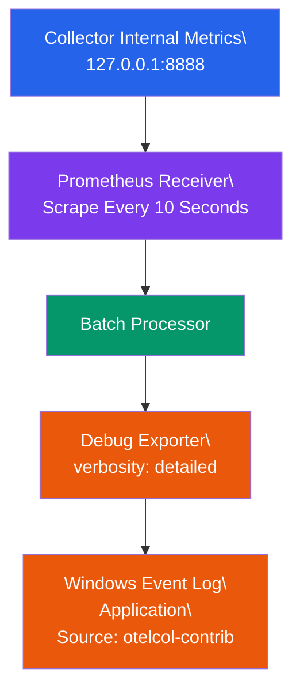
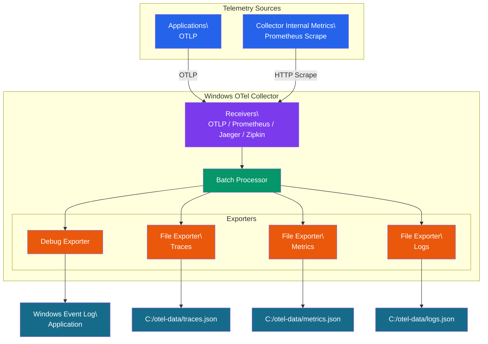

# Windows OpenTelemetry Collector — Debug Exporter、Windows Event Log 與 File Exporter

## 1. Overview

OpenTelemetry Collector 預設不會自動將 Application Logs、Traces 和 Metrics 儲存為本機資料檔案。

目前 Windows Collector 已經確認：

**Collector Internal Metrics → Prometheus Receiver → Batch Processor → Debug Exporter → Windows Event Log**

另外，可以使用 **File Exporter**，將 Telemetry 儲存至本機 JSON 檔案。

| Exporter                 | Output Destination                             | Purpose                                  |
| ------------------------ | ---------------------------------------------- | ---------------------------------------- |
| **Debug Exporter** | Windows Event Log（目前 Windows Service 環境） | 查看詳細 Telemetry，方便 Troubleshooting |
| **File Exporter**  | 本機 JSON Files                                | 儲存接收到的 Logs、Traces、Metrics       |
| **OTLP Exporter**  | Remote Collector / Backend                     | 將 Telemetry 轉送至其他服務              |

**Important:** Windows Event Log 與 File Exporter 是不同的輸出機制，可以同時使用。

---

## 2. Windows Collector Installation

以下 `bash` 指令適用於 **Windows 11 的 Git Bash**，不是 WSL/Linux Bash。請使用 **以系統管理員身分啟動的 Git Bash** 執行 Windows Service 變更與 `C:/Program Files` 下的配置修改。`sc.exe`、`wevtutil.exe` 仍是 Windows 工具；Git Bash 僅作為 Shell。`MSYS_NO_PATHCONV=1` 可避免 Git Bash 誤將 `wevtutil.exe` 的 `/q:`、`/c:` 參數轉為路徑。
目前安裝環境：

| Item                   | Value                                                            |
| ---------------------- | ---------------------------------------------------------------- |
| OS                     | Windows 11 ARM64                                                 |
| Collector Distribution | `otelcol-contrib`                                              |
| Collector Version      | `0.165.0`                                                      |
| Service Name           | `otelcol-contrib`                                              |
| Service Status         | Running                                                          |
| Executable             | `C:\Program Files\OpenTelemetry Collector\otelcol-contrib.exe` |
| Configuration          | `C:\Program Files\OpenTelemetry Collector\config.yaml`         |
| Internal Metrics       | `http://127.0.0.1:8888/metrics`                                |
| Diagnostic Logs        | Windows Event Log — Application                                 |

### Check Windows Service

```bash
sc.exe query otelcol-contrib
```

### Check Service Configuration

```bash
sc.exe qc otelcol-contrib
# BINARY_PATH_NAME includes the executable and --config path
```

### View Collector Configuration

```bash
cat "/c/Program Files/OpenTelemetry Collector/config.yaml"
```

---

## 3. Current Verification Results

| Item                | Result           | Interpretation                      |
| ------------------- | ---------------- | ----------------------------------- |
| Windows Service     | Normal           | `otelcol-contrib` 0.165.0         |
| Prometheus Receiver | Normal           | 成功收集 Collector Internal Metrics |
| Scrape Status       | `up = 1`       | Prometheus Scrape 成功              |
| Batch Processor     | Normal           | 正常執行批次處理                    |
| Debug Exporter      | Normal           | 成功輸出 Metrics                    |
| Windows Event Log   | Normal           | 存有 Debug Metrics 訊息             |
| Application Traces  | Not Yet Verified | 尚未確認 OTLP Traces 接收           |
| Application Logs    | Not Yet Verified | 尚未確認 OTLP Logs 接收             |

### Windows Event Log Example

```text
TimeCreated : 11/26/2026 10:39:56 AM
Message : Metrics
    otelcol.component.id: debug
    otelcol.component.kind: exporter
    otelcol.signal: metrics
    resource metrics: 1
    metrics: 20
    data points: 21
```

同時可以看到 `ResourceMetrics`、`Metric`、`NumberDataPoints` 和 `Value` 等詳細資訊。

這證明目前的 **Metrics Pipeline** 正常運作，但尚未證明 Traces、Logs 也已成功接收。

---

## 4. Current Debug Exporter Architecture



**Important:**

Windows Event Log 記錄的是 Collector 的 Diagnostic / Debug Output，不是專門用來長期儲存、搜尋及分析 OpenTelemetry Signals 的 Observability Backend。

目前沒有自動產生：

- `traces.json`
- `metrics.json`
- `logs.json`

若需要這些檔案，必須明確配置 File Exporter。

---

## 5. View Telemetry in Windows Event Log

你的 Collector 使用：

```yaml
exporters:
  debug:
    verbosity: detailed
```

因此 Debug Exporter 會在 Collector Diagnostic Logs 中輸出接收到的 Telemetry。

### 5.1 View Recent Collector Events

```bash
MSYS_NO_PATHCONV=1 wevtutil.exe qe Application \
  '/q:*[System[Provider[@Name="otelcol-contrib"]]]' \
  /rd:true /c:10 /f:text
```

### 5.2 View Metrics

```bash
MSYS_NO_PATHCONV=1 wevtutil.exe qe Application \
  '/q:*[System[Provider[@Name="otelcol-contrib"]]]' \
  /rd:true /c:500 /f:text | grep -E -A 8 'otelcol.signal.*metrics|ResourceMetrics'
```

### 5.3 View Traces

```bash
MSYS_NO_PATHCONV=1 wevtutil.exe qe Application \
  '/q:*[System[Provider[@Name="otelcol-contrib"]]]' \
  /rd:true /c:500 /f:text | grep -E -A 8 'otelcol.signal.*traces|ResourceSpans'
```

### 5.4 View Logs

```bash
MSYS_NO_PATHCONV=1 wevtutil.exe qe Application \
  '/q:*[System[Provider[@Name="otelcol-contrib"]]]' \
  /rd:true /c:500 /f:text | grep -E -A 8 'otelcol.signal.*logs|ResourceLogs'
```

**Note:** 如果沒有找到 Traces 或 Logs，不一定表示 Receiver 不正常，也可能是沒有接收到該 Signal、事件已被覆寫，或查詢範圍不足。

---

## 6. Add File Exporter — Persistent Local Files

### 6.1 Recommended Local Directory

```text
C:\otel-data\\
    traces.json
    metrics.json
    logs.json
```

建立資料夾：

```bash
mkdir -p /c/otel-data
```

確認 Windows Service Account 對 `C:\otel-data` 具備寫入權限。

File Exporter 會將收到的 Telemetry 以 JSON 格式寫入指定檔案。

這些檔案不是 Tempo、Loki 或 Prometheus 使用的資料庫格式。

### 6.2 Add File Exporters

在現有 `exporters` 中加入：

```yaml
exporters:
  debug:
    verbosity: detailed
  file/traces:
    path: C:/otel-data/traces.json
  file/metrics:
    path: C:/otel-data/metrics.json
  file/logs:
    path: C:/otel-data/logs.json
```

### 6.3 Update Service Pipelines

```yaml
service:
  pipelines:
    traces:
      receivers: [otlp, jaeger, zipkin]
      processors: [batch]
      exporters: [debug, file/traces]
    metrics:
      receivers: [otlp, prometheus]
      processors: [batch]
      exporters: [debug, file/metrics]
    logs:
      receivers: [otlp]
      processors: [batch]
      exporters: [debug, file/logs]
```

**Important:** 上述片段只顯示需要修改的部分。必須保留原本的 `service.telemetry`、`service.extensions` 及其他 Collector Configuration。

---

## 7. Revised Full Collector Configuration

以下完整範例依照目前 Windows `otelcol-contrib 0.165.0` 的配置修改，新增三個 File Exporters，並保留原本的 Receivers、Processors、Extensions、Internal Metrics 和 Debug Exporter。

同時將本機 Prometheus Scrape Target 改為 `127.0.0.1:8888`。

```yaml
# OpenTelemetry Collector Contrib
# Windows ARM64
# Version: 0.165.0
extensions:
  health_check:
  pprof:
    endpoint: 0.0.0.0:1777
  zpages:
    endpoint: 0.0.0.0:55679
receivers:
  otlp:
    protocols:
      grpc:
        endpoint: 0.0.0.0:4317
      http:
        endpoint: 0.0.0.0:4318
  # Scrape Collector Internal Metrics
  prometheus:
    config:
      scrape_configs:
        - job_name: 'otel-collector'
          scrape_interval: 10s
          static_configs:
            - targets: ['127.0.0.1:8888']
  jaeger:
    protocols:
      grpc:
        endpoint: 0.0.0.0:14250
      thrift_binary:
        endpoint: 0.0.0.0:6832
      thrift_compact:
        endpoint: 0.0.0.0:6831
      thrift_http:
        endpoint: 0.0.0.0:14268
  zipkin:
    endpoint: 0.0.0.0:9411
processors:
  batch:
exporters:
  # Diagnostic Output
  debug:
    verbosity: detailed
  # Persistent Local Files
  file/traces:
    path: C:/otel-data/traces.json
  file/metrics:
    path: C:/otel-data/metrics.json
  file/logs:
    path: C:/otel-data/logs.json
service:
  telemetry:
    metrics:
      readers:
        - pull:
            exporter:
              prometheus:
                host: '127.0.0.1'
                port: 8888
                without_scope_info: true
                without_type_suffix: true
                without_units: true
                with_resource_constant_labels:
                  included: []
  pipelines:
    traces:
      receivers: [otlp, jaeger, zipkin]
      processors: [batch]
      exporters: [debug, file/traces]
    metrics:
      receivers: [otlp, prometheus]
      processors: [batch]
      exporters: [debug, file/metrics]
    logs:
      receivers: [otlp]
      processors: [batch]
      exporters: [debug, file/logs]
  extensions:
    - health_check
    - pprof
    - zpages
```

### Security Notes

此版本保留原本的 `0.0.0.0` Receiver Bindings，供現有測試環境使用。

如果只從本機接收 Telemetry，建議改為 `127.0.0.1`。

尤其 `pprof`、`zpages` 等診斷服務應限制網路存取，不宜直接公開。

File Exporter 產生的資料可能包含業務資訊或其他敏感資料，應設置適當的 Access Permissions、Retention 和 Disk Capacity Controls。

---

## 8. Updated Collector Architecture

以下架構顯示 Collector 同時使用 Debug Exporter 與三個 File Exporters。



這張圖是邏輯架構，實際上 Collector 仍使用三條獨立的 Signals Pipelines：

| Pipeline          | Receiver             | Processor | Exporters           |
| ----------------- | -------------------- | --------- | ------------------- |
| **Traces**  | OTLP、Jaeger、Zipkin | Batch     | Debug、File/Traces  |
| **Metrics** | OTLP、Prometheus     | Batch     | Debug、File/Metrics |
| **Logs**    | OTLP                 | Batch     | Debug、File/Logs    |

---

## 9. Validate and Restart Collector

### 9.1 Back Up Current Configuration

以 Administrator Git Bash 執行：

```bash
cp "/c/Program Files/OpenTelemetry Collector/config.yaml" \
   "/c/Program Files/OpenTelemetry Collector/config.yaml.bak"
```

再將更新後的完整 YAML 儲存到原本的 `config.yaml`。

### 9.2 Validate Configuration

```bash
"/c/Program Files/OpenTelemetry Collector/otelcol-contrib.exe" \
  validate \
  --config 'C:\Program Files\OpenTelemetry Collector\config.yaml'
```

只有驗證成功後，才繼續重啟 Windows Service。

### 9.3 Restart Collector (Git Bash / Administrator)

```bash
sc.exe stop otelcol-contrib
# Wait until the service reaches STOPPED, then run:
sc.exe start otelcol-contrib
```

確認狀態：

```bash
sc.exe query otelcol-contrib
```

### 9.4 Verify Internal Metrics Endpoint

```bash
curl -fsS http://127.0.0.1:8888/metrics | head -n 30
```

### 9.5 Verify File Exporter Output

```bash
ls -lh /c/otel-data/
```

查看 Metrics：

```bash
tail -n 10 /c/otel-data/metrics.json
```

查看 Traces：

```bash
tail -n 10 /c/otel-data/traces.json
```

查看 Logs：

```bash
tail -n 10 /c/otel-data/logs.json
```

**Note:** Traces 與 Logs 如果沒有送入相應 Pipeline，其檔案可能尚未建立或尚無內容。

---

## 10. Important — Debug vs File Exporter

| Comparison                            | Debug Exporter                                     | File Exporter                        |
| ------------------------------------- | -------------------------------------------------- | ------------------------------------ |
| **Purpose**                     | Debugging / Troubleshooting                        | Local Telemetry Storage              |
| **Output**                      | Collector Diagnostic Logs                          | JSON Files                           |
| **Current Windows Destination** | Windows Event Log                                  | `C:\otel-data`                     |
| **Persistence**                 | 取決於 Event Log Retention                         | 取決於 File Storage 和 Retention     |
| **Search / Query**              | Windows Event Viewer / Git Bash (`wevtutil.exe`) | File Tools / JSON Processing         |
| **Long-term Storage**           | 不建議                                             | 需另外管理 Rotation / Retention      |
| **Production Backend**          | No                                                 | 不能取代專門的 Observability Backend |

**Important:** File Exporter 不會自動提供 Jaeger / Tempo 的 Trace Search、Prometheus 的 PromQL，或 Loki 的 LogQL 功能。

---

## 11. Operational Considerations

目前 Prometheus Receiver 每 10 秒 Scrape Collector Internal Metrics：

```yaml
scrape_interval: 10s
```

同時 Debug Exporter 設定：

```yaml
verbosity: detailed
```

因此會產生大量詳細 Debug Logs，並記錄至 Windows Event Log。

新增 File Exporter 後，Metrics 還會持續寫入 `metrics.json`。

為避免長期累積造成磁碟空間不足，應考慮：

- 將 Debug Exporter 改成 `verbosity: basic`，或僅在診斷時啟用。
- 評估是否需要持續使用 Collector 自身的 Prometheus Scraping Pipeline。
- 為 File Exporter 配置適當的 Rotation 設定。
- 設定 Windows Event Log Retention。
- 避免將包含敏感資訊的 Telemetry 不受控地寫入本機檔案。

---

## 12. Final Verification Summary

| Component                   | Status                         |
| --------------------------- | ------------------------------ |
| Windows Collector Service   | Verified                       |
| Collector Internal Metrics  | Verified                       |
| Prometheus Receiver         | Verified                       |
| Batch Processor             | Verified                       |
| Debug Exporter              | Verified                       |
| Windows Event Log Output    | Verified                       |
| File Exporter Configuration | Proposed — Pending Deployment |
| `traces.json`             | Pending Verification           |
| `metrics.json`            | Pending Verification           |
| `logs.json`               | Pending Verification           |
| Application Traces / Logs   | Pending Verification           |

### Conclusion

目前已確認：

**Collector Internal Metrics → Prometheus Receiver → Batch Processor → Debug Exporter → Windows Event Log**

新增 File Exporter 後，預期架構將變成：

**Telemetry Sources → Collector Receivers → Batch Processor → Debug Exporter + File Exporters**

其中：

- **Debug Exporter**：保留 Windows Event Log Diagnostic Output。
- **File/Traces**：寫入 `C:\otel-data\traces.json`。
- **File/Metrics**：寫入 `C:\otel-data\metrics.json`。
- **File/Logs**：寫入 `C:\otel-data\logs.json`。

**最終目標：同時驗證 Windows Event Log 與 File Exporter，確保 Traces、Metrics、Logs 都能成功接收並依配置輸出。**

---

## References

- [OpenTelemetry Collector Configuration](https://opentelemetry.io/docs/collector/configuration/)
- [OpenTelemetry Collector Internal Telemetry](https://opentelemetry.io/docs/collector/internal-telemetry/)
- [OpenTelemetry Collector File Exporter](https://github.com/open-telemetry/opentelemetry-collector-contrib/tree/main/exporter/fileexporter)
- [OpenTelemetry Collector Debug Exporter](https://github.com/open-telemetry/opentelemetry-collector/tree/main/exporter/debugexporter)
