# OpenTelemetry — Debugging & Maintenance（除錯與維護）

> 本章介紹如何診斷、排除及維護 OpenTelemetry Observability Pipelines，確保 Logs、Metrics、Traces 能夠正確產生、傳遞、處理及匯出。

## 1. Overview

本章包含四個主要主題：

| Topic                                     | 中文說明              | 學習重點                                                        |
| ----------------------------------------- | --------------------- | --------------------------------------------------------------- |
| **1. Context Propagation Failures** | 上下文傳遞失敗        | 排查 Trace ID、Parent Span、`traceparent`、Baggage 傳遞問題   |
| **2. Debug Collector Pipelines**    | Collector 管線除錯    | 檢查 Receivers、Processors、Exporters 的 Telemetry Data Flow    |
| **3. Error Handling & Data Loss**   | 錯誤處理與資料遺失    | 理解 Retry、Sending Queue、Backpressure、Persistent Storage     |
| **4. Schema Management**            | Telemetry Schema 管理 | 管理 Semantic Conventions、Schema URL、Schema Versions 與相容性 |

**Core Concept:**

OpenTelemetry Debugging 不只是確認 Application 是否產生 Telemetry，而是要驗證：

**Application → SDK Exporter → Collector Receiver → Collector Processor → Collector Exporter → Observability Backend**

任何一個環節發生問題，都可能造成 Telemetry 中斷、資料遺失或查詢結果不一致。

---

## 2. Context Propagation Failures

### 2.1 Purpose

**Context Propagation** 是 Distributed Tracing 的核心機制，負責在不同 Applications、Threads、Processes 及 Services 之間傳遞 Trace Context。

例如：

`Java MyServlet → Python Flask Service`

正常情況下，Java 與 Python Spans 應使用相同的 Trace ID，並形成正確的 Parent-Child Relationship。

### 2.2 Common Context Propagation Issues

| Issue                                  | Description                            | Possible Result                    |
| -------------------------------------- | -------------------------------------- | ---------------------------------- |
| **Missing traceparent**          | HTTP Request 未傳遞 W3C Trace Context  | 下游可能建立新的 Trace             |
| **Incorrect Context Injection**  | Sender 未正確注入 Context              | 下游無法取得正確 Parent Context    |
| **Incorrect Context Extraction** | Receiver 未正確解析 Context            | Trace 無法正確連結                 |
| **Missing Active Context**       | 手動建立的 Span 未設為 Current Context | 後續 Spans 可能無法正確繼承 Parent |
| **Propagator Mismatch**          | 上下游使用不相容的 Propagation Format  | Distributed Trace 中斷             |
| **Baggage Propagation Failure**  | `baggage` Header 未傳遞或解析        | Business Context 無法跨服務傳遞    |

### 2.3 Real-World Example

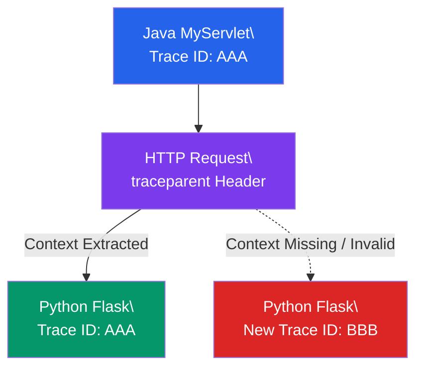

### 2.4 Debugging Checklist

1. 檢查 Outgoing HTTP Request 是否包含 `traceparent`。
2. 確認 Java / Python Instrumentation 支援相應 HTTP Library。
3. 確認 Sender 與 Receiver 的 Propagators 設定。
4. 檢查 Parent Span 是否正確成為 Active Context。
5. 比較上游與下游的 Trace ID。
6. 如果使用 Baggage，確認是否設定 `tracecontext,baggage`。

**Important:**

- `traceparent` 主要傳遞 Trace ID、Parent Span ID 及 Trace Flags。
- `baggage` 傳遞自訂 Key-Value Context。
- Baggage 不會自動變成 Span Attributes 或 Metric Labels。
- 不應透過 Baggage 傳遞密碼、個資或敏感業務資料。

---

## 3. Debug Collector Pipelines

### 3.1 Purpose

Collector Pipeline Debugging 的目標，是確認 Telemetry 是否成功通過：

**Receiver → Processor → Exporter**

即使 Collector Service 正在執行，也不代表所有 Telemetry Pipelines 都正常。

### 3.2 Common Pipeline Issues

| Component                  | Common Issues                                                  | Debugging Method                        |
| -------------------------- | -------------------------------------------------------------- | --------------------------------------- |
| **Receiver**         | Endpoint、Protocol、Network Configuration 錯誤                 | 檢查 Receiver Internal Metrics          |
| **Processor**        | Filtering、Memory Limiter、Transformation 導致資料被拒絕或移除 | 檢查 Processor Configuration 和 Metrics |
| **Exporter**         | Backend Unavailable、Authentication、TLS、Queue Full           | 檢查 Exporter Failed / Queue Metrics    |
| **Service Pipeline** | Component 未被 Pipeline 引用                                   | 檢查 `service.pipelines`              |
| **Backend**          | Telemetry 已送出但無法查詢                                     | 檢查 Backend Ingestion、Storage、Query  |

### 3.3 Windows Collector Example

目前 Windows Collector 使用：

`OTLP / Prometheus Receivers → Batch Processor → Debug Exporter → Windows Event Log`

已確認：

- Windows Collector Service 正常。
- Prometheus Receiver 成功收集 Collector Internal Metrics。
- Debug Exporter 將 Metrics 輸出至 Windows Event Log。
- Application Traces 與 Logs 仍需分別驗證。

### 3.4 Collector Internal Metrics

| Metric                                      | Purpose                            |
| ------------------------------------------- | ---------------------------------- |
| `otelcol_receiver_accepted_spans`         | 成功進入 Receiver 的 Spans         |
| `otelcol_receiver_accepted_metric_points` | 成功進入 Receiver 的 Metric Points |
| `otelcol_receiver_accepted_log_records`   | 成功進入 Receiver 的 Log Records   |
| `otelcol_receiver_refused_spans`          | Receiver 拒絕的 Spans              |
| `otelcol_exporter_sent_spans`             | Exporter 成功匯出的 Spans          |
| `otelcol_exporter_send_failed_spans`      | Span Export 失敗次數或數量的累計   |
| `otelcol_exporter_queue_size`             | Exporter Queue 目前大小            |

實際可用的 Metric Names 和 Labels 會因 Collector 版本與 Exporter Configuration 而異。

### 3.5 Windows Git Bash Example

查看 Collector Internal Metrics：

```bash
curl -fsS http\://127.0.0.1:8888/metrics
```

查看特定 Metrics：

```bash
curl -fsS http\://127.0.0.1:8888/metrics |
  grep -E 'otelcol_receiver_accepted|otelcol_exporter_sent'

```

這個 Endpoint 顯示的是 Collector Internal Metrics，不是完整的 Application Traces 或 Log Records。

**Key Point:** Debugging 應沿著 Telemetry Flow 逐層檢查，找出資料在哪一個 Component 開始出現異常。

---

## 4. Error Handling & Data Loss

### 4.1 Purpose

OpenTelemetry Collector 可能因為 Network、Backend、Resource Limit 或 Configuration 問題導致 Telemetry Export 失敗。

例如：

`SDK Exporter → Collector → Tempo（Unavailable）`

這時需要了解 Retry、Sending Queue、Backpressure 和 Persistent Storage。

### 4.2 Error Handling Mechanisms

| Mechanism                  | Responsibility                              | Limitation                                           |
| -------------------------- | ------------------------------------------- | ---------------------------------------------------- |
| **Retry**            | 暫時失敗後重新傳送 Telemetry                | 超過 Retry Limit 可能遺失                            |
| **Sending Queue**    | 暫存等待匯出的 Telemetry                    | Memory Queue 可能溢出                                |
| **Backpressure**     | 下游負載過高時向上游回報壓力                | 上游不一定能持續緩衝資料                             |
| **Persistent Queue** | 將 Queue 資料保存在磁碟，改善重啟後恢復能力 | 仍可能因 Disk Failure、Capacity 或 Retry Limits 遺失 |
| **Memory Limiter**   | 降低 Collector OOM 風險                     | 可能拒絕部分 Telemetry                               |

### 4.3 Data Loss Scenarios

Telemetry 可能在下列情況下遺失：

1. Backend 長時間無法接收 Telemetry。
2. Exporter Sending Queue 已滿。
3. Retry Timeout 或 Retry Limit 被超過。
4. Collector Crash，且 Queue 只儲存在 Memory。
5. Persistent Storage 發生 Disk Failure 或容量不足。
6. Collector Processor 主動丟棄資料，例如 Filter 或 Sampling。
7. Application SDK 端已丟棄資料，Collector 根本沒有收到。

### 4.4 Example — Resilient OTLP Exporter

```yaml
extensions:
  file_storage:
    directory: C:/otel-data/queue

exporters:
  otlp:
    endpoint: tempo.example.com:4317
    tls:
      insecure: false

    sending_queue:
      enabled: true
      storage: file_storage
      queue_size: 5000

    retry_on_failure:
      enabled: true
      initial_interval: 5s
      max_interval: 30s
      max_elapsed_time: 10m

service:
  extensions: [file_storage]

  pipelines:
    traces:
      receivers: [otlp]
      exporters: [otlp]
```

這是獨立示例，並非可直接覆蓋目前 Windows Collector 的完整配置。實際使用時，還需確認 Receiver 設定、Backend TLS 憑證、目錄權限及 Collector 版本。

**Important:** Persistent Queue 只能降低部分故障情境的資料遺失風險，不能保證 End-to-End Exactly-once Delivery。

---

## 5. Schema Management

### 5.1 Purpose

Schema Management 用於處理 OpenTelemetry Semantic Conventions 隨版本演進所產生的相容性問題。

例如 HTTP Attribute：

`http.request.method`

當 Instrumentation Libraries 升級後，可能出現 Attribute Names 或 Telemetry Structure 的變更，影響既有 Dashboards、Queries 或 Alert Rules。

### 5.2 Important Concepts

| Concept                         | Description                                                        |
| ------------------------------- | ------------------------------------------------------------------ |
| **Semantic Conventions**  | 定義標準 Telemetry Attribute、Metric 等名稱及語意                  |
| **Schema URL**            | 標識 Telemetry 所使用的 Schema Version                             |
| **Schema Version**        | 描述特定版本的 Telemetry Schema                                    |
| **Schema Transformation** | 在支援的情況下，轉換不同版本之間的 Telemetry                       |
| **Compatibility**         | 確保 Instrumentation 更新不會不必要地破壞既有 Queries / Dashboards |

### 5.3 Example

假設舊版 Instrumentation 使用：

`http.method`

新版 Semantic Conventions 使用：

`http.request.method`

如果 Dashboard 仍查詢 `http.method`，可能無法取得新版資料。

需要確認：

1. Instrumentation Library 使用哪一版本的 Semantic Conventions。
2. Telemetry 是否攜帶對應的 Schema URL。
3. Backend 或 Collector 是否支援所需的 Schema Transformation。
4. Dashboards、Queries、Alerts 是否需要同步更新。

**Important:** Schema URL 用於標識 Schema，不代表 Collector 一定會自動執行 Schema Translation。

而且 Schema Transformation 並非保證能處理所有不相容變更。

---

## 6. End-to-End Debugging Architecture

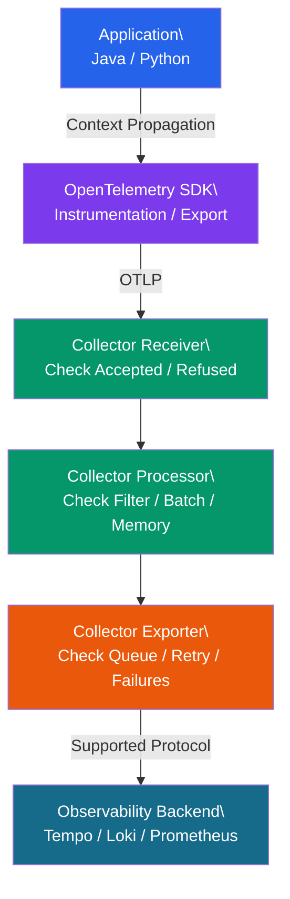

**Troubleshooting Principle:**

先確認 Application 端是否產生 Telemetry，再依序檢查 SDK Exporter、Collector Receiver、Processor、Exporter，最後確認 Backend Ingestion 與 Query。

Context Propagation 則需另外驗證跨服務的 Request Headers 和 Parent-Child Span Relationship。

---

## 7. Windows Collector Logs — Archiving & Rotation

本節針對 Windows 11 ARM64、`otelcol-contrib 0.165.0` 的實驗環境，區分 **Collector Diagnostic Logs（Windows Event Log）** 與 **Collector File Exporter Telemetry（JSON Files）**。前者已在本機驗證；後者是建議新增的設定，**尚未確認已部署**。

| Category                          | Current / Proposed Destination                                       | Archiving Method                               | Notes                                                        |
| --------------------------------- | -------------------------------------------------------------------- | ---------------------------------------------- | ------------------------------------------------------------ |
| Collector Debug / Diagnostic Logs | Windows Application Event Log，Source: `otelcol-contrib`（已驗證） | `wevtutil.exe epl`、Windows Event Log Policy | Event Log 不等於 Observability Backend                       |
| Application Traces                | `C:/otel-data/traces.json`（擬新增）                               | File Exporter `rotation`                     | 僅在有 Traces 到達 Pipeline 時會有內容                       |
| Application Metrics               | `C:/otel-data/metrics.json`（擬新增）                              | File Exporter `rotation`                     | 會包含 Prometheus Receiver 收集的 Collector Internal Metrics |
| Application Logs                  | `C:/otel-data/logs.json`（擬新增）                                 | File Exporter `rotation`                     | 不等於 Collector Diagnostic Logs                             |

### 7.1 Inspect Windows Event Log Policy (Git Bash)

```bash
wevtutil.exe gl Application
```

查看 `maxSize`、`retention`、`autoBackup` 及 log file path。這些選項管理的是 **Windows Application Log 整體**，不是單一 `otelcol-contrib` Source。

### 7.2 Manually Export Windows Event Logs

在 **Windows Git Bash** 執行；封存目錄需具有寫入權限：

```bash
mkdir -p /c/otel-archive

# Export entire Application Event Log (does not clear it)

MSYS_NO_PATHCONV=1 wevtutil.exe epl Application \
  'C:\otel-archive\Application-20261126.evtx'

# Export only the otelcol-contrib events (does not clear them)

MSYS_NO_PATHCONV=1 wevtutil.exe epl Application \
  'C:\otel-archive\otelcol-20261126.evtx' \
  '/q:*[System[Provider[@Name="otelcol-contrib"]]]'
```

上述檔名中的日期僅為示例，請依實際封存日期更改，避免重複檔名。`epl` 匯出但**不會清除**原本的事件紀錄；若檔案已存在，預設可能失敗而不是覆寫。`MSYS_NO_PATHCONV=1` 可避免 Git Bash 將 Windows CLI 的 `/q:` 選項誤當成 POSIX 路徑轉換。

### 7.3 Optional Windows Automatic Event Log Backup

> **Administrative change — not recommended to apply casually.** 此命令會更改整個 Application Event Log 的保留規則；請在確認其他應用程式需求、磁碟空間與公司政策後，才以系統管理員權限執行。

```bash
MSYS_NO_PATHCONV=1 wevtutil.exe sl Application \
  /ms:104857600 /rt:true /ab:true
```

| Option            | Meaning                                                                            |
| ----------------- | ---------------------------------------------------------------------------------- |
| `/ms:104857600` | Application Log 容量上限 100 MiB                                                   |
| `/rt:true`      | 啟用保留模式：達上限時不直接覆寫舊事件；若無法完成自動備份，可能無法繼續寫入新事件 |
| `/ab:true`      | 在 Event Log 滿載時啟用 Windows 自動備份；必須同時設定 `/rt:true`                |

此機制不是「每天封存」，也**不會自動刪除過期 Archive**。正式環境建議透過 Windows 管理政策或排程作業管理封存與保留，而不是單憑這段命令直接變更共用 Application Log。

### 7.4 Configure File Exporter Rotation

若已依前述計畫加入 File Exporter，將原有 `exporters` 區段修改為以下示例（**不要建立第二個根層 `exporters:`**）：

```yaml
exporters:
  debug:
    verbosity: basic

  file/traces:
    path: C:/otel-data/traces.json
    rotation:
      max_megabytes: 50
      max_days: 7
      max_backups: 10
      localtime: true

  file/metrics:
    path: C:/otel-data/metrics.json
    rotation:
      max_megabytes: 50
      max_days: 7
      max_backups: 10
      localtime: true

  file/logs:
    path: C:/otel-data/logs.json
    rotation:
      max_megabytes: 50
      max_days: 7
      max_backups: 10
      localtime: true
```

並在既有 `service.pipelines` 中將兩個 Exporters 都啟用：

```yaml
service:
  pipelines:
    traces:
      receivers: [otlp, jaeger, zipkin]
      processors: [batch]
      exporters: [debug, file/traces]

    metrics:
      receivers: [otlp, prometheus]
      processors: [batch]
      exporters: [debug, file/metrics]

    logs:
      receivers: [otlp]
      processors: [batch]
      exporters: [debug, file/logs]
```

**注意：上述 `service:` 為局部示例**，套用時務必保留現有的 `service.telemetry`、`service.extensions` 與 `health_check` / `pprof` / `zpages` 設定，不要以此片段覆蓋整份 `config.yaml`。

| Rotation Parameter    | Description                                           |
| --------------------- | ----------------------------------------------------- |
| `max_megabytes: 50` | 下一批資料會讓檔案超過約 50 MiB 時，按大小輪替        |
| `max_days: 7`       | 清理超過 7 天的**已輪替**檔案，不會每天強制輪替 |
| `max_backups: 10`   | 最多保留 10 個已輪替備份                              |
| `localtime: true`   | 輪替檔名使用本機時區的時間戳記                        |

示意檔案（實際檔名依輪替發生時刻而定）：

```text
C:\otel-data\
├── traces.json
├── traces-2026-11-26T10-30-00.000-size.json
├── metrics.json
├── metrics-2026-11-26T10-35-00.000-size.json
├── logs.json
└── logs-2026-11-26T10-40-00.000-size.json
```

`max_days` 和 `max_backups` 不是永久 Archive 策略，而是**清理已輪替檔案的保留設定**。如果需要不可變、長期稽核保存，應另設正式的存放、備份及 Retention Policy。

### 7.5 Archive / Rotation Architecture

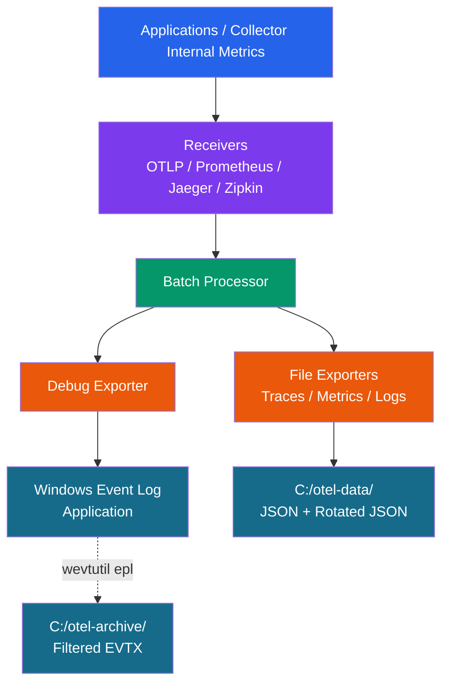

本圖為邏輯示意。實際上 Logs / Traces / Metrics 使用**三條獨立 Pipelines**，File Exporter 的每個 Instance 只接收所屬 Pipeline 的 Signal。

---

## 8. Windows Git Bash — Validate, Restart and Verify

以下為 Windows **Git Bash** 指令，而不是 WSL Linux `systemctl` 指令。涉及設定檔寫入、服務重啟及 Event Log Policy 變更時，請以有足夠權限的終端機執行。

### 8.1 Back Up and Prepare Directories

```bash
mkdir -p /c/otel-data /c/otel-archive

cp '/c/Program Files/OpenTelemetry Collector/config.yaml' \
   '/c/Program Files/OpenTelemetry Collector/config.yaml.bak'

# Inspect the existing YAML

cat '/c/Program Files/OpenTelemetry Collector/config.yaml'
```

### 8.2 Validate Before Restart

```bash
'/c/Program Files/OpenTelemetry Collector/otelcol-contrib.exe' \
  validate \
  --config 'C:/Program Files/OpenTelemetry Collector/config.yaml'
```

修改 Configuration 後先 Validate；若驗證失敗，**不要重啟**。亦需確認 Windows Service Account 對 `C:\otel-data` 有寫入權限。

### 8.3 Restart Windows Service

```bash
sc.exe stop otelcol-contrib
sc.exe query otelcol-contrib
# After the service reports STOPPED:

sc.exe start otelcol-contrib
sc.exe query otelcol-contrib
```

不要在 Windows 原生 MSI Service 使用 `systemctl`。停機與啟動之間應確認服務狀態；`sc.exe stop` 並不保證立即停止完成。

### 8.4 Check Metrics and Files

```bash
curl -fsS http://127.0.0.1:8888/metrics | head -n 20

ls -lh /c/otel-data/

# These files may not exist until data arrives

[ -f /c/otel-data/metrics.json ] && tail -n 5 /c/otel-data/metrics.json
[ -f /c/otel-data/traces.json ] && tail -n 5 /c/otel-data/traces.json
[ -f /c/otel-data/logs.json ] && tail -n 5 /c/otel-data/logs.json
```

### 8.5 Read Collector Events

```bash
# Recent events from the Application log, filtered by Collector provider

MSYS_NO_PATHCONV=1 wevtutil.exe qe Application \
  '/q:*[System[Provider[@Name="otelcol-contrib"]]]' \
  /rd:true /c:10 /f:text
```

只有 Metrics Debug Logs 已由前面的 Windows 實驗確認。**File Exporter 三個 JSON 檔案，以及 Application Traces / Logs 是否成功匯入仍有待部署與驗證。**

---

## 9. Learning Summary

| Topic                                  | Key Takeaway                                                    |
| -------------------------------------- | --------------------------------------------------------------- |
| **Context Propagation Failures** | 確保跨服務的 Trace Context 正確傳遞                             |
| **Debug Collector Pipelines**    | 透過 Debug Exporter 和 Internal Metrics 檢查資料流程            |
| **Error Handling & Data Loss**   | 利用 Retry、Queue、Persistent Storage 改善 Telemetry Resiliency |
| **Schema Management**            | 利用 Semantic Conventions、Schema URL 管理版本相容性            |

### Final Conclusion

OpenTelemetry Debugging & Maintenance 的主要目的，是確保三種 Telemetry Signals：

**Logs、Metrics、Traces**

能夠：

**Correctly Instrumented → Properly Propagated → Successfully Collected → Reliably Exported → Correctly Interpreted**

對目前的實驗環境：

**Java MyServlet → Python Flask → OpenTelemetry Collector → Windows Event Log / File Exporter**

可以分別用於驗證 Distributed Context Propagation、Collector Pipeline Debugging，以及 Telemetry Export 的完整流程。

---

## Official References

- [OpenTelemetry Context Propagation](https\://opentelemetry.io/docs/concepts/context-propagation/)
- [OpenTelemetry Collector Troubleshooting](https\://opentelemetry.io/docs/collector/troubleshooting/)
- [OpenTelemetry Collector Internal Telemetry](https\://opentelemetry.io/docs/collector/internal-telemetry/)
- [OpenTelemetry Collector Resiliency](https\://opentelemetry.io/docs/collector/resiliency/)
- [OpenTelemetry Telemetry Schemas](https\://opentelemetry.io/docs/specs/otel/schemas/)
- [OpenTelemetry Semantic Conventions](https\://opentelemetry.io/docs/specs/semconv/)
- [OpenTelemetry Troubleshooting](https\://opentelemetry.io/docs/collector/troubleshooting/)

---
## **OTCA Exam Domains & Weighting**

| Domain                                               | Exam Weight | 主要內容                                                                     |
| ---------------------------------------------------- | ----------- | ------------------------------------------------------------------------ |
| 1. Fundamentals of Observability                     | 18%         | Observability 基礎、Logs、Metrics、Traces                                     |
| 2. The OpenTelemetry API and SDK                     | **46%**     | API、SDK、Instrumentation、Context Propagation、Exporters                    |
| 3. The OpenTelemetry Collector                       | 26%         | Receivers、Processors、Exporters、Deployment Patterns、Scaling               |
| 4. Maintaining and Debugging Observability Pipelines | **10%**     | Context Propagation、Debugging Pipelines、Error Handling、Schema Management |
| **Total**                                            | **100%**    |     

---
# ** Working vs Broken Propagation**

| Comparison                | Working Propagation | Broken Propagation    |
| ------------------------- | ------------------- | --------------------- |
| Trace ID                  | Span 1、2、3 相同       | Span 3 使用另一個 Trace ID |
| Parent-Child Relationship | 正確串接                | Span 3 無法連接上游         |
| Trace 數量                  | 1 條                 | 2 條                   |
| Java Agent                | 正確擷取、注入 Context     | 某個通訊環節未正確傳遞 Context   |
| Jaeger / Tempo            | 可以看到完整 Trace        | 顯示兩條分離的 Traces        |

## ** Java EE 實際案例**

假設：

`Browser → Java EE Servlet → Java Service → Python Flask`

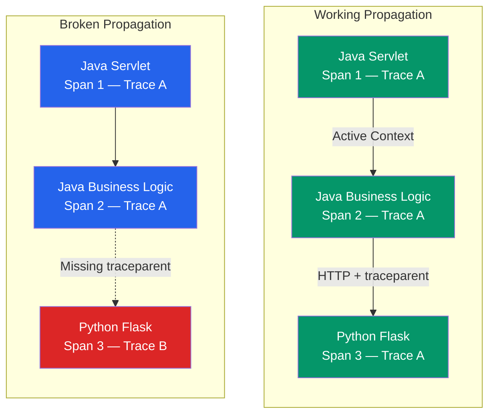

## ** Java Agent 可以自動處理嗎？**

**可以，但取決於 Java Application 使用的通訊技術是否受到 Java Agent 支援。**

| Java EE 技術            | Zero-code Trace 支援                 |
| --------------------- | ---------------------------------- |
| Servlet / JSP         | 通常可自動建立 HTTP Server Span           |
| JDBC                  | 通常可自動建立 Database Span              |
| Apache HttpClient     | 相容版本通常可自動注入 `traceparent`          |
| JDK HTTP Client       | 依 JDK 與 Agent Instrumentation 支援情況 |
| Custom TCP / Socket   | 不保證自動傳遞                            |
| Proprietary Messaging | 可能需要 Manual Instrumentation        |

---
## **OpenTelemetry — Context Propagation Failure**

這張投影片介紹造成 **Distributed Tracing 的 Context Propagation 失敗**的三個主要原因。

| Reason                          | 中文說明                                                                 | 可能造成的問題                              |
| ------------------------------- | -------------------------------------------------------------------- | ------------------------------------ |
| **1. Mismatched Propagators**   | 不同服務使用不相容的傳遞格式，例如 W3C Trace Context 與 B3                             | 下游無法解析 Trace Context，可能建立新的 Trace ID |
| **2. Headers Stripped**         | Load Balancer、API Gateway 或 Reverse Proxy 移除追蹤 Headers               | `traceparent` 無法到達下游服務               |
| **3. Failed Context Injection** | Application 或 Instrumentation 未將 Trace Context 正確注入 Outgoing Request | 下游沒有可使用的 Parent Context              |

### **1. Mismatched Propagators**

例如：

- Java EE A 使用 `tracecontext`（W3C）。
- Java EE B 只支援 `b3`。

若兩端沒有共同支援的格式，就可能導致 Trace 中斷。

OpenTelemetry 可以透過以下設定指定 Propagators：

```yaml
OTEL_PROPAGATORS=tracecontext,baggage
```

### **2. Headers Stripped — 投影片特別強調的原因**

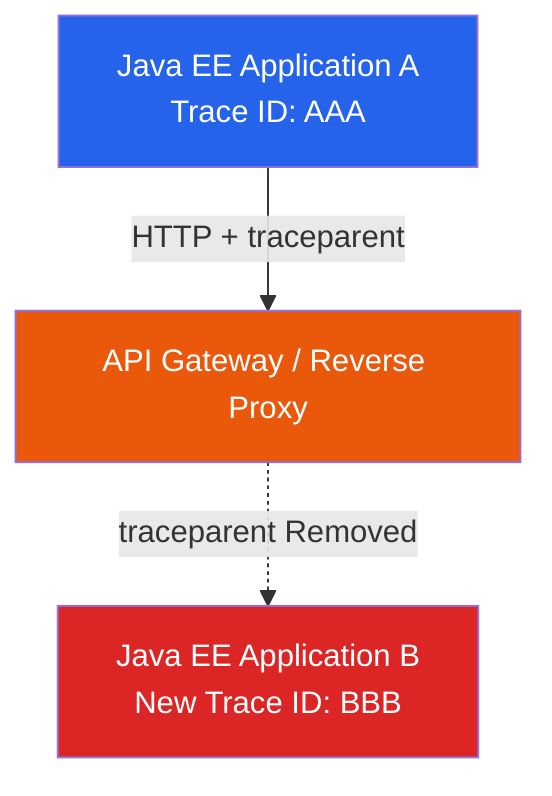

即使 Java EE A 和 B 都安裝 OpenTelemetry Java Agent，如果中間的 API Gateway 移除 `traceparent`，下游仍可能建立新的 Trace ID。

這種情況不是 Java Agent 本身故障，而是 **Trace Context 在網路中介設備上遺失**。

### **3. Failed Context Injection**

假設：

`Java EE A → IBM MQ → Java EE B`

如果 Java EE A 的 JMS Producer 沒有把 Trace Context 注入 MQ Message，而 Java EE B 又無法取得上游 Context，兩端就可能產生不同的 Trace IDs。

對受支援的 JMS APIs，可以先測試 OpenTelemetry Java Agent 是否自動處理 Injection / Extraction。

## **如何排查？**

| Check Point                 | Verification                              |
| --------------------------- | ----------------------------------------- |
| **Producer / Sender**       | 是否正確注入 `traceparent`                      |
| **Load Balancer / Gateway** | 是否保留 Trace Context Headers                |
| **MQ Middleware**           | 是否正確保留及傳遞 Message Properties              |
| **Consumer / Receiver**     | 是否正確 Extract Parent Context               |
| **Jaeger / Tempo**          | 兩端 Spans 是否使用相同 Trace ID，或具有正確 Span Links |

**核心結論：Context Propagation Failure 不代表 OpenTelemetry 沒有產生 Spans，而是不同服務的 Spans 可能無法形成同一條 Distributed Trace。**

對你的 Java EE 銀行系統，尤其需要檢查 **API Gateway、Reverse Proxy，以及 IBM MQ 的 Message Context Injection / Extraction**，這些都是跨系統 Trace 中斷時的重要排查位置。

---
## **OpenTelemetry — Debugging Collector Pipelines（Collector 管線除錯）**

這張投影片介紹 **四種 OpenTelemetry Collector 官方提供的 Debugging 工具**，用來確認 Collector Configuration、Telemetry Data Flow，以及 Collector 本身的運作狀態。

| Debugging Tool                   | 主要用途                       | 檢查內容                                              |
| -------------------------------- | -------------------------- | ------------------------------------------------- |
| **1. Debug Exporter**            | 檢視實際接收的 Telemetry          | Traces、Metrics、Logs                               |
| **2. Collector**`validate` | 驗證 Collector Configuration | YAML 結構、元件設定與 Pipeline 配置                         |
| **3. Internal Telemetry**        | 監控 Collector 自身            | Receiver、Processor、Exporter、CPU、Memory            |
| **4. zPages**                    | 即時診斷 Collector             | Collector Components、Internal Traces、Runtime 診斷資訊 |

## **1. Debug Exporter**

**用途：確認 Telemetry 是否成功通過 Collector Pipeline 並抵達 Debug Exporter。**

你的 Windows Collector 已配置：

```
exporters:
  debug:
    verbosity: detailed
```

流程為：

`Prometheus Receiver → Batch Processor → Debug Exporter → Windows Event Log`

你之前已成功在 Windows Event Log 中看到 `ResourceMetrics` 及 `otelcol.signal: metrics`。

這證明 Metrics Pipeline 正常運作，但不代表 Application Traces / Logs 也已成功接收。

## **2. Collector**`validate`**Subcommand**

**用途：在啟動或重新啟動 Collector 之前，檢查 Configuration 是否有效。**

你目前使用 Windows 11 ARM64，可在 Git Bash 執行：

```bash
cd Otel-Foundations/hello-telemetry/

"/c/Program Files/OpenTelemetry Collector/otelcol-contrib.exe" validate --config otel-collector-config.yaml
"/c/Program Files/OpenTelemetry Collector/otelcol-contrib.exe" validate --config otel-collector-config.dev.yaml
"/c/Program Files/OpenTelemetry Collector/otelcol-contrib.exe" validate --config otel-collector-config.prod.yaml

cd "/c/Program Files/OpenTelemetry Collector"
otelcol-contrib.exe validate --config config.yaml

cd /d/development/opentelemetry-101/Otel-Foundations/hello-telemetry

```

`validate` 可以檢查設定檔是否能被 Collector 正確解析與驗證，但**無法保證 Remote Backend 可以正常連線**。

## **3. Internal Telemetry**

**用途：監控 Collector 自己的健康狀態及 Telemetry Processing 效能。**

你已啟用：

```yaml
service:
  telemetry:
    metrics:
      readers:
        - pull:
            exporter:
              prometheus:
                host: '127.0.0.1'
                port: 8888
```

在 Git Bash 執行：

```bash
curl -fsS http://127.0.0.1:8888/metrics
```

特別注意這些 Metrics：

| Metric                                    | 功能                                |
| ----------------------------------------- | --------------------------------- |
| `otelcol_receiver_accepted_metric_points` | 成功接收的 Metrics 數量                  |
| `otelcol_receiver_refused_metric_points`  | Receiver 拒絕的 Metrics 數量           |
| `otelcol_exporter_sent_metric_points`     | Exporter 成功輸出的 Metrics 數量         |
| `otelcol_exporter_queue_size`             | Exporter Queue 的目前大小，若有啟用相應 Queue |
| `otelcol_process_memory_rss`              | Collector 實體記憶體使用量                |

你先前的驗證結果顯示 Prometheus Receiver 的 Refused Metric Points 為 0，且 Debug Exporter 已成功處理 Metrics。

## **4. zPages**

**用途：透過 HTTP 頁面檢視 Collector 的即時診斷資訊。**

你的配置已啟用：

```yaml
extensions:
  zpages:
    endpoint: 0.0.0.0:55679

service:
  extensions: [zpages]
```

因此可以在本機瀏覽器開啟：

- [Collector zPages — Service Diagnostics](http://127.0.0.1:55679/debug/servicez?utm_source=chatgpt.com)
- [Collector zPages — Internal Traces](http://127.0.0.1:55680/debug/tracez?utm_source=chatgpt.com)

zPages 的 Traces 是 Collector 自身的診斷資料，**不是取代 Jaeger / Tempo 用來查詢所有 Application Distributed Traces 的介面**。

為安全起見，若只需要本機診斷，建議將 `zpages` 的 Endpoint 綁定 `127.0.0.1:55679`，避免不必要的外部暴露。

## **5. 四種工具如何配合使用？**

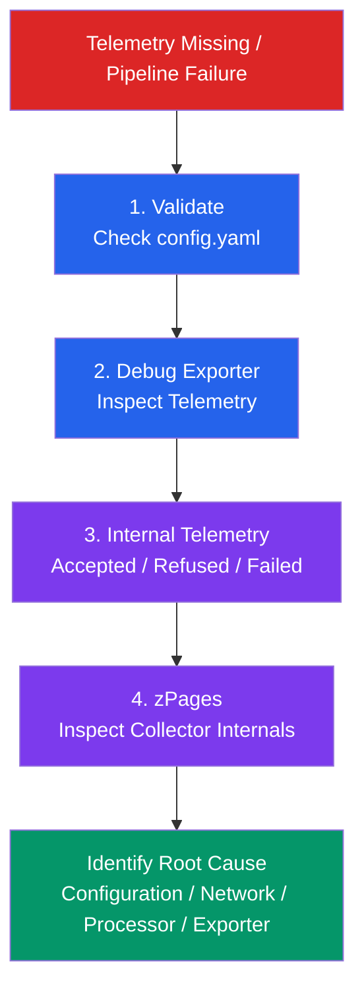

### **OTCA Exam — Key Takeaways**

- **Debug Exporter**：檢查 Collector 實際輸出的 Telemetry。
- **Validate**：檢查 Collector Configuration 有效性。
- **Internal Telemetry**：透過 Metrics / Logs 監控 Collector 本身。
- **zPages**：檢查 Collector 的內部狀態與診斷資訊。

**結論：這四種工具的功能互補。對你目前的 Windows Collector，Debug Exporter、Validate、Internal Metrics 已有實際使用基礎，zPages 也已配置，可進一步使用瀏覽器驗證。**

---


# OpenTelemetry — zPages Diagnosis

## 1. Overview

本機同時運行兩個 OpenTelemetry Collector Instances：

| Instance | Version | Deployment |
|---|---|---|
| Docker Collector | 0.145.0 | Docker Compose |
| Windows Collector | 0.165.0 | Windows Service |

**Important:** 兩個 Collector 需要分開設定 Host Ports，避免 Port Conflicts。

## 2. Validate Collector Configuration

使用 Windows Git Bash：

```bash
"/c/Program Files/OpenTelemetry Collector/otelcol-contrib.exe" \
  validate --config otel-collector-config.dev.yaml

"/c/Program Files/OpenTelemetry Collector/otelcol-contrib.exe" \
  validate --config otel-collector-config.prod.yaml
```

注意：這裡使用 Windows Collector 0.165.0 驗證 YAML。如果 Docker Collector 使用 0.145.0，還需要以實際 Docker Image 版本驗證相容性。

更新 Docker Compose 後：

```bash
docker compose up --build --force-recreate -d
```

確認容器：

```bash
docker compose ps
```

## 3. Validate Collector Internal Metrics

```bash
curl -fsS http://127.0.0.1:8888/metrics |
  grep '^target_info'
```

先前看到兩個不同版本的結果：

```text
# Docker Collector
target_info{service_name="otelcol-contrib",service_version="0.145.0",...} 1

# Windows Collector
target_info{service_name="otelcol-contrib",service_version="0.165.0",...} 1
```

上述為示意摘要，不代表兩個 Collector 能同時綁定 Host 的 `8888`。

如果兩個 Collector 同時運行，應分別設定 Host Metrics Port，例如：

- Windows Collector：`127.0.0.1:8888`
- Docker Collector：`127.0.0.1:8889`，映射至 Container 的 `8888`

## 4. zPages Endpoints

假設：

- Windows Collector zPages：`127.0.0.1:55679`
- Docker Collector zPages：`127.0.0.1:55680` // .env => OTEL_ZPAGES_PORT=55680

### 4.1 Update config yaml files

- `otel-collector-config.yaml`, `otel-collector-config.dev.yaml`, `otel-collector-config.prod.yaml` for Docker Collector
- `config.yaml` for Windows Collector

```yaml
...
telemetry:
  # Bugfixing
  traces:
    processors:
      - batch:
          exporter:
            otlp:
              protocol: http/protobuf
              endpoint: http://127.0.0.1:4318

```

```powershell
notepad C:\Program Files\OpenTelemetry Collector\config.yaml
Restart-Service -Name otelcol-contrib -Force
```

```bash
docker compose up --build --force-recreate -d
```

### Windows Collector

| Page | URL |
|---|---|
| Service Diagnostics | http://127.0.0.1:55679/debug/servicez |
| Pipeline Diagnostics | http://127.0.0.1:55679/debug/pipelinez |
| Internal Traces | http://127.0.0.1:55679/debug/tracez |
| Extensions | http://127.0.0.1:55679/debug/extensionz |
| Metrics | http://127.0.0.1:8888/metrics |

### Docker Collector

| Page | URL |
|---|---|
| Service Diagnostics | http://127.0.0.1:55680/debug/servicez |
| Pipeline Diagnostics | http://127.0.0.1:55680/debug/pipelinez |
| Internal Traces | http://127.0.0.1:55680/debug/tracez |
| Extensions | http://127.0.0.1:55680/debug/extensionz |
| Metrics | http://localhost:8888/metrics |

## 5. Validate IPv4 / IPv6 Connectivity

Check IPv6:

```bash
curl.exe -6 -v http://localhost:55680/debug/tracez 2>&1 |
  grep -i 'Trying'
```

Check IPv4:

```bash
curl.exe -4 -v http://localhost:55680/debug/tracez 2>&1 |
  grep -i 'Trying'
```

Expected connection attempts:

```text
IPv6: Trying [::1]:55680...
IPv4: Trying 127.0.0.1:55680...
```

**Important:** `Trying` 只代表 Curl 嘗試連線，不代表 HTTP Request 成功。

Verify HTTP Response:

```bash
curl.exe -4 -sS -o /dev/null -w '%{http_code}\n' \
  http://localhost:55680/debug/tracez
```

HTTP `200` 表示該頁面正常回應。

## 6. What Can zPages Diagnose?

| zPages | Purpose |
|---|---|
| **ServiceZ** | Collector Service、Build、Runtime |
| **PipelineZ** | Pipeline Components 和 Data Flow |
| **TraceZ** | Collector Internal Spans / Errors |
| **ExtensionZ** | Active Extensions |
| **FeatureZ** | Feature Gates |

zPages 主要用於 Collector 自身的診斷，不是查詢所有 Application Distributed Traces 的後端。

## 7. Conclusion

**Windows Collector 和 Docker Collector 可以同時運行，但必須使用不同 Host Ports。**

建議：

- Windows Metrics：`8888`
- Docker Metrics：`8889`
- Windows zPages：`55679`
- Docker zPages：`55680`

這樣可以清楚分開兩個 Collector 的 Metrics 和 Diagnostics。

---

## Official References

- [OpenTelemetry Collector Configuration](https://opentelemetry.io/docs/collector/configuration/)
- [OpenTelemetry zPages Extension](https://github.com/open-telemetry/opentelemetry-collector/tree/main/extension/zpagesextension)

---

# OpenTelemetry Collector — In-memory Queue vs Persistent Queue

> 本章介紹 OpenTelemetry Collector 的 Sending Queue、Retry、Backpressure 與 Persistent Storage，說明如何提升 Telemetry Export 的可靠性，以及發生 Backend Failure 時如何降低 Data Loss 的風險。

## 1. Overview

OpenTelemetry Collector 的 Exporter 可以使用 **Sending Queue** 暫存等待傳送的 Telemetry，並透過 **Retry on Failure** 處理可重試的 Export Errors。

**Core Concept:**

- **Sending Queue**：暫存尚未成功匯出的 Telemetry Requests。
- **Retry**：當 Export 發生可重試錯誤時，依 Backoff Policy 重新傳送。
- **Persistent Queue**：使用 Disk-backed Storage，改善 Collector Restart / Crash 後的資料恢復能力。
- **Backpressure**：當下游無法持續接收資料時，可能向上游回報拒絕或可重試錯誤。

**Important:** Queue 和 Retry 可以降低資料遺失風險，但不保證 Telemetry 永遠不會遺失。

---

## 2. Collector Queue Architecture

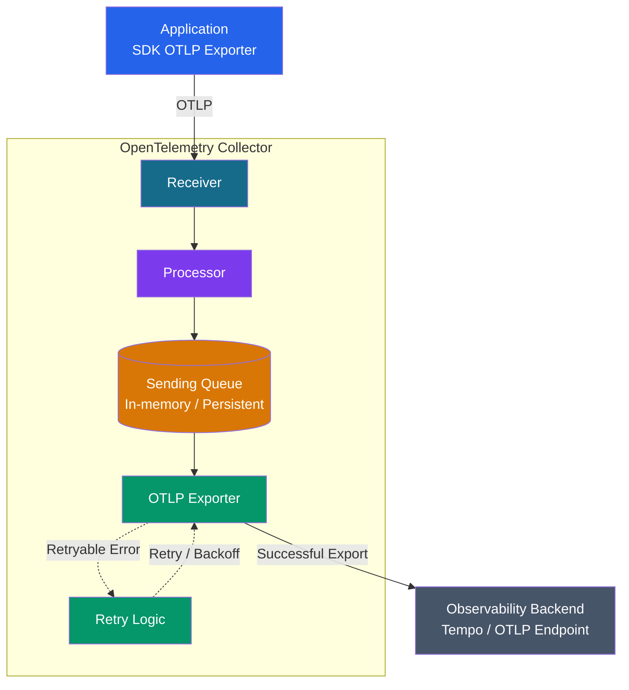

此圖是概念架構。

- 實際 Sending Queue、Retry、Timeout 通常由 Collector 的 **Exporter Helper** 提供，並非每種 Exporter 都支援完全相同的設定。
- Queue 位於 Export Path，負責緩衝等待匯出的 Telemetry；Retry 則處理 Exporter 發生的可重試錯誤。

---

## 3. In-memory Queue vs Persistent Queue

| Comparison | In-memory Queue | Persistent Queue |
|---|---|---|
| **Storage** | Collector Process Memory | Disk-backed Storage |
| **Performance** | 通常較快，無額外 Disk I/O | 需要 Disk I/O |
| **Collector Restart** | 未完成匯出的 Queue 資料通常遺失 | 可恢復仍保存在磁碟中的 Queue 資料 |
| **Collector Crash** | Queue 內的資料通常遺失 | 可降低 Crash 造成的 Queue 資料遺失 |
| **Queue Full** | 無法接收更多 Queue Items | 同樣可能達到容量限制 |
| **Disk Dependency** | 不需要 | 需要可靠的 Persistent Storage |
| **Configuration** | `sending_queue.enabled: true` | `sending_queue.storage: file_storage` |
| **Data Durability** | 不提供 Process Restart Durability | 提供較好的 Queue Durability |
| **Best Use Case** | PoC、低風險環境或可容忍資料遺失的 Workload | 對 Restart / Crash 資料恢復要求較高的 Production |

### Important Clarification

配置：

- `storage: file_storage`: 代表 Sending Queue 使用 Persistent Storage。 **不是 Collector 同時建立兩份獨立的 In-memory Queue 和 Persistent Queue。**
- File Storage 用於保存 Queue 的待處理資料；Collector 在執行時仍然會使用**一定的 Memory** 進行資料處理。

---

## 4. Sending Queue — Queue Size

例如：

```yaml
sending_queue:
  enabled: true
  queue_size: 5000
```

**`queue_size: 5000` 並不代表可以儲存 5,000 個 Spans。**

Exporter Helper 的 Sending Queue 支援不同計量方式：

| `sizer` | Meaning |
|---|---|
| `requests` | 按 Telemetry Requests / Batches 計算 |
| `items` | 按 Spans、Metric Data Points 或 Log Records 計算 |
| `bytes` | 按序列化資料大小計算 |

預設值通常是：

```yaml
sending_queue:
  enabled: true
  sizer: requests
  queue_size: 5000
```

因此 `queue_size: 5000` 在此表示最多約 5,000 個 Queue Requests / Batches，而不是 5,000 個 Spans。

實際容量也取決於每個 Request 的大小。

---

## 5. Configuration Examples

### 5.1 In-memory Queue

```yaml
exporters:
  otlp:
    endpoint: tempo.example.com:4317

    tls:
      insecure: false

    sending_queue:
      enabled: true
      sizer: requests
      queue_size: 5000

    retry_on_failure:
      enabled: true
      initial_interval: 5s
      max_interval: 30s
      max_elapsed_time: 10m
```

**Behavior:**

1. Collector 接收 Telemetry。
2. Sending Queue 將待匯出的 Requests 暫存於 Memory。
3. Exporter 將資料傳送到 Tempo。
4. 如果發生可重試錯誤，依 Retry Policy 重試。
5. Collector Crash / Restart 後，Memory Queue 中尚未完成的資料通常無法恢復。

### 5.2 Persistent Queue

```yaml
extensions:
  file_storage:
    directory: C:/otel-data/queue

receivers:
  otlp:
    protocols:
      grpc:
        endpoint: 127.0.0.1:4317

exporters:
  otlp:
    endpoint: tempo.example.com:4317

    tls:
      insecure: false

    sending_queue:
      enabled: true
      sizer: requests
      storage: file_storage
      queue_size: 5000

    retry_on_failure:
      enabled: true
      initial_interval: 5s
      max_interval: 30s
      max_elapsed_time: 10m

service:
  extensions: [file_storage]

  pipelines:
    traces:
      receivers: [otlp]
      exporters: [otlp]
```

**Behavior:**

1. Collector 接收 Spans。
2. Exporter Sending Queue 將待處理 Requests 保存至 File Storage。
3. Collector 嘗試匯出到 Tempo。
4. 若 Backend 暫時不可用，依 Retry Policy 重試。
5. 若 Collector Crash / Restart，重新啟動後可嘗試恢復仍保存在 Storage 中的 Requests。
6. 當 Backend 恢復時，Collector 繼續處理可恢復的 Queue Items。

### Important Notes

- `tempo.example.com` 是示例 Endpoint，須替換為實際的 OTLP Backend。
- `tls.insecure: false` 表示使用 TLS，Backend 必須具備相容的 TLS Configuration。
- 如果 Collector 需要接收遠端 Telemetry，必須依網路與安全需求配置 Receiver Endpoint。
- `file_storage` 需由 `service.extensions` 啟用。
- `C:/otel-data/queue` 必須存在，Windows Service Account 需要讀寫權限。
- 此為獨立配置範例，不能直接覆蓋現有的 Windows Collector Configuration。

---

## 6. File Storage vs File Exporter

這兩個元件容易混淆，但用途完全不同。

| Comparison | File Storage Extension | File Exporter |
|---|---|---|
| **Component Type** | Extension | Exporter |
| **Purpose** | 儲存 Collector Queue / State | 將 Telemetry 匯出成檔案 |
| **Typical Use** | Persistent Sending Queue | Debugging、Local Telemetry Files |
| **Data Format** | 由 Storage Extension 管理 | JSON 等支援格式 |
| **Configuration** | `extensions.file_storage` | `exporters.file` |
| **Pipeline Reference** | `service.extensions` + Exporter Storage Reference | `service.pipelines.exporters` |

例如：

- **Persistent Queue Storage**: `C:/otel-data/queue`
- **File Exporter Output**: `C:/otel-data/traces.json`
- **Key Point:** Persistent Queue 不是長期 Telemetry Database；成功匯出的 Queue Data 通常不再需要保留。

---

## 7. Backend Failure — What Happens?

假設：

`Java SDK Exporter → Collector → Tempo`

但 Tempo 暫時無法連線。

| Step | In-memory Queue | Persistent Queue |
|---|---|---|
| **1. Backend Unavailable** | 嘗試 Export / Retry | 嘗試 Export / Retry |
| **2. Queue Buffering** | 將 Requests 暫存於 Memory | 將 Requests 暫存於 Disk-backed Storage |
| **3. Collector Crash** | 尚未完成的 Memory Queue 資料通常遺失 | 可在 Restart 後恢復已持久化的資料 |
| **4. Backend Recovery** | 繼續傳送尚存 Queue Data | 繼續傳送可恢復的 Queue Data |
| **5. Queue Full** | 可能拒絕新的 Telemetry | 可能拒絕新的 Telemetry |
| **6. Retry Exhausted** | 相關 Requests 可能被丟棄 | 相關 Requests 仍可能被丟棄 |

### Retry Behavior

```yaml
retry_on_failure:
  enabled: true
  initial_interval: 5s
  max_interval: 30s
  max_elapsed_time: 10m
```

| Parameter | Purpose |
|---|---|
| `enabled: true` | 啟用 Retry |
| `initial_interval: 5s` | 初始重試等待間隔 |
| `max_interval: 30s` | Backoff 的最大等待間隔 |
| `max_elapsed_time: 10m` | 單次待匯出資料的最大重試時間 |

Retry 通常採用 Exponential Backoff，並可能包含 Jitter。

**Important:** `max_elapsed_time: 10m` 不是保證資料一定可保存 10 分鐘，也不是 Queue Retention Policy。

它控制可重試失敗的 Retry Duration；當期限耗盡，資料可能被丟棄。

---

## 8. Queue Full、Backpressure 與 Data Loss

當 Exporter Queue 滿載時，Collector 可能無法繼續將新的 Telemetry Requests 加入 Queue。

這時通常會發生：

1. Queue Enqueue Failure。
2. Collector 向上游回報錯誤或拒絕資料。
3. 上游 SDK / Agent / Collector 可能依其設定重新傳送。
4. 如果上游無法重試或沒有可用 Buffer，Telemetry 可能遺失。

因此：

**Queue Full 不等於每一筆新資料必然立即遺失，但代表資料遺失風險顯著增加。**

Exporter Helper 亦可能提供 `block_on_overflow` 設定，讓資料在 Queue 滿載時等待可用空間，但這仍受 Timeout 和上游重試行為限制。

### Common Data Loss Scenarios

| Scenario | Risk |
|---|---|
| Backend 長時間不可用 | Retry Exhausted |
| Queue Full | Enqueue Failure |
| Collector Crash + Memory Queue | 未持久化的 Queue Data 遺失 |
| Persistent Storage Full | 新資料無法寫入 |
| Persistent Storage Corruption | Queue 恢復可能失敗 |
| Permanent Export Error | Retry 不適用或資料被丟棄 |
| Upstream SDK Drops Data | Collector 無法恢復從未收到的 Telemetry |

**Persistent Queue 不保證 End-to-End Exactly-once Delivery。**

---

## 9. Monitoring Sending Queue

透過 Collector Internal Metrics 監控 Exporter 的狀態。

| Metric | Purpose |
|---|---|
| `otelcol_exporter_queue_size` | 目前 Queue 使用量 |
| `otelcol_exporter_queue_capacity` | Queue 容量 |
| `otelcol_exporter_enqueue_failed_spans` | Spans 無法加入 Queue |
| `otelcol_exporter_send_failed_spans` | Spans Export 發生失敗 |
| `otelcol_exporter_sent_spans` | 成功送出的 Spans |
| `otelcol_receiver_refused_spans` | Receiver 拒絕的 Spans |

實際 Metrics 名稱、是否啟用及 Labels，需依 Collector 版本與 Exporter Configuration 確認。

### Windows Git Bash Commands

```bash
curl -fsS http://127.0.0.1:8888/metrics |
  grep -E 'otelcol_exporter_queue_size|otelcol_exporter_queue_capacity|otelcol_exporter_enqueue_failed|otelcol_exporter_send_failed'
```

### Queue Utilization

```promql
otelcol_exporter_queue_size
/
otelcol_exporter_queue_capacity
```

上面是概念性 PromQL，實際使用應確認 `exporter`、`service_instance_id` 等 Labels 是否正確配對。

**Important:** Queue Size 持續增加，可能代表：

- Backend Processing Capacity 不足。
- Network Connection 或 TLS / Authentication 異常。
- Exporter Retry 持續發生。
- Telemetry Ingestion Rate 高於 Export Rate。
- Collector CPU / Memory 或其他資源不足。

應先確認瓶頸位置，不要直接認定增加 Collector Replicas 就能解決問題。

---

## 10. Windows Collector — Current vs Future Configuration

目前已驗證的 Windows Collector 架構：

`OTLP / Prometheus Receivers → Batch Processor → Debug Exporter`

其中：

- Receiver 正常接收 Collector Internal Metrics。
- Batch Processor 正常運作。
- Debug Exporter 將 Telemetry 寫入 Windows Event Log。
- 尚未配置遠端 OTLP Backend Exporter。
- 尚未配置 Persistent Sending Queue。

因此，**目前不需要為 Debug Exporter 強行加入 Sending Queue。**

### Future Production Architecture

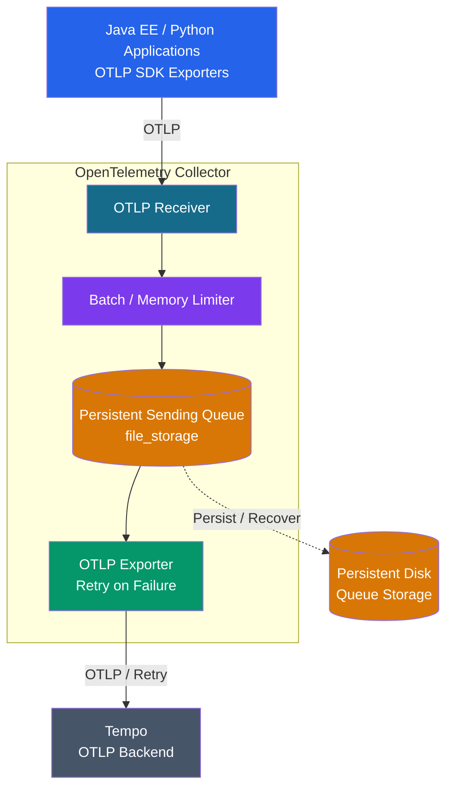

對需要高可靠性的 Production，可考慮：

- Network Exporters 啟用 Sending Queue。
- 啟用 Retry on Failure。
- 根據容量和 Recovery Requirements 使用 Persistent Queue。
- 監控 Queue Size、Queue Capacity、Enqueue Failures、Send Failures。
- 將 Queue Storage 部署於受保護且具有適當 Disk Capacity 的 Persistent Volume。
- 評估 Collector Agent → Gateway 和 Gateway → Backend 的各段傳輸可靠性。

---

## 11. OTCA Exam — Key Takeaways

| Concept | Key Point |
|---|---|
| **Sending Queue** | 暫存待匯出的 Telemetry |
| **In-memory Queue** | 使用 RAM，Restart / Crash 可能遺失資料 |
| **Persistent Queue** | 使用 Disk-backed Storage，可改善 Restart / Crash Recovery |
| **Retry** | 對可重試的 Export Failures 重新傳送 |
| **Backpressure** | 下游無法處理時，可能向上游回報錯誤 |
| **Queue Full** | 可能拒絕新資料，造成 Enqueue Failure |
| **File Storage Extension** | 提供持久化 Queue Storage |
| **File Exporter** | 將 Telemetry 匯出到本機檔案 |
| **Internal Metrics** | 監控 Queue Capacity、Failures 與 Export Throughput |

### Final Conclusion

- **In-memory Queue = Fast Buffering，但 Collector Crash / Restart 可能遺失尚未匯出的資料。**
- **Persistent Queue = Disk-backed Buffering，可改善 Collector Crash / Restart 後的資料恢復能力。**
- **Retry = 重新傳送暫時匯出失敗的資料，但不保證永久成功。**
- **Backpressure = 當 Collector 或 Backend 無法持續處理新資料時，透過錯誤或拒絕機制將壓力反映到上游。**

這些機制共同提高 Telemetry Pipeline Resiliency，但無法完全消除資料遺失風險。

---

## Official References

- [OpenTelemetry Collector — Resiliency](https://opentelemetry.io/docs/collector/resiliency/)
- [OpenTelemetry Collector — Exporter Helper](https://github.com/open-telemetry/opentelemetry-collector/tree/main/exporter/exporterhelper)
- [OpenTelemetry Collector Contrib — File Storage Extension](https://github.com/open-telemetry/opentelemetry-collector-contrib/tree/main/extension/storage/filestorage)
- [OpenTelemetry Collector — Internal Telemetry](https://opentelemetry.io/docs/collector/internal-telemetry/)

---
# ** OpenTelemetry Collector `memory_limiter` Processor（記憶體限制處理器）**

> 主要作用是：**監控 Collector 的記憶體使用量，當使用量過高時，暫時拒絕接收新的 Telemetry Data，降低 Collector 發生 Out of Memory（OOM）的風險。**

## **1. YAML Configuration 說明**

```yaml

processors:
  memory_limiter:
    check_interval: 1s
    limit_mib: 512
    spike_limit_mib: 128

```

| Parameter         | Value     | 說明                        |
| ----------------- | --------- | ------------------------- |
| `check_interval`  | `1s`      | 每 1 秒檢查 Collector 的記憶體使用量 |
| `limit_mib`       | `512`     | 記憶體 Hard Limit，512 MiB    |
| `spike_limit_mib` | `128`     | 預留 128 MiB 作為突增緩衝         |
| Soft Limit        | `384 MiB` | 512 − 128 = 384 MiB       |

這組設定會產生兩個重要的記憶體門檻。

## **2. Soft Limit 與 Hard Limit 的差異**

| Memory Usage            | Collector Behavior                     |
| ----------------------- | -------------------------------------- |
| 低於 384 MiB              | 正常接收 Telemetry                         |
| 達到約 384 MiB（Soft Limit） | 開始拒絕新資料，向上游回傳可重試錯誤                     |
| 達到約 512 MiB（Hard Limit） | 除了拒絕資料，也會嘗試強制執行 Garbage Collection（GC） |
| 降回 Soft Limit 以下        | 恢復正常接收                                 |

這些門檻主要針對 Collector 的 Go Heap Memory，不是 Windows Process 或 Kubernetes Container 的完整記憶體上限。

## **3.**`memory_limiter`**應該放在哪裡？**

官方建議將 `memory_limiter` 放在 Pipeline 的第一個 Processor，讓它可以盡早對上游施加 Backpressure。

```yaml
processors:
  memory_limiter:
    check_interval: 1s
    limit_mib: 512
    spike_limit_mib: 128

  batch: {}

service:
  pipelines:
    traces:
      receivers: [otlp]
      processors: [memory_limiter, batch]
      exporters: [debug]
```

執行流程：

`OTLP Receiver → Memory Limiter → Batch Processor → Debug Exporter`

注意：只在 `processors` 定義元件還不夠，**必須在**`service.pipelines`**引用它才會生效。**

## **4. Memory Limiter 會不會造成 Telemetry 遺失？**

**有可能，但不是一超過門檻就必然遺失。**

當 Collector 記憶體不足時，Memory Limiter 會拒絕新資料並回報可重試錯誤。若上游 SDK 或 Collector 能夠正確重試，資料可能成功補送；若無法重試，則可能遺失。

### **最後總結**

- `check_interval: 1s`：每秒檢查記憶體。
- `limit_mib: 512`：設定 Hard Limit。
- `spike_limit_mib: 128`：為突發記憶體使用預留空間，讓 Soft Limit 成為 384 MiB。

**Memory Limiter 的目的不是把 Collector 記憶體永久鎖定在 512 MiB 以下，而是在記憶體壓力過高時啟動保護機制，降低 OOM 與 Telemetry Data Loss 的風險。**

---
## **OpenTelemetry Collector — Error Handling & Data Loss（重點摘要）**

本課介紹當 Collector 無法將 Telemetry 傳送至 Backend 時，如何透過 **Retry、Sending Queue、Persistent Queue、Memory Limiter 和 Backpressure** 降低資料遺失風險。

### **1. 三個可能發生 Data Loss 的位置**

| Component     | Data Loss 原因                       |
| ------------- | ---------------------------------- |
| **Receiver**  | Collector 負載過高，拒絕接收 Telemetry      |
| **Processor** | Filter、Sampling 或錯誤配置導致資料被丟棄       |
| **Exporter**  | Backend 無法連線、回應緩慢或 Network Failure |

### **2. 五種 Error Handling 機制**

| Mechanism            | Purpose               | Limitation                     |
| -------------------- | --------------------- | ------------------------------ |
| **Retry**            | Export 失敗時自動重試        | 超過重試期限可能遺失資料                   |
| **In-memory Queue**  | 暫存在 RAM，等待重新傳送        | Collector Crash / Restart 可能遺失 |
| **Persistent Queue** | 將待傳送資料儲存在 Disk        | 有 Disk I/O 開銷，但可改善重啟後恢復能力      |
| **Backpressure**     | 將下游處理不足的壓力回傳上游        | 上游無法持續緩衝時可能丟失資料                |
| **Memory Limiter**   | 記憶體過高時拒絕新資料，降低 OOM 風險 | 需要上游具備適當 Retry 能力              |

### **3. Error Handling Architecture**

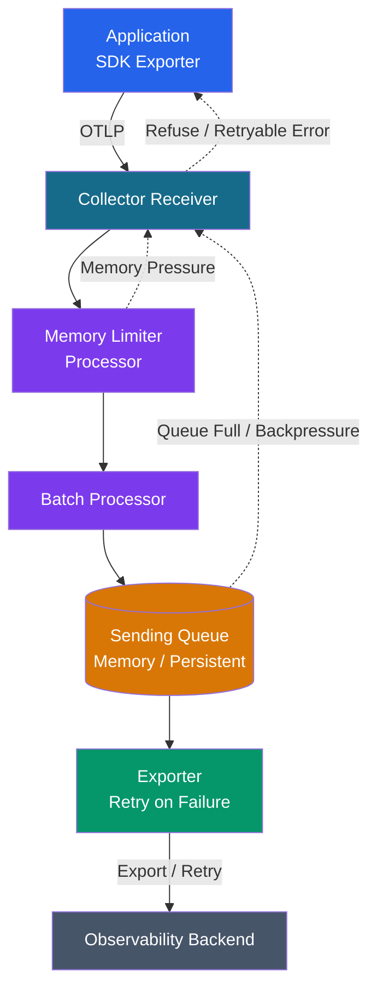

此圖為概念流程；Backpressure 通常透過錯誤回傳傳遞，不是另一條實際的 Telemetry Pipeline。

### **4. OTCA Exam — Key Takeaways**

- **Retry**：處理暫時性的 Backend / Network Failure。
- **Sending Queue**：緩衝等待匯出的 Telemetry。
- **Persistent Queue**：降低 Collector Restart / Crash 造成的資料遺失風險。
- **Backpressure**：當下游無法處理資料時，向上游反映壓力。
- **Memory Limiter**：建議放在 Pipeline 第一個 Processor，降低 Collector OOM 風險。

**最重要的結論：**

**Retry + Sending Queue + Memory Limiter + Backpressure = Resilient Telemetry Pipeline**

但這些機制**無法保證 Zero Data Loss**，只能降低常見故障情境下的資料遺失風險。

---
✅ **基本上對！但更精確地說，Queue Full 或 Memory Pressure 會透過 Backpressure 機制，讓 Collector Receiver 無法繼續成功接收部分 Telemetry，而不是直接通知 Receiver 關閉或停止監聽。**

## **1. 兩種 Backpressure 情況**

| Condition           | 發生位置                     | 行為                                          |
| ------------------- | ------------------------ | ------------------------------------------- |
| **Queue Full**      | Exporter Sending Queue   | Exporter 無法將新的 Telemetry 加入 Queue，可能向上游回傳錯誤 |
| **Memory Pressure** | Memory Limiter Processor | 拒絕新的 Telemetry，回傳可重試錯誤                      |
| **Receiver**        | Pipeline Entry           | 將下游錯誤回傳給 SDK / Sender（視 Receiver 協定而定）      |
| **SDK Exporter**    | Application              | 依 SDK 實作和設定進行 Retry、Buffer 或 Drop           |

## **2. Backpressure 如何傳遞？**

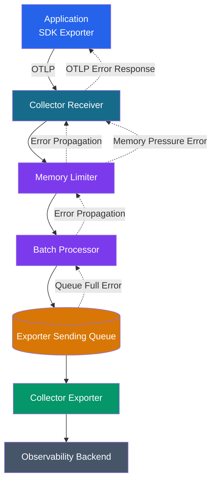

此圖為同步錯誤回傳的概念示意。實際上 Batch Processor 可能非同步轉送資料，因此 Exporter Queue Full 的錯誤不一定能回傳至原始的 SDK Request。

## **3. Receiver 會停止接收嗎？**

**通常不會直接停止監聽 Port&#x20;**`4317`**&#x20;或&#x20;**`4318`**。**

例如：

- Collector 的 OTLP Receiver 仍在監聽 `4317`。
- 新的 Application Request 仍可能建立連線。
- 但當 Memory Limiter 拒絕資料時，Receiver 可能回傳 gRPC `Unavailable` 等可重試錯誤。
- SDK 收到錯誤後，依其 Retry Policy 決定是否重新傳送。

因此要區分：

**停止監聽（Stop Listening）≠ 拒絕處理資料（Refuse Telemetry）。**

### **4. OTCA Exam 重點**

- **Queue Full**：Exporter 無法加入新的 Requests。
- **Memory Limiter**：Collector 記憶體壓力過高時拒絕新資料。
- **Backpressure**：讓上游得知下游暫時無法處理資料。
- **Receiver**：可能向 SDK 回傳錯誤，但不一定停止監聽。
- **SDK**：能否成功 Retry 取決於具體實作。

**結論：**

> 當 **Exporter Queue 已滿**，或 **Memory Limiter 偵測到記憶體使用量過高**時，OpenTelemetry Collector 可能會拒絕接收新的 Telemetry 資料，並透過 **Backpressure（反向壓力）機制**，將無法處理資料的情況向上游 Receiver 及 SDK 回報。

> **Receiver** 通常仍會持續監聽連接埠，但可能回傳可重試的錯誤（Retryable Errors），而不是接受新的 Telemetry 資料。

---
# OpenTelemetry Collector Sending Queue 有兩種設定方式：

架構是： `Application → Collector Receiver → Memory Limiter → Batch Processor → Sending Queue → OTLP Exporter → Tempo`

1. **In-memory Queue**：資料暫存在 RAM。
2. **Persistent Queue**：資料保存在 Disk，可改善 Collector 重啟後的恢復能力。

## **1. In-memory Queue Configuration**

```yaml

exporters:
  otlp:
    endpoint: tempo.example.com:4317

    tls:
      insecure: false

    sending_queue:
      enabled: true
      sizer: requests
      queue_size: 5000
      num_consumers: 10

    retry_on_failure:
      enabled: true
      initial_interval: 5s
      max_interval: 30s
      max_elapsed_time: 10m

```

### **各參數的意義**

| Parameter          | Value      | Description                          |
| ------------------ | ---------- | ------------------------------------ |
| `enabled`          | `true`     | 啟用 Sending Queue                     |
| `sizer`            | `requests` | 以 Requests / Batches 為 Queue 計量單位    |
| `queue_size`       | `5000`     | Queue 容量為 5,000 個 Requests / Batches |
| `num_consumers`    | `10`       | 最多 10 個 Queue Consumers 並行執行匯出工作     |
| `retry_on_failure` | `true`     | 啟用可重試錯誤的重傳                           |
| `max_elapsed_time` | `10m`      | 每個失敗 Request 的最大重試期間                 |

**注意：**`queue_size: 5000`**不代表 5,000 個 Spans，而是最多 5,000 個 Requests / Batches。**

## **2. Persistent Queue Configuration**

如果你希望 Collector 重啟後仍能恢復尚未成功傳送的資料，則加入 `file_storage` Extension。

```yaml

extensions:
  file_storage:
    directory: C:/otel-data/queue

exporters:
  otlp:
    endpoint: tempo.example.com:4317

    tls:
      insecure: false

    sending_queue:
      enabled: true
      sizer: requests
      storage: file_storage
      queue_size: 5000
      num_consumers: 10

    retry_on_failure:
      enabled: true
      initial_interval: 5s
      max_interval: 30s
      max_elapsed_time: 10m

service:
  extensions: [file_storage]

```

這只是配置片段。需要與現有 Receivers、Processors、Pipelines 合併。

在你的 Windows 環境中，先建立儲存目錄：

```bash
mkdir -p /c/otel-data/queue
```

並確認 Windows Service Account 具備讀寫權限。

**Persistent Queue 使用**`file_storage`**保存 Queue 資料，不是額外建立一個與 In-memory Queue 並行的獨立 Queue。**

## **3. Queue 在 Collector 的位置**

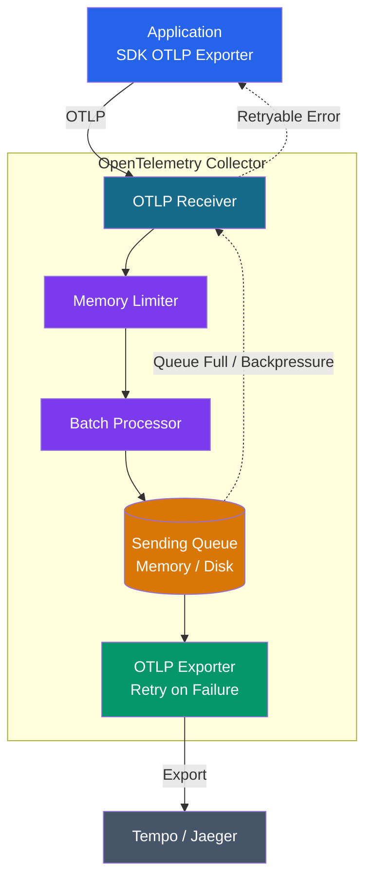

此圖為概念架構。Queue Full 時錯誤不一定能傳回最初的 SDK Request，尤其當中間使用非同步 Batch Processor 時。

## **4. 你的 Windows Collector 要如何設定？**

你目前的 `config.yaml` 使用：

```yaml
exporters:
  debug:
    verbosity: detailed
```

以及：

```yaml
service:
  pipelines:
    traces:
      receivers: [otlp, jaeger, zipkin]
      processors: [batch]
      exporters: [debug]
```

`debug`**Exporter 主要用來輸出診斷資料，不需要配置網路 Sending Queue。**

當你新增真正的 OTLP Exporter 後，可以這樣修改 Traces Pipeline：

```yaml
service:
  pipelines:
    traces:
      receivers: [otlp, jaeger, zipkin]
      processors: [batch]
      exporters: [debug, otlp]
```

並在 `exporters.otlp` 中設定前面介紹的 `sending_queue` 與 `retry_on_failure`。

這樣 Traces 就會同時輸出至 Debug Exporter，以及使用 Sending Queue 的遠端 OTLP Exporter。

## **5. 如何查看 Queue 使用量？**

透過 Collector Internal Metrics，在 Windows Git Bash 執行：

```
curl -fsS http://127.0.0.1:8888/metrics |
  grep -E 'otelcol_exporter_queue_size|otelcol_exporter_queue_capacity|otelcol_exporter_enqueue_failed'
```

| Metric                                  | Purpose            |
| --------------------------------------- | ------------------ |
| `otelcol_exporter_queue_size`           | 目前 Queue 使用量       |
| `otelcol_exporter_queue_capacity`       | Queue 最大容量         |
| `otelcol_exporter_enqueue_failed_spans` | 無法加入 Queue 的 Spans |

如果目前只有 `debug` Exporter，可能不會看到這些 Queue Metrics。實際可用的指標也取決於 Collector 版本和配置。


**最終建議：** 你的 Windows Collector PoC 可以先使用 **In-memory Queue + Retry** 測試 Backend Failure。如果要模擬 Collector Restart 後恢復待送資料，再改成 **Persistent Queue +**`file_storage`。

官方參考：[OpenTelemetry Collector — Resiliency](https://opentelemetry.io/docs/collector/resiliency/?utm_source=chatgpt.com)。

---

# OpenTelemetry — Schema Management（結構描述管理）

- <https://github.com/open-telemetry/semantic-conventions/tree/main/schemas>
- Container `ht-otel-collector` => Resource SchemaURL: https://opentelemetry.io/schemas/1.38.0

> Schema Management 用於管理不同版本的 OpenTelemetry Telemetry Schema，確保不同版本的 Instrumentation 可以共存，並在有適用轉換規則時，將 Telemetry 轉換為一致的格式。

## 1. Overview

OpenTelemetry Schema Management 包含四個核心概念：

| Concept | Purpose |
|---|---|
| **Schema Management** | 管理不同版本 Telemetry 的相容性 |
| **Schema URL** | 識別 Telemetry 使用的 Schema Version |
| **Schema Files** | 定義不同 Schema Versions 之間的轉換規則 |
| **Schema Processor** | 在 Collector 中執行 Schema Translation |

**Core Concept:**

不同版本的 Java EE、Python、Node.js Instrumentation 可能產生不同的 Attribute Names。

透過 **Schema URL + Schema Files + Schema Processor**，可以在支援的轉換範圍內將不同版本的 Telemetry 統一成一致的格式。

---

## 2. Why Schema Management Is Needed

### 2.1 Attribute Naming Changes

例如 OpenTelemetry Semantic Conventions 更新後：

| Comparison | Older Schema | Newer Schema |
|---|---|---|
| Schema Version | 1.11.0 | 1.21.0 |
| Attribute Name | `net.host.name` | `server.address` |
| Purpose | Host Name | Server Address |

**Schema Translation:**

`net.host.name` → `server.address`

這項 Attribute Rename 存在於 OpenTelemetry 的相關 Schema Migration Rules 中。

假設：

- Java EE Legacy Application 使用舊版 Instrumentation。
- Python Flask Service 使用新版 Instrumentation。
- Collector 同時接收兩個 Applications 的 Telemetry。

如果 Grafana Dashboard 或 Tempo Query 只搜尋 `server.address`，舊版 `net.host.name` 的資料可能不會被查詢到。

Schema Management 可以降低不同 Instrumentation Versions 對 Dashboard、Query 和 Alert Rules 的影響。

### 2.2 Important Clarification

Schema Management 不是單純修改 Attribute Name，而是根據 Schema Version 與相應的 Transformation Rules 執行相容性轉換。

並非所有 Semantic Conventions Changes 都能自動完成轉換。

---

## 3. Schema URL

### 3.1 What Is a Schema URL?

Schema URL 用來標識一組 Telemetry 所遵循的 OpenTelemetry Schema。

例如：

`https://opentelemetry.io/schemas/1.24.0`

| Component | Meaning |
|---|---|
| `https://opentelemetry.io/schemas/` | Schema Family / URL Prefix |
| `1.24.0` | Schema Version |
| Full Schema URL | 識別特定版本的 Schema |

例如 Java Application 或 Python Instrumentation 產生 Telemetry 時，可能包含：

```text
SchemaURL:
https://opentelemetry.io/schemas/1.24.0
```

這代表該組 Telemetry 宣告使用 OpenTelemetry Schema `1.24.0`。

### 3.2 Collector Debug Exporter Example

投影片中的 Debug Exporter 顯示：

```text
ScopeSpans SchemaURL:
https://opentelemetry.io/schemas/1.11.0
```

這表示該組 ScopeSpans Telemetry 使用 Schema `1.11.0`。

**Important:**

- Schema URL 不是 Trace ID。
- Schema Version 不是 Java Agent Version。
- Schema Version 不是 SDK Version。
- Schema Version 也不是 Collector Software Version。

Schema URL 是讓 Telemetry Consumer 或 Schema-aware Processor 識別資料 Schema 的依據。

---

## 4. Schema Files

### 4.1 Purpose

Schema Files 定義不同 Schema Versions 之間可執行的 Transformation Rules。

例如：

**Older Attribute:**

```text
net.host.name
```

**Newer Attribute:**

```text
server.address
```

Schema File 可描述這類 Attribute Rename，供支援 Schema Translation 的元件使用。

### 4.2 Schema Files vs Semantic Conventions

| Component | Responsibility |
|---|---|
| **Semantic Conventions** | 定義標準 Telemetry Attributes、Metrics、Spans 等名稱及語意 |
| **Schema Files** | 描述不同 Schema Versions 之間的變更及轉換規則 |
| **Schema URL** | 識別 Telemetry 使用的 Schema |
| **Schema Processor** | 依可用規則執行 Telemetry Transformation |

**Important:**

Schema File 主要描述版本之間的轉換規則，不是所有 Telemetry Attributes 的完整資料字典。

Schema Files 也不保證可以轉換所有不相容的語意變更。

---

## 5. Schema Processor — Collector Translation

### 5.1 Purpose

Schema Processor 是 OpenTelemetry Collector 的 Processor Component。

它可以根據輸入的 Schema URL 與可用的 Schema Transformation Rules，嘗試將 Telemetry 轉換至指定的 Target Schema。

### 5.2 Architecture

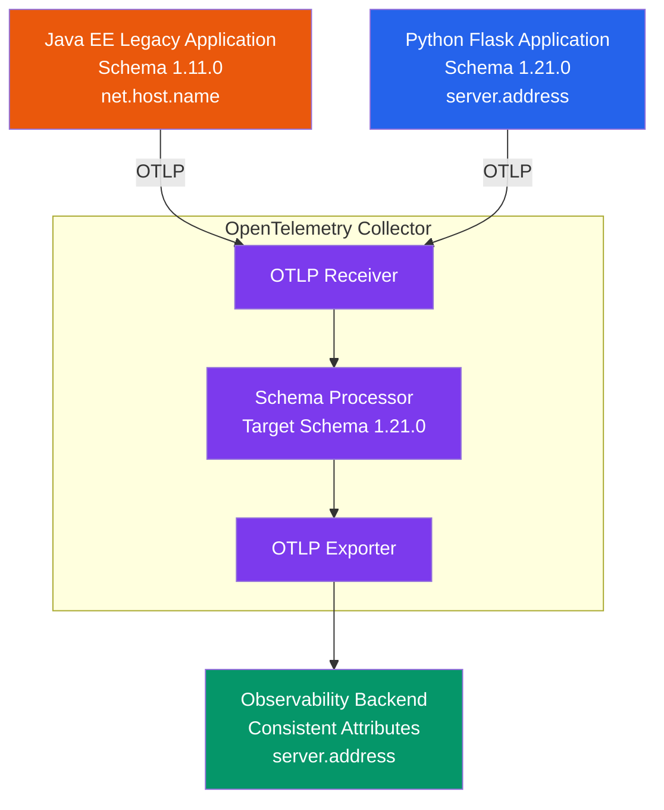

### 5.3 Expected Translation

在具備適用轉換規則的情況下：

| Input | Target Schema | Output |
|---|---|---|
| `net.host.name` | 1.21.0 | `server.address` |
| `server.address` | 1.21.0 | `server.address` |

因此，下游 Observability Backend 可以使用一致的 Attribute Name。

**Important:** Schema Processor 會依 Schema URL 與可用規則處理 Telemetry，不會無條件修改所有 Attributes。

---

## 6. Schema Processor Configuration

### 6.1 Configuration from the Training Slide

投影片中的範例：

```yaml
processors:
  schema:
    prefetch:
      - https://opentelemetry.io/schemas/1.9.0

    targets:
      - https://opentelemetry.io/schemas/1.6.1
```

| Parameter | Purpose |
|---|---|
| `prefetch` | 預先取得或快取指定 Schema 的轉換定義 |
| `targets` | 定義欲轉換的目標 Schema Version |

注意：此範例的 Target Schema 是 `1.6.1`，不是 `1.21.0` 或 `1.24.0`。

### 6.2 Example — Target Schema 1.21.0

如果希望將有適用規則的舊版 Telemetry 轉換至 Schema `1.21.0`：

```yaml
processors:
  schema:
    prefetch:
      - https://opentelemetry.io/schemas/1.21.0

    targets:
      - https://opentelemetry.io/schemas/1.21.0

service:
  pipelines:
    traces:
      receivers: [otlp]
      processors: [schema, batch]
      exporters: [otlp]
```

### 6.3 Example — Target Schema 1.24.0

```yaml
processors:
  schema:
    targets:
      - https://opentelemetry.io/schemas/1.24.0

service:
  pipelines:
    traces:
      receivers: [otlp]
      processors: [schema, batch]
      exporters: [otlp]
```

這些都是部分 Configuration Examples，實際部署仍需定義：

- OTLP Receiver
- Batch Processor
- OTLP Exporter
- Service Pipelines

此外，必須確認 Collector Contrib 版本是否包含 Schema Processor，以及所使用版本支援的配置格式和 Schema Translation Rules。

**Important:** Processor 只在 `processors` 中宣告並不會自動啟用，必須透過 `service.pipelines` 引用。

Schema Processor 的成熟度與支援範圍需依實際版本確認，不應假設其適用於所有 Production Workloads。

---

## 7. Real-World Example — Java EE + Python Flask

假設既有銀行系統的 Distributed Tracing 架構為：

`Java EE Application → Python Flask Service → OpenTelemetry Collector → Tempo`

不同 Application 可能使用不同 Instrumentation Versions。

| Application | Instrumentation | Attribute |
|---|---|---|
| Java EE Legacy System | Older Java Agent | `net.host.name` |
| Python Flask Service | Newer Python Instrumentation | `server.address` |
| Collector Schema Processor | Schema Translation | `server.address` |
| Grafana / Tempo | Unified Query | `server.address` |

### Benefits

Schema Management 可以：

1. 讓不同 Instrumentation Versions 共存。
2. 在可轉換範圍內統一 Attribute Names。
3. 降低 Grafana Dashboard Query 的維護負擔。
4. 降低不同 Schema Versions 對 Alert Rules 的影響。
5. 協助 Application Instrumentation 升級與遷移。

### Important Distinction

**Schema Management ≠ Context Propagation**

| Comparison | Schema Management | Context Propagation |
|---|---|---|
| Purpose | 統一 Telemetry Schema | 維持跨服務 Trace Context |
| Main Component | Schema URL / Schema Processor | Propagator |
| Typical Data | `net.host.name`、`server.address` | `traceparent`、`tracestate` |
| Main Problem | Attribute Naming Inconsistency | Broken Distributed Trace |
| Fix Different Trace IDs? | No | 正確的 Context Propagation 可避免不必要的 Trace 分裂 |

Schema Processor 不會修復缺失的 `traceparent`，也不會自動合併不同 Trace IDs。

---

## 8. OTCA Exam — Key Takeaways

| Concept | Key Point |
|---|---|
| **Schema Management** | Maintain Telemetry Compatibility |
| **Semantic Conventions** | Define Standard Telemetry Names and Meaning |
| **Schema URL** | Identify Schema Version |
| **Schema Files** | Describe Version-to-Version Transformations |
| **Schema Processor** | Translate Telemetry to a Supported Target Schema |
| **Target Schema** | Define Desired Output Schema |
| **Schema Compatibility** | Reduce Impact of Instrumentation Version Changes |

### Key Definitions

**Schema URL = Which Schema Version?**

**Schema File = What Changed Between Versions?**

**Schema Processor = How to Transform Telemetry?**

**Schema Management = How to Maintain Compatibility?**

---

## 9. Conclusion

OpenTelemetry Schema Management 的主要目的是：

**維持不同版本的 Instrumentation、Collector 與 Observability Backend 之間的 Telemetry Schema Compatibility。**

主要流程為：

**Telemetry + Schema URL → Schema Processor → Target Schema → Observability Backend**

例如：

`net.host.name (Older Schema) → Schema Translation → server.address (Newer Schema)`

對 Java EE Legacy Application 與 Python Flask Service 而言，Schema Management 可在支援的轉換範圍內統一 Telemetry Attributes，降低 Semantic Conventions 更新對 Grafana Dashboards、Tempo Queries 和 Alert Rules 的影響。

但 **Schema Processor 只處理 Schema Transformation，不處理 Context Propagation 或 Trace ID Correlation。**

---

## Official References

- [OpenTelemetry Telemetry Schemas](https://opentelemetry.io/docs/specs/otel/schemas/)
- [OpenTelemetry Semantic Conventions](https://opentelemetry.io/docs/specs/semconv/)
- [OpenTelemetry Schema 1.24.0](https://opentelemetry.io/schemas/1.24.0)
- [OpenTelemetry Collector Schema Processor](https://github.com/open-telemetry/opentelemetry-collector-contrib/tree/main/processor/schemaprocessor)

---

## **Recap — OpenTelemetry Debugging & Maintenance**

### **1. Context Propagation Failures**

- Mismatched propagators
- Headers stripped
- Missing context injection

### **2. Debugging Collector Pipelines**

- Debug exporter
- `validate` subcommand
- Internal telemetry
- zPages extension

### **3. Error Handling & Data Loss**

- Retries
- Queues — In-memory, persistent
- Backpressure

### **4. Schema Management**

- Schema URL
- Schema files
- `schemaprocessor`

---
