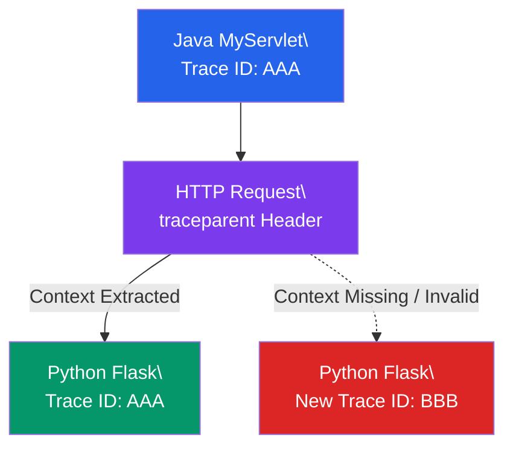
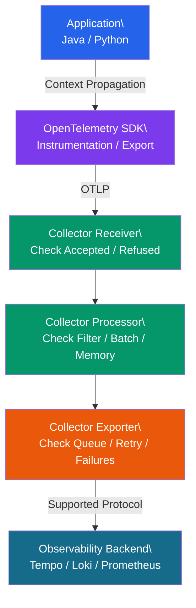
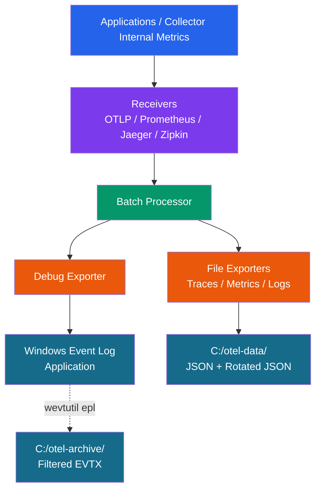
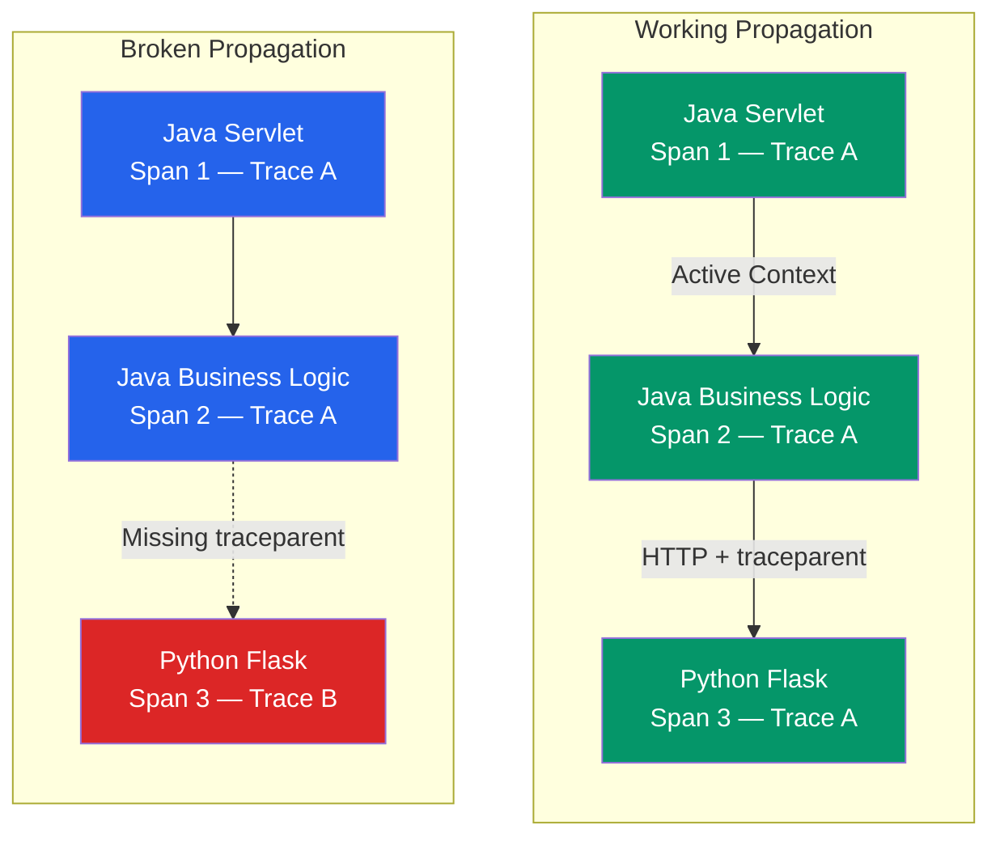
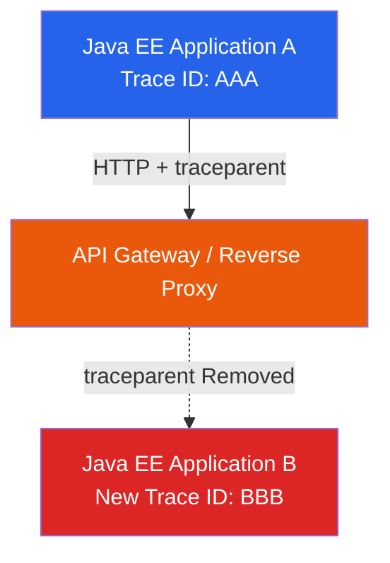
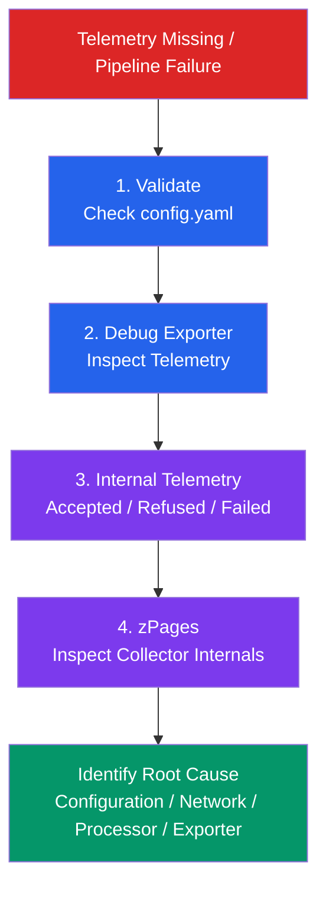

# OpenTelemetry — Debugging & Maintenance（除錯與維護）

> 本章介紹如何診斷、排除及維護 OpenTelemetry Observability Pipelines，確保 Logs、Metrics、Traces 能夠正確產生、傳遞、處理及匯出。

## 1. Overview

本章包含四個主要主題：

| Topic                                     | 中文說明              | 學習重點                                                        |
| ----------------------------------------- | --------------------- | --------------------------------------------------------------- |
| **1. Context Propagation Failures** | 上下文傳遞失敗        | 排查 Trace ID、Parent Span、`traceparent`、Baggage 傳遞問題   |
| **2. Debug Collector Pipelines**    | Collector 管線除錯    | 檢查 Receivers、Processors、Exporters 的 Telemetry Data Flow    |
| **3. Error Handling & Data Loss**   | 錯誤處理與資料遺失    | 理解 Retry、Sending Queue、Backpressure、Persistent Storage     |
| **4. Schema Management**            | Telemetry Schema 管理 | 管理 Semantic Conventions、Schema URL、Schema Versions 與相容性 |

**Core Concept:**

OpenTelemetry Debugging 不只是確認 Application 是否產生 Telemetry，而是要驗證：

**Application → SDK Exporter → Collector Receiver → Collector Processor → Collector Exporter → Observability Backend**

任何一個環節發生問題，都可能造成 Telemetry 中斷、資料遺失或查詢結果不一致。

---

## 2. Context Propagation Failures

### 2.1 Purpose

**Context Propagation** 是 Distributed Tracing 的核心機制，負責在不同 Applications、Threads、Processes 及 Services 之間傳遞 Trace Context。

例如：

`Java MyServlet → Python Flask Service`

正常情況下，Java 與 Python Spans 應使用相同的 Trace ID，並形成正確的 Parent-Child Relationship。

### 2.2 Common Context Propagation Issues

| Issue                                  | Description                            | Possible Result                    |
| -------------------------------------- | -------------------------------------- | ---------------------------------- |
| **Missing traceparent**          | HTTP Request 未傳遞 W3C Trace Context  | 下游可能建立新的 Trace             |
| **Incorrect Context Injection**  | Sender 未正確注入 Context              | 下游無法取得正確 Parent Context    |
| **Incorrect Context Extraction** | Receiver 未正確解析 Context            | Trace 無法正確連結                 |
| **Missing Active Context**       | 手動建立的 Span 未設為 Current Context | 後續 Spans 可能無法正確繼承 Parent |
| **Propagator Mismatch**          | 上下游使用不相容的 Propagation Format  | Distributed Trace 中斷             |
| **Baggage Propagation Failure**  | `baggage` Header 未傳遞或解析        | Business Context 無法跨服務傳遞    |

### 2.3 Real-World Example



### 2.4 Debugging Checklist

1. 檢查 Outgoing HTTP Request 是否包含 `traceparent`。
2. 確認 Java / Python Instrumentation 支援相應 HTTP Library。
3. 確認 Sender 與 Receiver 的 Propagators 設定。
4. 檢查 Parent Span 是否正確成為 Active Context。
5. 比較上游與下游的 Trace ID。
6. 如果使用 Baggage，確認是否設定 `tracecontext,baggage`。

**Important:**

- `traceparent` 主要傳遞 Trace ID、Parent Span ID 及 Trace Flags。
- `baggage` 傳遞自訂 Key-Value Context。
- Baggage 不會自動變成 Span Attributes 或 Metric Labels。
- 不應透過 Baggage 傳遞密碼、個資或敏感業務資料。

---

## 3. Debug Collector Pipelines

### 3.1 Purpose

Collector Pipeline Debugging 的目標，是確認 Telemetry 是否成功通過：

**Receiver → Processor → Exporter**

即使 Collector Service 正在執行，也不代表所有 Telemetry Pipelines 都正常。

### 3.2 Common Pipeline Issues

| Component                  | Common Issues                                                  | Debugging Method                        |
| -------------------------- | -------------------------------------------------------------- | --------------------------------------- |
| **Receiver**         | Endpoint、Protocol、Network Configuration 錯誤                 | 檢查 Receiver Internal Metrics          |
| **Processor**        | Filtering、Memory Limiter、Transformation 導致資料被拒絕或移除 | 檢查 Processor Configuration 和 Metrics |
| **Exporter**         | Backend Unavailable、Authentication、TLS、Queue Full           | 檢查 Exporter Failed / Queue Metrics    |
| **Service Pipeline** | Component 未被 Pipeline 引用                                   | 檢查 `service.pipelines`              |
| **Backend**          | Telemetry 已送出但無法查詢                                     | 檢查 Backend Ingestion、Storage、Query  |

### 3.3 Windows Collector Example

目前 Windows Collector 使用：

`OTLP / Prometheus Receivers → Batch Processor → Debug Exporter → Windows Event Log`

已確認：

- Windows Collector Service 正常。
- Prometheus Receiver 成功收集 Collector Internal Metrics。
- Debug Exporter 將 Metrics 輸出至 Windows Event Log。
- Application Traces 與 Logs 仍需分別驗證。

### 3.4 Collector Internal Metrics

| Metric                                      | Purpose                            |
| ------------------------------------------- | ---------------------------------- |
| `otelcol_receiver_accepted_spans`         | 成功進入 Receiver 的 Spans         |
| `otelcol_receiver_accepted_metric_points` | 成功進入 Receiver 的 Metric Points |
| `otelcol_receiver_accepted_log_records`   | 成功進入 Receiver 的 Log Records   |
| `otelcol_receiver_refused_spans`          | Receiver 拒絕的 Spans              |
| `otelcol_exporter_sent_spans`             | Exporter 成功匯出的 Spans          |
| `otelcol_exporter_send_failed_spans`      | Span Export 失敗次數或數量的累計   |
| `otelcol_exporter_queue_size`             | Exporter Queue 目前大小            |

實際可用的 Metric Names 和 Labels 會因 Collector 版本與 Exporter Configuration 而異。

### 3.5 Windows Git Bash Example

查看 Collector Internal Metrics：

```bash
curl -fsS http\://127.0.0.1:8888/metrics
```

查看特定 Metrics：

```bash
curl -fsS http\://127.0.0.1:8888/metrics |
  grep -E 'otelcol_receiver_accepted|otelcol_exporter_sent'

```

這個 Endpoint 顯示的是 Collector Internal Metrics，不是完整的 Application Traces 或 Log Records。

**Key Point:** Debugging 應沿著 Telemetry Flow 逐層檢查，找出資料在哪一個 Component 開始出現異常。

---

## 4. Error Handling & Data Loss

### 4.1 Purpose

OpenTelemetry Collector 可能因為 Network、Backend、Resource Limit 或 Configuration 問題導致 Telemetry Export 失敗。

例如：

`SDK Exporter → Collector → Tempo（Unavailable）`

這時需要了解 Retry、Sending Queue、Backpressure 和 Persistent Storage。

### 4.2 Error Handling Mechanisms

| Mechanism                  | Responsibility                              | Limitation                                           |
| -------------------------- | ------------------------------------------- | ---------------------------------------------------- |
| **Retry**            | 暫時失敗後重新傳送 Telemetry                | 超過 Retry Limit 可能遺失                            |
| **Sending Queue**    | 暫存等待匯出的 Telemetry                    | Memory Queue 可能溢出                                |
| **Backpressure**     | 下游負載過高時向上游回報壓力                | 上游不一定能持續緩衝資料                             |
| **Persistent Queue** | 將 Queue 資料保存在磁碟，改善重啟後恢復能力 | 仍可能因 Disk Failure、Capacity 或 Retry Limits 遺失 |
| **Memory Limiter**   | 降低 Collector OOM 風險                     | 可能拒絕部分 Telemetry                               |

### 4.3 Data Loss Scenarios

Telemetry 可能在下列情況下遺失：

1. Backend 長時間無法接收 Telemetry。
2. Exporter Sending Queue 已滿。
3. Retry Timeout 或 Retry Limit 被超過。
4. Collector Crash，且 Queue 只儲存在 Memory。
5. Persistent Storage 發生 Disk Failure 或容量不足。
6. Collector Processor 主動丟棄資料，例如 Filter 或 Sampling。
7. Application SDK 端已丟棄資料，Collector 根本沒有收到。

### 4.4 Example — Resilient OTLP Exporter

```yaml
extensions:
  file_storage:
    directory: C:/otel-data/queue

exporters:
  otlp:
    endpoint: tempo.example.com:4317
    tls:
      insecure: false

    sending_queue:
      enabled: true
      storage: file_storage
      queue_size: 5000

    retry_on_failure:
      enabled: true
      initial_interval: 5s
      max_interval: 30s
      max_elapsed_time: 10m

service:
  extensions: [file_storage]

  pipelines:
    traces:
      receivers: [otlp]
      exporters: [otlp]
```

這是獨立示例，並非可直接覆蓋目前 Windows Collector 的完整配置。實際使用時，還需確認 Receiver 設定、Backend TLS 憑證、目錄權限及 Collector 版本。

**Important:** Persistent Queue 只能降低部分故障情境的資料遺失風險，不能保證 End-to-End Exactly-once Delivery。

---

## 5. Schema Management

### 5.1 Purpose

Schema Management 用於處理 OpenTelemetry Semantic Conventions 隨版本演進所產生的相容性問題。

例如 HTTP Attribute：

`http.request.method`

當 Instrumentation Libraries 升級後，可能出現 Attribute Names 或 Telemetry Structure 的變更，影響既有 Dashboards、Queries 或 Alert Rules。

### 5.2 Important Concepts

| Concept                         | Description                                                        |
| ------------------------------- | ------------------------------------------------------------------ |
| **Semantic Conventions**  | 定義標準 Telemetry Attribute、Metric 等名稱及語意                  |
| **Schema URL**            | 標識 Telemetry 所使用的 Schema Version                             |
| **Schema Version**        | 描述特定版本的 Telemetry Schema                                    |
| **Schema Transformation** | 在支援的情況下，轉換不同版本之間的 Telemetry                       |
| **Compatibility**         | 確保 Instrumentation 更新不會不必要地破壞既有 Queries / Dashboards |

### 5.3 Example

假設舊版 Instrumentation 使用：

`http.method`

新版 Semantic Conventions 使用：

`http.request.method`

如果 Dashboard 仍查詢 `http.method`，可能無法取得新版資料。

需要確認：

1. Instrumentation Library 使用哪一版本的 Semantic Conventions。
2. Telemetry 是否攜帶對應的 Schema URL。
3. Backend 或 Collector 是否支援所需的 Schema Transformation。
4. Dashboards、Queries、Alerts 是否需要同步更新。

**Important:** Schema URL 用於標識 Schema，不代表 Collector 一定會自動執行 Schema Translation。

而且 Schema Transformation 並非保證能處理所有不相容變更。

---

## 6. End-to-End Debugging Architecture



**Troubleshooting Principle:**

先確認 Application 端是否產生 Telemetry，再依序檢查 SDK Exporter、Collector Receiver、Processor、Exporter，最後確認 Backend Ingestion 與 Query。

Context Propagation 則需另外驗證跨服務的 Request Headers 和 Parent-Child Span Relationship。

---

## 7. Windows Collector Logs — Archiving & Rotation

本節針對 Windows 11 ARM64、`otelcol-contrib 0.165.0` 的實驗環境，區分 **Collector Diagnostic Logs（Windows Event Log）** 與 **Collector File Exporter Telemetry（JSON Files）**。前者已在本機驗證；後者是建議新增的設定，**尚未確認已部署**。

| Category                          | Current / Proposed Destination                                       | Archiving Method                               | Notes                                                        |
| --------------------------------- | -------------------------------------------------------------------- | ---------------------------------------------- | ------------------------------------------------------------ |
| Collector Debug / Diagnostic Logs | Windows Application Event Log，Source: `otelcol-contrib`（已驗證） | `wevtutil.exe epl`、Windows Event Log Policy | Event Log 不等於 Observability Backend                       |
| Application Traces                | `C:/otel-data/traces.json`（擬新增）                               | File Exporter `rotation`                     | 僅在有 Traces 到達 Pipeline 時會有內容                       |
| Application Metrics               | `C:/otel-data/metrics.json`（擬新增）                              | File Exporter `rotation`                     | 會包含 Prometheus Receiver 收集的 Collector Internal Metrics |
| Application Logs                  | `C:/otel-data/logs.json`（擬新增）                                 | File Exporter `rotation`                     | 不等於 Collector Diagnostic Logs                             |

### 7.1 Inspect Windows Event Log Policy (Git Bash)

```bash
wevtutil.exe gl Application
```

查看 `maxSize`、`retention`、`autoBackup` 及 log file path。這些選項管理的是 **Windows Application Log 整體**，不是單一 `otelcol-contrib` Source。

### 7.2 Manually Export Windows Event Logs

在 **Windows Git Bash** 執行；封存目錄需具有寫入權限：

```bash
mkdir -p /c/otel-archive

# Export entire Application Event Log (does not clear it)

MSYS_NO_PATHCONV=1 wevtutil.exe epl Application \
  'C:\otel-archive\Application-20261126.evtx'

# Export only the otelcol-contrib events (does not clear them)

MSYS_NO_PATHCONV=1 wevtutil.exe epl Application \
  'C:\otel-archive\otelcol-20261126.evtx' \
  '/q:*[System[Provider[@Name="otelcol-contrib"]]]'
```

上述檔名中的日期僅為示例，請依實際封存日期更改，避免重複檔名。`epl` 匯出但**不會清除**原本的事件紀錄；若檔案已存在，預設可能失敗而不是覆寫。`MSYS_NO_PATHCONV=1` 可避免 Git Bash 將 Windows CLI 的 `/q:` 選項誤當成 POSIX 路徑轉換。

### 7.3 Optional Windows Automatic Event Log Backup

> **Administrative change — not recommended to apply casually.** 此命令會更改整個 Application Event Log 的保留規則；請在確認其他應用程式需求、磁碟空間與公司政策後，才以系統管理員權限執行。

```bash
MSYS_NO_PATHCONV=1 wevtutil.exe sl Application \
  /ms:104857600 /rt:true /ab:true
```

| Option            | Meaning                                                                            |
| ----------------- | ---------------------------------------------------------------------------------- |
| `/ms:104857600` | Application Log 容量上限 100 MiB                                                   |
| `/rt:true`      | 啟用保留模式：達上限時不直接覆寫舊事件；若無法完成自動備份，可能無法繼續寫入新事件 |
| `/ab:true`      | 在 Event Log 滿載時啟用 Windows 自動備份；必須同時設定 `/rt:true`                |

此機制不是「每天封存」，也**不會自動刪除過期 Archive**。正式環境建議透過 Windows 管理政策或排程作業管理封存與保留，而不是單憑這段命令直接變更共用 Application Log。

### 7.4 Configure File Exporter Rotation

若已依前述計畫加入 File Exporter，將原有 `exporters` 區段修改為以下示例（**不要建立第二個根層 `exporters:`**）：

```yaml
exporters:
  debug:
    verbosity: basic

  file/traces:
    path: C:/otel-data/traces.json
    rotation:
      max_megabytes: 50
      max_days: 7
      max_backups: 10
      localtime: true

  file/metrics:
    path: C:/otel-data/metrics.json
    rotation:
      max_megabytes: 50
      max_days: 7
      max_backups: 10
      localtime: true

  file/logs:
    path: C:/otel-data/logs.json
    rotation:
      max_megabytes: 50
      max_days: 7
      max_backups: 10
      localtime: true
```

並在既有 `service.pipelines` 中將兩個 Exporters 都啟用：

```yaml
service:
  pipelines:
    traces:
      receivers: [otlp, jaeger, zipkin]
      processors: [batch]
      exporters: [debug, file/traces]

    metrics:
      receivers: [otlp, prometheus]
      processors: [batch]
      exporters: [debug, file/metrics]

    logs:
      receivers: [otlp]
      processors: [batch]
      exporters: [debug, file/logs]
```

**注意：上述 `service:` 為局部示例**，套用時務必保留現有的 `service.telemetry`、`service.extensions` 與 `health_check` / `pprof` / `zpages` 設定，不要以此片段覆蓋整份 `config.yaml`。

| Rotation Parameter    | Description                                           |
| --------------------- | ----------------------------------------------------- |
| `max_megabytes: 50` | 下一批資料會讓檔案超過約 50 MiB 時，按大小輪替        |
| `max_days: 7`       | 清理超過 7 天的**已輪替**檔案，不會每天強制輪替 |
| `max_backups: 10`   | 最多保留 10 個已輪替備份                              |
| `localtime: true`   | 輪替檔名使用本機時區的時間戳記                        |

示意檔案（實際檔名依輪替發生時刻而定）：

```text
C:\otel-data\
├── traces.json
├── traces-2026-11-26T10-30-00.000-size.json
├── metrics.json
├── metrics-2026-11-26T10-35-00.000-size.json
├── logs.json
└── logs-2026-11-26T10-40-00.000-size.json
```

`max_days` 和 `max_backups` 不是永久 Archive 策略，而是**清理已輪替檔案的保留設定**。如果需要不可變、長期稽核保存，應另設正式的存放、備份及 Retention Policy。

### 7.5 Archive / Rotation Architecture



本圖為邏輯示意。實際上 Logs / Traces / Metrics 使用**三條獨立 Pipelines**，File Exporter 的每個 Instance 只接收所屬 Pipeline 的 Signal。

---

## 8. Windows Git Bash — Validate, Restart and Verify

以下為 Windows **Git Bash** 指令，而不是 WSL Linux `systemctl` 指令。涉及設定檔寫入、服務重啟及 Event Log Policy 變更時，請以有足夠權限的終端機執行。

### 8.1 Back Up and Prepare Directories

```bash
mkdir -p /c/otel-data /c/otel-archive

cp '/c/Program Files/OpenTelemetry Collector/config.yaml' \
   '/c/Program Files/OpenTelemetry Collector/config.yaml.bak'

# Inspect the existing YAML

cat '/c/Program Files/OpenTelemetry Collector/config.yaml'
```

### 8.2 Validate Before Restart

```bash
'/c/Program Files/OpenTelemetry Collector/otelcol-contrib.exe' \
  validate \
  --config 'C:/Program Files/OpenTelemetry Collector/config.yaml'
```

修改 Configuration 後先 Validate；若驗證失敗，**不要重啟**。亦需確認 Windows Service Account 對 `C:\otel-data` 有寫入權限。

### 8.3 Restart Windows Service

```bash
sc.exe stop otelcol-contrib
sc.exe query otelcol-contrib
# After the service reports STOPPED:

sc.exe start otelcol-contrib
sc.exe query otelcol-contrib
```

不要在 Windows 原生 MSI Service 使用 `systemctl`。停機與啟動之間應確認服務狀態；`sc.exe stop` 並不保證立即停止完成。

### 8.4 Check Metrics and Files

```bash
curl -fsS http://127.0.0.1:8888/metrics | head -n 20

ls -lh /c/otel-data/

# These files may not exist until data arrives

[ -f /c/otel-data/metrics.json ] && tail -n 5 /c/otel-data/metrics.json
[ -f /c/otel-data/traces.json ] && tail -n 5 /c/otel-data/traces.json
[ -f /c/otel-data/logs.json ] && tail -n 5 /c/otel-data/logs.json
```

### 8.5 Read Collector Events

```bash
# Recent events from the Application log, filtered by Collector provider

MSYS_NO_PATHCONV=1 wevtutil.exe qe Application \
  '/q:*[System[Provider[@Name="otelcol-contrib"]]]' \
  /rd:true /c:10 /f:text
```

只有 Metrics Debug Logs 已由前面的 Windows 實驗確認。**File Exporter 三個 JSON 檔案，以及 Application Traces / Logs 是否成功匯入仍有待部署與驗證。**

---

## 9. Learning Summary

| Topic                                  | Key Takeaway                                                    |
| -------------------------------------- | --------------------------------------------------------------- |
| **Context Propagation Failures** | 確保跨服務的 Trace Context 正確傳遞                             |
| **Debug Collector Pipelines**    | 透過 Debug Exporter 和 Internal Metrics 檢查資料流程            |
| **Error Handling & Data Loss**   | 利用 Retry、Queue、Persistent Storage 改善 Telemetry Resiliency |
| **Schema Management**            | 利用 Semantic Conventions、Schema URL 管理版本相容性            |

### Final Conclusion

OpenTelemetry Debugging & Maintenance 的主要目的，是確保三種 Telemetry Signals：

**Logs、Metrics、Traces**

能夠：

**Correctly Instrumented → Properly Propagated → Successfully Collected → Reliably Exported → Correctly Interpreted**

對目前的實驗環境：

**Java MyServlet → Python Flask → OpenTelemetry Collector → Windows Event Log / File Exporter**

可以分別用於驗證 Distributed Context Propagation、Collector Pipeline Debugging，以及 Telemetry Export 的完整流程。

---

## Official References

- [OpenTelemetry Context Propagation](https\://opentelemetry.io/docs/concepts/context-propagation/)
- [OpenTelemetry Collector Troubleshooting](https\://opentelemetry.io/docs/collector/troubleshooting/)
- [OpenTelemetry Collector Internal Telemetry](https\://opentelemetry.io/docs/collector/internal-telemetry/)
- [OpenTelemetry Collector Resiliency](https\://opentelemetry.io/docs/collector/resiliency/)
- [OpenTelemetry Telemetry Schemas](https\://opentelemetry.io/docs/specs/otel/schemas/)
- [OpenTelemetry Semantic Conventions](https\://opentelemetry.io/docs/specs/semconv/)
- [OpenTelemetry Troubleshooting](https\://opentelemetry.io/docs/collector/troubleshooting/)

---
## **OTCA Exam Domains & Weighting**

| Domain                                               | Exam Weight | 主要內容                                                                     |
| ---------------------------------------------------- | ----------- | ------------------------------------------------------------------------ |
| 1. Fundamentals of Observability                     | 18%         | Observability 基礎、Logs、Metrics、Traces                                     |
| 2. The OpenTelemetry API and SDK                     | **46%**     | API、SDK、Instrumentation、Context Propagation、Exporters                    |
| 3. The OpenTelemetry Collector                       | 26%         | Receivers、Processors、Exporters、Deployment Patterns、Scaling               |
| 4. Maintaining and Debugging Observability Pipelines | **10%**     | Context Propagation、Debugging Pipelines、Error Handling、Schema Management |
| **Total**                                            | **100%**    |     

---
# ** Working vs Broken Propagation**

| Comparison                | Working Propagation | Broken Propagation    |
| ------------------------- | ------------------- | --------------------- |
| Trace ID                  | Span 1、2、3 相同       | Span 3 使用另一個 Trace ID |
| Parent-Child Relationship | 正確串接                | Span 3 無法連接上游         |
| Trace 數量                  | 1 條                 | 2 條                   |
| Java Agent                | 正確擷取、注入 Context     | 某個通訊環節未正確傳遞 Context   |
| Jaeger / Tempo            | 可以看到完整 Trace        | 顯示兩條分離的 Traces        |

## ** Java EE 實際案例**

假設：

`Browser → Java EE Servlet → Java Service → Python Flask`



## ** Java Agent 可以自動處理嗎？**

**可以，但取決於 Java Application 使用的通訊技術是否受到 Java Agent 支援。**

| Java EE 技術            | Zero-code Trace 支援                 |
| --------------------- | ---------------------------------- |
| Servlet / JSP         | 通常可自動建立 HTTP Server Span           |
| JDBC                  | 通常可自動建立 Database Span              |
| Apache HttpClient     | 相容版本通常可自動注入 `traceparent`          |
| JDK HTTP Client       | 依 JDK 與 Agent Instrumentation 支援情況 |
| Custom TCP / Socket   | 不保證自動傳遞                            |
| Proprietary Messaging | 可能需要 Manual Instrumentation        |

---
## **OpenTelemetry — Context Propagation Failure**

這張投影片介紹造成 **Distributed Tracing 的 Context Propagation 失敗**的三個主要原因。

| Reason                          | 中文說明                                                                 | 可能造成的問題                              |
| ------------------------------- | -------------------------------------------------------------------- | ------------------------------------ |
| **1. Mismatched Propagators**   | 不同服務使用不相容的傳遞格式，例如 W3C Trace Context 與 B3                             | 下游無法解析 Trace Context，可能建立新的 Trace ID |
| **2. Headers Stripped**         | Load Balancer、API Gateway 或 Reverse Proxy 移除追蹤 Headers               | `traceparent` 無法到達下游服務               |
| **3. Failed Context Injection** | Application 或 Instrumentation 未將 Trace Context 正確注入 Outgoing Request | 下游沒有可使用的 Parent Context              |

### **1. Mismatched Propagators**

例如：

- Java EE A 使用 `tracecontext`（W3C）。
- Java EE B 只支援 `b3`。

若兩端沒有共同支援的格式，就可能導致 Trace 中斷。

OpenTelemetry 可以透過以下設定指定 Propagators：

```yaml
OTEL_PROPAGATORS=tracecontext,baggage
```

### **2. Headers Stripped — 投影片特別強調的原因**



即使 Java EE A 和 B 都安裝 OpenTelemetry Java Agent，如果中間的 API Gateway 移除 `traceparent`，下游仍可能建立新的 Trace ID。

這種情況不是 Java Agent 本身故障，而是 **Trace Context 在網路中介設備上遺失**。

### **3. Failed Context Injection**

假設：

`Java EE A → IBM MQ → Java EE B`

如果 Java EE A 的 JMS Producer 沒有把 Trace Context 注入 MQ Message，而 Java EE B 又無法取得上游 Context，兩端就可能產生不同的 Trace IDs。

對受支援的 JMS APIs，可以先測試 OpenTelemetry Java Agent 是否自動處理 Injection / Extraction。

## **如何排查？**

| Check Point                 | Verification                              |
| --------------------------- | ----------------------------------------- |
| **Producer / Sender**       | 是否正確注入 `traceparent`                      |
| **Load Balancer / Gateway** | 是否保留 Trace Context Headers                |
| **MQ Middleware**           | 是否正確保留及傳遞 Message Properties              |
| **Consumer / Receiver**     | 是否正確 Extract Parent Context               |
| **Jaeger / Tempo**          | 兩端 Spans 是否使用相同 Trace ID，或具有正確 Span Links |

**核心結論：Context Propagation Failure 不代表 OpenTelemetry 沒有產生 Spans，而是不同服務的 Spans 可能無法形成同一條 Distributed Trace。**

對你的 Java EE 銀行系統，尤其需要檢查 **API Gateway、Reverse Proxy，以及 IBM MQ 的 Message Context Injection / Extraction**，這些都是跨系統 Trace 中斷時的重要排查位置。

---
## **OpenTelemetry — Debugging Collector Pipelines（Collector 管線除錯）**

這張投影片介紹 **四種 OpenTelemetry Collector 官方提供的 Debugging 工具**，用來確認 Collector Configuration、Telemetry Data Flow，以及 Collector 本身的運作狀態。

| Debugging Tool                   | 主要用途                       | 檢查內容                                              |
| -------------------------------- | -------------------------- | ------------------------------------------------- |
| **1. Debug Exporter**            | 檢視實際接收的 Telemetry          | Traces、Metrics、Logs                               |
| **2. Collector&#x20;**`validate` | 驗證 Collector Configuration | YAML 結構、元件設定與 Pipeline 配置                         |
| **3. Internal Telemetry**        | 監控 Collector 自身            | Receiver、Processor、Exporter、CPU、Memory            |
| **4. zPages**                    | 即時診斷 Collector             | Collector Components、Internal Traces、Runtime 診斷資訊 |

## **1. Debug Exporter**

**用途：確認 Telemetry 是否成功通過 Collector Pipeline 並抵達 Debug Exporter。**

你的 Windows Collector 已配置：

```
exporters:
  debug:
    verbosity: detailed
```

流程為：

`Prometheus Receiver → Batch Processor → Debug Exporter → Windows Event Log`

你之前已成功在 Windows Event Log 中看到 `ResourceMetrics` 及 `otelcol.signal: metrics`。

這證明 Metrics Pipeline 正常運作，但不代表 Application Traces / Logs 也已成功接收。

## **2. Collector&#x20;**`validate`**&#x20;Subcommand**

**用途：在啟動或重新啟動 Collector 之前，檢查 Configuration 是否有效。**

你目前使用 Windows 11 ARM64，可在 Git Bash 執行：

```bash
cd Otel-Foundations/hello-telemetry/

"/c/Program Files/OpenTelemetry Collector/otelcol-contrib.exe" validate --config otel-collector-config.yaml
"/c/Program Files/OpenTelemetry Collector/otelcol-contrib.exe" validate --config otel-collector-config.dev.yaml
"/c/Program Files/OpenTelemetry Collector/otelcol-contrib.exe" validate --config otel-collector-config.prod.yaml

cd "/c/Program Files/OpenTelemetry Collector"
otelcol-contrib.exe validate --config config.yaml

cd /d/development/opentelemetry-101/Otel-Foundations/hello-telemetry

```

`validate` 可以檢查設定檔是否能被 Collector 正確解析與驗證，但**無法保證 Remote Backend 可以正常連線**。

## **3. Internal Telemetry**

**用途：監控 Collector 自己的健康狀態及 Telemetry Processing 效能。**

你已啟用：

```yaml
service:
  telemetry:
    metrics:
      readers:
        - pull:
            exporter:
              prometheus:
                host: '127.0.0.1'
                port: 8888
```

在 Git Bash 執行：

```bash
curl -fsS http://127.0.0.1:8888/metrics
```

特別注意這些 Metrics：

| Metric                                    | 功能                                |
| ----------------------------------------- | --------------------------------- |
| `otelcol_receiver_accepted_metric_points` | 成功接收的 Metrics 數量                  |
| `otelcol_receiver_refused_metric_points`  | Receiver 拒絕的 Metrics 數量           |
| `otelcol_exporter_sent_metric_points`     | Exporter 成功輸出的 Metrics 數量         |
| `otelcol_exporter_queue_size`             | Exporter Queue 的目前大小，若有啟用相應 Queue |
| `otelcol_process_memory_rss`              | Collector 實體記憶體使用量                |

你先前的驗證結果顯示 Prometheus Receiver 的 Refused Metric Points 為 0，且 Debug Exporter 已成功處理 Metrics。

## **4. zPages**

**用途：透過 HTTP 頁面檢視 Collector 的即時診斷資訊。**

你的配置已啟用：

```yaml
extensions:
  zpages:
    endpoint: 0.0.0.0:55679

service:
  extensions: [zpages]
```

因此可以在本機瀏覽器開啟：

- [Collector zPages — Service Diagnostics](http://127.0.0.1:55679/debug/servicez?utm_source=chatgpt.com)
- [Collector zPages — Internal Traces](http://127.0.0.1:55680/debug/tracez?utm_source=chatgpt.com)

zPages 的 Traces 是 Collector 自身的診斷資料，**不是取代 Jaeger / Tempo 用來查詢所有 Application Distributed Traces 的介面**。

為安全起見，若只需要本機診斷，建議將 `zpages` 的 Endpoint 綁定 `127.0.0.1:55679`，避免不必要的外部暴露。

## **5. 四種工具如何配合使用？**



### **OTCA Exam — Key Takeaways**

- **Debug Exporter**：檢查 Collector 實際輸出的 Telemetry。
- **Validate**：檢查 Collector Configuration 有效性。
- **Internal Telemetry**：透過 Metrics / Logs 監控 Collector 本身。
- **zPages**：檢查 Collector 的內部狀態與診斷資訊。

**結論：這四種工具的功能互補。對你目前的 Windows Collector，Debug Exporter、Validate、Internal Metrics 已有實際使用基礎，zPages 也已配置，可進一步使用瀏覽器驗證。**

---


# OpenTelemetry — zPages Diagnosis

## 1. Overview

本機同時運行兩個 OpenTelemetry Collector Instances：

| Instance | Version | Deployment |
|---|---|---|
| Docker Collector | 0.145.0 | Docker Compose |
| Windows Collector | 0.165.0 | Windows Service |

**Important:** 兩個 Collector 需要分開設定 Host Ports，避免 Port Conflicts。

## 2. Validate Collector Configuration

使用 Windows Git Bash：

```bash
"/c/Program Files/OpenTelemetry Collector/otelcol-contrib.exe" \
  validate --config otel-collector-config.dev.yaml

"/c/Program Files/OpenTelemetry Collector/otelcol-contrib.exe" \
  validate --config otel-collector-config.prod.yaml
```

注意：這裡使用 Windows Collector 0.165.0 驗證 YAML。如果 Docker Collector 使用 0.145.0，還需要以實際 Docker Image 版本驗證相容性。

更新 Docker Compose 後：

```bash
docker compose up --build --force-recreate -d
```

確認容器：

```bash
docker compose ps
```

## 3. Validate Collector Internal Metrics

```bash
curl -fsS http://127.0.0.1:8888/metrics |
  grep '^target_info'
```

先前看到兩個不同版本的結果：

```text
# Docker Collector
target_info{service_name="otelcol-contrib",service_version="0.145.0",...} 1

# Windows Collector
target_info{service_name="otelcol-contrib",service_version="0.165.0",...} 1
```

上述為示意摘要，不代表兩個 Collector 能同時綁定 Host 的 `8888`。

如果兩個 Collector 同時運行，應分別設定 Host Metrics Port，例如：

- Windows Collector：`127.0.0.1:8888`
- Docker Collector：`127.0.0.1:8889`，映射至 Container 的 `8888`

## 4. zPages Endpoints

假設：

- Windows Collector zPages：`127.0.0.1:55679`
- Docker Collector zPages：`127.0.0.1:55680` // .env => OTEL_ZPAGES_PORT=55680

### 4.1 Update config yaml files

- `otel-collector-config.yaml`, `otel-collector-config.dev.yaml`, `otel-collector-config.prod.yaml` for Docker Collector
- `config.yaml` for Windows Collector

```yaml
...
telemetry:
  # Bugfixing
  traces:
    processors:
      - batch:
          exporter:
            otlp:
              protocol: http/protobuf
              endpoint: http://127.0.0.1:4318

```

```powershell
notepad C:\Program Files\OpenTelemetry Collector\config.yaml
Restart-Service -Name otelcol-contrib -Force
```

```bash
docker compose up --build --force-recreate -d
```

### Windows Collector

| Page | URL |
|---|---|
| Service Diagnostics | http://127.0.0.1:55679/debug/servicez |
| Pipeline Diagnostics | http://127.0.0.1:55679/debug/pipelinez |
| Internal Traces | http://127.0.0.1:55679/debug/tracez |
| Extensions | http://127.0.0.1:55679/debug/extensionz |
| Metrics | http://127.0.0.1:8888/metrics |

### Docker Collector

| Page | URL |
|---|---|
| Service Diagnostics | http://127.0.0.1:55680/debug/servicez |
| Pipeline Diagnostics | http://127.0.0.1:55680/debug/pipelinez |
| Internal Traces | http://127.0.0.1:55680/debug/tracez |
| Extensions | http://127.0.0.1:55680/debug/extensionz |
| Metrics | http://localhost:8888/metrics |

## 5. Validate IPv4 / IPv6 Connectivity

Check IPv6:

```bash
curl.exe -6 -v http://localhost:55680/debug/tracez 2>&1 |
  grep -i 'Trying'
```

Check IPv4:

```bash
curl.exe -4 -v http://localhost:55680/debug/tracez 2>&1 |
  grep -i 'Trying'
```

Expected connection attempts:

```text
IPv6: Trying [::1]:55680...
IPv4: Trying 127.0.0.1:55680...
```

**Important:** `Trying` 只代表 Curl 嘗試連線，不代表 HTTP Request 成功。

Verify HTTP Response:

```bash
curl.exe -4 -sS -o /dev/null -w '%{http_code}\n' \
  http://localhost:55680/debug/tracez
```

HTTP `200` 表示該頁面正常回應。

## 6. What Can zPages Diagnose?

| zPages | Purpose |
|---|---|
| **ServiceZ** | Collector Service、Build、Runtime |
| **PipelineZ** | Pipeline Components 和 Data Flow |
| **TraceZ** | Collector Internal Spans / Errors |
| **ExtensionZ** | Active Extensions |
| **FeatureZ** | Feature Gates |

zPages 主要用於 Collector 自身的診斷，不是查詢所有 Application Distributed Traces 的後端。

## 7. Conclusion

**Windows Collector 和 Docker Collector 可以同時運行，但必須使用不同 Host Ports。**

建議：

- Windows Metrics：`8888`
- Docker Metrics：`8889`
- Windows zPages：`55679`
- Docker zPages：`55680`

這樣可以清楚分開兩個 Collector 的 Metrics 和 Diagnostics。

---

## Official References

- [OpenTelemetry Collector Configuration](https://opentelemetry.io/docs/collector/configuration/)
- [OpenTelemetry zPages Extension](https://github.com/open-telemetry/opentelemetry-collector/tree/main/extension/zpagesextension)

---
