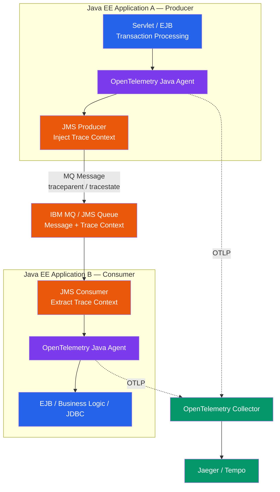
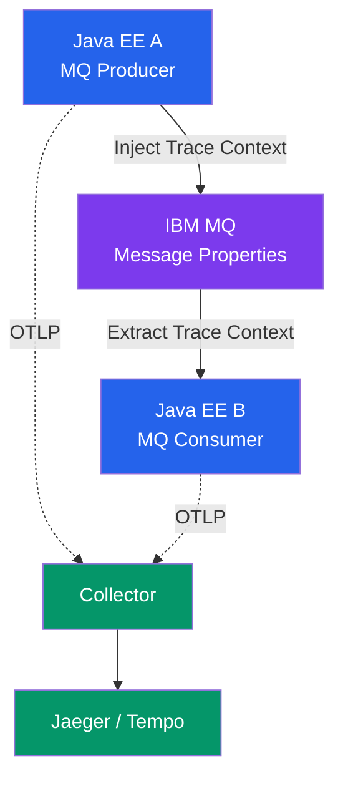

# Java EE Applications 透過 IBM MQ 傳送交易 — OpenTelemetry Trace Context Propagation

> 關鍵是讓 MQ Message 攜帶 **W3C Trace Context**，並由接收端正確解析，以便跨 Java EE Applications 建立 Distributed Tracing。

## 1. 兩種實作方式

| 方法 | 修改 Java 程式？ | 說明 |
|---|---|---|
| **OpenTelemetry Java Agent + JMS** | 通常不需要 | 相容的 JMS Instrumentation 可自動 Inject / Extract Trace Context |
| **Manual Instrumentation** | 需要 | MQ Producer 注入 Context，Consumer 擷取 Context |

**建議先測試 Java Agent 的 Zero-code Instrumentation。** 如果 IBM MQ API 或版本不支援自動傳遞，再考慮修改程式。

## 2. Java EE Applications 透過 IBM MQ 的架構



圖中的 Java Agent 是附加於各自 JVM 的 **Zero-code Instrumentation Agent**，可攔截受支援的 JMS 操作，而不要求 Application 直接呼叫 Agent。

## 3. 如何維持相同 Trace ID？

假設 Application A 收到 LC Issuance Request，建立或延續：

`Trace ID = 4bf92f3577b34da6a3ce929d0e0e4736`

接著將交易透過 IBM MQ 傳送到 Application B。

| Step | Component | Action |
|---|---|---|
| 1 | Java EE A | 建立或延續 Trace |
| 2 | JMS Producer | 將 W3C Trace Context 注入 Message Properties |
| 3 | IBM MQ | 傳送 Message 並保留 Trace Context |
| 4 | JMS Consumer | 從 Message Properties 擷取 Context |
| 5 | Java EE B | 使用擷取的 Parent Context 建立 Consumer Span |
| 6 | Collector | 接收兩端產生的 Spans |
| 7 | Jaeger / Tempo | 透過 Trace ID 與 Span Relationship 查看交易 |

要讓 Consumer Span 使用相同 Trace ID，必須以正確的 Remote Parent Context 延續 Trace。

如果採用 **Span Links**，也可以關聯不同 Trace IDs，但不一定形成單一 Trace。

## 4. 不修改 Java EE 原始碼，可以做到嗎？

如果兩個 Java EE Applications 使用受 Java Agent 支援的 JMS API，通常可以透過 Zero-code Instrumentation 傳遞 Trace Context。

| Java EE 通訊方式 | 不修改原始碼 | 說明 |
|---|---|---|
| JMS Producer → IBM MQ → JMS Consumer | 通常可以 | 需驗證 JMS、IBM MQ、Java Agent 版本相容性 |
| Spring JMS / Message Listener | 通常可以 | 依 Framework 與 Instrumentation Support |
| IBM MQ Native Java API | 不一定 | JMS Instrumentation 不一定涵蓋 Native API |
| Custom MQ Wrapper / Proprietary Protocol | 需測試 | 可能需要 Manual Injection / Extraction |

### Java Agent 啟動參數

在兩個 Java EE JVM 中載入相容的 Java Agent：

```bash
-javaagent:/path/to/opentelemetry-javaagent.jar
```

Application A：

```bash
OTEL_SERVICE_NAME=javaee-producer
OTEL_PROPAGATORS=tracecontext,baggage
OTEL_EXPORTER_OTLP_ENDPOINT=http://otel-collector:4317
OTEL_EXPORTER_OTLP_PROTOCOL=grpc
```

Application B：

```bash
OTEL_SERVICE_NAME=javaee-consumer
OTEL_PROPAGATORS=tracecontext,baggage
OTEL_EXPORTER_OTLP_ENDPOINT=http://otel-collector:4317
OTEL_EXPORTER_OTLP_PROTOCOL=grpc
```

以上為 Java Agent Configuration 示意；實際配置需符合 Application Server 的啟動方式。

## 5. 修改程式時應該做甚麼？

如果使用的 MQ API 不支援 Auto-Instrumentation，需要自行完成：

- Producer：**Context Injection**
- Consumer：**Context Extraction**
- Consumer Span：**Parent Context 或 Span Links**



Producer 使用 OpenTelemetry `TextMapPropagator.inject()`，將 Context 寫入 MQ Message 的可傳遞欄位。

Consumer 使用 `TextMapPropagator.extract()` 取得 Context，並建立正確的 Span Relationship。

**注意：** JMS Message Properties 有命名限制，必須使用與兩端 Instrumentation 相容的 Property Mapping。不能直接假設所有 JMS Provider 都接受 `setStringProperty("traceparent", ...)`。

此外，如果 Java Agent 已自動 Instrument JMS，應避免重複建立相同的 Messaging Spans。

## 6. W3C Trace Context — traceparent / tracestate

| Header / Property | Required? | Purpose |
|---|---|---|
| `traceparent` | W3C Trace Context 的核心欄位 | 傳遞 Trace ID、Parent Span ID、Trace Flags |
| `tracestate` | Optional | 傳遞 Vendor-specific Trace State |

Example：

```text
traceparent = 00-4bf92f3577b34da6a3ce929d0e0e4736-00f067aa0ba902b7-01
```

不需要由 Application 自行產生或硬編碼 Trace ID，應交由 OpenTelemetry SDK / Propagator 管理。

## 7. Parent-Child Relationship vs Span Links

| Comparison | Parent-Child | Span Links |
|---|---|---|
| Relationship | Consumer Span 使用擷取的 Parent Context | Consumer Span 連結 Message Creation Context |
| Same Trace ID | 可以 | 不一定 |
| 適合情境 | 單一訊息、延續同一 Trace | 非同步處理、Batch、Fan-out、多個來源 |
| Observability | 同一 Trace Tree | 透過 Span Links 跨 Trace 關聯 |

**Important:** OpenTelemetry Messaging Instrumentation 不保證所有非同步操作都形成單一 Trace Tree；實際行為取決於 Instrumentation 和 Messaging Semantic Conventions。

## 8. Java EE Banking Application 建議

對以下架構：

**Java EE A → IBM MQ → Java EE B → Database**

建議先在兩端 JVM 部署相容的 OpenTelemetry Java Agent，驗證 JMS Producer / Consumer 是否自動建立 Spans，以及 MQ Message Properties 是否成功傳遞 Trace Context。

接著在 Jaeger / Tempo 檢查 Trace ID、Parent-Child Relationship 或 Span Links。

如果使用 IBM MQ Native API、Custom Wrapper 或特殊 Middleware，再考慮 Manual Instrumentation。

## 9. Conclusion

**如果兩端支援 JMS Auto-Instrumentation：**

`Java EE A + Java Agent → IBM MQ → Java EE B + Java Agent`

通常可以不修改 Java Business Code，自動傳遞 Trace Context。

**如果不支援：**

則需要在 MQ Producer 與 Consumer 增加 Context Injection / Extraction。

**最終建議：先測試 Java Agent → 驗證 MQ Trace Context Propagation → 必要時再修改程式。**

---

## References

- [OpenTelemetry Context Propagation](https://opentelemetry.io/docs/concepts/context-propagation/)
- [OpenTelemetry Java Agent](https://opentelemetry.io/docs/zero-code/java/agent/)
- [OpenTelemetry Messaging Semantic Conventions](https://opentelemetry.io/docs/specs/semconv/messaging/)
- [W3C Trace Context Specification](https://www.w3.org/TR/trace-context/)

---
